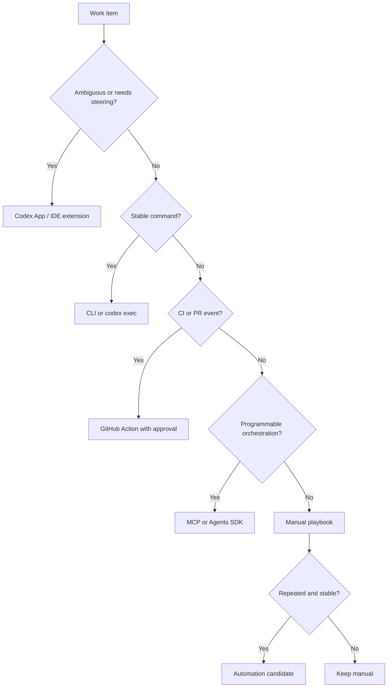

# Runtime decision map

Source status: `official + experiment`

Use this map to choose where Codex work should run: Codex App, CLI, `codex exec`, GitHub Action, MCP, Agents SDK or automation.

## Inputs

- Uncertainty level, risk, required tools, approval boundary and expected evidence.
- Existing project rules for sandbox, network, external writes and git actions.

## Outputs

- A runtime choice with explicit evidence and rollback expectations.
- A safe next action for manual work, skill promotion or automation candidate.

## Verification

Runtime choice should be recorded with source context, allowed commands, forbidden actions and stop conditions.

## Risks

- Using automation or MCP to compensate for an unclear prompt contract can hide missing requirements.
- A live or external runtime needs separate explicit approval and current evidence.
