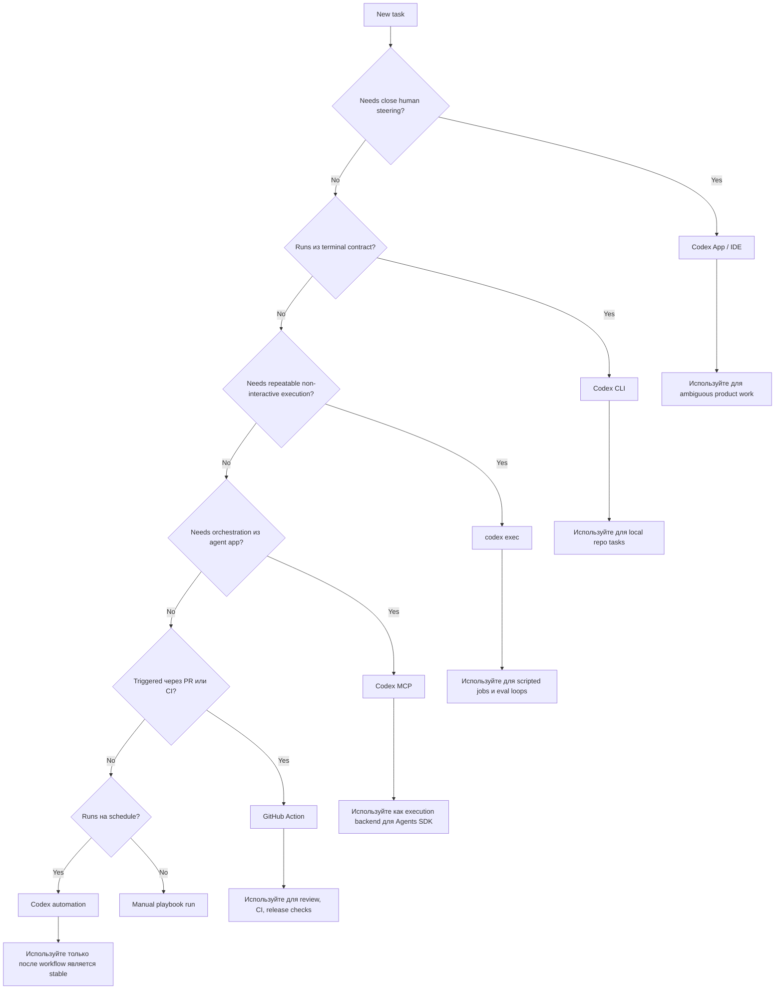

# Runtime Decision Map

Source status: `official + experiment`

Эта диаграмма помогает выбрать, где запускать задачу Codex: в App, CLI, Cloud, non-interactive mode, MCP, GitHub Action или scheduled automation.

## Диаграмма

## Как применять

Выбирайте runtime по уровню неопределенности и цене ошибки.

| Поверхность | Когда использовать | Что проверить |
| --- | --- | --- |
| Codex App / IDE | Нужно много steering, review, уточнений | Видны ли файлы, diff и результаты команд |
| CLI | Локальная инженерная задача с понятным scope | Есть ли команды проверки и sandbox policy |
| `codex exec` | Non-interactive job, повторяемый eval, batch update | Prompt должен быть самодостаточным |
| Codex MCP | Agent app должна делегировать работу Codex | Нужны границы tools, logs и approvals |
| GitHub Action | PR review, разбор CI и проверки release | Нужны permissions и предсказуемый output. |
| Automation | Регулярная задача с устойчивым workflow | Нужны skill, schedule и failure policy. |

## Правило выбора

Если задачу трудно описать как контракт, оставляйте ее в App/IDE. Если задачу можно описать как стабильный контракт с входами, выходами и проверкой, переносите ее в CLI, `codex exec`, MCP или automation.

## Антипаттерны

- Запускать scheduled automation до появления eval criteria.
- Использовать MCP как обходной путь вокруг неясного prompt contract.
- Отправлять в non-interactive mode задачу, где нужен product judgment.
- Делать GitHub Action, которая пишет большие изменения без review gate.
