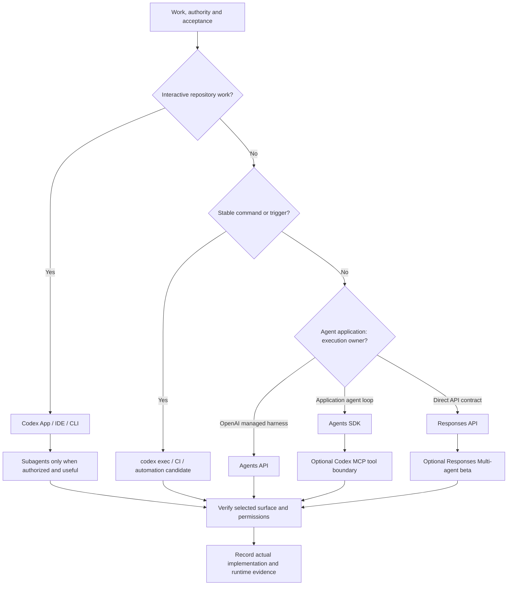

# Runtime decision map

Source status: `official + experiment`

Проверено 2026-11-03.

## Как применять

Выбирайте по неопределенности, владельцу исполнения, сроку жизни state, tools, approval scope и цене ошибки. Интерактивная неоднозначность подходит App/IDE/CLI; стабильный самодостаточный контракт — `codex exec`. CI/GitHub Action и расписания требуют явного разрешения, минимальных permissions и понятной обработки failures. MCP задает tool boundary, но не устраняет отсутствующие требования.

Для agent application [Agents API](https://developers.openai.com/api/docs/guides/agents) предоставляет OpenAI-managed Codex harness; SDK работает в приложении; Responses предоставляет API-контракт с optional hosted orchestration. [Responses Multi-agent](https://developers.openai.com/api/docs/guides/responses-multi-agent) — отдельная beta с ограничениями моделей/режимов. Эти варианты не взаимозаменяемы автоматически с Codex subagents.

## Следующие artifacts и проверки

Зафиксируйте runtime/client/auth/model, владельцев state/tools, разрешенные действия, stop/rollback и требуемые evidence. Используйте [runtime overview](../runtime/overview.md), [SDK contracts](../agent-systems/sdk-patterns.md), [session control](../agent-systems/session-control.md) и [матрицу моделей](../codex/models-and-reasoning.md). Раздельно отмечайте documented, designed, implemented и runtime-verified. Обновление не активирует новый runtime.

## Типичные ошибки

- Считать session, conversation и sandbox одним ресурсом.
- Переносить beta support одной модели на все семейство.
- Использовать MCP/automation для обхода неясного scope.
- Публиковать, запускать сервер или вызывать provider без отдельного разрешения.
- Выдавать статическую диаграмму или docs build за runtime evidence.

## Входы и выходы

Входы: текущая цель, применимые инструкции, источники, ownership и требуемые доказательства. Выходы: ограниченный пакет работы, обоснованный результат и handoff с открытыми рисками. Проверяйте применимость, полномочия и наблюдаемые evidence. Основные риски: пересечение записей, устаревший контекст и выдача предложения за активированное поведение.
