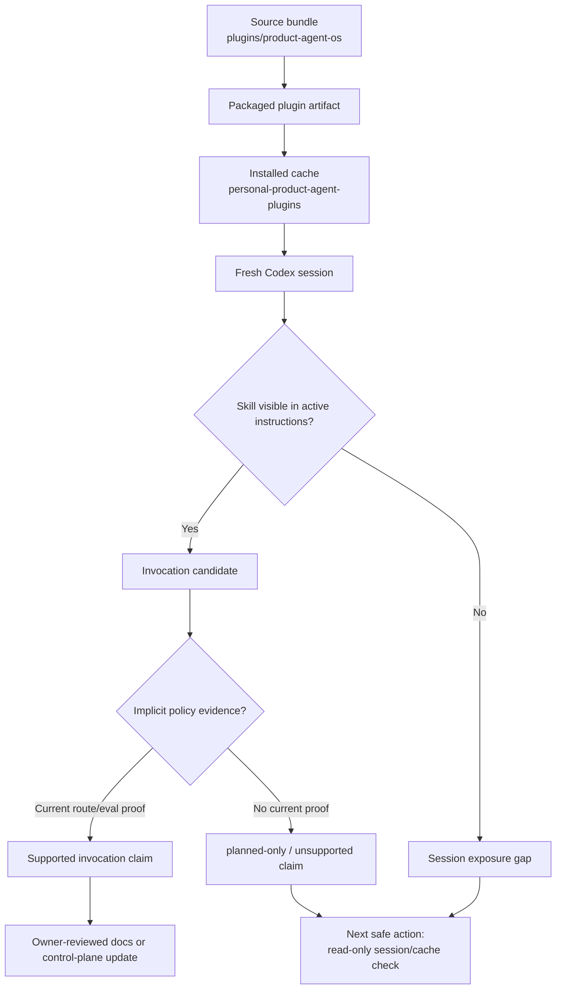

# Skill Exposure And Invocation Boundary

Source status: `official + project evidence`

This diagram shows how a Product-Agent OS skill moves from the source bundle to the installed cache and then to an active Codex session. A file in the source tree does not prove that the skill is available in the current session, and a cached skill does not prove implicit invocation policy.

## Diagram

## How To Use

Use this page before claiming that a Product-Agent OS skill auto-engages:

1. Check the source bundle: which skills, templates and scripts exist in the repository.
2. Inspect the installed cache only through read-only checks, and do not run a cache refresh without separate approval.
3. Check the fresh Codex session: whether the current session sees the skill and its trigger.
4. Keep `present_unverified` separate from current route/eval proof.
5. Mark auto-engagement as `planned-only` until fresh evidence exists for active session behavior.

## Related Artifacts

| Artifact | Role | Evidence Limit |
| --- | --- | --- |
| `plugins/product-agent-os/` | Source bundle for the plugin and skills. | Source correctness, not installed exposure. |
| Installed plugin cache | Local copy that Codex may see. | Cache presence, not active session invocation. |
| Active session instructions | What is actually loaded into the current context. | Session exposure, not fixed auto-engagement without route/eval proof. |
| `RUNLOG.md` | Current-cycle decisions and evidence summaries. | Handoff evidence, not runtime proof by itself. |
| `DOC-M25` | Final generated `site` freshness route. | Not part of skill invocation; only proves site/search/sitemap freshness after it runs. |

## Common Failure Modes

- Treating a source file as installed skill exposure.
- Treating installed cache as proof that the current session will invoke the skill automatically.
- Treating a session summary as source truth.
- Running a cache refresh without approval and rollback evidence.
- Letting generated docs or a diagram page promise fixed auto-engagement without current route/eval proof.
- Mixing browser proof approval_required or generated `site` freshness deferred with skill invocation proof.

## Safe Next Action

If a claim touches auto-engagement, create a read-only packet first: source path, cache path, active session exposure, trigger wording, current invocation evidence, unsupported claims and owner decision. Until that packet exists, this page records only the architecture boundary, not fixed behavior.
