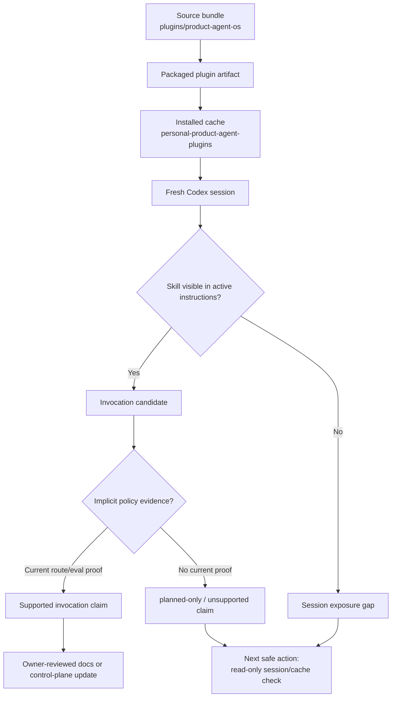

# Skill exposure and invocation boundary

Source status: `official + project evidence`

Эта диаграмма показывает, как Product-Agent OS skill проходит путь от исходного bundle до installed cache и active Codex session. Наличие файла в source tree не доказывает, что skill доступен в текущей сессии, а наличие skill в cache не доказывает implicit invocation policy.

## Диаграмма

## Как применять

Используйте страницу перед заявлениями о том, что Product-Agent OS skill уже включается автоматически:

1. Проверьте source bundle: какие skills, templates и scripts существуют в repository.
2. Проверьте installed cache только read-only способом и не выполняйте cache refresh без отдельного approval.
3. Проверьте fresh Codex session: видит ли текущая сессия нужный skill и его trigger.
4. Отделите `present_unverified` от current route/eval proof.
5. Записывайте auto-engagement как `planned-only`, пока нет свежего evidence для active session behavior.

## Связанные артефакты

| Артефакт | Роль | Доказательный предел |
| --- | --- | --- |
| `plugins/product-agent-os/` | Source bundle для plugin и skills. | Source correctness, но не installed exposure. |
| Installed plugin cache | Локальная копия, которую может видеть Codex. | Cache presence, но не active session invocation. |
| Active session instructions | То, что реально загружено в текущий контекст. | Session exposure, но не fixed auto-engagement без route/eval proof. |
| `RUNLOG.md` | Current-cycle decisions и evidence summaries. | Handoff evidence, не runtime proof by itself. |
| `DOC-M25` | Финальная generated `site` freshness route. | Не относится к skill invocation; нужен только для site/search/sitemap freshness. |

## Common failure modes

- Source file принят за installed skill exposure.
- Installed cache принят за proof, что текущая сессия вызовет skill автоматически.
- Session summary принят за source truth.
- Cache refresh выполнен без approval и rollback evidence.
- Generated docs или diagram page обещают fixed auto-engagement без current route/eval proof.
- Browser proof approval_required или generated `site` freshness deferred смешиваются с skill invocation proof.

## Safe next action

Если claim касается auto-engagement, сначала создайте read-only packet: source path, cache path, active session exposure, trigger wording, current invocation evidence, unsupported claims и owner decision. До такого packet страница фиксирует только architecture boundary, а не исправленное поведение.
