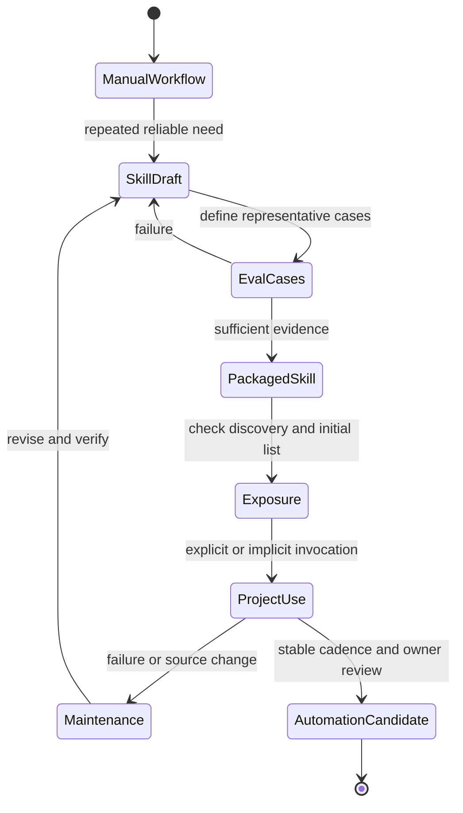

# Skill lifecycle

Source status: `official + experiment`

This diagram shows how a repeated workflow becomes a reusable skill and later an automation candidate only after evidence exists.

## Inputs

- A successful manual workflow, playbook, source policy and failure examples.
- Candidate trigger words, inputs, outputs and verification command.

## Outputs

- A skill with one job, explicit boundaries, eval cases and failure modes.
- A promotion decision for keeping the method manual, packaging it or proposing automation.

## Verification

Run positive and negative eval cases before treating the skill as reusable. Automation still requires separate approval.

## Risks

- A broad skill can hide unrelated behavior under one trigger.
- Automation without stable inputs, outputs and rollback can create repeated unsafe actions.

## Discovery before invocation

Start with an instructions-only skill. Check the file, initial skill list, explicit/implicit invocation and observed result. Shortened descriptions and omission from the initial list do not mean the skill was removed. [Troubleshooting](../agent-systems/subagents-skills.md) · [Build skills](https://learn.chatgpt.com/docs/build-skills).
