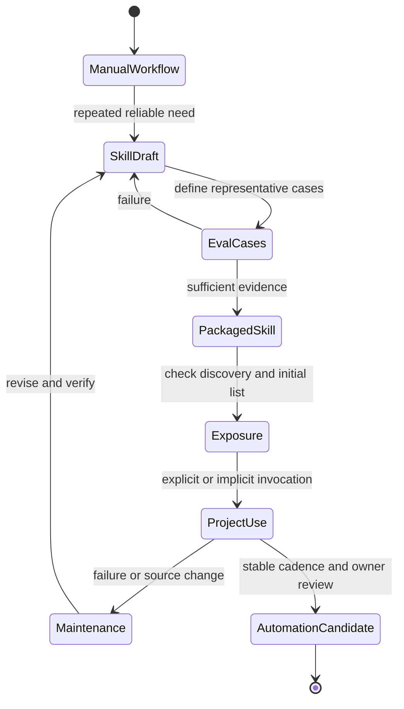

# Skill Lifecycle

Source status: `official + experiment`

Эта диаграмма показывает, как повторяемый workflow становится reusable skill, а затем может стать automation candidate.

## Диаграмма

## Когда создавать skill

Создавайте skill, когда workflow:

- повторяется в нескольких проектах или нескольких задачах одного проекта;
- имеет узнаваемые trigger words;
- требует специальных правил, checklist или источников;
- может вернуть понятный результат;
- имеет failure modes, которые можно описать заранее.

Не создавайте skill для одноразовой инструкции, временного решения или workflow без проверки.

## Rubric качества skill

| Критерий | Хороший skill | Слабый skill |
| --- | --- | --- |
| Scope | Одна работа | Несколько несвязанных работ |
| Trigger | Понятные слова запуска | “Используй когда полезно” |
| Входы | Явно перечислены | Модель угадывает |
| Выходы | Формат результата задан | Ответ произвольный |
| Проверка | Есть eval cases | Проверка отсутствует |
| Scripts | Только deterministic behavior | Скрипты скрывают reasoning |

## Примеры product skills

- `product-spec-writer` — превращает идею в `REQUIREMENTS.md`.
- `implementation-planner` — делает `PLAN.md` из требований и repo context.
- `test-gap-finder` — ищет несоответствие между изменениями и тестами.
- `eval-loop-runner` — запускает focused improvement loop и обновляет score history.
- `ui-visual-reviewer` — проверяет layout, screenshots, overlap, responsive states.
- `release-note-writer` — пишет заметки к release на основе diff, PR и user-facing changes.

## Условия остановки

Остановите упаковку skill, если:

- workflow не воспроизводится вручную;
- нет eval examples;
- политика источников неясна;
- skill требует secrets;
- результат нельзя проверить человеком или deterministic checks.

## Discovery перед invocation

Начните с instructions-only skill. Проверьте файл, initial skill list, explicit/implicit invocation и наблюдаемый результат. Сокращение descriptions и omission из initial list не равны удалению skill. [Troubleshooting](../agent-systems/subagents-skills.md) · [Build skills](https://learn.chatgpt.com/docs/build-skills).
