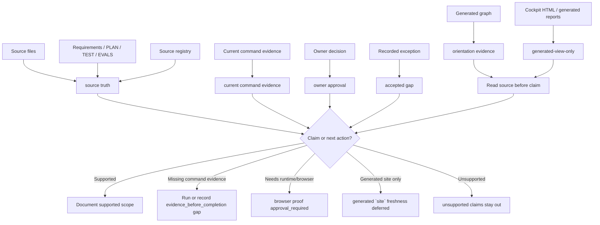

# Source and Generated Evidence Boundary

Source status: `project-local plan + accepted boundary`

This diagram separates `source truth`, `orientation evidence`, `generated-view-only` outputs, current commands, `owner approval` and an `accepted gap`. It is a decision aid for Track 11 G3 `DOC-M07`, not proof of readiness by itself.

## Diagram

## How to Use

Use this map before moving statements from a generated graph, cockpit HTML, report or `site/` build into user-facing documentation.

1. Identify `source truth`: source file, source registry entry, planning marker or owner-reviewed artifact.
2. Mark `orientation evidence` separately: generated graphs, cockpit HTML, summaries and dashboards help navigation but do not prove behavior.
3. For done, ready, fixed or works claims, require `current command evidence`, `owner approval` or a recorded `accepted gap`.
4. If the claim needs runtime or browser evidence, stop at `browser proof approval_required`.
5. If the only freshness signal is generated `site`, keep this status: generated `site` freshness deferred.
6. If evidence is missing, keep the statement under `unsupported claims` or leave it out.

## Related Artifacts

| Artifact | Role |
| --- | --- |
| `docs/sources/registry.md` | Index for source-backed claims; not changed in this slice. |
| `.codex/workflows/control-plane-sync.md` | Decides whether root control-plane files need updates before closure. |
| `.codex/workflows/task-plan-lifecycle.md` | User-visible Task Brief and Completion Brief contract. |
| `DOC-M25` | Follow-up source-doc item for additional evidence boundary routing. |
| Generated graph / cockpit HTML | `orientation evidence` or `generated-view-only`, not `source truth`. |

## Common Failure Modes

- Treating generated graph, cockpit HTML or generated `site` output as proof without reading source files.
- Hiding the approval boundary when runtime or browser proof is required.
- Making readiness claims without `evidence_before_completion`.
- Mixing `owner approval` and `accepted gap`: approval permits an action, while a gap records residual risk.
- Moving `unsupported claims` from a report into core docs without a source boundary.
