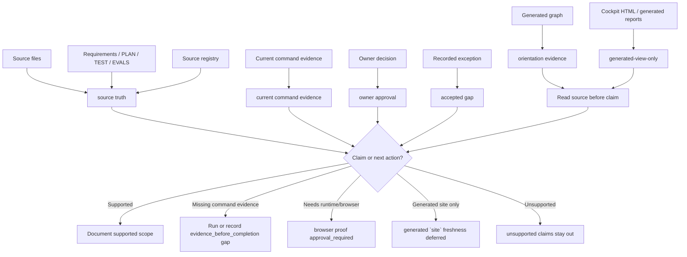

# Граница source и generated evidence

Source status: `project-local plan + accepted boundary`

Эта диаграмма показывает, где проходит граница между `source truth`, `orientation evidence`, `generated-view-only` представлениями, текущими командами, `owner approval` и `accepted gap`. Ее задача - не доказать готовность, а подсказать, какой источник нужен перед claim, release или следующим шагом Track 11 G3 `DOC-M07`.

## Диаграмма

## Как применять

Используйте схему перед тем, как переносить вывод из generated graph, cockpit HTML, отчета или `site/` в пользовательскую документацию.

1. Сначала найдите `source truth`: исходный файл, source registry entry, плановый marker или owner-reviewed artifact.
2. Отдельно отметьте `orientation evidence`: generated graph, cockpit HTML, summaries и dashboards помогают навигации, но не доказывают behavior.
3. Для утверждений о выполнении, готовности или исправлении проверьте `current command evidence`, `owner approval` или явно оформленный `accepted gap`.
4. Если claim требует runtime/browser evidence, остановитесь на `browser proof approval_required`.
5. Если единственный свежий сигнал - generated `site`, оставьте статус `generated `site` freshness deferred`.
6. Если доказательства нет, вынесите claim в `unsupported claims` или не включайте его в страницу.

## Связанные артефакты

| Артефакт | Роль |
| --- | --- |
| `docs/sources/registry.md` | Индекс source-backed claims, который обновляется только когда меняется source-backed документация. |
| `.codex/workflows/control-plane-sync.md` | Решение, нужно ли обновлять root control-plane перед закрытием. |
| `.codex/workflows/task-plan-lifecycle.md` | User-visible Task Brief и Completion Brief. |
| `DOC-M25` | Финальная generated-site freshness gate после source updates G2-G5. |
| Generated graph / cockpit HTML | `orientation evidence` или `generated-view-only`, не `source truth`. |

## Типовые ошибки

- Принимать generated graph, cockpit HTML или generated `site` как proof без чтения исходных файлов.
- Убирать approval boundary из текста, когда нужен runtime или browser proof.
- Писать readiness claim без `evidence_before_completion`.
- Смешивать `owner approval` и `accepted gap`: approval разрешает действие, gap фиксирует остаточный риск.
- Переносить `unsupported claims` из отчета в core docs без source boundary.
