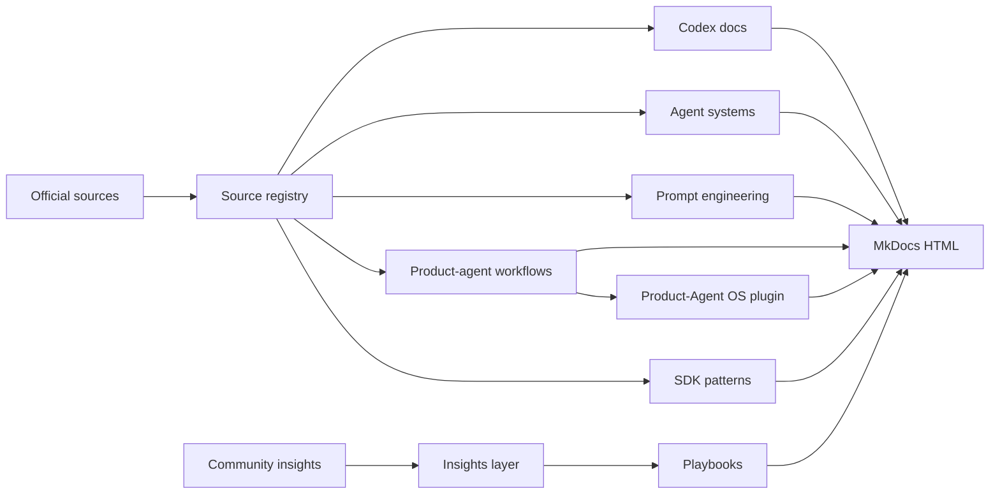

# База знаний OpenAI Codex

Эта база знаний предназначена для продвинутого пользователя, который изучает OpenAI Codex как среду для агентной разработки: Codex App, CLI, IDE extension, cloud tasks, subagents, skills, `AGENTS.md`, memory, approvals, sandboxing и повторяемые workflows.

Дата первичной сверки источников: **2026-05-14**.

## Как читать

1. Начните с [Diagram atlas](diagrams/index.md), чтобы увидеть полный маршрут реализации проекта через agents, skills, runtime и eval loops.
2. Перейдите к [обзору Codex](codex/overview.md), чтобы зафиксировать модель продукта и границы официальной документации.
3. Прочитайте [глубокий анализ Codex use cases](codex/use-cases-deep-analysis.md), чтобы переводить официальные use cases в playbooks, skills, plugins и automations.
4. Перейдите к [поверхностям работы](codex/surfaces.md), чтобы выбрать App, CLI, IDE или cloud под конкретную задачу.
5. Прочитайте [безопасность и approvals](codex/security.md) до запуска автономных или сетевых workflow.
6. Изучите [архитектуру агентных систем](agent-systems/overview.md), если цель - проектировать multi-agent workflows.
7. Пройдите [Prompt & Context Engineering](prompting/overview.md), чтобы формулировать вопросы, упаковывать контекст и снижать hallucinations.
8. Перейдите к [Product-Agent Workflows](product-agent/overview.md), чтобы собрать знания в delivery loop для полноценных продуктов.
9. Изучите [Product-Agent OS plugin](product-agent-os/index.md), если нужно применить этот delivery loop как локальный Codex plugin.
10. Откройте [Methodologies для Large Projects](methodologies/index.md), если проекту нужна системная карта business, domain, architecture, frontend, backend, API, data, LLM, quality, security, delivery и Codex workflows.
11. Изучите [Codex Automation & Runtime](runtime/overview.md), если workflow нужно запускать через CLI, MCP, GitHub или automations.
12. Используйте playbooks как операционные инструкции, а insights - как слой гипотез и пользовательских трюков.

## Принцип доверия

Официальные страницы OpenAI и OpenAI Agents SDK являются источником истины. Пользовательские приемы, GitHub issues, блоги и Reddit-записи не смешиваются с официальными инструкциями без явного статуса:

- `official` - официальная документация или репозиторий OpenAI.
- `community` - внешний пользовательский источник.
- `experiment` - рабочая гипотеза, которую нужно проверить в локальном проекте.

## Граница public/internal документации

Публичный маршрут этой базы знаний начинается с обзоров, diagram atlas, Product-Agent Workflows и [Product-Agent OS plugin](product-agent-os/index.md). Эти страницы объясняют продуктовую ценность, возможности, границы, результаты и ближайшее действие.

`docs/sources/` является внутренним evidence/history layer. Он хранит source registry, packets, backlogs и verification records, но не заменяет публичные страницы и не должен быть первым маршрутом для нового пользователя.

Сгенерированный `site/`, dashboard, graph, cockpit, reports и smoke evidence являются поверхностями проверки. Они помогают review, search и handoff, но источником истины остаются исходные Markdown-файлы, registry, current command/eval/runtime evidence, owner decisions и accepted gaps.

## Карта проекта

## Текущий результат

База знаний теперь содержит не только документационную основу, но и описание локального Product-Agent OS plugin: packaged skills, staged infrastructure, CLI contracts, generated project graph/cockpit, behavioral evals, compatibility checks и closure workflow.

Live server launch, browser automation, provider/live external model/API calls, canonical graph mutation и git stage/commit/push/PR остаются approval-bound actions. Generated graph, dashboard, cockpit, reports и readiness packets являются evidence surfaces, not source of truth.
