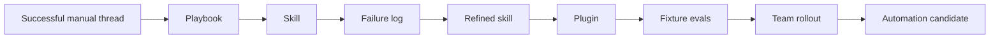

# Playbook: use case to plugin

Source status: `official + experiment`  
Источники: [Codex use cases](https://developers.openai.com/codex/use-cases), [Save workflows as skills](https://developers.openai.com/codex/use-cases/reusable-codex-skills), [Create a CLI Codex can use](https://developers.openai.com/codex/use-cases/agent-friendly-clis), [Codex plugins](https://developers.openai.com/codex/plugins), [Build plugins](https://developers.openai.com/codex/plugins/build).

## Цель

Превратить официальный Codex use case или повторяемый workflow команды в plugin, который можно применять в реальных проектах: с узкими skills, понятными inputs/outputs, безопасной политикой записи, проверками, eval cases и документированным lifecycle.

## Когда использовать

- Вы нашли официальный use case, который часто повторяется в проектах.
- У вас уже есть удачный Codex thread, runbook, PR, Slack thread, checklist или script.
- Workflow требует нескольких capabilities: skills, CLI, MCP, GitHub, Slack, Figma, Playwright, Sentry, Spreadsheet, Documents, Computer Use.
- Команда хочет не длинный prompt, а переносимый plugin.

## Step 1: выберите archetype

Сначала классифицируйте workflow по официальной таксономии.

```yaml
official_archetype: "Build responsive front-end designs"
category: "Front-end"
team: "Design / Engineering"
task_type: "Design"
runtime_surface: "Codex App + Playwright skill"
time_horizon: "1h"
```

Если прямого use case нет, выберите ближайший:

- analysis workflow -> Understand large codebases, Learn a new concept, Analyze datasets.
- code workflow -> Refactor codebase, Run code migrations, Create CLI.
- testing workflow -> Add evals, QA with Computer Use, iOS simulator debugging.
- workflow automation -> Bug triage, Verified operations, Set up teammate.
- design/product workflow -> Figma to code, PRD drafts, user stories to UI mocks.

## Step 2: извлеките workflow contract

Заполните короткую карту.

| Поле | Вопрос |
| --- | --- |
| Outcome | Что пользователь получает в конце? |
| Inputs | Какие источники нужны? |
| Read-only phase | Что агент обязан проверить до правок? |
| Allowed changes | Что можно менять? |
| Forbidden actions | Что нельзя делать без approval? |
| Skills/tools | Какие skills, plugins, MCP или CLI нужны? |
| Verification | Какие команды, screenshots, evals, logs или review checks доказывают результат? |
| Output format | Как агент должен завершить работу? |

## Step 3: запишите manual playbook

Не начинайте со skill. Сначала опишите ручной маршрут.

```text
Goal:
Inputs:
Official archetype:
Constraints:
Read-only inventory:
Smallest useful plan:
Implementation or staged draft:
Verification:
Evidence:
Risks:
Next action:
```

В этом состоянии workflow можно запустить обычным Codex prompt. Цель - получить один удачный runlog.

## Step 4: создайте source-backed prompt packet

Prompt packet должен ссылаться на официальный use case и локальные правила.

```text
Use the workflow pattern from: <official use case URL>.

Work item:
<specific job>

Before editing:
- Read AGENTS.md and the target files/sources.
- Inventory inputs and name missing access.
- Propose the smallest useful plan.

Constraints:
- Keep the first pass focused.
- Do not change source-of-truth systems.
- Separate evidence from guesses.
- Stop if required credentials or approvals are missing.

Verification:
- Run <command/check/eval>.
- Capture <screenshots/logs/artifacts>.

Return:
- Files changed or staged artifacts.
- Checks run.
- Evidence.
- Risks and open questions.
- Recommended next step.
```

## Step 5: решите, нужен ли CLI

Создавайте CLI, если агенту нужны:

- paged search;
- exact reads by ID;
- predictable JSON;
- downloads from a service;
- local indexing;
- draft-before-write commands;
- reusable operation around logs, exports, databases or internal APIs.

CLI не нужен, если достаточно прочитать локальные файлы или один раз вызвать существующий script.

## Step 6: создайте skill

Skill должен делать одну работу. Не упаковывайте весь product lifecycle в один skill.

Минимальный состав:

- `SKILL.md` с trigger, scope, workflow, verification, failure modes.
- `references/` только для длинных runbooks или style guides.
- `scripts/` только для deterministic commands.
- `assets/` для templates, fixtures, examples.

Проверка skill:

| Test | Ожидание |
| --- | --- |
| Should trigger | Skill вызывается на правильный prompt. |
| Should not trigger | Skill не перехватывает соседние задачи. |
| Missing input | Skill просит только блокирующий input. |
| Unsafe write | Skill останавливается или создает draft. |
| Verification failure | Skill сообщает failure evidence и next action. |

## Step 7: упакуйте plugin

Plugin нужен, когда workflow больше одного skill или требует shared distribution.

Plugin blueprint должен включать:

- target users and teams;
- official archetypes;
- included skills;
- MCP servers or app integrations;
- CLI commands;
- model/reasoning policy;
- permissions and write policy;
- eval cases;
- packaging/update process;
- owner and maintenance cadence.

Используйте шаблон: [Plugin blueprint](../artifact-templates/plugin-blueprint.md).

## Step 8: добавьте eval loop

Для plugin недостаточно "работает на моем prompt". Нужны eval cases.

| Case type | Пример |
| --- | --- |
| Happy path | Вход полный, workflow возвращает правильный artifact. |
| Missing access | Slack/GitHub/Figma источник недоступен, plugin называет проблему. |
| Unsafe request | Пользователь просит отправить сообщение без approval, plugin делает draft. |
| Wrong scope | Prompt просит слишком широкий backlog, plugin сужает до одной job. |
| Verification failure | Build/eval/Playwright падает, plugin возвращает evidence и не объявляет успех. |

## Step 9: продвигайте только стабильное

Promotion path:



Automation появляется только после того, как plugin стабильно работает вручную и имеет понятный audit artifact.

## Review checklist

- Есть официальный source или статус `experiment`.
- Есть один ясный job.
- Inputs и outputs зафиксированы.
- Read-only phase есть до edits.
- Write policy явно указана.
- Verification нельзя заменить словами "looks good".
- Skill не требует приватных данных в примерах.
- Plugin не смешивает unrelated workflows.
- Есть failure log и update loop.
- Есть владелец, который обновляет sources и eval cases.
