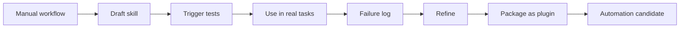

# Playbook: workflow to skill

Source status: `official + experiment`  
Sources: [Agent Skills](https://developers.openai.com/codex/skills#create-a-skill), [Codex best practices](https://developers.openai.com/codex/learn/best-practices), [Codex automations](https://developers.openai.com/codex/app/automations).

## Goal

Turn a repeatable workflow into a Codex skill that can be used manually, then tested and automated when necessary.

If the workflow should become a plugin, use [Playbook: use case to plugin](use-case-to-plugin.md) after the first skill has passed real validation.

## When a workflow is ready for a skill

- It has been run manually at least several times.
- Inputs and outputs are stable.
- There is a clear trigger.
- There is a verification command or checklist.
- Risks and forbidden actions are known.

## Skill rubric

| Criterion | Requirement |
| --- | --- |
| Scope | One job, not "do everything" |
| Trigger | Description contains explicit trigger words |
| Inputs | Required inputs are listed |
| Outputs | Result format is fixed |
| Progressive disclosure | `SKILL.md` is short; references are loaded as needed |
| Scripts | Only for deterministic behavior or external tooling |
| Evals | Cases exist: should trigger, should not trigger |

## Lifecycle

For `completion-skeptic`, the same path is mandatory: manual -> playbook -> skill -> plugin -> automation candidate. The failure log must capture false pass, false rewrite, fake evidence, missing checks, accepted gaps and owner review. Eval cases must cover trigger and non-trigger behavior before any automation candidate is promoted.

Automation blockers: no schedule, hook, MCP server, Agents SDK runner, provider call or external write is allowed without separate approval, rollback/disable path and scorecard evidence.

Use lowercase contract labels in handoffs when needed: eval cases and automation blockers.

## Candidate product skills

- `product-spec-writer`
- `implementation-planner`
- `test-gap-finder`
- `release-note-writer`
- `eval-loop-runner`
- `ui-visual-reviewer`
- `workspace-readiness-auditor`

## Minimal skill implementation

Start with an instructions-only `SKILL.md`. Add scripts for deterministic operations only. Before distribution check the trigger, initial exposure, explicit/implicit invocation and result; see [troubleshooting](../agent-systems/subagents-skills.md).
