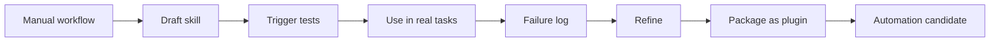

# Playbook: workflow to skill

Source status: `official + experiment`  
Источники: [Agent Skills](https://developers.openai.com/codex/skills#create-a-skill), [Codex best practices](https://developers.openai.com/codex/learn/best-practices), [Codex automations](https://developers.openai.com/codex/app/automations).

## Цель

Превратить повторяемый workflow в Codex skill, который можно использовать вручную, затем тестировать и при необходимости автоматизировать.

Если workflow должен стать plugin, используйте [Playbook: use case to plugin](use-case-to-plugin.md) после того, как первый skill прошел реальную проверку.

## Когда workflow готов к skill

- Выполнялся вручную минимум несколько раз.
- Inputs и outputs стабильны.
- Есть понятный trigger.
- Есть verification command или checklist.
- Риски и forbidden actions известны.

## Skill rubric

| Критерий | Требование |
| --- | --- |
| Scope | Один job, не "делай все" |
| Trigger | Описание содержит явные trigger words |
| Inputs | Перечислены required inputs |
| Outputs | Формат результата фиксирован |
| Progressive disclosure | `SKILL.md` краткий, references по необходимости |
| Scripts | Только для deterministic behavior или external tooling |
| Evals | Есть cases: should trigger, should not trigger |

## Lifecycle

## Candidate product skills

- `product-spec-writer`
- `implementation-planner`
- `test-gap-finder`
- `release-note-writer`
- `eval-loop-runner`
- `ui-visual-reviewer`
- `workspace-readiness-auditor`
