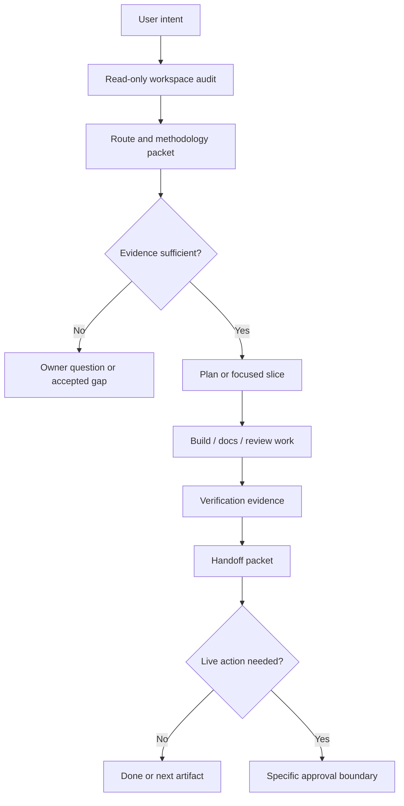
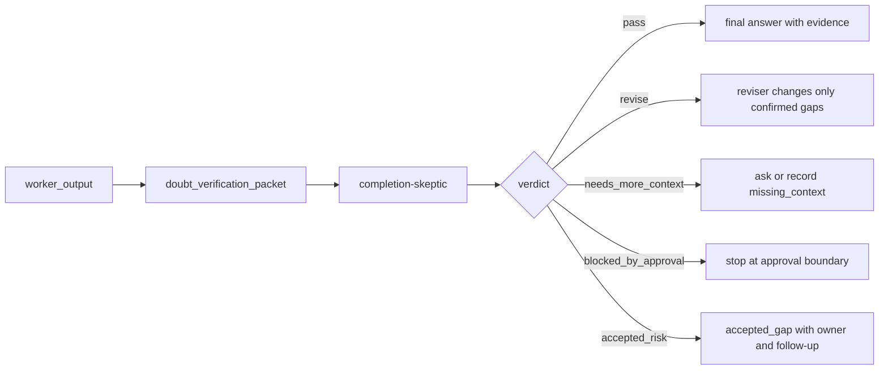
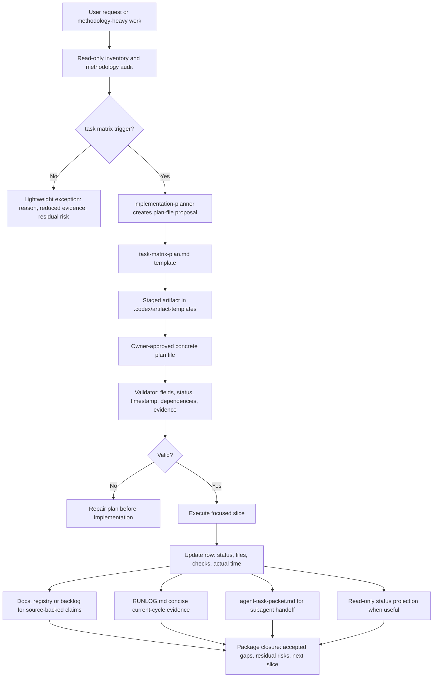

# Product-Agent OS architecture

Source status: `official + experiment`

Sources: [Codex plugins](https://developers.openai.com/codex/plugins), [Build plugins](https://developers.openai.com/codex/plugins/build), [Agent Skills](https://developers.openai.com/codex/skills), [Subagents](https://developers.openai.com/codex/subagents), [AGENTS.md](https://developers.openai.com/codex/guides/agents-md), [Codex hooks](https://developers.openai.com/codex/hooks), [Codex MCP](https://developers.openai.com/codex/mcp), [Codex workflows](https://developers.openai.com/codex/workflows), [Codex with Agents SDK](https://developers.openai.com/codex/guides/agents-sdk).

Product-Agent OS packages a product-delivery operating model for Codex. It combines durable project rules, lifecycle skills, staged artifacts, evals and approval boundaries while keeping live systems disabled until the owner explicitly approves a specific action.

## End-to-end ordinary route {#ordinary-route}

| Boundary | Behavior | What the result does not prove |
| --- | --- | --- |
| Discovery → adapter | Real paths/manifests and task context enter `task_routing.py` | Commands found in files are not executed |
| Adapter → selectors | Reuses `select_code_quality_profile` and `select_test_strategy` | Tool presence does not mean a successful check |
| State resolver → route | Separates structural readiness, task-bound state and inferred recommendation; RU/EN headings and builder.toml do not control the ordinary route | State provenance grants no write authority |
| Route → result | Compact contract, reasoned checks, gaps and trace | `route_ready` does not mean task completion |
| Renderer → stage | A template subset or reuse of existing documents | The full registry is not a mandatory package |

The `--task-context` or explicit inline `--task` entry point is opt-in. Without either, the explicitly identified legacy fallback is preserved, including previous control-plane heading inference. Legacy lifecycle/runner diagrams describe that compatibility path. The scoped path supplements it; high-risk/full retains applicable gates, source policy and approval checks.

An empty or ambiguous project receives a discovery/requirements gap rather than fictitious build readiness. Explicit task state requires matching task ID, lifecycle value and source-record hash. ORD-01–ORD-06 local integration does not imply fresh host activation, promotion, production readiness or automatic infrastructure application.

## Layered Model

| Layer | Responsibility | Boundary |
| --- | --- | --- |
| Codex surface | Codex App, CLI, IDE extension and MCP declarations. | Runs under sandbox and approvals. |
| Plugin package | Manifest, skills, templates, scripts, examples and compatibility checks. | Package presence is not activation or publication. |
| Control plane | `AGENTS.md`, `REQUIREMENTS.md`, `PLAN.md`, `TEST.md`, `EVALS.md`, `RUNLOG.md`. | Source-backed decisions, not generated-site output. |
| Methodology layer | Read-only routing, domain gates and false-positive control. | Recommends and stages; it does not mutate targets. |
| Verification layer | Unit tests, fixture evals, transcript evals, docs checks and compatibility checks. | Claims require current evidence or accepted gaps. |
| Live layer | Runtime, browser, providers, graph mutation and git/release actions. | Disabled until a specific approval packet exists. |

## Operating Flow

## Graph And Live Boundary

Generated project graphs, cockpit views, runtime summaries and analysis reports are orientation evidence. They help a worker find source files, stale assumptions and review targets, but they are not sources of truth. Any live runtime launch, browser automation, provider call, canonical graph mutation or git/release action needs a separate approval packet, current evidence and rollback or stop condition.

## Completion-skeptic Route

The packet has a claim ledger, requirement ledger and evidence ledger. The claim ledger records supported, unsupported, contradicted and needs_fresh_check items. The requirement ledger keeps user requirements, non-goals and approval constraints visible. The evidence ledger records source registry, local files, current commands, evals, owner decisions or explicit missing checks.

Completion-skeptic route is a manual/local Product-Agent OS gate, not a live runtime proof.

The reviser changes only confirmed gaps. If the verifier finds only speculative concerns, the route returns residual risk instead of rewriting correct content.

### Agents SDK Output Guardrail Candidate

This is a design-only direction. The same packet can later become an Agents SDK output guardrail candidate with a tripwire for fake evidence, pass without evidence, approval-blocked pass, missing source status or unsafe private data. The current boundary: docs/site work does not create an Agents SDK runner, MCP server, tracing export, provider call or live guardrail.

## Engineering Standards Route

The engineering standards route maps workspace evidence to product, architecture, frontend, backend, API, data, AI/RAG, security, release and cross-domain gates. Detection creates `present_unverified`; readiness requires command evidence, runtime/eval proof, owner-reviewed evidence or an accepted gap.

## Lifecycle Routing

Lifecycle routing chooses the smallest useful next move:

- answer directly when the request is bounded and source-backed;
- stage a proposal when writing into a target workspace would be premature;
- request approval when an external or live action is required;
- run focused verification when evidence is available locally;
- stop on a gap when source evidence is missing.

Routes must include source context, assumptions, files owned, expected evidence, approval boundary and stop condition before delegating work to a skill or subagent.

## task and plan architecture

This architecture records how Product-Agent OS creates plan files, manages a task matrix, cleans accumulated history and returns a user-facing completion report after implementation. It applies when work includes development methodology, related work items, architecture decisions, agent roles, `skills`, `subagents`, approval boundaries or staged delivery.

A plan file is created when work requires staged delivery, architecture capture, multiple roles, multiple verification gates, rollback, evals or a user-facing completion report. A small mechanical edit can use a lightweight exception, but the reason, reduced evidence and residual risk must be stated in the response or `RUNLOG.md`.

Plans are cleaned by moving detail to the correct owning artifact, not by losing useful history: current sequencing stays in `PLAN.md` or a batch-specific plan file, concise decisions and failures go to `RUNLOG.md`, source-backed history goes to `docs/sources/registry.md` or a backlog, and repeated workflows move through manual workflow, playbook, skill, plugin and automation candidate.

| Element | Controls | Noise control |
| --- | --- | --- |
| task matrix | Source, scope, non-goals, expected result, acceptance criteria, verification, risks, agents, skills and dependencies | Each row bounds scope and owner |
| Completion report | What was done, files touched, technical value, product value, actual date and time | Filled after implementation, not in advance |
| `RUNLOG.md` | Current-cycle decisions, latest evidence and failures | Does not store the full historical ledger |
| `docs/sources/registry.md` | Source-backed claims and historical evidence pointers | Does not accept unsupported claims |
| Status projection | Read-only operational status | Does not replace the plan file, tests or source registry |

`task-matrix-plan.md` is a staged planning artifact. Its presence can guide planning, handoffs and validation, but it is not source truth, execution evidence, verification evidence, dashboard readiness or release approval by itself.

The methodology connection stays practical: Scrum and Kanban provide sequencing and WIP discipline, ADR records architecture decisions and non-goals, test-driven development defines verification gates, docs-as-code requires output artifacts and registry updates, and eval-driven AI work adds baseline, rubric, threshold and residual quality risk.

## Route Packet

A route packet should include:

- `usage_mode.primary` and optional secondary mode;
- confidence and routing reasons;
- source artifacts used;
- minimum artifacts required for the next stage;
- approval boundary;
- verification gates;
- residual risks and accepted gaps;
- `finish_options` and `safe_next_action`.

## Methodology Intelligence

Methodology intelligence is read-only. It inspects the workspace, control-plane files and route signals, then returns methodology applicability, packets, owner questions, synthesis and source-artifact mapping. It must avoid forced ceremony: simple work stays simple, while production, public-contract, release, security-sensitive and AI behavior changes require stronger evidence.

## Usage Mode Coverage

Product-Agent OS covers first-run intake, bug rescue, greenfield idea shaping, complex system acceleration, PR review, legacy onboarding, API migration, AI/RAG eval regression, native/mobile work, desktop local-first work, data migration, security-sensitive change, CI stabilization, release packaging, docs-only work, standard feature work and maintenance.

## Staged-First Infrastructure

Infrastructure generation is staged-first. Renderers may inspect a target workspace and write proposals into an explicit staging directory. They must preserve user-authored files, avoid direct target mutation unless a later approved merge path exists, and keep hooks and automations inactive by default.

## Codex Runtime Runner

The Codex runtime runner is a package-level contract surface for Codex workflows. It can route lifecycle work, validate packets and produce staged artifacts without requiring a separate OpenAI API key. It does not hide a standalone Agents SDK runtime, start servers, call providers or mutate global config by itself.

## Automation Promotion

Automation is the last step in the promotion chain: manual workflow, playbook, skill, plugin, then automation. A candidate needs stable inputs/outputs, owner, cadence, verification, failure modes, value evidence and rollback/disable path. Product-Agent OS can stage a candidate but must not create active automation without explicit approval.

## Common Failure Modes

- Treating generated graphs, dashboards or reports as source of truth.
- Using subagents without file ownership, fresh context or stop conditions.
- Converting a repeated workflow into automation before manual success evidence exists.
- Claiming readiness from detection alone.
- Combining approvals across unrelated live surfaces.
- Letting package compatibility imply publication, deployment or external mutation.

Next artifact: use [Scenarios](scenarios.md) to choose the route, [Professional Code Authoring Standards](coding-standards.md) for code-writing gates and [Development standards](development-standards.md) to decide which evidence gates apply.

## Inputs

- Current workspace context, control-plane files, source registry and approved route.
- Agent ownership boundaries, staged artifacts and verification requirements.

## Outputs

- A system model for routing work through staged-first Product-Agent OS layers.
- Clear boundaries for generated views, runtime contracts, approvals and handoff evidence.

## Risks

- Generated architecture views can be mistaken for source truth.
- Parallel work without ownership and stop conditions can create conflicting edits.
