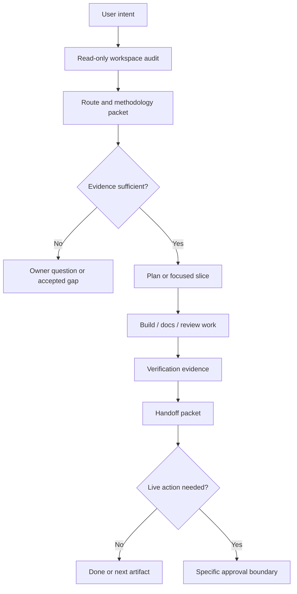

# Product-Agent OS architecture

Source status: `official + experiment`

Sources: [Codex plugins](https://developers.openai.com/codex/plugins), [Build plugins](https://developers.openai.com/codex/plugins/build), [Agent Skills](https://developers.openai.com/codex/skills), [Subagents](https://developers.openai.com/codex/subagents), [AGENTS.md](https://developers.openai.com/codex/guides/agents-md), [Codex hooks](https://developers.openai.com/codex/hooks), [Codex MCP](https://developers.openai.com/codex/mcp), [Codex workflows](https://developers.openai.com/codex/workflows), [Codex with Agents SDK](https://developers.openai.com/codex/guides/agents-sdk).

Product-Agent OS packages a product-delivery operating model for Codex. It combines durable project rules, lifecycle skills, staged artifacts, evals and approval boundaries while keeping live systems disabled until the owner explicitly approves a specific action.

## Layered Model

| Layer | Responsibility | Boundary |
| --- | --- | --- |
| Codex surface | Codex App, CLI, IDE extension and MCP declarations. | Runs under sandbox and approvals. |
| Plugin package | Manifest, skills, templates, scripts, examples and compatibility checks. | Package presence is not activation or publication. |
| Control plane | `AGENTS.md`, `REQUIREMENTS.md`, `PLAN.md`, `TEST.md`, `EVALS.md`, `RUNLOG.md`. | Source-backed decisions, not generated-site output. |
| Methodology layer | Read-only routing, domain gates and false-positive control. | Recommends and stages; it does not mutate targets. |
| Verification layer | Unit tests, fixture evals, transcript evals, docs checks and compatibility checks. | Claims require current evidence or accepted gaps. |
| Live layer | Runtime, browser, providers, graph mutation and git/release actions. | Disabled until a specific approval packet exists. |

## Operating Flow

## Graph And Live Boundary

Generated project graphs, cockpit views, runtime summaries and analysis reports are orientation evidence. They help a worker find source files, stale assumptions and review targets, but they are not sources of truth. Any live runtime launch, browser automation, provider call, canonical graph mutation or git/release action needs a separate approval packet, current evidence and rollback or stop condition.

## Engineering Standards Route

The engineering standards route maps workspace evidence to product, architecture, frontend, backend, API, data, AI/RAG, security, release and cross-domain gates. Detection creates `present_unverified`; readiness requires command evidence, runtime/eval proof, owner-reviewed evidence or an accepted gap.

## Lifecycle Routing

Lifecycle routing chooses the smallest useful next move:

- answer directly when the request is bounded and source-backed;
- stage a proposal when writing into a target workspace would be premature;
- request approval when an external or live action is required;
- run focused verification when evidence is available locally;
- stop on a gap when source evidence is missing.

Routes must include source context, assumptions, files owned, expected evidence, approval boundary and stop condition before delegating work to a skill or subagent.

## Route Packet

A route packet should include:

- `usage_mode.primary` and optional secondary mode;
- confidence and routing reasons;
- source artifacts used;
- minimum artifacts required for the next stage;
- approval boundary;
- verification gates;
- residual risks and accepted gaps;
- `finish_options` and `safe_next_action`.

## Methodology Intelligence

Methodology intelligence is read-only. It inspects the workspace, control-plane files and route signals, then returns methodology applicability, packets, owner questions, synthesis and source-artifact mapping. It must avoid forced ceremony: simple work stays simple, while production, public-contract, release, security-sensitive and AI behavior changes require stronger evidence.

## Usage Mode Coverage

Product-Agent OS covers first-run intake, bug rescue, greenfield idea shaping, complex system acceleration, PR review, legacy onboarding, API migration, AI/RAG eval regression, native/mobile work, desktop local-first work, data migration, security-sensitive change, CI stabilization, release packaging, docs-only work, standard feature work and maintenance.

## Staged-First Infrastructure

Infrastructure generation is staged-first. Renderers may inspect a target workspace and write proposals into an explicit staging directory. They must preserve user-authored files, avoid direct target mutation unless a later approved merge path exists, and keep hooks and automations inactive by default.

## Codex Runtime Runner

The Codex runtime runner is a package-level contract surface for Codex workflows. It can route lifecycle work, validate packets and produce staged artifacts without requiring a separate OpenAI API key. It does not hide a standalone Agents SDK runtime, start servers, call providers or mutate global config by itself.

## Automation Promotion

Automation is the last step in the promotion chain: manual workflow, playbook, skill, plugin, then automation. A candidate needs stable inputs/outputs, owner, cadence, verification, failure modes, value evidence and rollback/disable path. Product-Agent OS can stage a candidate but must not create active automation without explicit approval.

## Common Failure Modes

- Treating generated graphs, dashboards or reports as source of truth.
- Using subagents without file ownership, fresh context or stop conditions.
- Converting a repeated workflow into automation before manual success evidence exists.
- Claiming readiness from detection alone.
- Combining approvals across unrelated live surfaces.
- Letting package compatibility imply publication, deployment or external mutation.

Next artifact: use [Scenarios](scenarios.md) to choose the route and [Development standards](development-standards.md) to decide which evidence gates apply.

## Inputs

- Current workspace context, control-plane files, source registry and approved route.
- Agent ownership boundaries, staged artifacts and verification requirements.

## Outputs

- A system model for routing work through staged-first Product-Agent OS layers.
- Clear boundaries for generated views, runtime contracts, approvals and handoff evidence.

## Risks

- Generated architecture views can be mistaken for source truth.
- Parallel work without ownership and stop conditions can create conflicting edits.
