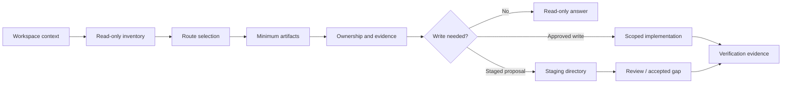
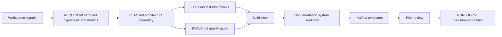
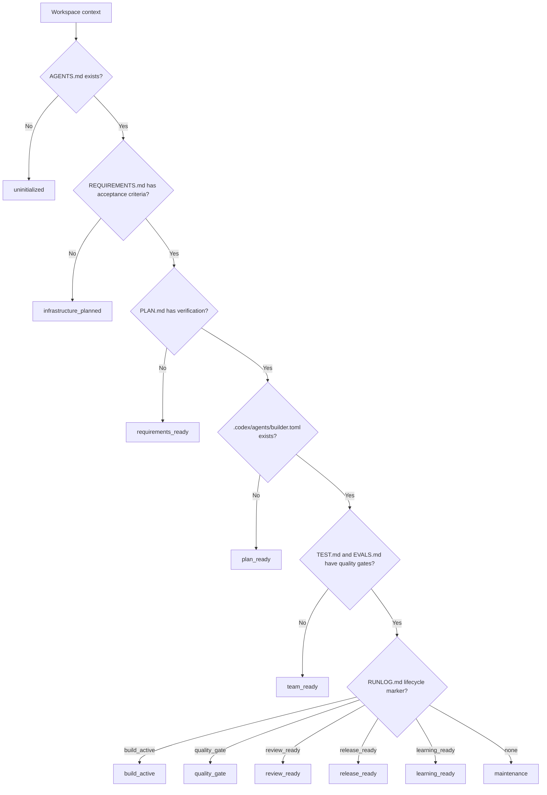
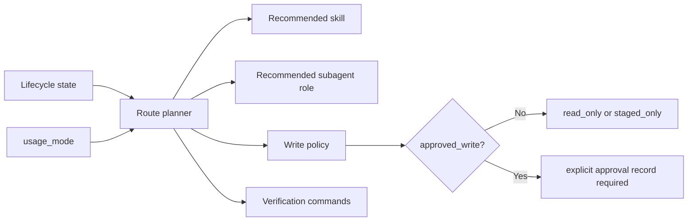
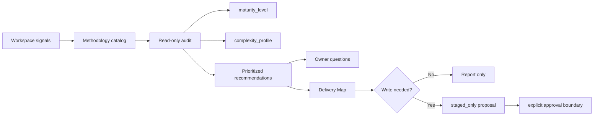
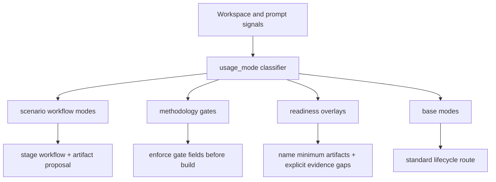
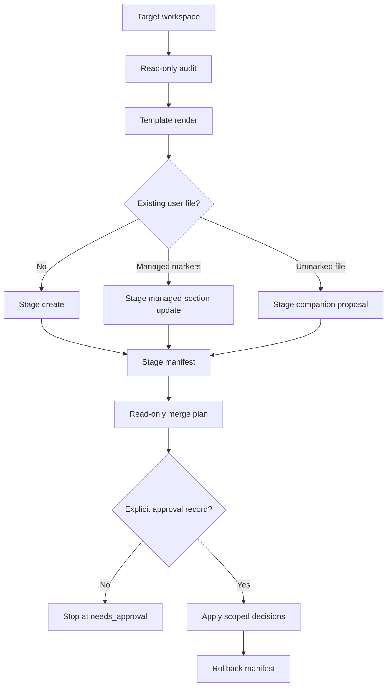
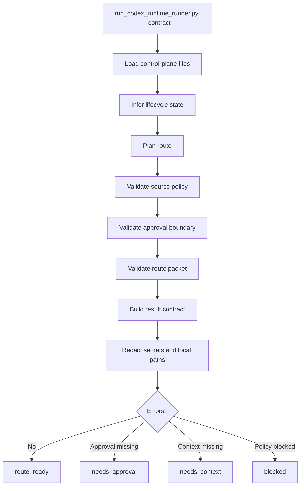
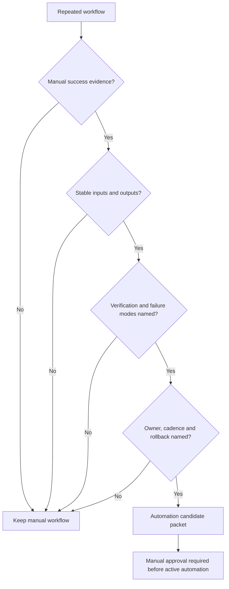

# Product-Agent OS architecture

Source status: `official + experiment`

Источники: [Codex plugins](https://developers.openai.com/codex/plugins), [Agent Skills](https://developers.openai.com/codex/skills), [Subagents](https://developers.openai.com/codex/subagents), [AGENTS.md](https://developers.openai.com/codex/guides/agents-md), [Codex hooks](https://developers.openai.com/codex/hooks), [Agent approvals and security](https://developers.openai.com/codex/agent-approvals-security), [Codex workflows](https://developers.openai.com/codex/workflows), [Technical features](technical.md).

Product-Agent OS plugin строит управляемый lifecycle вокруг Codex App, CLI, IDE extension, subagents, skills, `AGENTS.md`, memory, sandbox, approvals, MCP и Agents SDK. Его архитектура не пытается "сразу сделать все": она сначала читает workspace, выбирает route, фиксирует ownership и evidence, затем stage-ит предложения или выполняет разрешенный slice.

Главное правило: generated surfaces помогают ориентироваться, но source files, owner decisions и current verification evidence остаются сильнее любого dashboard, graph, report или chat memory.

## Layered Model

| Layer | Purpose | Boundary |
| --- | --- | --- |
| Plugin package | Manifest, commands, packaged skills and validators. | Package compatibility does not activate external systems. |
| Lifecycle skills | Requirements, planning, test/eval, implementation, review and release handoffs. | Every handoff names files, evidence, risks and stop conditions. |
| Staged infrastructure | Templates for `AGENTS.md`, control-plane files, hooks, workflows and agent configs. | Existing user files are preserved; ambiguous writes become proposals. |
| Approved merge | Manifest, approval record, rollback and scoped apply. | No direct target-workspace merge without explicit approval. |
| Codex runtime runner | Deterministic route packet for Codex usage. | No separate live model call or hidden Agents SDK app. |
| Engineering standards | Hypothesis, architecture, tests, evals, docs, review and release measurement. | Standards become evidence requirements, not ceremony by default. |
| Scenario routes | `usage_mode` chooses first response and minimum artifacts. | Detection never equals readiness. |
| Methodology intelligence | Read-only audit, applicability, owner questions and staged recommendations. | Recommendations do not mutate target projects. |
| Graph and live governance | Generated graph, cockpit, runtime gates, provider gates, review, mutation dry-run and audit. | Live execution remains disabled until separate owner approval. |

This order prevents stale shortcuts. Runtime, standards, scenarios, methodology synthesis and live governance are one stack; every write still passes staged-first and approval boundaries.

## Operating Flow

The route is derived from artifacts, not from chat memory. User intent can steer the next action, but source policy, sandbox, approvals and current evidence still decide what can run.

## Graph And Live Boundary

Generated graph and cockpit surfaces help readers understand topology, code flow and stale evidence. They do not become source of truth and they do not authorize live systems.

| Surface | Primary page | Architectural rule |
| --- | --- | --- |
| Static graph and cockpit | [Project Code Graph](project-code-graph.md) | Graph/cockpit are generated review surfaces; source files remain canonical. |
| Live runtime governance | [Live Runtime Governance](live-runtime-governance.md) | Runtime remains disabled-by-default, local-only and read-only until separate approval. |
| Provider gates | [Live Runtime Governance](live-runtime-governance.md) | Embedding, reranker and LLM proposal providers stay blocked until approval, redaction, cache, budget and eval threshold are current. |
| Human review | [Artifact Contracts](artifact-contracts.md) | Review ledger decisions are `accepted`, `rejected` or `accepted_gap`; proposal evidence is not a canonical fact. |
| Canonical mutation | [Artifact Contracts](artifact-contracts.md) | Mutation requires accepted proposal, dry-run plan, mutation journal and rollback proof before any pilot. |
| Audit and observability | [Live Runtime Governance](live-runtime-governance.md) | Live, provider and mutation actions must emit redacted audit and runtime evidence; unsafe cases block the route. |
| Real testing | [Approval-Bound Real Testing](approval-bound-real-testing.md) | Runtime launch, browser automation, provider/API pilot, canonical mutation pilot and git release/PR action are separate approvals. |

## Engineering Standards Route

Product-agent work starts only after boundary, verification and documentation impact are visible to the next worker. If one element is unavailable, the route records an explicit gap instead of hiding it in chat.

## Lifecycle Routing

| State | Next worker | Write policy |
| --- | --- | --- |
| `uninitialized` | `workspace-discovery-auditor` | `read_only` |
| `infrastructure_planned` | `requirements-author` | `staged_only` |
| `requirements_ready` | `implementation-planner` | `staged_only` |
| `plan_ready` | `agent-team-designer` | `staged_only` |
| `team_ready` | `test-eval-designer` | `staged_only` |
| `build_active` | `builder` subagent when allowed | `approved_write` |
| `quality_gate` | `risk-reviewer` | `read_only` |
| `review_ready` | `pr-release-operator` | `staged_only` |
| `release_ready` | `learning-loop-maintainer` | `staged_only` |
| `learning_ready` | `automation-promoter` | `staged_only` |
| `maintenance` | `project-lifecycle-orchestrator` | `read_only` |

## Route Packet

The route packet carries `usage_mode`, confidence, routing reasons, minimum artifacts, approval boundary, expected evidence, residual risks and next safe action. It is a planning contract, not permission to mutate external systems.

## Methodology Intelligence

Methodology intelligence runs before lifecycle mutation. It can read the workspace and produce `methodology_applicability`, `methodology-audit-report.md`, Delivery Map priorities and owner questions. It does not write target-project files, enable hooks, activate automations or touch external systems. Any generated artifact after the report remains staged-only until explicit approval.

## Usage Mode Coverage

| Coverage | Modes | Required behavior |
| --- | --- | --- |
| Scenario workflows | first-run intake plus `bug_rescue`, `greenfield_idea`, `complex_system_acceleration`, `pr_review`, `legacy_onboarding`, `api_migration`, `ai_eval_regression`, `native_mobile_feature`, `desktop_local_first`, `data_migration`, `security_sensitive_change`, `ci_stabilization`, `release_packaging` | Stage existing workflow/artifact templates, keep first response small and run behavior-level checks. |
| Methodology gates | no-placeholder planning, generalized two-stage review, fresh-context handoff, acceptance scenarios, conditional DDD domain modeling, bounded-context-to-architecture traceability, ubiquitous language traceability, conditional FSD structure routing | Require exact files, commands, expected outputs, rollback, evidence owner, accepted gaps and ownership before build or handoff. |
| Readiness overlays | quality, release, security, AI/RAG, data and runtime readiness | Route safely, name required artifacts, record evidence gaps and avoid completion claims without verification evidence. |
| Base modes | `standard_feature`, `docs_only`, `maintenance` | Use normal lifecycle route with minimum control-plane artifacts. |

## Staged-First Infrastructure

Renderer may inspect a workspace and write only to an explicit staging directory. Direct target writes happen only through merge tooling after approval.

## Codex Runtime Runner

The runner is Codex-only. It does not call an external model, does not require a separate OpenAI API key and does not become an Agents SDK app. It produces a deterministic contract packet that Codex can use to route the next action.

## Automation Promotion

Product-Agent OS can stage an automation candidate, but it must not create active recurring automation until the workflow has stability evidence and explicit approval.

## Common Failure Modes

| Failure | Required behavior |
| --- | --- |
| Missing requirements | Route to requirements author, do not build. |
| Missing verification | Route to planning or test/eval designer. |
| Source-backed claim lacks source | Mark needs review or block through source policy. |
| Approved write route lacks approval | Return `needs_approval`. |
| Active automation requested too early | Block and keep candidate-only. |
| Secret-like content appears in output | Redact and report redaction category. |
| Existing file has ambiguous managed markers | Stop and report conflict. |

Next artifact: use [Scenarios](scenarios.md) for route selection and [Behavioral evals](behavioral-evals.md) for expected/forbidden behavior.
