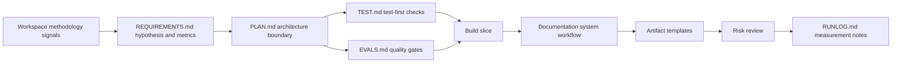
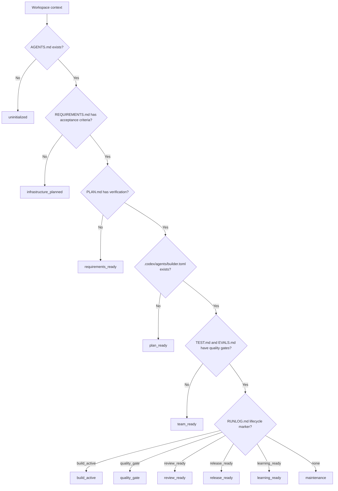
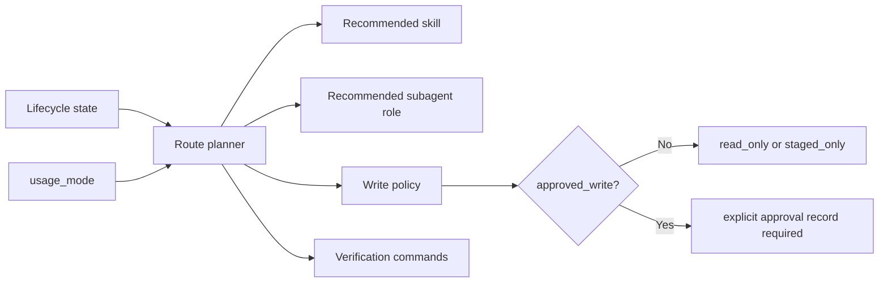
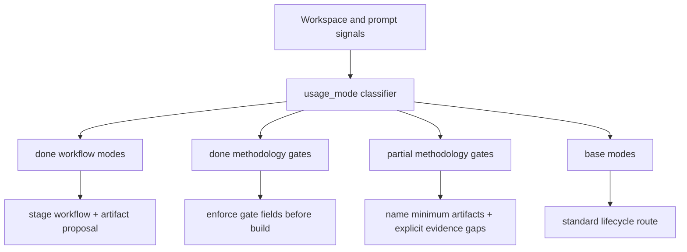
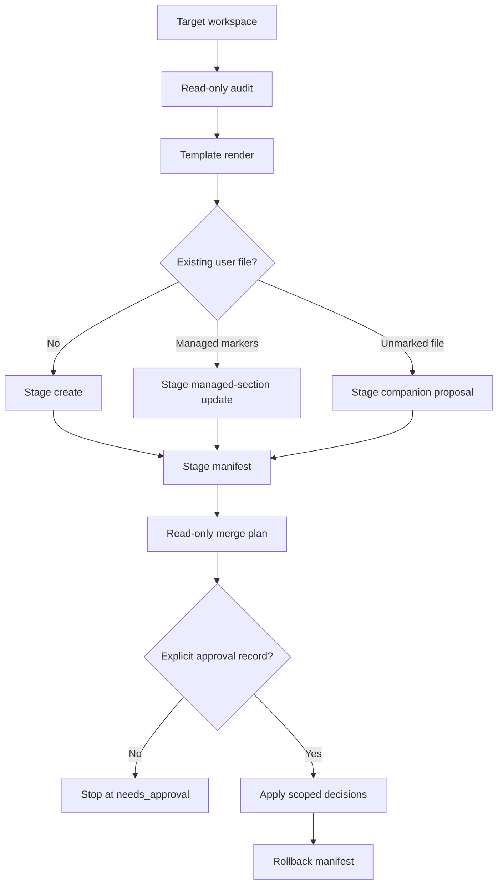
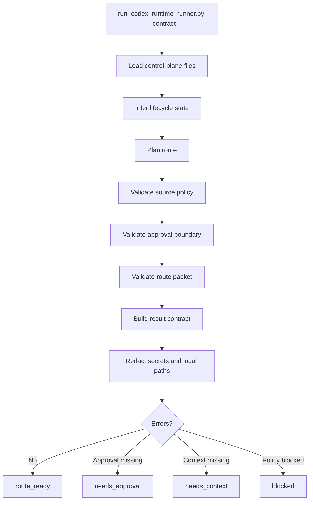
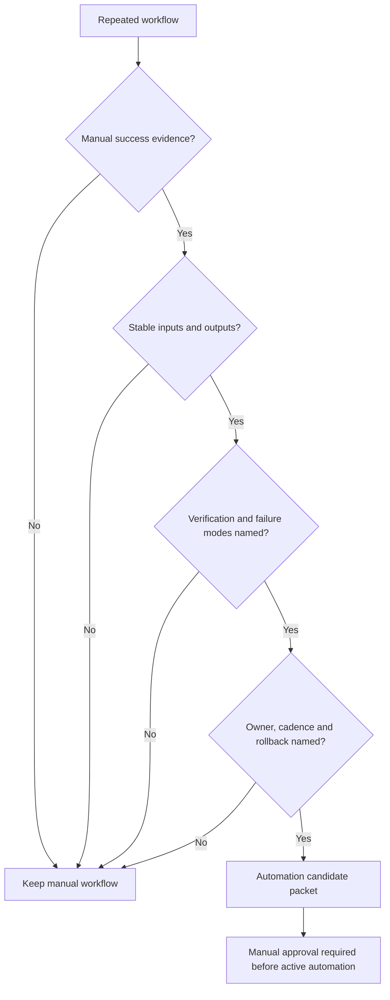

# Диаграммы и принципы работы

Source status: `official + experiment`  
Источники: [Codex plugins](https://developers.openai.com/codex/plugins), [Agent Skills](https://developers.openai.com/codex/skills), [Subagents](https://developers.openai.com/codex/subagents), [AGENTS.md](https://developers.openai.com/codex/guides/agents-md), [Codex hooks](https://developers.openai.com/codex/hooks), [Agent approvals and security](https://developers.openai.com/codex/agent-approvals-security), [Codex workflows](https://developers.openai.com/codex/workflows), [Technical features](technical.md).

Эта страница показывает не историю реализации, а рабочую модель Product-Agent OS plugin: как он выбирает следующий step, как stages changes, где требует approval и почему automation remains candidate-only.

Engineering standards layer добавляет методические gates поверх lifecycle: product hypothesis, architecture boundary, test-first/eval-first path, docs-as-code impact, review и release measurement. Track 7 дополняет это discovery signals и concrete artifact templates, чтобы plugin видел существующую инженерную зрелость workspace и мог stage недостающие outputs. Эти gates не запускают внешние системы сами; они появляются в staged artifacts и должны быть подтверждены evidence.

Track 8 добавляет `usage_mode` route перед методическими gates. Route выбирает first response и minimum artifacts, но не отменяет lifecycle, source policy, sandbox or approvals. First-run route теперь явно различает empty workspace, failed verification, existing control-plane и complex system starts, возвращая mode, confidence, next smallest action, minimum artifacts, evidence gaps и approval boundary. После нового audit plan plugin различает `done` сценарии, done methodology gates, partial methodology gates и base modes. API migration, AI/RAG eval regression, native/mobile feature work, desktop local-first work, data migration, security-sensitive change, CI stabilization и release packaging имеют packaged workflows, artifacts, behavioral eval coverage and current verification evidence. Done methodology gates now include no-placeholder planning, generalized two-stage review for risky public-contract/migration/security/data/release/parallel slices, fresh-context handoff for subagents or parallel workers, acceptance scenarios with ATDD/BDD traceability before behavior changes, conditional DDD domain modeling for complex backend/workflow/enterprise/data-heavy/multi-service/multi-context work, bounded-context-to-architecture traceability, ubiquitous language traceability, conditional FSD structure routing, metric hardening for product behavior changes, evidence-before-completion for ready/completed/fixed/works/release claims, docs tooling selection, conditional readiness statuses, and deterministic transcript/session eval replay.

Docs tooling selector is part of the Track 8 methodology gate set: `docs_tooling_selector` records `docs_as_code_impact`, selected tools, rejected tools, evidence owner, maintenance owner, command evidence, accepted gaps and approval-required items. It keeps docs-light/internal-only projects lightweight and treats hosted docs, CI activation and DB introspection as explicit approval boundaries.

Conditional readiness gates are now part of the route model: `project-readiness.json` defines `readiness_statuses` and per-gate applicability, pass condition, accepted gap, required evidence, owner and residual risk. Detection alone can only create `present_unverified`; verified readiness requires current command, owner or artifact evidence.

For operator-facing details, use [Scenarios](scenarios.md) for route selection, [Behavioral evals](behavioral-evals.md) for expected/forbidden behavior, and [Codex compatibility](codex-compatibility.md) for package-surface boundaries.

## Engineering standards route

Принцип: Codex-agent work начинается только после того, как boundary, verification и documentation impact видны следующему worker. Если один из элементов невозможен, это фиксируется как gap, а не скрывается в chat.

## Lifecycle routing

Принцип: route is derived from artifacts, not from chat memory. User request can override lifecycle state only when it matches the allowed state list and guardrails still pass.

## Route packet

| State | Next worker | Write policy |
| --- | --- | --- |
| `uninitialized` | `workspace-discovery-auditor` | `read_only` |
| `infrastructure_planned` | `requirements-author` | `staged_only` |
| `requirements_ready` | `implementation-planner` | `staged_only` |
| `plan_ready` | `agent-team-designer` | `staged_only` |
| `team_ready` | `test-eval-designer` | `staged_only` |
| `build_active` | `builder` subagent when allowed | `approved_write` |
| `quality_gate` | `risk-reviewer` | `read_only` |
| `review_ready` | `pr-release-operator` | `staged_only` |
| `release_ready` | `learning-loop-maintainer` | `staged_only` |
| `learning_ready` | `automation-promoter` | `staged_only` |
| `maintenance` | `project-lifecycle-orchestrator` | `read_only` |

## Usage mode coverage

| Coverage | Modes | Required behavior |
| --- | --- | --- |
| `done` | first-run intake plus `bug_rescue`, `greenfield_idea`, `complex_system_acceleration`, `pr_review`, `legacy_onboarding`, `api_migration`, `ai_eval_regression`, `native_mobile_feature`, `desktop_local_first`, `data_migration`, `security_sensitive_change`, `ci_stabilization`, `release_packaging` | Stage existing workflow/artifact templates, keep first response small, and run behavior-level checks. |
| `done methodology gate` | no-placeholder planning, generalized two-stage review, fresh-context handoff, acceptance scenarios, conditional DDD domain modeling, bounded-context-to-architecture traceability, ubiquitous language traceability, conditional FSD structure routing | Require exact files, owned/forbidden files, exact commands, expected outputs, rollback, evidence owner, placeholder scan, plan repair and `mechanical_change` reason before build; require spec compliance before quality/risk for risky PR/public-contract/migration/security/data/release/parallel slices; require complete task context, source constraints, ownership, expected evidence, handoff output schema, stop conditions and sequential fallback before subagent or parallel work; require `requirement -> scenario -> check -> evidence owner`, Given/When/Then or equivalent behavior format, business rule, edge case, non-goal and explicit gap before behavior changes; require `domain_model_when_complex_domain` only for complex backend/workflow/enterprise/data-heavy/multi-service/multi-context work, require `bounded_context_architecture_boundary_trace` from every bounded context to an architecture boundary or accepted gap, require `ubiquitous_language_traceability` from every domain term to requirement/source plus API/event/contract, UI label, code module or owner, and require `fsd_structure` only for applicable web UI/component work with Feature-Sliced Design layer, slice, segment, public API and import rule. |
| `partial` | readiness eval overlays | Route safely, name required artifacts, record evidence gaps, and avoid completion claims without verification evidence. |
| `base` | `standard_feature`, `docs_only`, `maintenance` | Use normal lifecycle route with minimum control-plane artifacts. |

## Staged-first infrastructure

Принцип: renderer may inspect the workspace and write only to an explicit staging directory. Direct target writes happen only through merge tooling after approval.

## Codex runtime runner

Принцип: Track 5 is Codex-only. Runner does not call an external model, does not require a separate OpenAI API key, and does not become an Agents SDK app. It produces a deterministic contract packet that Codex can use to route the next action.

## Automation promotion

Принцип: plugin can stage an automation candidate, but it must not create active recurring automation until the workflow has stability evidence and explicit approval.

## Common failure modes

| Failure | Required behavior |
| --- | --- |
| Missing requirements | Route to requirements author, do not build |
| Missing verification | Route to planning or test/eval designer |
| Source-backed claim lacks source | Mark needs review or block through source policy |
| Approved write route lacks approval | Return `needs_approval` |
| Active automation requested too early | Block and keep candidate-only |
| Secret-like content appears in output | Redact and report redaction category |
| Existing file has ambiguous managed markers | Stop and report conflict |
