# Product-Agent OS architecture

Source status: `official + experiment`

Источники: [Codex plugins](https://developers.openai.com/codex/plugins), [Agent Skills](https://developers.openai.com/codex/skills), [Subagents](https://developers.openai.com/codex/subagents), [AGENTS.md](https://developers.openai.com/codex/guides/agents-md), [Codex hooks](https://developers.openai.com/codex/hooks), [Agent approvals and security](https://developers.openai.com/codex/agent-approvals-security), [Codex workflows](https://developers.openai.com/codex/workflows), [Technical features](technical.md).

Product-Agent OS plugin строит управляемый lifecycle вокруг Codex App, CLI, IDE extension, subagents, skills, `AGENTS.md`, memory, sandbox, approvals, MCP и Agents SDK. Его архитектура не пытается "сразу сделать все": она сначала читает workspace, выбирает route, фиксирует ownership и evidence, затем stage-ит предложения или выполняет разрешенный slice.

Главное правило: generated surfaces помогают ориентироваться, но source files, owner decisions и текущий verification evidence остаются сильнее любого dashboard, graph, report или chat memory.

## Layered Model

| Layer | Purpose | Boundary |
| --- | --- | --- |
| Пакет plugin | Manifest, commands, packaged skills и validators. | Package compatibility не активирует external systems. |
| Lifecycle skills | Requirements, planning, test/eval, implementation, review и release handoffs. | Every handoff names files, evidence, risks и stop conditions. |
| Staged infrastructure | Templates для `AGENTS.md`, control-plane files, hooks, workflows и agent configs. | Existing пользователь files являются preserved; ambiguous пишет become proposals. |
| Approved merge | Manifest, approval record, rollback и scoped apply. | Нет direct target-workspace merge без explicit approval. |
| Codex runtime runner | Deterministic route packet для Codex usage. | Нет separate live model call или hidden Agents SDK app. |
| Engineering standards | Hypothesis, architecture, tests, evals, docs, review и release measurement. | Standards become evidence requirements, не ceremony через default. |
| Scenario routes | `usage_mode` chooses first response и minimum artifacts. | Detection never equals readiness. |
| Methodology intelligence | Read-only audit, applicability, owner questions и staged recommendations. | Recommendations не mutate target projects. |
| Graph и live governance | Generated graph, cockpit, runtime gates, provider gates, review, mutation dry-run и audit. | Live execution остается disabled пока separate owner approval. |

Этот порядок prevents stale shortcuts. Runtime, standards, scenarios, methodology synthesis и live governance являются один stack; every писать still passes staged-first и approval boundaries.

## Operating Flow

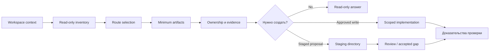

Этот route является derived из artifacts, не из chat memory. User intent может steer следующий action, но политика источников, sandbox, approvals и текущий evidence по-прежнему определяют, что можно запускать.

## Архитектура планов и задач

Эта схема фиксирует, как Product-Agent OS создает файлы-планы, ведет матрицу задач, очищает накопленную историю и возвращает пользователю отчет после реализации. Она применяется для работы, где есть методология разработки, несколько связанных задач, архитектурные решения, роли агентов, `skills`, `subagents`, approval boundaries или поэтапная поставка.

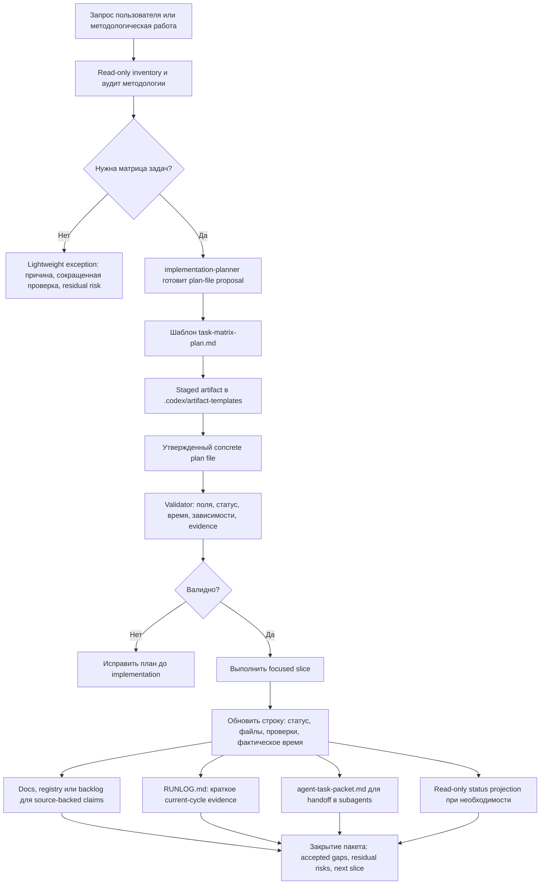

Plan file создается, когда работа требует staged delivery, архитектурной фиксации, нескольких ролей, нескольких verification gates, rollback, eval или user-facing completion report. Для маленькой механической правки допустимо исключение, но причина, сниженный набор evidence и residual risk должны быть названы в ответе или `RUNLOG.md`.

План очищается переносом detail в owning artifact, а не удалением полезной истории: текущая последовательность остается в `PLAN.md` или batch-specific plan file, краткие решения и failures идут в `RUNLOG.md`, source-backed история идет в `docs/sources/registry.md` или backlog, а повторяемые workflow продвигаются по цепочке manual workflow, playbook, skill, plugin, automation candidate.

| Элемент | Что контролирует | Защита от засорения |
| --- | --- | --- |
| Матрица задач | Source, scope, non-goals, expected result, acceptance criteria, verification, risks, agents, skills и dependencies | Каждая строка ограничивает scope и owner |
| Completion report | Что сделано, какие файлы затронуты, technical value, product value, фактическая дата и время | Заполняется после реализации, не заранее |
| `RUNLOG.md` | Current-cycle decisions, latest evidence и failures | Не хранит полный historical ledger |
| `docs/sources/registry.md` | Source-backed claims и historical evidence pointers | Не принимает unsupported claims |
| Status projection | Read-only operational status | Не заменяет plan file, tests или source registry |

Связь с методологиями остается практической: Scrum и Kanban дают sequencing и WIP discipline, ADR фиксирует architecture decisions и non-goals, test-driven development задает verification gates, docs-as-code требует обновления output artifacts и registry, eval-driven AI work добавляет baseline, rubric, threshold и residual quality risk.

`task-matrix-plan.md` -- staged artifact для планирования. Его наличие помогает вести planning, handoff и validation, но само по себе не является source of truth, execution evidence, verification evidence, dashboard readiness или release approval.

## Graph And Live Boundary

Generated graph и cockpit surfaces help readers understand topology, code flow и stale evidence. Они не become source of truth и they не authorize live systems.

| Surface | Primary page | Architectural rule |
| --- | --- | --- |
| Static graph и cockpit | [Project Code Graph](project-code-graph.md) | Graph/cockpit являются generated review surfaces; source files остаются canonical. |
| Live runtime governance | [Live Runtime Governance](live-runtime-governance.md) | Runtime остается disabled-by-default, local-only и read-only пока separate approval. |
| Provider gates | [Live Runtime Governance](live-runtime-governance.md) | Embedding, reranker и LLM proposal providers stay blocked пока approval, redaction, cache, budget и eval threshold являются current. |
| Human review | [Artifact Contracts](artifact-contracts.md) | Review ledger decisions являются `accepted`, `rejected` или `accepted_gap`; proposal evidence является не canonical fact. |
| Canonical mutation | [Artifact Contracts](artifact-contracts.md) | Mutation требует accepted proposal, dry-run plan, mutation journal и rollback proof до any pilot. |
| Audit и observability | [Live Runtime Governance](live-runtime-governance.md) | Live, provider и mutation actions должен emit redacted audit и runtime evidence; unsafe cases block route. |
| Real testing | [Approval-Bound Real Testing](approval-bound-real-testing.md) | Runtime launch, browser automation, provider/API pilot, canonical mutation pilot и git release/PR action являются separate approvals. |

## Completion-skeptic route

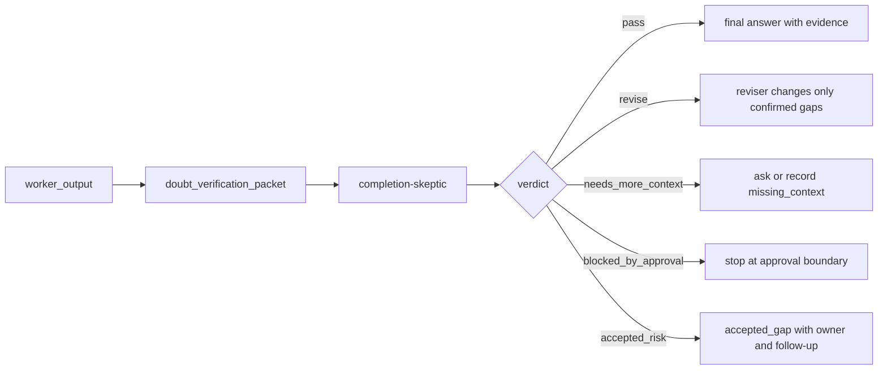

Packet содержит `claim ledger`, `requirement ledger` и `evidence ledger`. `claim ledger` фиксирует `supported`, `unsupported`, `contradicted` и `needs_fresh_check`; `requirement ledger` держит видимыми user requirements, non-goals и approval constraints; `evidence ledger` указывает на source registry, local files, current commands, evals, owner decisions или explicit missing checks.

Completion-skeptic route - ручной и локальный gate Product-Agent OS, а не live runtime proof.

Reviser changes only confirmed gaps. Если verifier находит только speculative concerns, route возвращает residual risk вместо rewrite корректного content.

### Agents SDK output guardrail candidate

Это design-only направление. Тот же packet позже может стать Agents SDK output guardrail candidate с `tripwire` для fake evidence, pass without evidence, approval-blocked pass, missing source status или unsafe private data. Текущая граница: docs/site work не создает Agents SDK runner, MCP server, tracing export, provider call или live guardrail.

## Engineering Standards Route

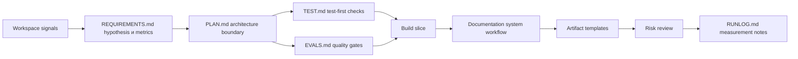

Product-agent work начинается только после того, как boundary, verification и documentation impact видны следующему worker. Если один element является unavailable, route records explicit gap instead из hiding это в chat.

## Lifecycle Routing

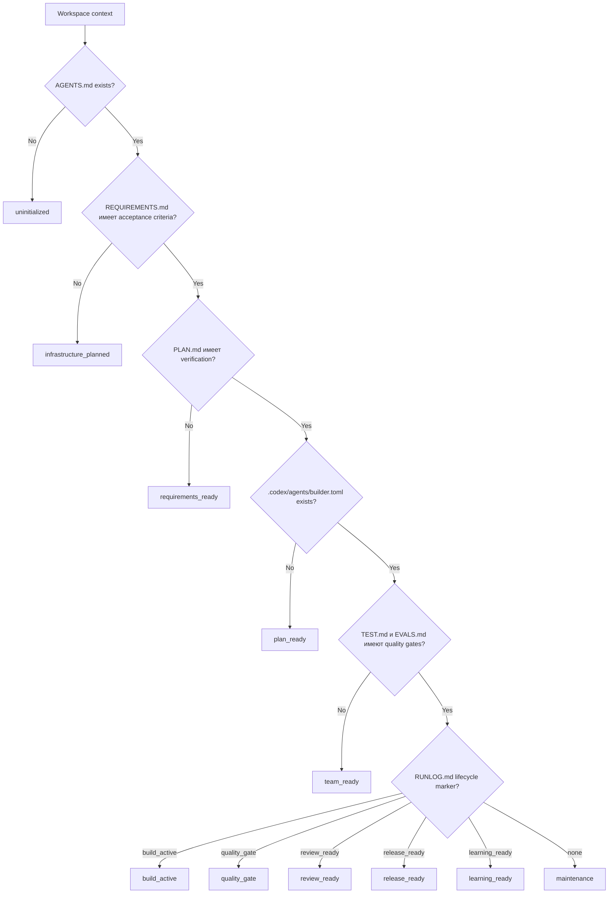

| State | Next worker | Создайте policy |
| --- | --- | --- |
| `uninitialized` | `workspace-discovery-auditor` | `read_only` |
| `infrastructure_planned` | `requirements-author` | `staged_only` |
| `requirements_ready` | `implementation-planner` | `staged_only` |
| `plan_ready` | `agent-team-designer` | `staged_only` |
| `team_ready` | `test-eval-designer` | `staged_only` |
| `build_active` | `builder` subagent когда allowed | `approved_write` |
| `quality_gate` | `risk-reviewer` | `read_only` |
| `review_ready` | `pr-release-operator` | `staged_only` |
| `release_ready` | `learning-loop-maintainer` | `staged_only` |
| `learning_ready` | `automation-promoter` | `staged_only` |
| `maintenance` | `project-lifecycle-orchestrator` | `read_only` |

## Route Packet

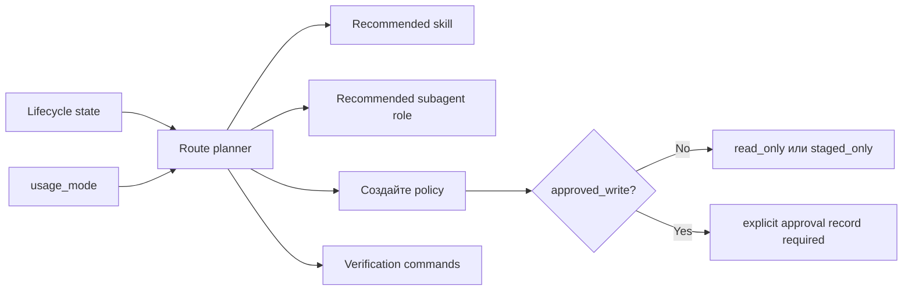

Этот route packet carries `usage_mode`, confidence, routing reasons, minimum artifacts, approval boundary, ожидаемые доказательства, residual risks и next safe action. Это является planning contract, не permission к mutate external systems.

## Methodology Intelligence

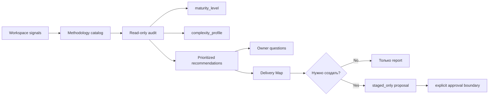

Methodology intelligence запускается до lifecycle mutation. Он может read workspace и produce `methodology_applicability`, `methodology-audit-report.md`, Delivery Map priorities и owner questions. Он не пишет target-project files, не включает hooks, не активирует automations и не touch external systems. Any generated artifact после report остается staged-only пока explicit approval.

## Usage Mode Coverage

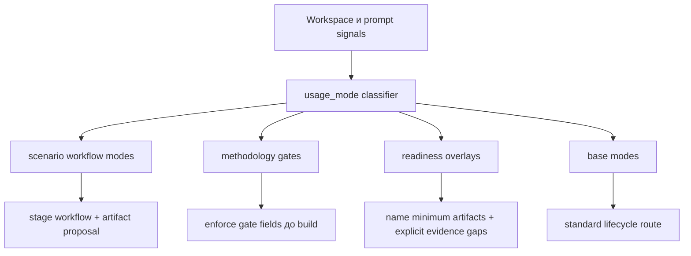

| Coverage | Modes | Required behavior |
| --- | --- | --- |
| Scenario workflows | first-run intake plus `bug_rescue`, `greenfield_idea`, `complex_system_acceleration`, `pr_review`, `legacy_onboarding`, `api_migration`, `ai_eval_regression`, `native_mobile_feature`, `desktop_local_first`, `data_migration`, `security_sensitive_change`, `ci_stabilization`, `release_packaging` | Stage existing workflow/artifact templates, keep first response small и запуск behavior-level checks. |
| Methodology gates | no-placeholder planning, generalized two-stage review, fresh-context handoff, acceptance scenarios, conditional DDD domain modeling, bounded-context-to-architecture traceability, ubiquitous language traceability, conditional FSD structure routing | Require exact files, commands, expected outputs, rollback, evidence owner, accepted gaps и ownership до build или handoff. |
| Readiness overlays | quality, release, security, AI/RAG, data и runtime readiness | Route safely, name required artifacts, record evidence gaps и avoid completion claims без verification evidence. |
| Base modes | `standard_feature`, `docs_only`, `maintenance` | Используйте normal lifecycle route с minimum control-plane artifacts. |

## Staged-First Infrastructure

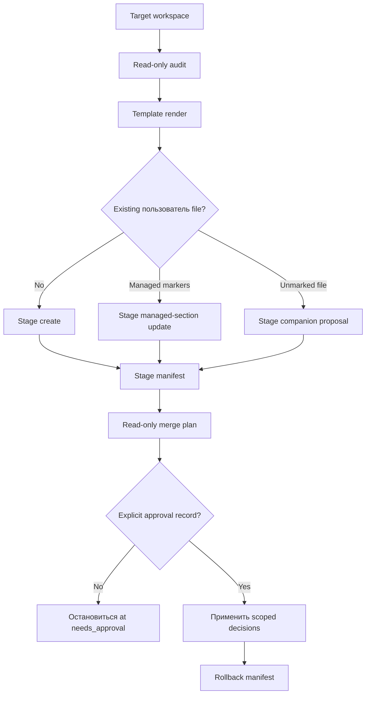

Renderer может inspect workspace и писать только в explicit staging directory. Direct target пишет выполняются только через merge tooling после approval.

## Codex Runtime Runner

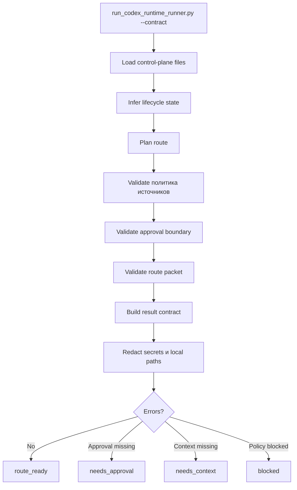

Этот runner является Codex-only. Это не call external model, не требуют separate OpenAI API key и не become Agents SDK app. Это produces deterministic contract packet который Codex может использовать к route следующий action.

## Automation Promotion

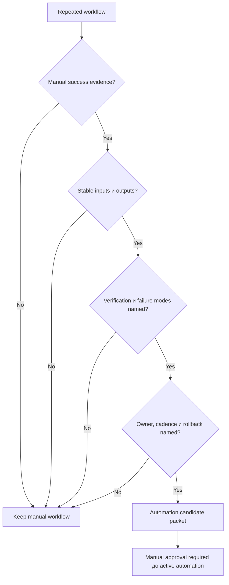

Product-Agent OS может stage automation candidate, но это должен не create active recurring automation пока workflow имеет stability evidence и explicit approval.

## Common Failure Modes

| Failure | Required behavior |
| --- | --- |
| Missing requirements | Route к requirements author, не build. |
| Missing verification | Route к planning или test/eval designer. |
| Source-backed claim lacks source | Mark требует review или block через политика источников. |
| Approved писать route lacks approval | Return `needs_approval`. |
| Active automation requested too early | Block и keep candidate-only. |
| Secret-like content appears в output | Redact и report redaction category. |
| Existing file имеет ambiguous managed markers | Остановиться и report conflict. |

Следующий artifact: используйте [Scenarios](scenarios.md) для route selection, [Professional Code Authoring standards](coding-standards.md) для code-writing gates и [Behavioral evals](behavioral-evals.md) для expected/forbidden behavior.
