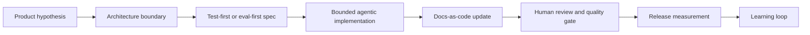

# Engineering standards layer

Source status: `official + verified methodology + experiment`  
Источники: [Codex build plugins](https://developers.openai.com/codex/plugins/build), [Agent Skills](https://developers.openai.com/codex/skills), [Building an AI-Native Engineering Team](https://developers.openai.com/codex/guides/build-ai-native-engineering-team), [Codex: add evals to your AI application](https://developers.openai.com/codex/use-cases/ai-app-evals), [Codex: iterate on difficult problems](https://developers.openai.com/codex/use-cases/iterate-on-difficult-problems), [Codex: keep documentation up-to-date](https://developers.openai.com/codex/use-cases/update-documentation), [Agile Alliance TDD](https://agilealliance.org/glossary/tdd/), [Agile Alliance ATDD](https://agilealliance.org/glossary/atdd/), [Agile Alliance BDD](https://agilealliance.org/glossary/bdd/), [Feature-Sliced Design](https://feature-sliced.github.io/documentation/), [C4 model](https://c4model.com/), [arc42](https://arc42.org/overview), [OpenAPI Initiative](https://www.openapis.org/), [OpenAPI Specification v3.2.0](https://spec.openapis.org/oas/v3.2.0.html), [AsyncAPI](https://www.asyncapi.com/docs/reference/specification/v3.0.0), [Storybook Autodocs](https://storybook.js.org/docs/writing-docs/autodocs), [Storybook accessibility tests](https://storybook.js.org/docs/writing-tests/accessibility-testing), [GitLab Docs architecture](https://docs.gitlab.com/development/documentation/site_architecture/), [GitHub Actions workflows](https://docs.github.com/en/actions/concepts/workflows-and-actions/workflows), [GitHub protected branches](https://docs.github.com/articles/about-required-reviews-for-pull-requests), [Martin Fowler: Domain-Driven Design](https://martinfowler.com/bliki/DomainDrivenDesign.html).

Эта страница фиксирует расширение `product-agent-os`: plugin должен вести проект не только как агентную разработку, а как управляемую инженерную систему с продуктовой гипотезой, архитектурной границей, test-first/eval-first проверками, docs-as-code, review gates и измерением результата.

## Что меняется

Раньше Product-Agent OS в основном отвечал на вопрос: как Codex App, CLI, IDE extension, subagents, skills, `AGENTS.md`, hooks, evals и automation candidates проходят lifecycle без потери контекста.

Новый слой добавляет вопрос: соответствует ли работа зрелой инженерной практике.

## Проверенные выводы из источников

| Область | Подтверждено источниками | Как использовать в plugin |
| --- | --- | --- |
| Codex plugin packaging | Plugin имеет `.codex-plugin/plugin.json` и может указывать bundled skills, hooks, MCP, apps и assets. | Новые стандарты добавляются как packaged templates и docs, а не как silent runtime behavior. |
| Codex skills | Skills являются форматом reusable workflows, plugin - installable distribution unit. | Повторяемые методики остаются workflow templates до накопления manual success evidence. |
| AI-native engineering | Роль senior-инженера смещается к spec, architecture, guardrails, review и доменной логике. | Product-Agent OS усиливает planning, review, standards и evidence вместо слепой генерации кода. |
| TDD | Test-Driven Development связывает coding, testing и design/refactoring; тест пишется до реализации. | `TEST.md`, `build-slice.md` и builder instructions требуют test-first/eval-first path или явный gap. |
| ATDD/BDD | Acceptance and behavior scenarios align product, development and testing perspectives before implementation. | `acceptance-scenarios.md`, `REQUIREMENTS.md`, `TEST.md` и `EVALS.md` теперь требуют `requirement -> scenario -> check -> evidence owner`, Given/When/Then или equivalent behavior format, business rule, edge case, non-goal и explicit gap до behavior changes. |
| DDD | Domain-Driven Design нужен для сложной domain logic, где модель, bounded context и ubiquitous language снижают риск неверной архитектуры. | `domain-modeling.md`, `architecture-overview.md`, `project-readiness.json`, `implementation-planner` и discovery gap `missing domain model for complex domain` требуют `domain_model_when_complex_domain` только для complex backend/workflow/enterprise/data-heavy/multi-service/multi-context work, `bounded_context_architecture_boundary_trace` связывает каждый bounded context с architecture boundary или accepted gap, а `ubiquitous_language_traceability` связывает domain terms с requirement/source, API/event/contract, UI label, code module or owner. |
| FSD | Feature-Sliced Design задает layers, slices, segments, public API и import rule. | Для применимого web UI plugin теперь обнаруживает optional `fsd_structure`, требует layer/slice/segment/public API/import rule в `component-card.md` или accepted gap, но не навязывает FSD backend, native, simple CRUD и simple MVP. |
| Architecture docs | C4 дает уровни context/container/component/code; arc42 задает структуру architecture communication. | `documentation-system.md` требует architecture overview, ADR и диаграммы для изменений границ. |
| API contracts | OpenAPI описывает HTTP APIs; AsyncAPI описывает message-driven APIs машинно-читаемо. | Backend/API changes должны обновлять source-of-truth contracts или фиксировать gap. |
| UI docs | Storybook Autodocs превращает stories в документацию; a11y addon поддерживает accessibility checks. | UI changes должны иметь component states, docs, accessibility/visual checks где применимо. |
| Docs-as-code | GitLab хранит docs source рядом с product code; GitHub Actions workflow - YAML process in repo; protected branches can require reviews/status checks. | Docs становятся частью `PLAN.md`, `TEST.md`, `RUNLOG.md`, а CI/CODEOWNERS остаются staged proposals. |

## Context7 findings

Context7 использовался как дополнительный retrieval layer, но official status присваивается только underlying source.

- Feature-Sliced Design: официальная документация подтверждает import rule - slice может импортировать только slices нижних layers; также подтверждает public API rule для slices.
- Storybook: документация подтверждает `autodocs` tag, MDX/Doc Blocks и integration path для accessibility tests.
- OpenAPI: спецификация подтверждает Security Scheme Object и типы security schemes, включая `apiKey`, `http`, `oauth2`, `openIdConnect`.
- Direct web verification on 2026-05-23: latest published OpenAPI Specification is v3.2.0; v3.1.1 remains useful only as a compatibility reference.

Эти findings не заменяют primary links в source registry.

## Operating standard

Для любой meaningful feature plugin должен требовать:

1. Product hypothesis: что меняем, для кого, какая метрика покажет успех, какие privacy/security constraints.
2. Architecture boundary: где живет код, какие dependency rules, какие public contracts нельзя ломать.
3. Test-first or eval-first path: тест, contract check, fixture или eval до изменения поведения.
4. Bounded agentic implementation: owned files, files out of scope, stop conditions, approvals.
5. Documentation impact: architecture, API/event contracts, UI docs, database docs, release/user docs.
6. Review gate: correctness, security, data handling, performance, rollback, source fidelity.
7. Measurement: post-release metrics, support signals, defects, latency, cost, user feedback.

## Что добавлено в plugin

Generated control-plane files теперь содержат эти поля:

| Artifact | Новые обязанности |
| --- | --- |
| `AGENTS.md` | Engineering standards baseline: hypothesis, architecture boundary, test/eval-first, docs-as-code, bounded agent work, evidence-before-completion. |
| `REQUIREMENTS.md` | Product hypothesis, success metrics, guardrail metrics, metric hardening, source-of-truth docs. |
| `PLAN.md` | Methodology gates, architecture boundary, metric hardening, evidence-before-completion, documentation impact, contract/schema/docs/eval gates. |
| `TEST.md` | Test-first cases, acceptance scenarios, metric hardening checks, evidence-before-completion checks, API/event/schema checks, docs checks, AI/subjective checks. |
| `EVALS.md` | Architecture boundary, acceptance scenario evals, metric hardening evals, evidence-before-completion evals, documentation quality, AI answer quality, retrieval quality, latency/cost/grounding thresholds. |
| `RUNLOG.md` | Methodology trace, metric hardening evidence, evidence-before-completion evidence and measurement notes. |
| `.codex/workflows/development-standards.md` | Reusable workflow for product hypothesis -> architecture -> tests/evals -> implementation -> review -> measurement. |
| `.codex/workflows/documentation-system.md` | Reusable docs-as-code workflow for architecture, API, UI, code reference, DB and release docs. |
| `.codex/artifact-templates/*.md` | Concrete templates for ADR, architecture overview, domain modeling, bounded-context-to-architecture traceability, ubiquitous language traceability, metrics, API contracts, UI component cards and database dictionaries. |
| `.codex/artifact-templates/acceptance-scenarios.md` | ATDD/BDD traceability from requirement to scenario, check and evidence owner before behavior changes. |
| `.codex/artifact-templates/governance-proposal.md` | Staged governance proposal for CODEOWNERS status and GitHub Actions least privilege without external activation. |

Track 7 hardening добавляет поведенческие проверки поверх prose:

- `workspace-discovery-auditor` теперь может видеть methodology signals: architecture docs, ADR, OpenAPI, AsyncAPI, Storybook, optional `fsd_structure`, DB docs, CODEOWNERS, CI, evals и metrics.
- `project-readiness.json` фиксирует methodology gates: product hypothesis, architecture boundary, optional `fsd_structure_when_ui_architecture_applies`, test/eval-first evidence, docs-as-code impact и release measurement.
- Artifact templates переводят рекомендации из research-файлов в конкретные reviewable outputs.

Track 8 hardening добавляет scenario-first routing:

- `done` workflows now cover first-run intake, bug rescue, greenfield idea shaping, complex system acceleration, PR review readiness, legacy onboarding, API migration, AI/RAG eval regression, native/mobile feature work, desktop local-first work, data migration, security-sensitive change, CI stabilization and release packaging.
- Dedicated scenario docs now describe `usage_mode`, first response, minimum artifacts, approval boundary and verification gates for plugin operators.
- Dedicated behavioral eval docs now separate expected behavior, forbidden behavior, fixture eval coverage and deterministic transcript/session replay coverage.
- Dedicated Codex compatibility docs now record Codex App, CLI, IDE extension, `.codex-plugin`, skills, MCP and staged hooks as the supported package boundary.
- First-run intake keeps the first response small for empty, broken, existing control-plane and complex system starts: mode, confidence, next smallest action, minimum artifacts, evidence gaps and approval boundary.
- Release packaging now has `release-packaging.md`, `release-readiness.md`, discovery signals, behavioral eval coverage, and publish/tag/upload/package-registry approval boundaries.
- Acceptance scenario traceability now has `acceptance-scenarios.md`, lifecycle skill wording, readiness eval coverage and behavioral eval coverage before behavior changes.
- Conditional DDD domain modeling now has `domain_model` discovery, `domain_model_when_complex_domain` readiness gate, `bounded_context_architecture_boundary_trace`, `ubiquitous_language_traceability`, implementation-planner stop condition, accepted-gap support and false-positive protection for plain `domain/` folders.
- Conditional FSD structure routing now has `fsd_structure` discovery, `component-card.md` layer/slice/segment/public API/import rule fields, implementation-planner stop condition, accepted-gap support and false-positive protection for backend, native, simple CRUD and simple MVP work.
- Metric hardening now has `metric_hardening_when_product_behavior_changes`, strengthened `metric-spec.md`, release packet checks, generated control-plane fields, lifecycle skill enforcement and fixture eval coverage for North Star or primary value metric, input metric, counter-metric, proxy metric risk, guardrail, qualitative review, privacy classification, retention period, data minimization, owner signoff and post-release review evidence.
- Evidence-before-completion now has `evidence_before_completion`, release packet checks, development standards guidance, generated control-plane fields, lifecycle skill enforcement, behavioral eval coverage and fixture eval coverage for ready/completed/fixed/works/release claims.
- Docs tooling selector now has `docs_tooling_selector`, `docs-tooling-decision.md`, `docs_as_code_impact` status vocabulary, discovery routing, generated control-plane fields, lifecycle skill enforcement and fixture eval coverage for stack-aware docs choices without forced installs or unapproved external activation.
- Standards trigger policy now has `standards_trigger_policy`, `governance-proposal.md`, ADR trigger policy, C4/arc42 applicability, OpenAPI source of truth, AsyncAPI event contract fields, SemVer impact, Keep a Changelog categories, CODEOWNERS status, GitHub Actions least privilege fields and no forced external activation.
- Conditional readiness gates now have `readiness_statuses`, structured per-gate applicability, pass condition, accepted gap, required evidence, owner and residual risk in `project-readiness.json`, generated control-plane templates, lifecycle skills and fixture eval coverage. Detection alone can only produce `present_unverified`, not readiness.
- Detailed discovery status now has `methodology_applicability` packets in discovery output for architecture boundary, test/eval-first evidence, docs-as-code ownership, product measurement, complex-domain DDD, applicable FSD structure, docs tooling decision and standards trigger policy.
- Readiness gates must distinguish “route detected” from verified readiness. Completion claims require current evidence or an explicit inspection-only gap.

## Важные ограничения

- Data-Driven Development в source-файле не является тем же термином, что Domain-Driven Design. В core guidance используем формулировки `data-informed product decisions`, `product hypothesis` и `success metric`, чтобы не смешивать термины.
- ATDD/BDD scenarios do not replace unit tests, integration tests, contract tests or evals; they are a traceability layer for behavior intent and evidence ownership.
- Domain-Driven Design не навязывается простому CRUD или simple MVP. Product-Agent OS требует domain modeling, bounded-context-to-architecture traceability и ubiquitous language traceability только при complex backend/workflow/enterprise/data-heavy/multi-service/multi-context signals или при явном owner decision.
- Feature-Sliced Design не навязывается backend, native, simple CRUD или маленьким MVP. Plugin требует architecture boundary, а FSD является сильным default только для растущего web UI или explicit owner decision.
- Docs-as-code не означает автоматическое создание CI, CODEOWNERS, GitHub Actions или публикации. Product-Agent OS может stage proposals, но не активирует external workflows без explicit approval.
- Docs tooling selection records selected tools, rejected tools, evidence owner, maintenance owner and approval boundaries; docs-light/internal-only work can be `not_applicable`.
- AI/RAG quality нельзя закрывать только unit tests. Для retrieval, grounding, hallucination risk, latency и cost нужны evals или явно записанный gap.

## Definition of done для Product-Agent OS slice

Slice можно считать готовым к review только если:

- product hypothesis и success metric ясны или помечены not applicable;
- product behavior metrics have counter-metric, guardrail, qualitative review, privacy classification, retention period, data minimization, owner signoff and post-release review evidence, or an explicit not-applicable reason;
- architecture boundary и ownership названы;
- для complex backend/workflow/enterprise/data-heavy/multi-service/multi-context work есть domain-modeling artifact или accepted gap;
- test-first/eval-first evidence есть или gap явно принят;
- затронутые source-of-truth docs обновлены или gap записан;
- docs tooling impact is recorded as `not_applicable`, `present_unverified`, `present_verified`, `proposal_staged`, `explicit_gap_accepted` or `approval_required`;
- standards trigger impact is recorded through `standards_trigger_policy` when ADR/C4/arc42/OpenAPI/AsyncAPI/SemVer/Keep a Changelog/CODEOWNERS/GitHub Actions context applies;
- conditional readiness gates record `not_applicable`, `applicable_missing`, `present_unverified`, `present_verified`, `proposal_staged`, `explicit_gap_accepted` or `approval_required` with applicability reason, owner and residual risk;
- команды, exit codes, artifacts и residual risks записаны в `RUNLOG.md`;
- approvals, security, privacy, migration и rollback risks не скрыты.
