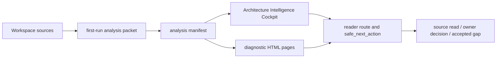

# First-Run Architecture Intelligence Cockpit

Source status: `official + experiment`

This page explains how to read the first-run Architecture Intelligence Cockpit in Product-Agent OS. The cockpit is a local orientation surface: it combines the first project analysis, routing, graph/code/schema signals, evidence and risk hierarchy, and one safe next action into a local HTML/JSON packet. It does not replace source files, current commands, owner decisions, the source registry or control-plane artifacts.

## Purpose

The first-run cockpit answers a practical question: what kind of workspace is this, where are the source boundaries, which artifacts already exist, which route is safe, and which claims need more evidence?

It is useful at the start of a pilot, after a read-only audit or before an architecture review. A good result should not read like an internal ledger: the reader should see the summary, key surfaces, evidence gaps, approval boundary and one `safe_next_action`.

## Source Boundary

The cockpit is a generated view and remains `orientation_only_not_proof`. It can guide navigation and review, but it is not standalone proof of architecture correctness, runtime behavior, security posture, visual quality, release readiness or target apply safety.

| Stronger than the cockpit | Orientation surface only |
| --- | --- |
| Project source files and checked-in docs | `index.html` cockpit |
| `AGENTS.md`, `REQUIREMENTS.md`, `PLAN.md`, `TEST.md`, `EVALS.md`, `RUNLOG.md` | `analysis-manifest.json` and renderer summaries |
| Source registry entries and owner decisions | Graph/code/schema projections |
| Current command/eval/runtime evidence | Scorecards, dashboards, generated pages |
| Accepted gaps with owner, reason, residual risk and follow-up | Static visual/a11y gate without browser proof |

If the cockpit shows a problem or recommendation, the next step must return to the source: read files, check command evidence, update owning docs or request an owner decision.

## Inputs

The main input is the first-run analysis packet. It contains workspace metadata, detected project shape, source artifacts, control-plane state, `usage_mode`, methodology route, risk map, source-policy status, graph/file/code summaries, schema/contract signals, runtime/browser/provider boundaries, generated pages, redaction status, evidence gaps and `safe_next_action`.

For private or real-project targets, the packet must stay redacted: no secrets, credentials, raw private chat logs, private customer data, unredacted PII, raw source bodies or absolute user-specific paths.

## Outputs

| Artifact | Role | Boundary |
| --- | --- | --- |
| `first-run-analysis-packet.json` | Machine-readable first analysis packet: route, summaries, gaps, generated pages, source policy and safe next action. | Orientation evidence; not release/readiness proof. |
| `analysis-manifest.json` | Renderer manifest: digests, baseline comparison, redaction report, generated page list and cockpit view model. | Generated-view boundary; sources and current commands are stronger. |
| `index.html` | Primary self-contained Architecture Intelligence Cockpit. | Local review surface; not browser/runtime proof by itself. |
| Additional `*.html` pages | Diagnostic pages for inventory, architecture, methodology, runtime route, control plane, graph, code flow, quality/evals, risks and recommendations. | Supporting views, not source truth. |
| Scorecard or comparison packet | Reading quality, structural checks, unsupported claim ceilings and static comparison. | Review evidence only; owner acceptance and runtime proof are separate. |

## View Model

The primary cockpit is organized around `first_run_cockpit_artifact_v1` and `architecture_intelligence_design_contract_v1`. These names describe the contract surface; they do not mean all claims are proven.

The view model should show:

- first viewport operator shell: goal, status, route, next action and claim ceiling;
- architecture/design contract: what the cockpit shows, what questions it answers and where the trust boundary sits;
- static diagrams: local SVG/Mermaid-style projections without external runtime;
- schema/contract surface: detected or explicitly missing DB/API/config/contract signals;
- graph/file/code surface: source graph, selected nodes, read order and graph blockers;
- guided review route for operator, reviewer and owner;
- evidence/risk hierarchy: supported, inspection-only, unsupported, approval-required and accepted-gap labels;
- visual/accessibility acceptance surface with static checks and an explicit browser proof gap.

## Local-JS Boundary

The cockpit may include local inline JavaScript for reading convenience: search, filters, tabs, expanded diagnostics, navigation highlighting and copy/select controls. This layer is allowed only as self-contained local interaction.

Without separate approval, the cockpit must not include external `<script src=...>`, external CSS, hosted assets, `fetch`, network calls, telemetry, provider/API calls, live server launch, browser automation, target mutation, canonical graph mutation, source-doc mutation or hidden runtime checks.

If JavaScript is disabled, the main content must remain readable as static HTML. Local controls improve navigation but do not increase evidentiary strength.

## Workspace Detection And Routing

First-run routing must classify a workspace narrowly enough to avoid an unsafe next step.

| Signal | What the cockpit shows | Safe interpretation |
| --- | --- | --- |
| Control-plane files | Whether `AGENTS.md`, requirements, plan, tests, evals, runlog or staged proposals exist. | File presence does not prove freshness; read owner source. |
| Stack and artifacts | Docs-only, backend/API, web/frontend, AI/RAG, data/migration, PR/review, automation/release or mixed signals. | `usage_mode` is a route hint, not owner approval. |
| Source policy | Missing `Source status`, registry gaps, private target boundaries and unsupported claims. | Block apply/promotion until fixed or accepted as an owner gap. |
| Runtime/browser/provider hints | Surfaces that need runtime or external proof. | Keep `approval_required` if proof was not run. |
| Graph/code/schema signals | Files, contracts and relationships worth reading first. | Use for read order, not automatic edit decisions. |

The first safe action is usually one of three things: read named source files, fix source-policy blockers or prepare an owner-reviewed accepted gap. A stronger action needs current evidence and an approval boundary.

## Artifact Relationships

This Mermaid diagram is Markdown source, not browser screenshot proof. Final generated `site/` and search/sitemap parity remain a separate final gate.

## Safe First Actions

After opening the cockpit, the operator should:

1. Check `Source status`, `generated_view_policy` and `approval_boundary`.
2. Read `safe_next_action` and avoid expanding it into runtime, browser, provider, git or target mutation.
3. Open the named source files or control-plane artifacts before architecture/readiness claims.
4. If source-policy blockers exist, fix the owning source or record an owner-reviewed accepted gap.
5. If screenshot/browser proof is needed, prepare a separate approval packet instead of inferring it from static HTML.

## Failure Modes

| Failure mode | Why it is risky | Correct response |
| --- | --- | --- |
| Generated HTML treated as source truth | A stale or partial view can look convincing. | Return to source files and current command evidence. |
| Static visual gate called WCAG proof | Static checks are not browser/a11y/runtime proof. | Record a browser proof gap or request approved visual QA. |
| Graph edge treated as runtime dependency | Static graph does not prove dynamic dispatch, framework wiring or live behavior. | Read code and run approved checks. |
| Local JS treated as app runtime | Inline controls only manage the HTML view. | Do not claim runtime behavior without separate proof. |
| Private target details leak into reader docs | The public/internal boundary breaks redaction policy. | Keep private labels and paths in source-owned ledgers only. |
| Root `site/` freshness claimed after a source edit | Generated site can be stale. | Wait for the final `DOC-M25` rebuild/search/sitemap gate. |

## Unsupported Claims

This page does not claim browser screenshot proof, Cosmos.gl/WebGL runtime execution proof, full WCAG certification, release readiness, publication readiness, target apply safety, provider/API behavior, canonical graph mutation safety or root `site/` freshness after G2-G5 source updates.

Those claims require separate current evidence, owner approval or an accepted gap. Static cockpit evidence can only show which proof is needed next.

## Screenshot And Browser Proof Boundary

Screenshots, canvas pixel checks, responsive layout proof, console/network cleanliness, keyboard/focus verification and actual browser behavior do not appear automatically from Markdown, strict MkDocs or static HTML inspection.

If that proof is needed, the next slice must name the target artifact, redaction policy, browser automation approval, viewport matrix, console/network evidence, screenshot or trace destination, expected failure handling and owner review path. Until then, the status is `not_run_approval_required`.

## Final Site Freshness Route

Source docs can be updated before the root `site/` rebuild. For this refresh, the final gate is `DOC-M25`: it should run after G2-G5 source/nav decisions so one final build can prove generated-site freshness, search index and sitemap parity.

Before `DOC-M25`, the correct claim is: source Markdown is updated, but generated `site/` freshness is not claimed.

## Related Pages

- [Artifact Contracts](artifact-contracts.md) maps generated artifacts and the first-run analysis artifact.
- [Project Code Graph](project-code-graph.md) explains graph/query/cockpit source boundaries.
- [Real-project pilot](real-project-pilot.md) covers first-run operator packets, target consent and evidence ledgers.
- [Technical Setup](technical.md) covers commands, package layout and local capability boundaries.

## Next Action

Use the cockpit as a reader-facing route map: choose `safe_next_action`, read the owning sources and only then move to docs/source updates, accepted gaps, approved browser proof or the final `DOC-M25` site freshness gate.
