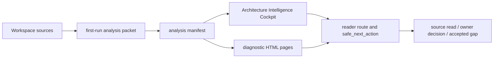

# First-run Architecture Intelligence Cockpit

Source status: `official + experiment`

Эта страница объясняет, как читать first-run Architecture Intelligence Cockpit в Product-Agent OS. Cockpit нужен как обзорная архитектурная поверхность: он собирает первый анализ проекта, маршрутизацию, graph/code/schema signals, evidence/risk hierarchy и безопасный следующий шаг в один локальный HTML/JSON пакет. Он не заменяет исходные файлы, текущие команды, owner decisions, source registry или control-plane artifacts.

## Назначение

First-run cockpit отвечает на практический вопрос: "Что это за workspace, где границы источников, какие artifacts уже есть, какой route безопасен и что нельзя утверждать без новой проверки?"

Он полезен в начале пилота, после read-only аудита или перед архитектурным review. Хороший результат не выглядит как длинный внутренний ledger: пользователь видит summary, ключевые surfaces, evidence gaps, approval boundary и один `safe_next_action`.

## Source Boundary

Cockpit является generated view и остается `orientation_only_not_proof`. Его можно использовать для навигации и review, но нельзя использовать как самостоятельное доказательство architecture correctness, runtime behavior, security posture, visual quality, release readiness или target apply safety.

| Сильнее cockpit | Только обзорная поверхность |
| --- | --- |
| Исходные файлы проекта и checked-in docs | `index.html` cockpit |
| `AGENTS.md`, `REQUIREMENTS.md`, `PLAN.md`, `TEST.md`, `EVALS.md`, `RUNLOG.md` | `analysis-manifest.json` и renderer summaries |
| Source registry entries и owner decisions | Graph/code/schema projections |
| Current command/eval/runtime evidence | Scorecards, dashboards, generated pages |
| Accepted gaps с owner, reason, residual risk и follow-up | Static visual/a11y gate без browser proof |

Если cockpit показывает проблему или рекомендацию, следующий шаг всегда должен вернуться к источнику: прочитать файлы, проверить command evidence, обновить owning docs или запросить owner decision.

## Входы

Основной вход - first-run analysis packet. Он собирает:

- workspace metadata и detected project shape;
- source artifacts и control-plane state;
- `usage_mode`, methodology route, risk map и source-policy status;
- graph/file/code summaries и schema/contract signals;
- runtime/browser/provider boundary;
- generated pages, redaction status, evidence gaps и `safe_next_action`.

Для private или real-project targets packet должен оставаться redacted: без secrets, credentials, raw private chat logs, private customer data, unredacted PII, raw source bodies и absolute user-specific paths.

## Выходы

Типичный first-run output состоит из нескольких связанных artifacts.

| Artifact | Роль | Boundary |
| --- | --- | --- |
| `first-run-analysis-packet.json` | Машинный пакет первого анализа: route, summaries, gaps, generated pages, source policy и safe next action. | Orientation evidence; не release/readiness proof. |
| `analysis-manifest.json` | Manifest renderer output: digests, baseline comparison, redaction report, generated page list и cockpit view model. | Generated-view boundary; источники и текущие команды сильнее. |
| `index.html` | Primary self-contained Architecture Intelligence Cockpit. | Local review surface; не browser/runtime proof by itself. |
| Дополнительные `*.html` pages | Diagnostic pages для inventory, architecture, methodology, runtime route, control plane, graph, code flow, quality/evals, risks и recommendations. | Raw diagnostics или supporting views, не source truth. |
| Scorecard или comparison packet | Удобство чтения, structural checks, unsupported claim ceilings, static comparison. | Review evidence only; owner acceptance и runtime proof отдельно. |

## View Model

Primary cockpit строится вокруг `first_run_cockpit_artifact_v1` и `architecture_intelligence_design_contract_v1`. Эти имена описывают contract surface, а не обещают, что все claims уже доказаны.

View model должен показывать:

- first viewport operator shell: цель, status, route, next action и claim ceiling сразу на первом экране;
- architecture/design contract: что cockpit показывает, какие вопросы отвечает и где проходит trust boundary;
- static diagrams: локальные SVG/Mermaid-style projections без внешнего runtime;
- schema/contract surface: найденные или явно отсутствующие DB/API/config/contracts signals;
- graph/file/code surface: source graph, selected nodes, read order и graph blockers;
- guided review route: порядок чтения для operator, reviewer и owner;
- evidence/risk hierarchy: supported, inspection-only, unsupported, approval-required и accepted-gap labels;
- visual/accessibility acceptance surface: static checks и явно записанный browser proof gap.

## Local-JS Boundary

Cockpit может включать локальный inline JavaScript для удобства чтения: поиск, фильтры, tabs, раскрытие diagnostics, navigation highlighting, copy/select controls. Этот слой допустим только как self-contained local interaction.

Запрещены без отдельного approval:

- external `<script src=...>`, external CSS или hosted assets;
- `fetch`, network calls, telemetry, provider/API calls;
- live server launch или browser automation;
- mutation target workspace, canonical graph или source docs;
- hidden runtime checks, которые выглядят как доказательство работы.

Если JavaScript отключен, основное содержание должно оставаться читаемым как static HTML. Local controls улучшают навигацию, но не повышают доказательную силу generated view.

## Workspace Detection And Routing

First-run route должен классифицировать workspace достаточно точно, чтобы не предложить опасный следующий шаг.

| Signal | Что cockpit показывает | Безопасная интерпретация |
| --- | --- | --- |
| Control-plane files | Есть ли `AGENTS.md`, requirements, plan, tests, evals, runlog или их staged proposals. | Наличие файла не доказывает актуальность; нужно читать owner source. |
| Stack and artifacts | Docs-only, backend/API, web/frontend, AI/RAG, data/migration, PR/review, automation/release или mixed signals. | `usage_mode` - route hint, не owner approval. |
| Source policy | Отсутствующий `Source status`, пробелы registry, private target boundaries и unsupported claims. | Блокировать apply/promotion до исправления или owner accepted gap. |
| Runtime/browser/provider hints | Есть ли surfaces, где нужны runtime или external proof. | Оставить `approval_required`, если proof не запускался. |
| Graph/code/schema signals | Какие файлы, contracts и relationships стоит читать первыми. | Использовать для read order, не для автоматического edit decision. |

Первый безопасный action обычно один из трех: прочитать указанные source files, исправить source-policy blockers, или подготовить owner-reviewed accepted gap. Если cockpit предлагает более сильное действие, оно должно иметь current evidence и approval boundary.

## Artifact Relationships

Mermaid diagram здесь является исходным Markdown, а не browser screenshot proof. Финальная проверка generated `site/` и search/sitemap parity остается отдельным последним gate.

## Safe First Actions

После открытия cockpit оператор должен:

1. Проверить `Source status`, `generated_view_policy` и `approval_boundary`.
2. Прочитать `safe_next_action` и не расширять его до runtime, browser, provider, git или target mutation.
3. Открыть указанные source files или control-plane artifacts до любых architecture/readiness claims.
4. Если есть source-policy blockers, исправить owning source или записать owner-reviewed accepted gap.
5. Если нужен screenshot/browser proof, подготовить отдельный approval packet вместо вывода из static HTML.

## Failure Modes

| Failure mode | Почему опасно | Правильная реакция |
| --- | --- | --- |
| Generated HTML принят за source truth | Старый или неполный view может выглядеть убедительно. | Вернуться к source files и current command evidence. |
| Static visual gate назван WCAG proof | Static checks не равны browser/a11y/runtime proof. | Записать browser proof gap или запросить approved visual QA. |
| Graph edge принят за runtime dependency | Static graph не доказывает dynamic dispatch, framework wiring или live behavior. | Читать код и запускать approved checks. |
| Local JS принят за app runtime | Inline controls управляют только HTML view. | Не заявлять runtime behavior без отдельного proof. |
| Private target details попали в reader docs | Public/internal boundary нарушает redaction policy. | Оставить private labels и paths в source-owned ledgers only. |
| Root `site/` freshness заявлена после source edit | Generated site может быть stale. | Дождаться финального `DOC-M25` rebuild/search/sitemap gate. |

## Unsupported Claims

Эта страница не заявляет:

- browser screenshot proof;
- Cosmos.gl/WebGL runtime execution proof;
- full WCAG certification;
- release readiness или publication readiness;
- target apply safety;
- provider/API behavior;
- canonical graph mutation safety;
- root `site/` freshness после G2-G5 source updates.

Такие claims требуют отдельного current evidence, owner approval или accepted gap. Static cockpit evidence может только указать, какой proof нужен дальше.

## Screenshot And Browser Proof Boundary

Скриншоты, canvas pixel checks, responsive layout proof, console/network cleanliness, keyboard/focus verification и actual browser behavior не появляются автоматически из Markdown, strict MkDocs или static HTML inspection.

Если такой proof нужен, следующий slice должен явно назвать:

- target artifact и redaction policy;
- browser automation approval;
- viewport matrix;
- console/network evidence;
- screenshot or trace destination;
- expected failure handling;
- owner review path.

До этого status остается `not_run_approval_required`.

## Final Site Freshness Route

Source docs могут быть обновлены раньше, чем root `site/` rebuild. Для этого refresh final gate - `DOC-M25`: он должен запускаться после G2-G5 source/nav decisions, чтобы один финальный build подтвердил generated-site freshness, search index и sitemap parity.

До `DOC-M25` корректная формулировка такая: исходный Markdown обновлен, но generated `site/` freshness не заявляется.

## Related Pages

- [Artifact Contracts](artifact-contracts.md) - contract map для generated artifacts и first-run analysis artifact.
- [Project Code Graph](project-code-graph.md) - graph/query/cockpit source boundary.
- [Real-project pilot](real-project-pilot.md) - first-run operator packet, target consent и evidence ledger.
- [Технические особенности и установка](technical.md) - команды, package layout и local capability boundaries.

## Next Action

Используйте cockpit как reader-facing route map: выберите `safe_next_action`, прочитайте owning sources и только затем переходите к docs/source update, accepted gap, approved browser proof или финальному `DOC-M25` site freshness gate.
