# Product-Agent OS plugin

Source status: `official + experiment`

## Executive overview

Product-Agent OS plugin is a local Codex plugin for projects where Codex App, CLI, IDE extension, subagents, skills, `AGENTS.md`, hooks, evals and automation candidates need to operate as a governed delivery system instead of a set of one-off prompts.

The plugin helps move a project through a full lifecycle: read-only workspace audit, requirements, plan, ownership, staged infrastructure, verification, review, release packet, learning loop and only then an automation candidate. It does not replace the owner, does not apply autonomous changes by itself and does not turn generated evidence into source of truth.

| Need | Main page |
| --- | --- |
| Read the generated graph and cockpit | [Project Code Graph](project-code-graph.md) |
| Understand the live runtime/provider/mutation boundary | [Live Runtime Governance](live-runtime-governance.md) |
| Know when real testing can start | [Approval-Bound Real Testing](approval-bound-real-testing.md) |
| Plan the first real-project pilot | [Real-Project Pilot](real-project-pilot.md) |
| Evaluate and modernize agents/skills | [Agent-Skill Modernization Loop](agent-skill-modernization-loop.md) |
| Find local plugin commands | [CLI Reference](cli-reference.md) |
| See user-facing outputs | [Artifact Gallery](artifact-gallery.md) |
| Understand JSON/HTML/ledger evidence artifacts | [Artifact Contracts](artifact-contracts.md) |
| Prepare release packet and handoff | [Packaging And Closure](packaging-and-closure.md) |

## G4 Operator-Flow Routes

`documentation_refresh_G4-A01` adds four operator-facing routes without claiming that the generated root `site` is fresh. Until final `DOC-M25`, these pages are source docs and search/sitemap freshness remains a separate gate.

| Need | Page |
| --- | --- |
| Instruction and tool-use compliance | [Instruction and tool-use compliance](instruction-tool-use-compliance.md) |
| Operator command matrix | [Operator command matrix](operator-command-matrix.md) |
| Guided questions and answer ledger | [Guided questions and answer ledger](guided-questions-answer-ledger.md) |
| Source, cache and active-session state | [Source, cache and active-session state](source-cache-session-state.md) |

Sources: [Codex plugins](https://developers.openai.com/codex/plugins), [Build plugins](https://developers.openai.com/codex/plugins/build), [Agent Skills](https://developers.openai.com/codex/skills), [Subagents](https://developers.openai.com/codex/subagents), [AGENTS.md](https://developers.openai.com/codex/guides/agents-md), [Codex hooks](https://developers.openai.com/codex/hooks), [Agent approvals and security](https://developers.openai.com/codex/agent-approvals-security), [Codex workflows](https://developers.openai.com/codex/workflows), [Product-Agent Workflows](../product-agent/overview.md).

## Current operating boundary

| Surface | Allowed without new approval | Forbidden without separate explicit approval |
| --- | --- | --- |
| Static project graph | Read-only scan, staged graph/cockpit, bounded query packets. | Treat generated graph as source of truth or mutate target files from graph evidence alone. |
| Local runtime | Validate disabled-by-default runtime contract and graph-only fallback. | Start live server, expose public routes or add write endpoints. |
| Provider retrieval | Stage provider gate/eval contracts and threshold fallback. | Perform live external model/API calls or provider calls. |
| Human review and mutation | Stage review ledger, diff preview and dry-run mutation plan. | Mutate canonical graph without accepted owner decision and rollback proof. |
| Audit and real testing | Stage audit/security/observability/readiness packets. | Run browser automation, provider pilots, canonical mutation pilots or git release actions. |

## First-Run Walkthrough

The first run should produce a route, not scaffolding. A useful starting prompt:

```text
Use Product-Agent OS for this project: start with a read-only workspace audit, identify lifecycle state, usage_mode, methodology gaps, staged artifacts, verification route, approval boundary and safe_next_action.
```

| Step | What the plugin does | What the user gets |
| --- | --- | --- |
| Read-only workspace audit | Reads project rules, docs, tests, runtime hints and current diff without changing files. | A context map, risk map, source boundaries and evidence gaps. |
| Lifecycle state | Classifies the project as intake, requirements, planning, build, review, release or learning. | A reasoned explanation for the next step. |
| Methodology selection | Maps project risks to DDD, TDD, ADD, FSD, eval-driven gates and related practices. | Relevant methods become checks and artifacts instead of dogma. |
| Staged artifacts | Proposes `REQUIREMENTS.md`, `PLAN.md`, `TEST.md`, `EVALS.md`, `RUNLOG.md` or domain packets only when needed. | Outputs can be reviewed before any target workspace write. |
| Verification route | Names commands, evals, runtime checks, owners and rollback path. | Readiness has a concrete evidence path. |
| Approval boundary | Separates read/staged proposals from live server launch, browser automation, provider/API calls, canonical mutation and git actions. | `safe_next_action` does not cross approvals. |

Generated views are not source of truth: graph, cockpit, dashboard and reports help review, but they do not replace source files, command evidence and owner decisions. The default stop line is: no live server launch, no browser automation, no provider/API calls, no canonical graph mutation and no git stage/commit/push/PR without separate explicit approval.

## Core capabilities

- Packaged lifecycle skills: orchestrator, discovery auditor, requirements author, implementation planner, team designer, test/eval designer, risk reviewer, release operator, learning loop maintainer and automation promoter.
- Staged infrastructure renderer for control-plane files, project-scoped `.codex/agents/`, hook templates, workflows, eval templates, PR/release templates and automation candidates.
- Safe merge tooling with approval record, manifest validation, workspace-bound paths and rollback support.
- Project Code Graph, bounded query packets and offline cockpit for navigation without treating generated views as truth.
- Live/runtime/provider governance with approval packets, redaction, budget, fallback, audit and staged-only evidence.
- Scenario workflows for first-run intake, bug rescue, greenfield idea shaping, complex system acceleration, PR review readiness, legacy onboarding, API migration, AI/RAG eval regression, native/mobile work, desktop local-first work, data migration, security-sensitive change, CI stabilization and release packaging.
- Engineering standards layer with product hypothesis, architecture boundary, acceptance scenarios, test/eval-first gates, docs-as-code, metric hardening, evidence-before-completion and release measurement.
- Transcript/session eval runner and fixture eval coverage for expected behavior, forbidden behavior, privacy checks and regression replay without external systems.
- Self-Verification And Modernization Loop for agents and skills through `agent_skill_metrics_loop`: target registry, trace intake, dataset quality, grader/judge calibration, scorecard ledger, staged modernization candidates, staged evidence only, no live eval/model/API calls, no active schedules and no self-applied updates.

## Problems It Solves

| Problem | What the plugin does |
| --- | --- |
| A long Codex session loses context | Moves goal, plan, checks and decisions into control-plane files |
| Requirements live only in chat | Creates `REQUIREMENTS.md` with scope, non-goals and acceptance criteria |
| Planning blends into implementation | Requires `PLAN.md`, ownership, verification and rollback before a build slice |
| Subagents work without boundaries | Designs roles through ownership, handoff artifacts and stop conditions |
| Checks are named after the fact | Separates deterministic checks in `TEST.md` and quality gates in `EVALS.md` |
| The agent writes code without engineering method | Adds product hypothesis, architecture boundary, test/eval-first path, docs impact and measurement |
| Project rules are scattered across memory | Moves durable rules into `AGENTS.md` and current decisions into `RUNLOG.md` |
| Hooks and automations are enabled too early | Keeps a staged-first and candidate-only boundary until manual approval |
| It is hard to prove that work was verified | Requires evidence: commands, fixture evals, source policy and review findings |

## Who It Fits

| Scenario | Benefit |
| --- | --- |
| Solo developer | Structure a feature quickly and keep acceptance criteria visible |
| Product engineer | Move from idea to PR packet through verifiable artifacts |
| Engineering team | Split worktrees, roles and write scopes without conflicts |
| AI product team | Add an eval-driven loop and source/context policy |
| Governed workspace | Preserve approvals, staged writes, rollback and audit trail |

## Main Lifecycle

```mermaid
flowchart LR
    A["Idea"] --> B["Workspace audit"]
    B --> C["REQUIREMENTS.md"]
    C --> D["PLAN.md"]
    D --> E["Agent team"]
    E --> F["Build slice"]
    F --> G["TEST.md / EVALS.md"]
    G --> H["Review"]
    H --> I["PR or release packet"]
    I --> J["RUNLOG.md learning"]
    J --> K["Automation candidate"]
```



The plugin keeps the lifecycle sequential. It should not jump from `uninitialized` directly to `build_active`: context, requirements, plan, ownership and quality gates come first.

## Product workflow gates

| Gate | When it activates | Required output |
| --- | --- | --- |
| Workspace discovery | At the start of work or before scope changes | Evidence-backed audit, source boundaries, risks and next smallest action |
| Requirements | Before implementation | Scope, non-goals, acceptance scenarios and evidence owner |
| Planning | Before build slice | Owned files, forbidden files, commands, expected outputs, rollback and verification |
| Agent/team design | Before subagents or parallel work | Ownership, handoff artifacts, stop conditions and sequential fallback |
| Review | For risky/public-contract/migration/security/data/release work | Spec compliance first, then quality/risk review |
| Release | Before publish/PR/package action | Current checks, artifact manifest, rollback, residual risks and explicit owner approval |
| Learning | After a meaningful slice | RUNLOG evidence, failures, accepted gaps and modernization candidates |

## Boundaries

- The plugin runs inside Codex. It does not require a separate OpenAI API key and does not start a standalone Agents SDK runner.
- Infrastructure generation is staged-first: dry-run or staging directory before any target workspace write.
- Hooks are packaged as templates and examples; they are not silently activated.
- Automation artifacts are candidate-only until manual workflow is stable and explicitly approved.
- Secrets, private customer data, raw private chat logs and local absolute paths must not enter docs, fixtures, prompts, memory or templates.

## Public/Internal Documentation Boundary

Public product pages explain capabilities, user route, outputs, boundaries and next action. Internal evidence pages under `docs/sources/` store source/history material, acceptance history and verification packets; they should not be the first route for a new user. Generated `site/` output is a rendered copy of source docs and review output, not source of truth.

If a public page references a graph, dashboard, cockpit, scorecard or report, it must say that the artifact is an orientation surface. If a claim affects readiness, release, security or approval, it must route to an owning source: source file, source registry, command/eval/runtime evidence, owner decision or accepted gap.

## G5 Evidence Quality Routes

`documentation_refresh_G5-A01` adds the final source-docs layer before `DOC-M25`: generated artifact quality, graph evidence, privacy/supply-chain boundaries, local HTML interaction boundaries and residual follow-up.

| Route | When to open it |
| --- | --- |
| [Generated artifact UX criteria](generated-artifact-ux-criteria.md) | Review generated HTML/report quality for internal review, owner review or future public transfer without claiming browser proof. |
| [Graph intelligence contract](graph-intelligence-contract.md) | Use graph packets, ontology, rejected links, freshness or query output for orientation before source reads. |
| [Privacy, supply-chain and retention](privacy-supply-chain-retention.md) | Review cache/session summaries, SBOM, dependency audit, remediation and raw report-retention boundaries. |
| [Local HTML interaction boundary](local-html-interaction-boundary.md) | Separate local tabs/search/filter/diagram controls from approved browser-proof evidence. |
| [Residual follow-up and site freshness](residual-follow-up-site-freshness.md) | Follow G1.1 residuals and the final root `site`/search/sitemap gate through `DOC-M25`. |

## Where To Go Next

- [Technical details and installation](technical.md) - real files, commands, capabilities and install boundary.
- [Artifact Gallery](artifact-gallery.md) - user-facing outputs and their trust boundary.
- [Doubt / verifier loop](../playbooks/doubt-verification-loop.md) - how `completion-skeptic` uses a `doubt_verification_packet` before final completion claims.
- [Real-Project Pilot](real-project-pilot.md) - first-run operator packet, target consent matrix, success metrics and evidence ledger for a safe real-project pilot.
- [Engineering standards layer](development-standards.md) - how the plugin applies DDD/FSD/TDD/ADD, docs-as-code and eval-driven quality without turning them into dogma.
- [Methodology intelligence](methodology-intelligence.md) - read-only audit, Delivery Map, recommendations, owner questions and staged artifact boundary.
- [Scenarios and usage modes](scenarios.md) - first response, minimum artifacts, approval boundary and verification gates for product scenarios.
- [Generated artifact UX criteria](generated-artifact-ux-criteria.md) - practical checklist for generated HTML/report quality without Storybook/browser proof claim.
- [Graph intelligence contract](graph-intelligence-contract.md) - ontology, freshness, rejected-link ledger and source-read-before-edit boundary.
- [Privacy, supply-chain and retention](privacy-supply-chain-retention.md) - privacy, SBOM/audit/remediation and report-retention approval gates.
- [Local HTML interaction boundary](local-html-interaction-boundary.md) - local controls, no-network policy, fallback and browser-proof packet requirements.
- [Residual follow-up and site freshness](residual-follow-up-site-freshness.md) - final G1.1 residual routing and `DOC-M25` generated-site gate.
- [Behavioral evals](behavioral-evals.md) - expected behavior, forbidden behavior, fixture eval and transcript/session replay.
- [Codex compatibility](codex-compatibility.md) - Codex App, CLI, IDE extension, `.codex-plugin`, skills, MCP and staged hooks support boundary.
- [Diagrams and operating principles](architecture.md) - state routing, staged-first merge, approval gates and runtime runner flow.
- [Product-Agent Workflows](../product-agent/overview.md) - general operating model without coupling to the plugin package.

## Doubt / verifier loop

Doubt / verifier loop is the manual and local-plugin completion gate for "check again" work. The user-facing route is [doubt-verification-loop.md](../playbooks/doubt-verification-loop.md): `completion-skeptic` reads a `doubt_verification_packet`, checks claims, requirements, evidence and accepted gaps, then returns pass, revise, needs_more_context, blocked_by_approval or accepted_risk.

This page only points to the gate. The documentation records the generated `site` view; manual pilots, scorecard calibration and any promotion beyond internal/manual use remain a separate stage.

## Inputs

- A real project workspace, source documentation and current project rules.
- Product intent, constraints, approval boundary and expected evidence.

## Outputs

- A staged Product-Agent OS route with requirements, plan, verification, review and learning artifacts.
- A clear separation between source-backed evidence and generated review views.

## Risks

- Treating generated evidence as proof can hide stale or unsupported claims.
- Skipping approvals can turn a safe local workflow into an unauthorized external action.
