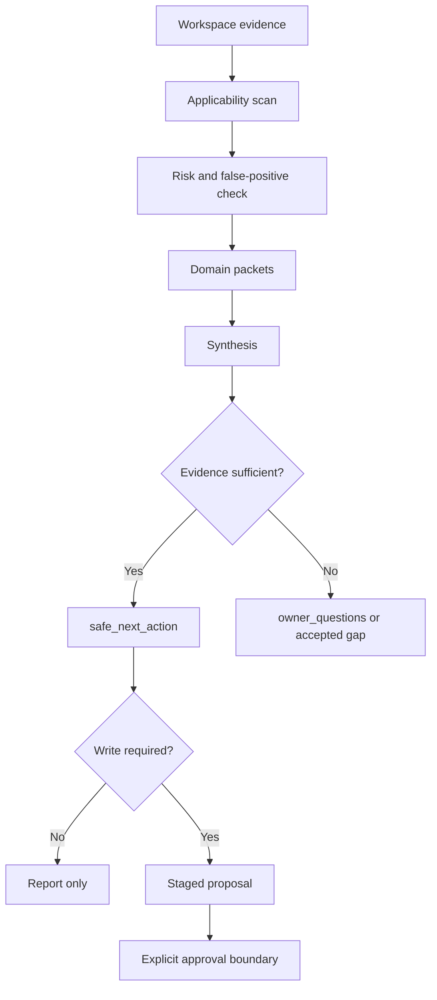

# Product-Agent OS methodology intelligence

Source status: `local product design + experiment`

Sources: [Product-Agent OS architecture](architecture.md), [Product-Agent OS scenarios](scenarios.md), [Behavioral evals](behavioral-evals.md), [Codex workflows](https://developers.openai.com/codex/workflows), [Agent approvals and security](https://developers.openai.com/codex/agent-approvals-security).

Methodology intelligence is the read-only layer that turns workspace evidence into practical delivery guidance. It reads files, control-plane artifacts and route signals, then returns `methodology_packet`, `finish_options`, `owner_questions`, `safe_next_action`, `methodology_synthesis` and `source_artifact_ledger` when they are useful.

Those packets are recommendation and routing evidence. They do not mutate target projects, enable hooks, activate automations, call providers or approve external writes.

## What It Solves

Product-agent work often fails in two opposite ways: it starts coding before the project contract is clear, or it forces heavy methodology onto simple work. Methodology intelligence gives Product-Agent OS a middle path:

- read the existing workspace before prescribing process;
- detect which engineering standards apply;
- keep lightweight work lightweight;
- require deeper evidence only for real risk;
- return owner questions when evidence is missing;
- stage recommendations instead of silently changing the target workspace.

## Inputs

- user intent or route hint;
- read-only workspace inventory;
- `AGENTS.md`, `REQUIREMENTS.md`, `PLAN.md`, `TEST.md`, `EVALS.md`, `RUNLOG.md`;
- architecture docs, ADRs, API contracts, database docs, Storybook/FSD signals, CI, evals, metrics, release artifacts and security/privacy evidence when present;
- current source policy, sandbox, approvals and external-system boundaries;
- accepted gaps and previous failure notes.

## Outputs

| Output | Purpose |
| --- | --- |
| `methodology_applicability` | Records which domains apply, why, and what evidence is missing. |
| `methodology_packet` | Route-ready evidence bundle for the next worker. |
| `finish_options` | Safe options such as answer, stage proposal, request approval, run focused verification or stop on gap. |
| `owner_questions` | Smallest blocking questions for decisions that cannot be inferred from source files. |
| `safe_next_action` | The next move that respects source policy, sandbox, approvals and evidence. |
| `source_artifact_ledger` | Mapping from recommendations to the source artifacts that support them. |
| `methodology_synthesis` | Grouped recommendations across domains with risk-aware ordering. |

## Methodology Domains

| Domain | When it applies | Minimum evidence |
| --- | --- | --- |
| Product hypothesis | Product behavior, acceptance criteria or outcome metrics change. | User/problem, non-goals, acceptance scenario, metric or explicit gap. |
| Solution architecture | Boundaries, services, public contracts, runtime topology or irreversible design change. | Scope, boundary, decision, alternatives, rollback and owner evidence. |
| Frontend | User-visible UI, interaction, accessibility, visual QA or performance change. | User flow, component states, browser/runtime evidence, visual/accessibility gap or proof. |
| Backend | Service behavior, jobs, queues, auth, errors, observability or rollback paths. | Runtime behavior, failure mode, health/logging, tests and rollback evidence. |
| API & Integrations | HTTP API, event contract, SDK, webhook, external provider or consumer contract. | Source-of-truth contract, consumer map, compatibility and external-write approval boundary. |
| Database & Data | Schema, migration, lineage, retention, sensitive data or production data. | Inventory, dictionary, migration plan, rollback/backup, data classification and production access boundary. |
| LLM / AI / RAG | Prompt/model/tool/RAG/eval behavior changes. | Baseline/current eval, prompt/model/tool contracts, grounding, traces, cost/latency and incident path. |
| Security, Privacy & Compliance | Authn/authz, secrets, PII, payments, abuse, supply chain, audit or compliance overlay. | Threat surface, risk review, negative tests, secrets/data/privacy evidence, scan status and owner review. |
| Delivery, Release & Operations | Publish, deploy, package, release, automation, incidents or operations readiness. | Release scope, versioning, changelog, artifact manifest, rollout, rollback, SLO/observability and approval evidence. |
| Cross-domain synthesis | Multiple domains overlap or recommendations conflict. | Grouped recommendations, owner/consumer domains, semantic evidence sufficiency and safe next action. |

Packet identifiers and exact contract phrases:

- Security/Privacy/Compliance uses `security_privacy_compliance_contract_present`, `data-classification-register.md` and `vulnerability-response-record.md`.
- Delivery/Release/Operations uses `delivery_release_operations_contract_present`, `release-artifact-manifest.md`, `operations-runbook.md`, `post-release-review.md`, release mode policy and owner-reviewed release evidence sufficiency.
- Cross-Domain Synthesis uses `recommendation_groups`, owner domains, consumer domains, risk-aware safe next action and approval-bound behavior.

## Read-Only Process



## Approval Boundary

The staged artifact boundary is strict:

- methodology recommendations can produce a report, owner question or staged proposal;
- release, deploy, publish, DB access, security scan, external write, hook activation and automation activation stay blocked until explicit owner approval and current evidence exist;
- generated reports and dashboards are evidence surfaces, not sources of truth;
- detection alone creates `present_unverified`, not readiness;
- high-risk, production, release, security-sensitive, AI behavior and public-contract work needs owner-reviewed evidence or explicit accepted gap.

## False-Positive Control

Methodology intelligence must avoid forced ceremony:

- docs-only changes do not need a full product/architecture/release process unless they change public contracts or publishing;
- simple CRUD does not force DDD;
- backend/native work does not force FSD;
- hosted docs, CI activation and DB introspection remain approval-required;
- source-like words in file paths are not enough to infer security, release or data readiness;
- a generated artifact is not safety proof until the relevant source or owner evidence is current.

## Verification

Use focused verification when methodology behavior changes:

```powershell
python -m unittest tests.product_agent_os.test_fixture_eval_runner -v
python plugins\product-agent-os\scripts\run_fixture_eval.py
python tools\check_docs.py
```

Use broader verification when lifecycle skills, templates or routing logic change:

```powershell
python -m unittest discover -s tests -p "test_*.py" -v
python plugins\product-agent-os\scripts\validate_codex_compatibility.py
python tools\check_docs.py
```

## Risks

- A read-only audit can still be wrong if workspace evidence is stale, incomplete or misleading.
- Over-eager methodology routing can force heavy process onto simple work; every recommendation needs applicability and false-positive handling.
- Generated reports can become stale quickly; completion or release claims still need fresh command, runtime, eval or owner evidence.
- Domain packet schema can evolve as real projects expose missing fields; additive compatibility should be preserved.

Next artifact: use [Scenarios](scenarios.md) to choose the operating route and [Behavioral evals](behavioral-evals.md) to validate shortcut resistance.
