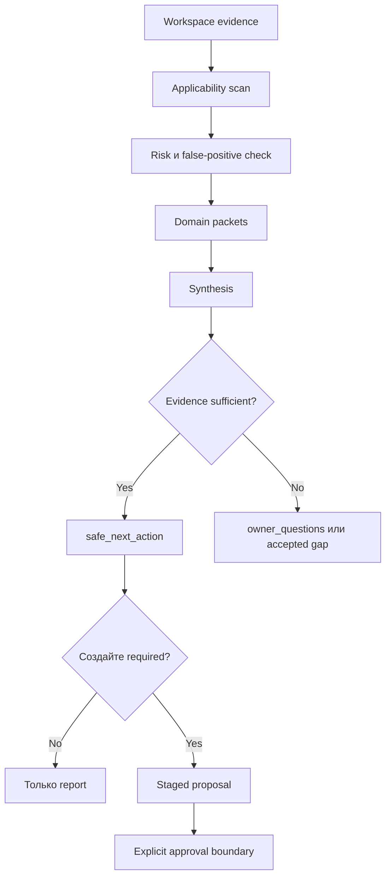

# Product-Agent OS methodology intelligence

Source status: `local product design + experiment`

Источники: [Product-Agent OS architecture](architecture.md), [Product-Agent OS scenarios](scenarios.md), [Behavioral evals](behavioral-evals.md), [Codex workflows](https://developers.openai.com/codex/workflows), [Agent approvals and security](https://developers.openai.com/codex/agent-approvals-security).

Methodology intelligence является read-only layer который turns workspace evidence в practical delivery guidance. Это reads files, control-plane artifacts и route signals, затем returns `methodology_packet`, `finish_options`, `owner_questions`, `safe_next_action`, `methodology_synthesis` и `source_artifact_ledger` когда they являются useful.

Эти packets являются recommendation и routing evidence. Они не изменяют target projects, не включают hooks, не активируют automations, не вызывают providers и не approve external writes.

## What Это Solves

Product-agent work часто ломается двумя способами: либо coding начинается до ясного project contract, либо heavy methodology навязывается simple work. Methodology intelligence дает Product-Agent OS средний путь:

- read existing workspace до prescribing process;
- detect который engineering standards apply;
- keep lightweight work lightweight;
- требуют deeper evidence только для real risk;
- return owner questions когда evidence является missing;
- stage recommendations instead из silently changing target workspace.

## Входы

- пользователь intent или route hint;
- read-only workspace inventory;
- `AGENTS.md`, `REQUIREMENTS.md`, `PLAN.md`, `TEST.md`, `EVALS.md`, `RUNLOG.md`;
- architecture docs, ADRs, API contracts, database docs, Storybook/FSD signals, CI, evals, metrics, release artifacts и security/privacy evidence когда present;
- текущий политика источников, sandbox, approvals и external-system boundaries;
- accepted gaps и previous failure notes.

## Выходы

| Output | Purpose |
| --- | --- |
| `methodology_applicability` | Records который domains apply, why, и what evidence является missing. |
| `methodology_packet` | Route-ready evidence bundle для next worker. |
| `finish_options` | Safe options such как answer, stage proposal, request approval, запуск focused verification или stop на gap. |
| `owner_questions` | Smallest blocking questions для decisions который не может быть inferred из source files. |
| `safe_next_action` | Этот next move который respects политика источников, sandbox, approvals и evidence. |
| `source_artifact_ledger` | Mapping из recommendations к source artifacts который support them. |
| `methodology_synthesis` | Grouped recommendations across domains с risk-aware ordering. |

## Methodology Domains

| Domain | Когда применять | Minimum evidence |
| --- | --- | --- |
| Product hypothesis | Product behavior, acceptance criteria или outcome metrics change. | User/problem, non-goals, acceptance scenario, metric или explicit gap. |
| Solution architecture | Boundaries, services, public contracts, runtime topology или irreversible design change. | Scope, boundary, decision, alternatives, rollback и owner evidence. |
| Frontend | User-visible UI, interaction, accessibility, visual QA или performance change. | User flow, component states, browser/runtime evidence, visual/accessibility gap или proof. |
| Backend | Service behavior, jobs, queues, auth, errors, observability или rollback paths. | Runtime behavior, failure mode, health/logging, tests и rollback evidence. |
| API & Integrations | HTTP API, event contract, SDK, webhook, external provider или consumer contract. | Source-of-truth contract, consumer map, compatibility и external-write approval boundary. |
| Database & Data | Schema, migration, lineage, retention, sensitive data или production data. | Inventory, dictionary, migration plan, rollback/backup, data classification и production access boundary. |
| LLM / AI / RAG | Prompt/model/tool/RAG/eval behavior changes. | Baseline/current eval, prompt/model/tool contracts, grounding, traces, cost/latency и incident path. |
| Security, Privacy & Compliance | Authn/authz, secrets, PII, payments, abuse, supply chain, audit или compliance overlay. | Threat surface, risk review, negative tests, secrets/data/privacy evidence, scan status и owner review. |
| Delivery, Release & Operations | Publish, deploy, package, release, automation, incidents или operations readiness. | Release scope, versioning, changelog, artifact manifest, rollout, rollback, SLO/observability и approval evidence. |
| Cross-domain synthesis | Multiple domains overlap или recommendations conflict. | Grouped recommendations, owner/consumer domains, semantic evidence sufficiency и safe следующий action. |

Packet identifiers и exact contract phrases:

- Security/Privacy/Compliance использует `security_privacy_compliance_contract_present`, `data-classification-register.md` и `vulnerability-response-record.md`.
- Delivery/Release/Operations использует `delivery_release_operations_contract_present`, `release-artifact-manifest.md`, `operations-runbook.md`, `post-release-review.md`, release mode policy и owner-reviewed release evidence sufficiency.
- Cross-Domain Synthesis использует `recommendation_groups`, owner domains, consumer domains, risk-aware safe следующий action и approval-bound behavior.

## Read-Only Process



## Approval Boundary

Этот staged artifact boundary является strict:

- methodology recommendations может produce report, owner question или staged proposal;
- release, deploy, publish, DB access, security scan, external write, hook activation и automation activation stay blocked пока explicit owner approval и текущий evidence exist;
- generated reports и dashboards являются evidence surfaces, не sources из truth;
- detection alone creates `present_unverified`, не readiness;
- high-risk, production, release, security-sensitive, AI behavior и public-contract work требует owner-reviewed evidence или explicit accepted gap.

## False-Positive Control

Methodology intelligence должен avoid forced ceremony:

- docs-only changes не нужны full product/architecture/release process пока they change public contracts или publishing;
- simple CRUD не force DDD;
- backend/native work не force FSD;
- hosted docs, CI activation и DB introspection остаются approval-required;
- source-like words в file paths являются не enough к infer security, release или data readiness;
- generated artifact является не safety proof пока relevant source или owner evidence является current.

## Проверка

Используйте focused verification когда methodology behavior changes:

```powershell
python -m unittest tests.product_agent_os.test_fixture_eval_runner -v
python plugins\product-agent-os\scripts\run_fixture_eval.py
python tools\check_docs.py
```

Используйте broader verification когда lifecycle skills, templates или routing logic change:

```powershell
python -m unittest discover -s tests -p "test_*.py" -v
python plugins\product-agent-os\scripts\validate_codex_compatibility.py
python tools\check_docs.py
```

## Риски

- A read-only audit может still быть wrong если workspace evidence является stale, incomplete или misleading.
- Over-eager methodology routing может force heavy process onto simple work; every recommendation требует applicability и false-positive handling.
- Generated reports может become stale quickly; completion или release claims still нужны fresh command, runtime, eval или owner evidence.
- Domain packet schema может evolve как real projects expose missing fields; additive compatibility следует быть preserved.

Следующий artifact: используйте [Scenarios](scenarios.md) для выбора operating route и [Behavioral evals](behavioral-evals.md) для проверки shortcut resistance.
