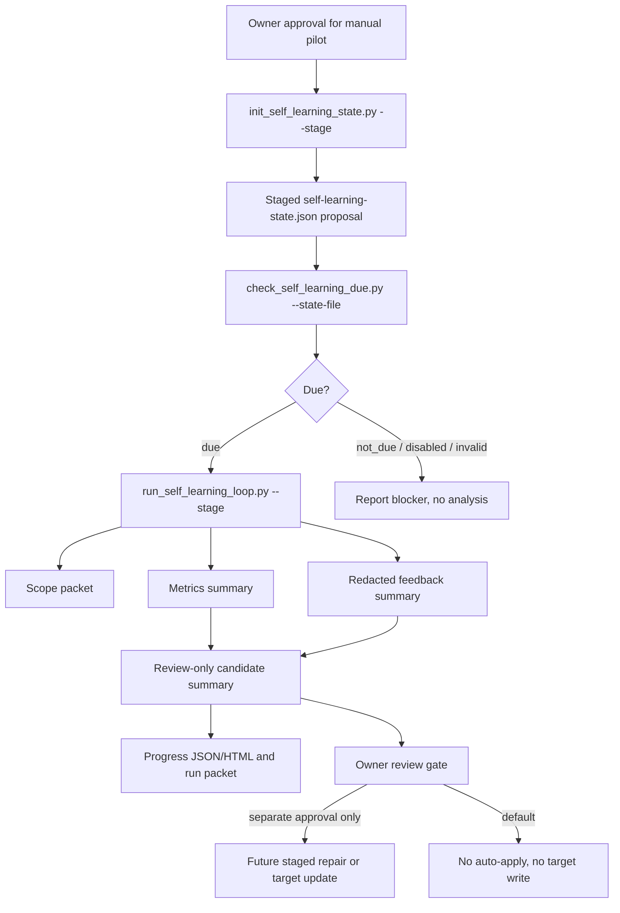
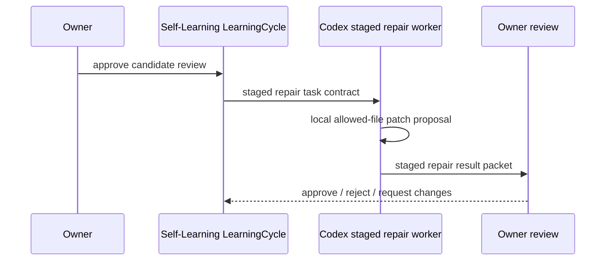

# Self-Learning Loop

Source status: `official + experiment`

`Self-Learning Loop` is the manual-first Product-Agent OS improvement loop for local evidence, redacted owner feedback, metrics ledgers and review-only candidates. It is not an autonomous learning system. The default path does not call providers or models, create Codex App automations, enable hooks, write to target workspaces or apply candidates automatically.

## Quickstart

Create a staged state proposal outside the target workspace:

```powershell
python plugins\product-agent-os\scripts\init_self_learning_state.py . --stage <stage-dir-outside-workspace> --installed-at 2026-06-01T00:00:00Z
```

Check due status without writing state:

```powershell
python plugins\product-agent-os\scripts\check_self_learning_due.py . --dry-run --state-file <stage-dir-outside-workspace>\.codex\product-agent-os\self-learning-state.json
```

Run the manual loop as staged evidence:

```powershell
python plugins\product-agent-os\scripts\run_self_learning_loop.py . --stage <stage-dir-outside-workspace> --state-file <state-file> --metrics-ledger <redacted-metrics.jsonl> --feedback-ledger <redacted-feedback.jsonl>
```

Export optional Promptfoo and HALO-style review packets without running a provider:

```powershell
python plugins\product-agent-os\scripts\export_self_learning_promptfoo.py . --stage <stage-dir-outside-workspace>
```

## Architecture



## State And Status

The proposed state path is `.codex/product-agent-os/self-learning-state.json`, with schema `self_learning_state_v1`. The initializer stages this file and reports `state_written: false`; a workspace write remains a separate owner-approved action.

| Status | Meaning | Safe next action |
| --- | --- | --- |
| `state_invalid` | State is missing, malformed or schema-invalid. | Stage a state initializer packet; do not write state without approval. |
| `disabled` | The owner disabled the loop or cadence. | Record the blocker; the owner must change state explicitly. |
| `not_due` | State is valid but cadence is not due. | Do not apply anything; keep the due packet if useful. |
| `due` | Manual run is available. | Run `--dry-run` or `--stage`. |
| `ready_for_owner_review` | Evidence packet is generated; candidates remain review-only. | Owner review; apply/provider/automation requires new approval. |

## Inputs And Outputs

Allowed inputs are Product-Agent OS scope packets, explicit state files, redacted owner feedback JSONL, metrics JSONL with synthetic or redacted privacy status, checked-in docs, plans, eval summaries and accepted gaps. Raw chat logs, raw transcripts, private payloads, secrets, credentials, unredacted PII, hidden telemetry and provider output without approval are forbidden.

Key staged outputs:

| Artifact | Role | Boundary |
| --- | --- | --- |
| `.codex/product-agent-os/self-learning-state.json` | Proposed initial state. | Stage-only until owner approval. |
| `.codex/product-agent-os/self-learning/state-initializer-packet.json` | Scope, proposed state and validation packet. | No schedule, provider or target write. |
| `.codex/product-agent-os/self-learning/runs/<run_id>/self-learning-run-packet.json` | Manual run evidence packet. | Candidate-only; no auto-apply. |
| `.codex/product-agent-os/self-learning/evals/eval-cases.json` | Durable eval cases. | Synthetic/redacted; no Promptfoo run claim. |
| `.codex/product-agent-os/self-learning/evals/failure-taxonomy.json` | Failure routing taxonomy. | Routing evidence, not incident completeness. |
| `.codex/product-agent-os/self-learning/evals/promptfooconfig.yaml` | Optional Promptfoo-compatible config. | Provider run requires separate approval. |
| `.codex/product-agent-os/self-learning/evals/halo-recommendation-packet.json` | HALO-style recommendation packet. | Local recommendation only; no HALO service call. |

## Eval And Repair Layer

The current failure taxonomy covers state/scope blockers, missing evidence before completion, wrong skill or surface selection, unsafe approval boundary crossing, stale docs or registry, weak evals, raw private context risk, missing rollback and staged repair validation failures.

Promptfoo integration is export-only by default. The adapter writes prompts, tests and assertions but does not execute a provider. HALO-style packets translate eval cases into recommendations with hypothesis, recommended action, learning objective, expected metric delta, guardrails and rollback.

`self_learning_repair.py` defines a Codex staged repair worker contract without auto-apply. The task contract names candidate id, objective, allowed files, forbidden files, validation commands, rollback target and privacy boundary; the result packet names changed files, validation results, summary and unsupported claims. Validators block absolute paths, private refs, out-of-allowlist changes, `auto_apply`, provider calls and target workspace writes.



## B44-S7 Evidence

`B44-S7-SELF-LEARNING-MANUAL-PILOT-A01` is recorded in `docs/superpowers/specs/batch44-self-learning-loop-approved-manual-pilot-summary.json`. It shows that the state initializer reached `ready_for_owner_review`, the runner used `state_source: explicit_state_file`, one redacted feedback row and one metrics row were consumed, two review-only candidates were produced, the Promptfoo export produced 8 eval cases, the taxonomy has 9 failure classes and the HALO-style packet has 6 local recommendations.

Accepted gaps: this is one manual pilot, not promotion evidence; Promptfoo was exported but not executed; the HALO-style packet was generated locally, without a HALO service call; generated HTML and reports remain review evidence.

## Verification

Focused checks:

```powershell
python -m unittest tests.product_agent_os.test_self_learning_extensions -v
python -m unittest tests.product_agent_os.test_self_learning_state -v
```

Docs/control-plane checks:

```powershell
python -m unittest tests.product_agent_os.test_product_agent_os_docs -v
python tools\check_docs.py
git diff --check
```
## Execution-loop diagnostics

The manual loop also measures time to first target diff, agent count, review/repair cycles, unchanged command repeats, control-plane writes before acceptance, target/test churn, compaction, stale lifecycle markers, mixed skill sources and projection conflicts. A budget breach produces `intervention_required` and a stop-or-narrow recommendation; it never edits prompts, skills, config, hooks or automation automatically. Missing records mean `insufficient_evidence`, not a successful run.
