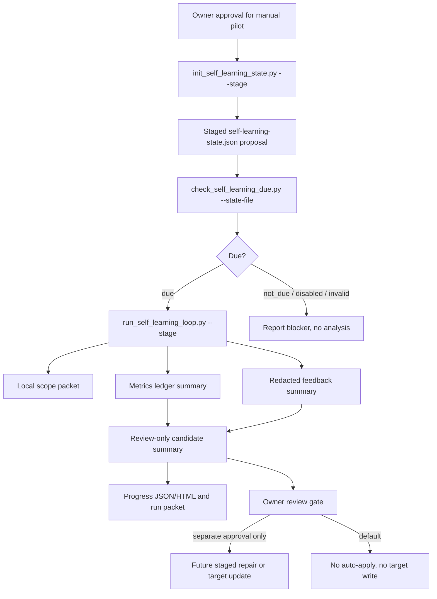
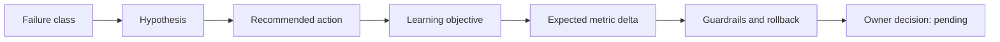
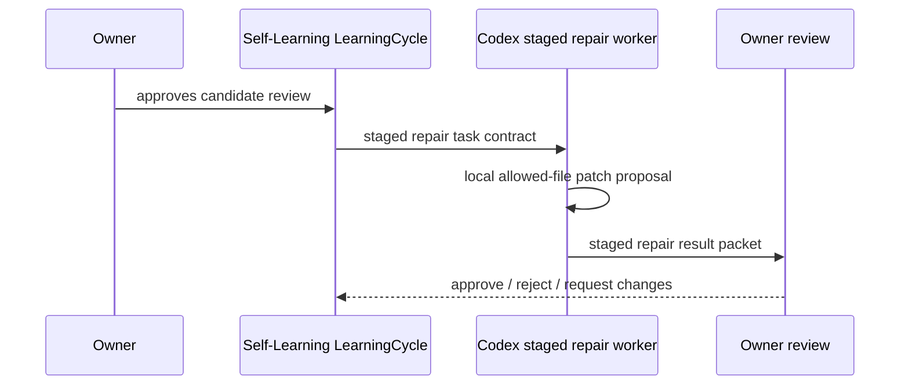

# Self-Learning Loop

Source status: `official + experiment`

Пустой ledger, полностью rejected записи и ноль допустимых owner labels дают `promotion_signal: insufficient_evidence`. `owner_feedback_rows`/`rejected_rows` описывают валидность входа, `denominator`/`human_label_count` — покрытие labels, `owner_sentiment` — только тональность явных owner labels. `owner_label_supported` не означает положительную оценку: отрицательные и mixed labels сохраняются. Автоматического promotion нет.

`Self-Learning Loop` - это ручной контур улучшения `Product-Agent OS` по локальным доказательствам, очищенной обратной связи владельца, журналу метрик и кандидатам на изменение. Он не является автономной системой обучения: режим `default` не запускает вызовы `provider` / `model` / `API`, не создает `Codex App automations`, не включает `hooks`, не пишет в целевой рабочий каталог и не применяет кандидатов автоматически.

Главная цель контура - превращать повторяющиеся сбои и обратную связь владельца в ограниченные артефакты: состояние, проверку срока запуска, отчет о ходе, eval cases, таксономию сбоев, staged repair task и recommendation packets для ревью владельца.

## Быстрый Старт

Первый запуск больше не должен упираться в `state_file:missing`. Создайте предложение состояния вне целевого рабочего каталога:

```powershell
python plugins\product-agent-os\scripts\init_self_learning_state.py . --stage <stage-dir-outside-workspace> --installed-at 2026-06-01T00:00:00Z
```

Проверьте срок запуска без записи в рабочий каталог:

```powershell
python plugins\product-agent-os\scripts\check_self_learning_due.py . --dry-run --state-file <stage-dir-outside-workspace>\.codex\product-agent-os\self-learning-state.json
```

Запустите ручной контур как staged evidence:

```powershell
python plugins\product-agent-os\scripts\run_self_learning_loop.py . --stage <stage-dir-outside-workspace> --state-file <state-file> --metrics-ledger <redacted-metrics.jsonl> --feedback-ledger <redacted-feedback.jsonl>
```

Экспортируйте необязательные review packets для `Promptfoo` и `HALO` без запуска поставщика:

```powershell
python plugins\product-agent-os\scripts\export_self_learning_promptfoo.py . --stage <stage-dir-outside-workspace>
```

Все команды выше локальные и staged. Каталог `--stage` должен быть вне целевого рабочего каталога; результат является предложением и доказательством, а не примененным состоянием.

## Архитектура



## Модель Состояния

Целевой файл состояния:

```text
.codex/product-agent-os/self-learning-state.json
```

Схема: `self_learning_state_v1`.

| Поле | Смысл |
| --- | --- |
| `installed_at` | Базовая дата для ручной или недельной проверки срока запуска. |
| `last_analysis_at` / `last_success_at` / `last_failure_at` | История запусков; initializer оставляет их `null`. |
| `next_due_at` | Явное переопределение следующего запуска, если оно задано. |
| `cadence_level` | `manual_only`, `weekly`, `on_change`, `disabled`. |
| `approval_state` | `manual_only`, `candidate_only`, `approval_required`, `disabled`. |
| `last_metrics_digest` / `last_report_id` | Связка с последним принятым доказательством. |

Initializer создает только предложение состояния как staged artifact. Запись в рабочий каталог остается отдельным действием с approval владельца; сам initializer сообщает `state_written: false`.

## Статусы

| Статус | Где появляется | Смысл | Безопасное следующее действие |
| --- | --- | --- | --- |
| `state_invalid` | due-check | State отсутствует, поврежден или не проходит проверку схемы. | Запустить `init_self_learning_state.py --stage`; не писать state без approval. |
| `disabled` | due-check / runner | Владелец выключил контур или cadence равен `disabled`. | Зафиксировать blocker; владелец явно меняет state. |
| `not_due` | due-check | State валиден, но cadence еще не требует запуска. | Ничего не применять; можно сохранить due packet. |
| `due` | due-check | Ручной запуск доступен. | Запустить runner в `--dry-run` или `--stage`. |
| `blocked` | initializer / runner / export | Scope, state, stage или проверка контракта не прошли. | Исправить конкретный blocker; не заявлять readiness. |
| `ready_for_owner_review` | runner / export | Evidence packet сформирован; candidates остаются review-only. | Owner review; любое применение, автоматизация или provider run требуют нового approval. |

## Входы

Разрешенные входы:

- локальный scope packet для `Product-Agent OS`;
- `self_learning_state_v1` из рабочего каталога или явный staged `--state-file`;
- очищенный owner feedback JSONL с `redaction_status: redacted`;
- metrics JSONL с `privacy_status: synthetic_only` или `redacted_summary_only`;
- checked-in docs, plans, eval summaries и accepted gaps.

Запрещенные входы:

- raw chat logs, raw transcripts, private payloads, secrets, credentials, unredacted PII;
- hidden app telemetry;
- generated dashboard/report как единственный источник истины;
- provider/model output без отдельного approval и eval packet.

## Выходы

| Артефакт | Создатель | Роль | Граница |
| --- | --- | --- | --- |
| `.codex/product-agent-os/self-learning-state.json` | `init_self_learning_state.py --stage` | Предложенное начальное состояние. | Только stage до approval владельца на запись. |
| `.codex/product-agent-os/self-learning/state-initializer-packet.json` | `init_self_learning_state.py --stage` | Scope, proposed state, validation и approval boundary. | Без schedule, provider и target write. |
| `.codex/product-agent-os/self-learning/progress.jsonl` | `run_self_learning_loop.py --stage` | События фаз: scope, due, evidence, metrics, feedback, candidates, owner review. | Сгенерированное доказательство, не proof completion. |
| `.codex/product-agent-os/self-learning/runs/<run_id>/self-learning-run-packet.json` | `run_self_learning_loop.py --stage` | Полный run packet со сроком запуска, summaries, unsupported claims и candidate summary. | Candidate-only; auto-apply disabled. |
| `.codex/product-agent-os/self-learning/evals/eval-cases.json` | `export_self_learning_promptfoo.py --stage` | Долговечные eval cases для маршрутизации сбоев. | Synthetic/redacted; без claim запуска `Promptfoo`. |
| `.codex/product-agent-os/self-learning/evals/failure-taxonomy.json` | `export_self_learning_promptfoo.py --stage` | Таксономия сбоев для evals и recommendations. | Таксономия является routing evidence, не proof всех сбоев. |
| `.codex/product-agent-os/self-learning/evals/promptfooconfig.yaml` | `export_self_learning_promptfoo.py --stage` | Необязательный config, совместимый с `Promptfoo`. | Provider run требует отдельного approval. |
| `.codex/product-agent-os/self-learning/evals/halo-recommendation-packet.json` | `export_self_learning_promptfoo.py --stage` | Recommendation packet в стиле `HALO`. | Только локальная рекомендация; без вызова сервиса `HALO`. |

## Таксономия Сбоев

Текущая таксономия группирует повторяющиеся сбои в такие классы:

- `state_or_scope_blocker`: отсутствующее состояние, невалидное состояние, выключенный cadence или out-of-scope workspace.
- `missing_evidence_before_completion`: claim ready/fixed/complete/release без текущего доказательства.
- `wrong_skill_or_surface_not_invoked`: matching skill/plugin/runtime surface не был вызван.
- `unsafe_tool_or_approval_boundary`: нарушена граница provider, hook, automation, GitHub/release или target write.
- `stale_docs_or_source_registry`: docs, registry, plan, tests или evals расходятся с поведением.
- `weak_eval_or_no_baseline`: нет baseline, rerun, holdout или false-pass audit.
- `raw_private_context_risk`: private raw content, absolute path или PII попали в артефакт.
- `candidate_without_rollback`: candidate не содержит rollback, tests, evidence refs или owner review.
- `repair_validation_failure`: staged repair изменил файл вне allowlist или не имеет validation evidence.

## Адаптер `Promptfoo`

Интеграция `Promptfoo` по умолчанию является только export. Adapter формирует:

- prompt text;
- `tests` из eval cases контура;
- assertions `contains` / `not-contains` для expected route и запрета `auto_apply_enabled`;
- отсутствие выполненных provider results.

`provider_calls` остается `not_performed`. Запуск `Promptfoo` против LLM provider является отдельным approval-bound eval slice с baseline, cost/latency, privacy и решением о хранении отчета.

## Пакет В Стиле `HALO`

Пакет в стиле `HALO` переводит eval cases и классы сбоев в записи рекомендаций:



Пакет не вызывает сервис `HALO` и не утверждает рекомендацию. Его продуктовая ценность - приоритизация: почему сбой важен, какой артефакт улучшать, какая метрика должна измениться и какие guardrails остаются обязательными.

## Контракт `Staged Repair Worker`

`self_learning_repair.py` задает контракт `Codex staged repair worker` без `auto-apply`:

- task contract: candidate id, objective, allowed files, forbidden files, change surface, expected behavior, validation commands, rollback target и privacy boundary;
- result packet: changed files, validation results, summary, unsupported claims и owner-review gate;
- validators блокируют absolute paths, private refs, out-of-allowlist changes, `auto_apply`, provider calls и target workspace writes.

Рекомендуемый поток:



Repair contract может помочь будущему implementation slice, но сам никогда не сливает и не применяет изменения.

## Доказательства `B44-S7`

Текущее доказательство approved manual pilot:

- evidence packet: `docs/superpowers/specs/batch44-self-learning-loop-approved-manual-pilot-summary.json`;
- redacted feedback input: `docs/superpowers/specs/batch44-self-learning-loop-approved-manual-pilot-feedback.jsonl`;
- metrics input: `docs/superpowers/specs/batch44-self-learning-loop-approved-manual-pilot-metrics.jsonl`.

Результаты, записанные в packet:

- initializer достиг `ready_for_owner_review`;
- runner достиг `ready_for_owner_review`;
- due-check использовал `state_source: explicit_state_file`;
- feedback rows: `1`;
- metrics rows: `1`;
- candidate count: `2`;
- Promptfoo eval case count: `8`;
- failure class count: `9`;
- HALO-style recommendation count: `6`;
- provider/model/API calls, browser automation, target workspace mutation, git, release, deploy, publish и active automation не выполнялись.

Принятые gaps:

- один manual pilot, без promotion denominator;
- Promptfoo export создан, Promptfoo не запускался;
- HALO-style packet создан локально, сервис HALO не вызывался;
- generated HTML/report остается review evidence.

## Проверка

Focused checks:

```powershell
python -m unittest tests.product_agent_os.test_self_learning_extensions -v
python -m unittest tests.product_agent_os.test_self_learning_state -v
```

Docs/control-plane checks после изменения этой страницы или registry:

```powershell
python -m unittest tests.product_agent_os.test_product_agent_os_docs -v
python tools\check_docs.py
git diff --check
```

Используйте strict MkDocs, когда меняются navigation, Mermaid, Markdown extensions, generated `site` evidence или MkDocs config.

## Типовые Сбои

- Staged state ошибочно считается applied state.
- Generated HTML ошибочно считается proof качества или completion.
- Raw owner sessions импортируются вместо redacted summaries.
- Promptfoo/provider/HALO запускаются через export adapter без explicit approval.
- Candidate продвигается после одного manual pilot без baseline и holdout.
- Active schedules или auto-apply создаются только потому, что есть cadence recommendation.
- Docs readiness заявляется без текущих docs checks.

## Следующее Действие

Используйте эту страницу, когда `Self-Learning Loop` должен восстановиться после отсутствующего state, упаковать redacted feedback, экспортировать eval cases или передать candidate в staged repair. Следующий безопасный артефакт после `ready_for_owner_review` - решение владельца: approve bounded staged repair, request more evidence или record a no-op.
## Диагностика execution-loop

Ручной контур дополнительно измеряет время до первого target diff, число агентов, review/repair cycles, повторы неизменившихся команд, записи control plane до acceptance, target/test churn, compaction, stale lifecycle marker, смешивание skill sources и projection conflicts. Превышение бюджета формирует `intervention_required` и рекомендацию остановить или сузить slice; оно не меняет prompts, skills, config, hooks или automation автоматически. Отсутствующие записи означают `insufficient_evidence`, а не успешный run.
