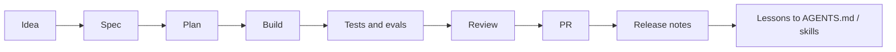

# Product-Agent Workflows

Source status: `official + experiment`  
Sources: [How OpenAI uses Codex](https://openai.com/business/guides-and-resources/how-openai-uses-codex/), [Codex best practices](https://developers.openai.com/codex/learn/best-practices), [A practical guide to building agents](https://openai.com/business/guides-and-resources/a-practical-guide-to-building-ai-agents/), [Agent Skills](https://developers.openai.com/codex/skills#create-a-skill), [AGENTS.md](https://developers.openai.com/codex/guides/agents-md).

## What this layer adds

Earlier sections explain Codex, prompts, context, memory and agents. Product-Agent Workflows connect them into an operating system for product development:

- `AGENTS.md` stores durable repository rules;
- control-plane files record requirements, plan, checks and run log;
- skills turn repeated methods into reusable workflows;
- subagents and Agents SDK help split bounded work;
- eval loops and PR checks prove quality;
- runtime tools run the workflow in Codex App, CLI, cloud, GitHub or automation.

## Main idea

A real product should not be built through one long prompt. Treat it as a controlled delivery loop:

## When Codex is enough, and when agents and skills are needed

| Situation | Sufficient level |
| --- | --- |
| One-off edit with a clear diff | Codex App / CLI |
| Repeated procedure | Skill |
| Background recurring check | Automation |
| Complex feature with several roles | Product-Agent Workflow |
| Programmable orchestration | Agents SDK + Codex MCP |
| Product improvement loop | Evals + RUNLOG + artifact inspection |

## Product-Agent OS plugin

To package this operating model as a portable Codex plugin, use [Product-Agent OS plugin](../product-agent-os/index.md). That section describes the plugin purpose, current capabilities, installation boundary, Codex-only runtime runner, guardrails and diagram-level operating principles.

## Definition of ready

Before starting a product-agent workflow, the project should have:

- a clear goal and non-goals;
- selected runtime: Codex App, CLI, cloud, `codex exec`, MCP or GitHub Action;
- control-plane files;
- test/eval commands;
- ownership for files or subsystems;
- policy for sandbox, approvals, secrets and network;
- a stop condition.

## Inputs

- Product intent, constraints, source docs and current project rules.
- A chosen Codex runtime surface and approval policy.

## Outputs

- A controlled delivery loop from idea to reviewable product artifact.
- Candidate skills, evals or automation only after manual success evidence exists.

## Verification

Use control-plane files, current checks, evals and review findings before claiming readiness.

## Risks

- One long prompt can hide missing requirements, approvals and verification evidence.
- Automation before manual stability can repeat failures at scale.
