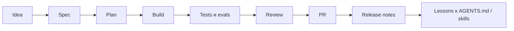

# Product-Agent Workflows

Source status: `official + experiment`  
Источники: [How OpenAI uses Codex](https://openai.com/business/guides-and-resources/how-openai-uses-codex/), [Codex best practices](https://developers.openai.com/codex/learn/best-practices), [A practical guide to building agents](https://openai.com/business/guides-and-resources/a-practical-guide-to-building-ai-agents/), [Agent Skills](https://developers.openai.com/codex/skills#create-a-skill), [AGENTS.md](https://developers.openai.com/codex/guides/agents-md).

## Что добавляет этот слой

Предыдущие разделы объясняют Codex, prompts, context, memory и agents. Product-Agent Workflows соединяет их в операционную систему разработки продукта:

- `AGENTS.md` задает постоянные правила репозитория;
- control-plane files фиксируют требования, план, проверки и запуск log;
- skills превращают повторяемые методы в reusable workflows;
- subagents и Agents SDK помогают распределять bounded work;
- eval loops и PR checks доказывают качество;
- runtime tools запускают это в Codex App, CLI, cloud, GitHub или automation.

## Главная идея

Полноценный продукт не стоит строить одним длинным prompt. Его нужно вести как управляемый delivery loop:

## Когда достаточно Codex, а когда нужны agents и skills

| Ситуация | Достаточный уровень |
| --- | --- |
| Разовая правка с понятным diff | Codex App / CLI |
| Повторяемая процедура | Skill |
| Фоновая регулярная проверка | Automation |
| Сложная фича с несколькими ролями | Product-Agent Workflow |
| Программируемая оркестрация | Agents SDK + Codex MCP |
| Продуктовый improvement loop | Evals + RUNLOG + artifact inspection |

## Product-Agent OS plugin

Для упаковки этого operating model в переносимый Codex plugin используйте [Product-Agent OS plugin](../product-agent-os/index.md). Новый раздел описывает назначение плагина, текущие capabilities, installation boundary, Codex-only runtime runner, guardrails и diagram-level принципы работы.

## Критерии готовности

Перед запуском product-agent workflow должны быть:

- понятная цель и non-goals;
- выбранный runtime: Codex App, CLI, cloud, `codex exec`, MCP или GitHub Action;
- control-plane files;
- test/eval commands;
- ownership файлов или подсистем;
- policy для sandbox, approvals, secrets и network;
- критерий остановки.

## Выбрать размер workflow

[Lifecycle](lifecycle.md) разделяет ordinary и full scopes. Начинайте с одного агента и существующих artifacts; добавляйте координацию по независимому ownership и риску. Локальный пакет помогает подготовить результат, но не доказывает autonomous hosted delivery.
