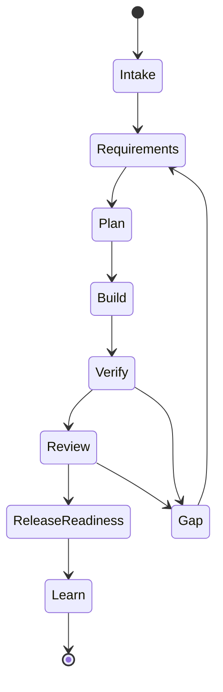

# Specification: Product-Agent OS plugin

Source status: `official + experiment`  
Sources: [Codex plugins](https://developers.openai.com/codex/plugins), [Build plugins](https://developers.openai.com/codex/plugins/build), [Agent Skills](https://developers.openai.com/codex/skills), [Subagents](https://developers.openai.com/codex/subagents), [Codex MCP](https://developers.openai.com/codex/mcp), [Codex hooks](https://developers.openai.com/codex/hooks), [AGENTS.md](https://developers.openai.com/codex/guides/agents-md), [Codex with Agents SDK](https://developers.openai.com/codex/guides/agents-sdk), [Product-Agent Workflows](overview.md), [Product-Agent OS](../product-agent-os/index.md).

## Purpose

Product-Agent OS is a portable Codex plugin that packages a product delivery operating model: control-plane artifacts, lifecycle skills, staged infrastructure templates, methodology routing, evals and compatibility checks. It helps a Codex worker move from user intent to verifiable product output without hiding approvals, live actions or source boundaries.

## Non-goals

The plugin does not publish itself, install dependencies, start live servers, activate hooks, create schedules, call providers, mutate production data, change hosted docs, stage/commit/push/open PRs or certify legal/security/compliance readiness. Those actions require explicit owner approval and current evidence.

## Target users

- Product engineers using Codex App, CLI or IDE extension for real projects.
- Teams that need repeatable product-agent workflows and handoff artifacts.
- Docs and release maintainers who need source-backed claims and verification evidence.
- Operators who want staged proposals before enabling live systems or automations.

## Supported surfaces

| Surface | Use |
| --- | --- |
| Codex App | Ambiguity resolution, steering, review and local workspace work. |
| CLI | Deterministic checks, renderers, validators and staged artifact generation. |
| IDE extension | Navigation, implementation support and review context. |
| skills | Repeatable methods with inputs, outputs, verification and failure modes. |
| subagents | Specialized or parallel work when ownership is clear. |
| MCP | Declared integration context with approval boundaries. |
| Agents SDK | Optional product/runtime architecture when explicitly selected. |

## Plugin package

The plugin package should include:

- `.codex-plugin/plugin.json`;
- lifecycle skills;
- artifact templates;
- staged infrastructure renderer;
- eval fixtures and transcript sessions;
- validation scripts;
- documentation and source-boundary notes;
- compatibility checks for Codex surfaces.

The manifest describes capabilities. It is not publication approval, external-system access or proof that runtime actions are safe.

## Lifecycle state machine

Product-Agent OS follows a conservative lifecycle:



Each transition needs source context, expected evidence, approval boundary, stop condition and either current verification or an accepted gap.

## Complexity profiles

| Profile | Use when | Expected path |
| --- | --- | --- |
| Lightweight | Mechanical, docs-only or low-risk work. | Focused edit, source labels, docs check or explicit inspection-only gap. |
| Standard | Bounded feature or review with known ownership. | Requirements, plan, implementation, focused verification and handoff. |
| High-risk | Public contracts, data, security, release, AI behavior, migrations or production systems. | Domain packet, owner review, stronger verification, rollback and approval gates. |
| Cross-domain | Several domains overlap or recommendations conflict. | Methodology synthesis, owner/consumer domains and risk-ordered safe next action. |

## Initialization behavior

Initialization should inspect the workspace read-only, discover existing control-plane files and source constraints, then stage missing artifacts only when requested or approved. It must preserve user-authored files and avoid broad scaffolding before the route is accepted.

## Usage-mode implementation status

The plugin supports route decisions for first-run intake, bug rescue, greenfield idea, complex system acceleration, PR review, legacy onboarding, API migration, AI/RAG eval regression, native/mobile work, desktop local-first work, data migration, security-sensitive change, CI stabilization, release packaging, docs-only work, standard feature work and maintenance.

## Generated project files

Generated files are proposals or managed artifacts. Typical outputs include `REQUIREMENTS.md`, `PLAN.md`, `TEST.md`, `EVALS.md`, `RUNLOG.md`, ADRs, architecture overview, component cards, API contract reviews, database dictionaries, release readiness notes, operations runbooks, eval reports and approval records.

## System file update policy

`AGENTS.md`, `.codex/config.toml`, hooks, workflows and automation files are sensitive. Existing unmarked files are user-authored content. The plugin should stage companion proposals unless a managed section and approved merge path exist.

## Context and information overflow policy

Context should be source-backed and bounded. Use summaries, route packets and handoffs instead of dumping entire histories. Memory and chat recall are useful context, not source of truth. Raw private chats, secrets, credentials and customer data must not be stored in prompts, docs, fixtures or templates.

## Skills

Skills should each do one job. A Product-Agent OS skill needs:

- trigger;
- inputs;
- outputs;
- source constraints;
- approval boundary;
- verification commands;
- failure modes;
- stop conditions.

Skills may recommend or stage actions. They cannot grant external permission or override stronger instructions.

## Agent team

Agent teams are designed around ownership, handoff artifacts, verification and stop conditions. Roles such as Product Manager, Architect, Builder, Tester, Reviewer, Docs Maintainer and Release Operator are useful only when their file/subsystem boundaries and expected evidence are explicit.

Subagents are appropriate when work is independent. Parallel work without ownership split increases risk and should fall back to sequential execution.

## Handoff contracts

Every handoff should include:

- sources/context used;
- assumptions;
- files touched or proposed;
- ownership and forbidden files;
- verification evidence;
- open risks;
- recommended next role or stop reason.

Fresh-context handoffs are required when a new worker or subagent starts from a packet rather than the full thread.

## Safety and approvals

The approval boundary is strict:

- external writes require approval;
- live provider/model/API calls require approval;
- browser automation and local runtime launch require approval when the current route forbids them;
- hosted docs, production DB/data access and security-system mutations require approval;
- hooks and automations are staged/inactive until approved;
- git staging, commit, push and PR creation remain explicit actions.

Approvals are specific. Approval for one surface does not grant another.

## Hooks and rules

Packaged hooks are examples or staged target-project assets. The plugin must not activate hooks at plugin root or in a target project without explicit approval. Durable rules belong in `AGENTS.md`; transient run details belong in `RUNLOG.md`.

## Runtime selection

Choose runtime by the job:

- Codex App or IDE extension for ambiguous work, steering and review;
- CLI for local deterministic checks and renderers;
- `codex exec` for stable non-interactive jobs;
- GitHub Action for PR/CI workflows when approved;
- MCP or Agents SDK for programmable orchestration when the contract is clear;
- automation only after a stable manual workflow or skill exists.

## Context7 and source policy

Official OpenAI and Codex documentation are the source of truth for OpenAI behavior. Project-authored behavior can cite repository artifacts, tests and source packets. Community claims must stay under `docs/insights/` with trust and verification labels until verified.

## Evals and verification

The plugin should keep deterministic verification close to the behavior being changed:

```powershell
python tools\check_docs.py
python plugins\product-agent-os\scripts\run_fixture_eval.py
python plugins\product-agent-os\scripts\validate_codex_compatibility.py
```

Use the full unit suite when scripts, templates, fixtures or lifecycle behavior change:

```powershell
python -m unittest discover -s tests -p "test_*.py" -v
```

Use transcript evals for multi-turn shortcut resistance and privacy/no-secrets checks.

## Automation promotion

Promotion order is manual workflow, playbook, skill, plugin, automation. Automation candidates need manual success evidence, stable inputs/outputs, owner, cadence, verification, failure modes, value evidence and rollback/disable path. Product-Agent OS can stage an automation candidate; it must not create active automation without explicit approval.

## Optional Agents SDK runner

Agents SDK can be used for a product/runtime app architecture when explicitly selected. It is not the hidden runtime layer for the plugin and should not bypass Codex sandbox, approvals, source policy or package compatibility boundaries.

## Failure modes

- Generated dashboards or graph views are treated as source of truth.
- A skill expands work instead of preserving the route boundary.
- Subagents receive incomplete context or overlapping ownership.
- Compatibility checks are interpreted as live readiness.
- Automation is created before manual stability evidence exists.
- A source-backed claim is added without `Source status:` and registry support.
- A live or external action is bundled into unrelated approval.

## Acceptance criteria

Product-Agent OS is acceptable when:

- package metadata is valid for Codex;
- skills have clear triggers, inputs, outputs, verification and failure modes;
- generated infrastructure is staged-first;
- control-plane files preserve source boundaries and evidence;
- evals catch shortcut behavior and false-positive routing;
- docs include `Source status:`;
- compatibility checks do not require provider calls or hidden external runtimes;
- approval-bound actions stay disabled until explicitly approved.

## Product capability areas

The product capability areas are:

- lifecycle routing and control-plane artifacts;
- staged infrastructure and safe merge planning;
- methodology intelligence and engineering standards;
- behavioral and transcript evals;
- Codex compatibility checks;
- graph/cockpit orientation;
- release, packaging and closure evidence;
- approval-bound real testing;
- skill, plugin and automation promotion.

Next artifact: use [Product-Agent OS architecture](../product-agent-os/architecture.md) for the system model and [Technical features and installation](../product-agent-os/technical.md) for operator commands.

## Inputs

- Codex plugin package metadata, skills, templates, eval fixtures and docs.
- Owner approval records and current verification evidence for risky surfaces.

## Outputs

- A portable Product-Agent OS plugin contract with lifecycle routing, staged artifacts and compatibility checks.
- Reviewable boundaries for skills, subagents, MCP, hooks, automation and optional Agents SDK use.

## Verification

Validate plugin metadata, docs structure, fixture evals and Codex compatibility before release claims.

## Risks

- Compatibility checks are not publication approval.
- Bundling live actions into the plugin contract can bypass the explicit approval model.
