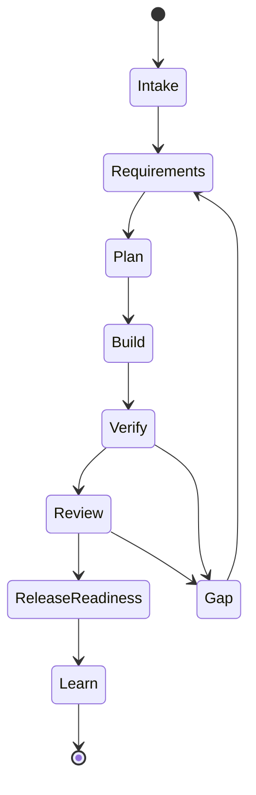

# Спецификация: Product-Agent OS plugin

Source status: `official + experiment`  
Источники: [Codex plugins](https://developers.openai.com/codex/plugins), [Build plugins](https://developers.openai.com/codex/plugins/build), [Agent Skills](https://developers.openai.com/codex/skills), [Subagents](https://developers.openai.com/codex/subagents), [Codex MCP](https://developers.openai.com/codex/mcp), [Codex hooks](https://developers.openai.com/codex/hooks), [AGENTS.md](https://developers.openai.com/codex/guides/agents-md), [Codex with Agents SDK](https://developers.openai.com/codex/guides/agents-sdk), [Product-Agent workflows](overview.md), [Product-Agent OS](../product-agent-os/index.md).

## Назначение

Product-Agent OS - это переносимый Codex plugin, который упаковывает операционную модель продуктовой разработки: control-plane artifacts, lifecycle skills, staged infrastructure templates, methodology routing, evals и compatibility checks. Он помогает Codex worker перейти от пользовательского намерения к проверяемому продукту без скрытых approvals, live actions или размытых source boundaries.

## Не входит в назначение

Plugin не публикует себя, не устанавливает dependencies, не запускает live servers, не активирует hooks, не создает schedules, не вызывает providers, не меняет production data, не меняет hosted docs, не выполняет stage/commit/push/open PR и не сертифицирует legal, security или compliance готовность. Эти действия требуют явного owner approval и текущих evidence.

## Целевые пользователи

- Product engineers, которые используют Codex App, CLI или IDE extension для реальных проектов.
- Команды, которым нужны повторяемые product-agent workflows и handoff artifacts.
- Docs и release maintainers, которым нужны source-backed claims и verification evidence.
- Operators, которые хотят staged proposals перед включением live systems или automations.

## Поддерживаемые поверхности

| Поверхность | Использование |
| --- | --- |
| Codex App | Разбор неоднозначности, steering, review и локальная работа в workspace. |
| CLI | Детерминированные checks, renderers, validators и staged artifact generation. |
| IDE extension | Работа с repo files и review context; native plugin installation не поддерживается. |
| skills | Повторяемые методы с inputs, outputs, verification и failure modes. |
| subagents | Специализированная или параллельная работа при явном ownership. |
| MCP | Объявленный integration context с approval boundaries. |
| Agents SDK | Опциональная product/runtime architecture, когда она явно выбрана. |

## Пакет plugin

Пакет plugin должен включать:

- `.codex-plugin/plugin.json`;
- lifecycle skills;
- artifact templates;
- staged infrastructure renderer;
- eval fixtures и transcript sessions;
- validation scripts;
- documentation и source-boundary notes;
- compatibility checks для Codex surfaces.

Manifest описывает capabilities. Он не является publication approval, external-system access или доказательством безопасности runtime actions.

## Машина состояний lifecycle

Product-Agent OS использует консервативный lifecycle:



Каждый transition требует source context, expected evidence, approval boundary, stop condition и текущую verification либо явно принятый gap.

## Профили сложности

| Профиль | Когда применять | Ожидаемый путь |
| --- | --- | --- |
| Lightweight | Механическая, docs-only или низкорисковая работа. | Сфокусированная правка, source labels, docs check или явно записанный inspection-only gap. |
| Standard | Ограниченная feature или review с понятным ownership. | Requirements, plan, implementation, focused verification и handoff. |
| High-risk | Public contracts, data, security, release, AI behavior, migrations или production systems. | Domain packet, owner review, усиленная verification, rollback и approval gates. |
| Cross-domain | Несколько domains пересекаются или рекомендации конфликтуют. | Methodology synthesis, owner/consumer domains и risk-ordered safe следующий action. |

## Поведение при initialization

Initialization должна read-only проверить workspace, обнаружить существующие control-plane files и source constraints, а затем stage missing artifacts только по запросу или approval. Она сохраняет user-authored files и избегает широкого scaffolding до принятия route.

## Статус usage modes

Plugin поддерживает route decisions для first-run intake, bug rescue, greenfield idea, complex system acceleration, PR review, legacy onboarding, API migration, AI/RAG eval regression, native/mobile work, desktop local-first work, data migration, security-sensitive change, CI stabilization, release packaging, docs-only work, standard feature work и maintenance.

## Генерируемые файлы проекта

Generated files являются proposals или managed artifacts. Типичные outputs: `REQUIREMENTS.md`, `PLAN.md`, `TEST.md`, `EVALS.md`, `RUNLOG.md`, ADRs, architecture overview, component cards, API contract reviews, database dictionaries, release readiness notes, operations runbooks, eval reports и approval records.

## Политика обновления системных файлов

`AGENTS.md`, `.codex/config.toml`, hooks, workflows и automation files являются чувствительными. Существующие unmarked files считаются user-authored content. Plugin должен stage companion proposals, если нет managed section и approved merge path.

## Политика context и information overflow

Context должен быть source-backed и bounded. Используйте summaries, route packets и handoffs вместо полного переноса истории. Memory и chat recall полезны как context, но не как source of truth. Raw private chats, secrets, credentials и customer data нельзя сохранять в prompts, docs, fixtures или templates.

## Skills

Каждый skill должен выполнять одну работу. Product-Agent OS skill требует:

- trigger;
- inputs;
- outputs;
- source constraints;
- approval boundary;
- verification commands;
- failure modes;
- stop conditions.

Skills могут рекомендовать или stage actions. Они не выдают external permission и не переопределяют более сильные instructions.

## Agent team

Agent teams проектируются вокруг ownership, handoff artifacts, verification и stop conditions. Роли Product Manager, Architect, Builder, Tester, Reviewer, Docs Maintainer и Release Operator полезны только тогда, когда их file/subsystem boundaries и expected evidence явные.

Subagents подходят для независимой работы. Parallel work без ownership split повышает риск и должна возвращаться к sequential execution.

## Handoff contracts

Каждый handoff должен включать:

- sources/context used;
- assumptions;
- files touched или proposed;
- ownership и forbidden files;
- verification evidence;
- open risks;
- recommended next role или stop reason.

Fresh-context handoffs обязательны, когда новый worker или subagent начинает из packet, а не из полной thread history.

## Safety и approvals

Approval boundary строгий:

- external пишет требуют approval;
- live provider/model/API calls требуют approval;
- browser automation и local runtime launch требуют approval, если текущий route их запрещает;
- hosted docs, production DB/data access и security-system mutations требуют approval;
- hooks и automations остаются staged/inactive до approval;
- git staging, commit, push и PR creation остаются явными действиями.

Approvals конкретны. Approval для одной поверхности не открывает другую.

## Hooks и правила

Packaged hooks являются examples или staged target-project assets. Plugin не должен активировать hooks в plugin root или target project без explicit approval. Durable rules хранятся в `AGENTS.md`; transient запуск details хранятся в `RUNLOG.md`.

## Выбор runtime

Выбирайте runtime по задаче:

- Codex App или IDE extension для ambiguous work, steering и review;
- CLI для локальных deterministic checks и renderers;
- `codex exec` для stable non-interactive jobs;
- GitHub Action для PR/CI workflows после approval;
- MCP или Agents SDK для programmable orchestration, когда contract ясен;
- automation только после stable manual workflow или skill.

## Context7 и политика источников

Official OpenAI и Codex documentation являются источником истины для поведения OpenAI. Project-authored behavior может ссылаться на repository artifacts, tests и source packets. Community claims остаются в `docs/insights/` с trust и verification labels до проверки.

## Evals и verification

Plugin должен держать deterministic verification рядом с изменяемым behavior:

```powershell
python tools\check_docs.py
python plugins\product-agent-os\scripts\run_fixture_eval.py
python plugins\product-agent-os\scripts\validate_codex_compatibility.py
```

Используйте полный unit suite, когда меняются scripts, templates, fixtures или lifecycle behavior:

```powershell
python -m unittest discover -s tests -p "test_*.py" -v
```

Transcript evals применяются для проверки multi-turn shortcut resistance и privacy/no-secrets behavior.

## Продвижение automation

Порядок продвижения: manual workflow, playbook, skill, plugin, automation. Automation candidates требуют manual success evidence, stable inputs/outputs, owner, cadence, verification, failure modes, value evidence и rollback/disable path. Product-Agent OS может stage automation candidate, но не должен создавать active automation без explicit approval.

## Опциональный Agents SDK runner

Agents SDK можно использовать для product/runtime app architecture, если она явно выбрана. Он не является hidden runtime layer для plugin и не должен обходить Codex sandbox, approvals, source policy или package compatibility boundaries.

## Режимы отказа

- Generated dashboards или graph views принимаются за source of truth.
- Skill расширяет работу вместо сохранения route boundary.
- Subagents получают неполный context или пересекающийся ownership.
- Compatibility checks трактуются как live readiness.
- Automation создается до manual stability evidence.
- Source-backed claim добавляется без `Source status:` и registry support.
- Live или external action включается в unrelated approval.

## Критерии приемки

Product-Agent OS приемлем, когда:

- package metadata валидны для Codex;
- skills имеют ясные triggers, inputs, outputs, verification и failure modes;
- generated infrastructure остается staged-first;
- control-plane files сохраняют source boundaries и evidence;
- evals ловят shortcut behavior и false-positive routing;
- docs включают `Source status:`;
- compatibility checks не требуют provider calls или hidden external runtimes;
- approval-bound actions остаются выключенными до explicit approval.

## Product capability areas

Основные capability areas продукта:

- lifecycle routing и control-plane artifacts;
- staged infrastructure и safe merge planning;
- methodology intelligence и engineering standards;
- behavioral и transcript evals;
- Codex compatibility checks;
- graph/cockpit orientation;
- release, packaging и closure evidence;
- approval-bound real testing;
- skill, plugin и automation promotion.

Следующий artifact: используйте [Product-Agent OS architecture](../product-agent-os/architecture.md) для system model и [Technical features и installation](../product-agent-os/technical.md) для operator commands.

## Входы

- Codex plugin package metadata, skills, templates, eval fixtures и docs.
- Owner approval records и текущий verification evidence для risky surfaces.

## Выходы

- Portable Product-Agent OS plugin contract с lifecycle routing, staged artifacts и compatibility checks.
- Reviewable boundaries для skills, subagents, MCP, hooks, automation и опционального Agents SDK use.

## Проверка

Перед release claims проверьте plugin metadata, docs structure, fixture evals и Codex compatibility.

## Риски

- Compatibility checks не являются publication approval.
- Включение live actions в plugin contract может обойти explicit approval model.

## Совместимость package

В specification перечислен layout существующего пакета, а не единственный официальный формат. Portable `plugin.json` / `mcp.json`, legacy fallback, новая сессия, auth и trust описаны в [technical installation](../product-agent-os/technical.md). Поддержку продукта, компонента и конкретного account проверяйте отдельно по [Plugins](https://learn.chatgpt.com/docs/plugins).
