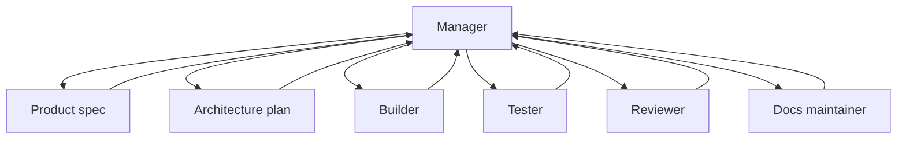

# Agent team roles

Source status: `official + experiment`  
Sources: [A practical guide to building agents](https://openai.com/business/guides-and-resources/a-practical-guide-to-building-ai-agents/), [Codex with Agents SDK](https://developers.openai.com/codex/guides/agents-sdk), [Subagents](https://learn.chatgpt.com/docs/agent-configuration/subagents), [Codex models](https://learn.chatgpt.com/docs/models), [Agents SDK models and providers](https://developers.openai.com/api/docs/guides/agents/models), [Reasoning best practices](https://developers.openai.com/api/docs/guides/reasoning-best-practices), [Build AI-native engineering teams](https://developers.openai.com/codex/guides/build-ai-native-engineering-team).

## Role map

| Role | Primary input | Output | Does not do |
| --- | --- | --- | --- |
| Product Manager | User request, business goal | `REQUIREMENTS.md`, acceptance criteria | Does not write production code |
| Architect | Requirements, codebase map | `PLAN.md`, component boundaries | Does not expand scope |
| Builder | Plan, ownership | Code diff, tests | Does not edit another worker's write scope |
| Tester | Requirements, diff, test plan | Test gaps, failing cases, eval report | Does not accept unverified claims |
| Reviewer | Diff, risk model | Findings ordered by severity | Does not rewrite without request |
| Docs Maintainer | Diff, sources, decisions | Docs, release notes | Does not mix official and community claims |
| Release Operator | Verification, PR body | PR, changelog, rollout notes | Does not skip failing checks |

## Model and reasoning policy

The [model matrix](../codex/models-and-reasoning.md) owns current product/auth/effort guidance. Role assignment below is a project design, not a benchmark or an active model change. The effective project/agent configuration owns selected models; PLAN records decisions and RUNLOG records evidence.

| Work class | Candidate selection rule | Effort decision |
| --- | --- | --- |
| Architecture, review, complex debugging | Evaluate Sol; consider Astra for the hardest cases | Preserve supported baseline first; raise only for demonstrated benefit |
| Focused implementation | Evaluate Sol against the existing baseline | Same task and tools; then compare a lower supported effort |
| Documentation, visual work, computer use | Consider Terra for matching tasks | Verify sources, tool completion and output quality |
| Narrow repeatable collection | Consider Luna after bounded evaluation | Optimize cost/latency only after quality passes |
| Release, security and final assurance | Use an evaluated project choice | Approval boundaries and evidence remain mandatory |

No role is assigned a new model by this table. See the [migration playbook](../playbooks/model-migration.md). Role cards must name ownership, input/output artifacts, verification, escalation/downgrade triggers and cost/latency budgets. Resolve unspecified model/effort using the applicable Codex schema rather than assuming universal inheritance across runtimes.

Read-only role instructions express intent. Codex custom agents inherit parent permissions, approvals, provider and MCP; they cannot create a separate sandbox by declaring a role-local override. Require runtime evidence for technical isolation and tool access.

## Manager pattern

For product delivery, the default is the Manager pattern:

- Manager keeps the goal, scope and gates.
- Specialist agents perform bounded work.
- Verifier/Reviewer checks the result.
- Manager publishes the result and decides what should move into docs or skills.

## Handoff rule

Every role must return more than output. The handoff must include:

- sources used;
- assumptions;
- files touched or proposed;
- verification evidence;
- open risks;
- recommended next role.

## Inputs

- Requirements, plan, source context and ownership constraints.
- Model and reasoning policy for the role and risk level.

## Outputs

- Role cards, handoff packets, verification evidence and stop conditions.
- A clear escalation path when ambiguity, security or release risk increases.

## Risks

- Vague titles without file ownership create overlap and hidden gaps.
- Overusing high reasoning or large agent teams can add latency without improving evidence.

## Role versus separate agent

A role defines responsibility; one agent may perform several roles sequentially. Delegation needs value, independent ownership and applicable authority. Parent permissions/MCP are inherited; role prose does not create a separate sandbox. [Subagents](https://learn.chatgpt.com/docs/agent-configuration/subagents).
