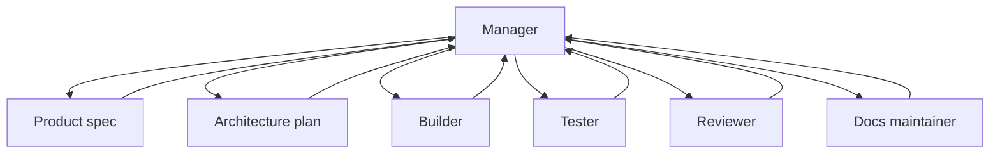

# Agent team roles

Source status: `official + experiment`  
Sources: [A practical guide to building agents](https://openai.com/business/guides-and-resources/a-practical-guide-to-building-ai-agents/), [Codex with Agents SDK](https://developers.openai.com/codex/guides/agents-sdk), [Subagents](https://developers.openai.com/codex/subagents), [Codex models](https://developers.openai.com/codex/models), [Agents SDK models and providers](https://developers.openai.com/api/docs/guides/agents/models), [Reasoning best practices](https://developers.openai.com/api/docs/guides/reasoning-best-practices), [Build AI-native engineering teams](https://developers.openai.com/codex/guides/build-ai-native-engineering-team).

## Role map

| Role | Primary input | Output | Does not do |
| --- | --- | --- | --- |
| Product Manager | User request, business goal | `REQUIREMENTS.md`, acceptance criteria | Does not write production code |
| Architect | Requirements, codebase map | `PLAN.md`, component boundaries | Does not expand scope |
| Builder | Plan, ownership | Code diff, tests | Does not edit another worker's write scope |
| Tester | Requirements, diff, test plan | Test gaps, failing cases, eval report | Does not accept unverified claims |
| Reviewer | Diff, risk model | Findings ordered by severity | Does not rewrite without request |
| Docs Maintainer | Diff, sources, decisions | Docs, release notes | Does not mix official and community claims |
| Release Operator | Verification, PR body | PR, changelog, rollout notes | Does not skip failing checks |

## Model and reasoning profile

Every role needs an execution profile. This is especially important for programmable Agents SDK workflows and Codex custom agents, where the model and reasoning effort can be set explicitly.

| Role | Model policy | Reasoning effort | Escalation rule |
| --- | --- | --- | --- |
| Product Manager | `gpt-5.5` or project default | `medium` / `high` | Raise to `high` when requirements conflict or a tradeoff must be chosen |
| Architect | `gpt-5.5` | `high` / `xhigh` | Use `xhigh` for multi-system architecture, migrations or deep debugging |
| Builder | project default; `gpt-5.4-mini` for small scoped edits | `medium` / `high` | Use `high` when shared contracts or several modules change |
| Explorer | `gpt-5.4-mini` or project default | `low` / `medium` | Use `medium` when discovered dependencies must be synthesized |
| Tester | project default | `medium` | Use `high` when failure is non-deterministic or eval-driven |
| Reviewer | `gpt-5.5` | `high` | Use `xhigh` when review touches security, data loss, concurrency or auth |
| Docs Maintainer | project default | `low` / `medium` | Use `medium` when several official sources must be checked |
| Release Operator | project default | `medium` | Use `high` when rollout is irreversible or approvals are ambiguous |

Minimal role card:

```yaml
role: "Architect"
owns: "Architecture, decomposition, risk analysis"
model_policy:
  model: "gpt-5.5"
  reasoning_effort: "high"
  cost_latency_budget: "quality-first"
  inherit_from_parent_when_unspecified: true
  override_allowed_by:
    - "run-level workflow config"
    - "human approval"
  escalation_rules:
    - "Use xhigh for multi-system migration or ambiguous architecture."
    - "Use medium for bounded implementation planning."
handoff:
  inputs: "REQUIREMENTS.md, codebase map, constraints"
  outputs: "PLAN.md, risks, open questions, verification strategy"
```

The project default should live in `PLAN.md` or a project-scoped agent config. Durable rules for when to raise reasoning effort can live in `AGENTS.md`; one-off runtime overrides are better recorded in `RUNLOG.md`.

## Manager pattern

For product delivery, the default is the Manager pattern:

- Manager keeps the goal, scope and gates.
- Specialist agents perform bounded work.
- Verifier/Reviewer checks the result.
- Manager publishes the result and decides what should move into docs or skills.



## Handoff rule

Every role must return more than output. The handoff must include:

- sources used;
- assumptions;
- files touched or proposed;
- verification evidence;
- open risks;
- recommended next role.

## Inputs

- Requirements, plan, source context and ownership constraints.
- Model and reasoning policy for the role and risk level.

## Outputs

- Role cards, handoff packets, verification evidence and stop conditions.
- A clear escalation path when ambiguity, security or release risk increases.

## Risks

- Vague titles without file ownership create overlap and hidden gaps.
- Overusing high reasoning or large agent teams can add latency without improving evidence.
