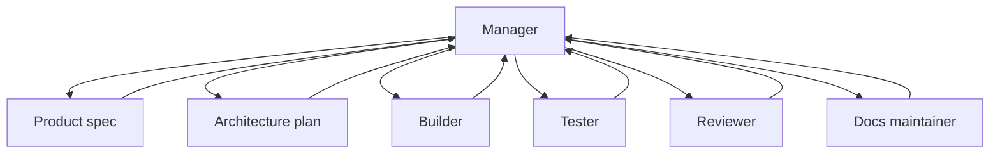

# Роли агентной команды

Source status: `official + experiment`  
Источники: [A practical guide to building agents](https://openai.com/business/guides-and-resources/a-practical-guide-to-building-ai-agents/), [Codex with Agents SDK](https://developers.openai.com/codex/guides/agents-sdk), [Subagents](https://developers.openai.com/codex/subagents), [Codex models](https://developers.openai.com/codex/models), [Agents SDK models and providers](https://developers.openai.com/api/docs/guides/agents/models), [Reasoning best practices](https://developers.openai.com/api/docs/guides/reasoning-best-practices), [Build AI-native engineering teams](https://developers.openai.com/codex/guides/build-ai-native-engineering-team).

## Role map

| Роль | Основной input | Output | Не делает |
| --- | --- | --- | --- |
| Product Manager | User request, business goal | `REQUIREMENTS.md`, acceptance criteria | Не пишет production code |
| Architect | Requirements, codebase map | `PLAN.md`, component boundaries | Не расширяет scope |
| Builder | Plan, ownership | Code diff, tests | Не меняет чужой write scope |
| Tester | Requirements, diff, test plan | Test gaps, failing cases, eval report | Не принимает неподтвержденные claims |
| Reviewer | Diff, risk model | Findings ordered by severity | Не переписывает без запроса |
| Docs Maintainer | Diff, sources, decisions | Docs, release notes | Не смешивает official/community |
| Release Operator | Verification, PR body | PR, changelog, rollout notes | Не пропускает failing checks |

## Model and reasoning profile

Каждая роль должна иметь execution profile. Это особенно важно для programmable Agents SDK workflows и Codex custom agents, где модель и reasoning могут задаваться явно.

| Роль | Model policy | Reasoning effort | Escalation rule |
| --- | --- | --- | --- |
| Product Manager | `gpt-5.5` или project default | `medium` / `high` | Поднять до `high`, если requirements конфликтуют или нужно выбрать tradeoff |
| Architect | `gpt-5.5` | `high` / `xhigh` | `xhigh` для multi-system architecture, migrations, deep debugging |
| Builder | project default; `gpt-5.4-mini` для малых scoped edits | `medium` / `high` | `high`, если меняются shared contracts или несколько модулей |
| Explorer | `gpt-5.4-mini` или project default | `low` / `medium` | `medium`, если нужно синтезировать найденные зависимости |
| Tester | project default | `medium` | `high`, если failure non-deterministic или eval-driven |
| Reviewer | `gpt-5.5` | `high` | `xhigh`, если review затрагивает security, data loss, concurrency, auth |
| Docs Maintainer | project default | `low` / `medium` | `medium`, если нужно сверять несколько official sources |
| Release Operator | project default | `medium` | `high`, если rollout irreversible или approvals неоднозначны |

Минимальная role card:

```yaml
role: "Architect"
owns: "Architecture, decomposition, risk analysis"
model_policy:
  model: "gpt-5.5"
  reasoning_effort: "high"
  cost_latency_budget: "quality-first"
  inherit_from_parent_when_unspecified: true
  override_allowed_by:
    - "run-level workflow config"
    - "human approval"
  escalation_rules:
    - "Use xhigh for multi-system migration or ambiguous architecture."
    - "Use medium for bounded implementation planning."
handoff:
  inputs: "REQUIREMENTS.md, codebase map, constraints"
  outputs: "PLAN.md, risks, open questions, verification strategy"
```

Project default должен жить в `PLAN.md` или project-scoped agent config. Durable rules о том, когда повышать reasoning, можно хранить в `AGENTS.md`; одноразовые runtime overrides лучше фиксировать в `RUNLOG.md`.

## Manager pattern

Для product delivery default - Manager pattern:

- Manager держит цель, scope и gates.
- Specialist agents выполняют bounded tasks.
- Verifier/Reviewer проверяет результат.
- Manager публикует итог и решает, что переносить в docs/skills.



## Handoff rule

Каждая роль должна возвращать не только output, но и:

- sources used;
- assumptions;
- files touched or proposed;
- verification evidence;
- open risks;
- recommended next role.
