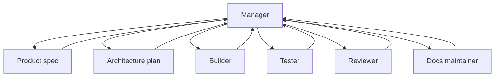

# Роли агентной команды

Source status: `official + experiment`  
Источники: [A practical guide to building agents](https://openai.com/business/guides-and-resources/a-practical-guide-to-building-ai-agents/), [Codex with Agents SDK](https://developers.openai.com/codex/guides/agents-sdk), [Subagents](https://learn.chatgpt.com/docs/agent-configuration/subagents), [Codex models](https://learn.chatgpt.com/docs/models), [Agents SDK models and providers](https://developers.openai.com/api/docs/guides/agents/models), [Reasoning best practices](https://developers.openai.com/api/docs/guides/reasoning-best-practices), [Build AI-native engineering teams](https://developers.openai.com/codex/guides/build-ai-native-engineering-team).

## Role map

| Роль | Основной input | Output | Не делает |
| --- | --- | --- | --- |
| Product Manager | Запрос пользователя, business goal | `REQUIREMENTS.md`, acceptance criteria | Не пишет production code |
| Architect | Requirements, codebase map | `PLAN.md`, component boundaries | Не расширяет scope |
| Builder | Plan, ownership | Code diff, tests | Не меняет чужой писать scope |
| Tester | Requirements, diff, test plan | Test gaps, failing cases, eval report | Не принимает неподтвержденные claims |
| Reviewer | Diff, risk model | Findings ordered через severity | Не переписывает без запроса |
| Docs Maintainer | Diff, sources, decisions | Docs, заметки к release | Не смешивает official/community |
| Release Operator | Проверка, PR body | PR, changelog и rollout notes | Не пропускает падающие проверки |

## Model и reasoning policy

[Матрица моделей](../codex/models-and-reasoning.md) владеет актуальными рекомендациями product/auth/effort. Таблица ниже — проектное предложение, а не benchmark и не изменение активных моделей. Выбранные модели определяет effective project/agent configuration; PLAN хранит решения, RUNLOG — доказательства.

| Класс работы | Правило выбора кандидата | Решение об effort |
| --- | --- | --- |
| Архитектура, review, сложный debugging | Оценить Sol; для наиболее сложных случаев рассмотреть Astra | Сначала сохранить поддерживаемый baseline; повышать при доказанной пользе |
| Ограниченная реализация | Сравнить Sol с действующим baseline | Одинаковые задача и tools; затем сравнить меньший поддерживаемый effort |
| Документация, визуальные задачи, computer use | Рассмотреть Terra для подходящих задач | Проверить источники, завершение tools и качество результата |
| Узкий повторяемый сбор данных | Рассмотреть Luna после ограниченного eval | Оптимизировать стоимость/latency только после quality gate |
| Release, безопасность и итоговая проверка | Использовать проверенный выбор проекта | Approval boundaries и evidence остаются обязательными |

Таблица не назначает новую модель ни одной роли. См. [playbook миграции](../playbooks/model-migration.md). Role card должна задавать ownership, входные/выходные artifacts, проверки, escalation/downgrade и budget. Неуказанные model/effort разрешаются по применимой схеме Codex, а не по универсальному предположению о наследовании во всех runtimes.

Read-only инструкция роли выражает намерение. Codex custom agents наследуют permissions, approvals, provider и MCP родителя; локальный override роли не создает отдельный sandbox. Техническая изоляция и доступ к инструменту требуют runtime evidence.

## Manager pattern

Для product delivery default используется Manager pattern:

- Manager держит цель, scope и gates.
- Specialist agents выполняют bounded tasks.
- Verifier/Reviewer проверяет результат.
- Manager публикует итог и решает, что переносить в docs/skills.

## Handoff rule

Каждая роль должна возвращать не только output, но и:

- sources used;
- assumptions;
- files touched или proposed;
- verification evidence;
- open risks;
- recommended next role.
