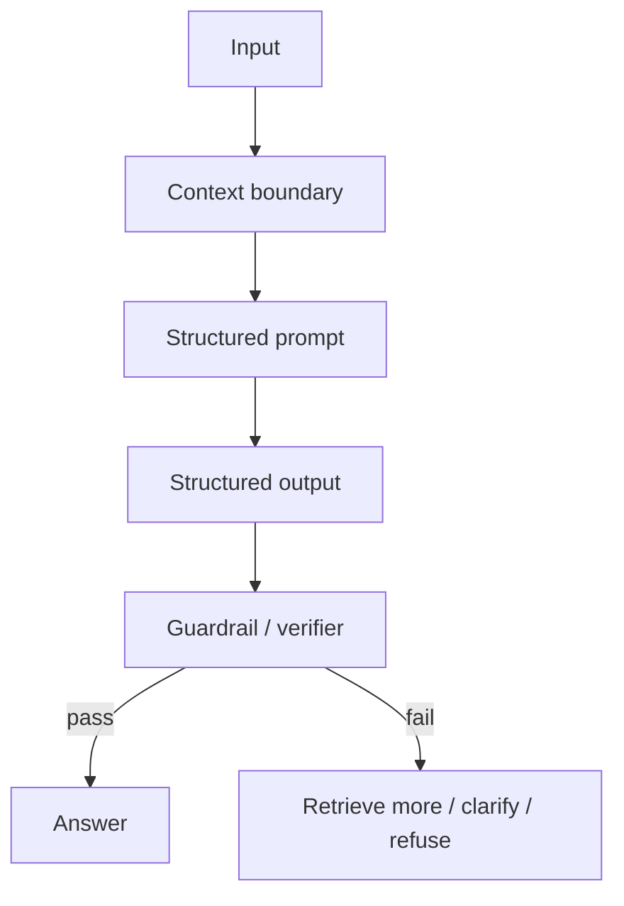

# Hallucination Control

Source status: `official + experiment`  
Sources: [Structured Outputs](https://developers.openai.com/api/docs/guides/structured-outputs), [Model optimization](https://developers.openai.com/api/docs/guides/model-optimization), [OpenAI Cookbook hallucination guardrails](https://github.com/openai/openai-cookbook), [Agents SDK guardrails](https://github.com/openai/openai-agents-python).

## Types of hallucinations

| Type | Example | Control |
| --- | --- | --- |
| Factual | Invented API capability | Grounding + citations |
| Citation | Nonexistent link or source ID | Citation validator |
| Format | Response does not match the schema | Structured Outputs |
| Tool | Model claims it called a tool, but did not | Tool trace |
| Temporal | Outdated price, version, model | Fresh source check |
| Scope | Model answers outside the provided context | Context-only policy |

## Layered controls



## Prompt-level controls

Use concrete rules instead of a generic "do not hallucinate":

```text
Use only the provided sources.
Every factual claim must cite a source ID.
If no source supports the claim, put it under `unsupported_claims`.
Do not infer API behavior from names alone.
If current facts are required and no browsing/tool is available, say that verification is required.
```

## Structured Outputs limits

Structured Outputs help keep the response shape, but do not guarantee factual correctness. Official documentation warns separately: if user input is incompatible with the task, the model may try to fill the schema.

Add an explicit fallback:

```json
{
  "answer": "",
  "citations": [],
  "missing_context": ["No source describes this API behavior"],
  "unsupported_claims": []
}
```

## Verifier agent

For important answers, use a separate verifier:

```text
Role: Verifier
Goal: Check the factuality of the answer against the provided context.

Rules:
- Ignore style.
- Check every factual claim.
- Mark each claim as supported, unsupported, contradicted, or needs_fresh_check.
- Do not repair the answer unless asked.

Output:
- supported_claims
- unsupported_claims
- contradicted_claims
- missing_context
- verdict: pass | fail | needs_more_context
```

## Hallucination score

The Cookbook approach can be adapted into a simple scale:

| Dimension | Pass condition |
| --- | --- |
| Factual accuracy | No unsupported factual claims |
| Relevance | The answer solves the question, not an adjacent task |
| Policy compliance | Source, safety and tool rules are followed |
| Contextual coherence | The answer does not contradict session/context |

If any dimension fails, the answer is not published without correction or clarification.

## When it is better to refuse to answer

Refusal or clarification is better than an answer when:

- the context does not contain the needed facts;
- the question requires current data and a tool is unavailable;
- sources contradict each other;
- the user asks for exact versions, prices, dates or legal/medical/financial advice without fresh verification;
- schema forcing makes the model choose from false options.

