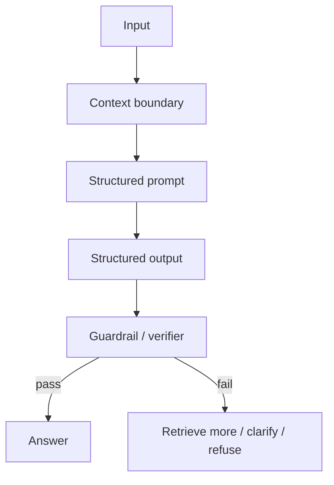

# Контроль галлюцинаций

Source status: `official + experiment`  
Источники: [Structured Outputs](https://developers.openai.com/api/docs/guides/structured-outputs), [Model optimization](https://developers.openai.com/api/docs/guides/model-optimization), [OpenAI Cookbook hallucination guardrails](https://github.com/openai/openai-cookbook), [Agents SDK guardrails](https://github.com/openai/openai-agents-python).

## Типы hallucinations

| Тип | Пример | Контроль |
| --- | --- | --- |
| Factual | Выдуманная возможность API | Grounding + citations |
| Citation | Несуществующая ссылка или source ID | Citation validator |
| Format | Ответ не по схеме | Structured Outputs |
| Tool | Модель утверждает, что вызвала tool, но не вызывала | Tool trace |
| Temporal | Устаревшая цена, версия, модель | Fresh source check |
| Scope | Модель отвечает вне предоставленного context | Context-only policy |

## Layered controls



## Prompt-level controls

Используйте конкретные правила вместо общего "не галлюцинируй":

```text
Use only the provided sources.
Every factual claim must cite a source ID.
If no source supports the claim, put it under `unsupported_claims`.
Do not infer API behavior from names alone.
If current facts are required and no browsing/tool is available, say that verification is required.
```

## Structured Outputs limits

Structured Outputs помогают держать форму ответа, но не гарантируют factual correctness. Официальная документация отдельно предупреждает: если user input несовместим с задачей, модель может пытаться заполнить схему.

Добавляйте явный fallback:

```json
{
  "answer": "",
  "citations": [],
  "missing_context": ["No source describes this API behavior"],
  "unsupported_claims": []
}
```

## Verifier agent

Для важных ответов используйте отдельный verifier:

```text
Role: Verifier
Goal: Проверить factuality ответа против предоставленного context.

Rules:
- Ignore style.
- Check every factual claim.
- Mark each claim as supported, unsupported, contradicted, or needs_fresh_check.
- Do not repair the answer unless asked.

Output:
- supported_claims
- unsupported_claims
- contradicted_claims
- missing_context
- verdict: pass | fail | needs_more_context
```

## Hallucination score

Cookbook-подход можно адаптировать в простую шкалу:

| Dimension | Pass condition |
| --- | --- |
| Factual accuracy | Нет unsupported factual claims |
| Relevance | Ответ решает вопрос, а не соседнюю задачу |
| Policy compliance | Соблюдены source, safety и tool rules |
| Contextual coherence | Ответ не противоречит session/context |

Если любой dimension fails, ответ не публикуется без исправления или уточнения.

## Когда лучше отказаться от ответа

Отказ или уточнение лучше ответа, если:

- context не содержит нужных фактов;
- вопрос требует текущих данных, а tool недоступен;
- источники противоречат друг другу;
- user просит точные версии, цены, даты или legal/medical/financial advice без fresh verification;
- schema forcing заставляет модель выбирать из ложных вариантов.

