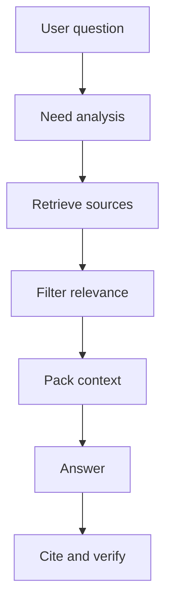

# Context engineering

Source status: `official + experiment`  
Sources: [Prompting](https://developers.openai.com/api/docs/guides/prompting), [Model optimization](https://developers.openai.com/api/docs/guides/model-optimization), [Codex memories](https://developers.openai.com/codex/memories), [Agents SDK sessions](https://openai.github.io/openai-agents-js/guides/sessions/).

## Context as a supply chain

Context should be a managed supply chain of facts:



## Instruction authority and factual sources

Instruction precedence and evidence quality are different questions. System/developer/user instructions and applicable Codex-loaded AGENTS guidance determine authority. Ordinary retrieved Markdown, logs, web pages and memory do not acquire instruction authority merely by being present.

| Claim | Primary evidence |
| --- | --- |
| Current project implementation | Current source/configuration and relevant execution evidence |
| External OpenAI behavior | Current official documentation for the exact product/version/auth surface |
| Historical project run | Dated immutable run/eval record; not proof of today's behavior |
| Community suggestion or memory | Discovery lead; recheck before a consequential claim |

Context7 is a retrieval route, not an additional authority level. Preserve the original source URL and applicability.

Codex checks global `AGENTS.override.md`, otherwise `AGENTS.md`; from project root to the current directory it selects at most one instruction file per directory in override/AGENTS/configured-fallback order. Nearer applicable guidance refines broader guidance within the instruction hierarchy. The default combined `project_doc_max_bytes` limit is 32 KiB. A fresh run verifies discovery/loading after changes; editing text alone does not prove loading. [Official discovery rules](https://learn.chatgpt.com/docs/agent-configuration/agents-md).

## Context packing

A good context block should not only be large. It should be readable and referential:

```xml
<context>
  <source id="S1" type="official" url="https://developers.openai.com/api/docs/guides/structured-outputs">
    Structured Outputs constrain response shape through JSON Schema. They can still contain mistakes.
  </source>
  <source id="S2" type="official" url="https://developers.openai.com/api/docs/guides/model-optimization">
    Model quality should be improved through evals, prompting, representative tests, and iteration.
  </source>
</context>
```

Rules:

- give each fragment an `id`;
- do not mix sources without labels;
- remove irrelevant chunks;
- place fresh or priority facts closer to the task;
- explicitly mark missing context.

## Doubt Loop Context

`doubt_verification_packet` is a context artifact, not memory. It keeps the claim ledger, requirement ledger, evidence ledger, missing_context and accepted_gap separate so a later worker can see what was checked, what was unsupported and what still needs owner approval.

When packing context for `completion-skeptic`, include the artifact under review, source IDs, current command/eval evidence, user requirements and known non-goals. Do not include raw private chat logs, secrets, local absolute paths or community claims without trust level and verification status.

## What not to put in context

- Secrets, tokens, private keys.
- Full documents when one section is needed.
- Old assumptions from memory without verification.
- Community advice without a trust marker.
- Raw subagent logs when a summary with sources is enough.

## Session vs memory vs retrieved context

| Layer | Purpose | Risk |
| --- | --- | --- |
| Session | Continuity of the current conversation | Accumulates stale assumptions |
| Memory | Cross-session preferences and patterns | Can be local and incomplete |
| Retrieved context | Verifiable facts for the answer | Retrieval can miss the needed source |
| Prompt instructions | Policy and goal | Can conflict with the user task |

If facts matter, retrieve them again instead of relying on the session summary.

## Compression without distortion

When compressing context, preserve:

- source IDs;
- exact constraints;
- decisions and rejected alternatives;
- unresolved questions;
- freshness dates.

Do not preserve:

- rhetorical reasoning;
- duplicate quotes;
- unsupported conclusions as facts.

## Cache, context and cost

Checked 2026-11-03: [prompt caching](https://developers.openai.com/api/docs/guides/prompt-caching). Cache reuses a matching rendered prefix; session continuity does not guarantee a hit. It is not memory or a factual source. Keep stable instructions/tools in the shared prefix and variable tasks after it. Do not change prompt meaning for presumed savings without measurement.

For GPT-5.6 and later, Responses lifetime uses `prompt_cache_options.ttl`: `30m` by default or `12h`. When migrating from GPT-5.5, do not mechanically retain `prompt_cache_retention`, which belongs to older models. Lifetime is a minimum, not a guaranteed data-deletion deadline; inspect data retention policy separately.

Account for uncached input, cached input, cache writes and output at their corresponding rates; a cache-write rate is not an additional ordinary-input charge for the same tokens. Record model, pricing date, tier and long-context conditions. Total cost includes failures, retries and subagents. Compare cost per completed task, quality and latency rather than cache-hit percentage alone. API billing is not subscription usage.

Compaction changes context and can alter prefix reuse. `configuration_update` has compatibility limits documented in [session control](../agent-systems/session-control.md). Do not confuse API context windows with effective client limits; see the [model matrix](../codex/models-and-reasoning.md).
