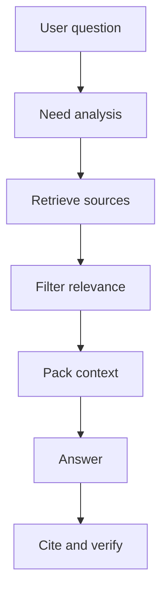

# Context engineering

Source status: `official + experiment`  
Sources: [Prompting](https://developers.openai.com/api/docs/guides/prompting), [Model optimization](https://developers.openai.com/api/docs/guides/model-optimization), [Codex memories](https://developers.openai.com/codex/memories), [Agents SDK sessions](https://openai.github.io/openai-agents-js/guides/sessions/).

## Context as a supply chain

Context should be a managed supply chain of facts:



## Source hierarchy

For this knowledge base, the trust order is:

1. Current workspace and checked-in docs.
2. Official OpenAI docs and OpenAI GitHub repositories.
3. Context7 retrieval, if the source URL points to an official source.
4. Community sources as candidate insights.
5. Memory as a recall layer, but not source of truth.

## Context packing

A good context block should not only be large. It should be readable and referential:

```xml
<context>
  <source id="S1" type="official" url="https://developers.openai.com/api/docs/guides/structured-outputs">
    Structured Outputs constrain response shape through JSON Schema. They can still contain mistakes.
  </source>
  <source id="S2" type="official" url="https://developers.openai.com/api/docs/guides/model-optimization">
    Model quality should be improved through evals, prompting, representative tests, and iteration.
  </source>
</context>
```

Rules:

- give each fragment an `id`;
- do not mix sources without labels;
- remove irrelevant chunks;
- place fresh or priority facts closer to the task;
- explicitly mark missing context.

## What not to put in context

- Secrets, tokens, private keys.
- Full documents when one section is needed.
- Old assumptions from memory without verification.
- Community advice without a trust marker.
- Raw subagent logs when a summary with sources is enough.

## Session vs memory vs retrieved context

| Layer | Purpose | Risk |
| --- | --- | --- |
| Session | Continuity of the current conversation | Accumulates stale assumptions |
| Memory | Cross-session preferences and patterns | Can be local and incomplete |
| Retrieved context | Verifiable facts for the answer | Retrieval can miss the needed source |
| Prompt instructions | Policy and goal | Can conflict with the user task |

If facts matter, retrieve them again instead of relying on the session summary.

## Compression without distortion

When compressing context, preserve:

- source IDs;
- exact constraints;
- decisions and rejected alternatives;
- unresolved questions;
- freshness dates.

Do not preserve:

- rhetorical reasoning;
- duplicate quotes;
- unsupported conclusions as facts.

