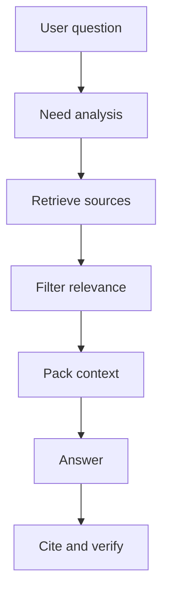

# Context engineering

Source status: `official + experiment`  
Источники: [Prompting](https://developers.openai.com/api/docs/guides/prompting), [Model optimization](https://developers.openai.com/api/docs/guides/model-optimization), [Codex memories](https://developers.openai.com/codex/memories), [Agents SDK sessions](https://openai.github.io/openai-agents-js/guides/sessions/).

## Context как supply chain

Контекст должен быть управляемой цепочкой поставки фактов:



## Полномочия инструкций и источники фактов

Приоритет инструкций и качество доказательств — разные вопросы. Полномочия задают system/developer/user instructions и применимые загруженные Codex AGENTS. Обычные Markdown, логи, web-страницы и memory не становятся инструкциями только из-за присутствия в контексте.

| Утверждение | Основное доказательство |
| --- | --- |
| Текущая реализация проекта | Актуальные source/configuration и соответствующие execution evidence |
| Поведение внешней платформы OpenAI | Текущие официальные docs для конкретных product/version/auth |
| Исторический запуск проекта | Датированный неизменяемый run/eval record; не доказательство сегодняшнего поведения |
| Community suggestion или memory | Подсказка для поиска; перед существенным выводом перепроверить |

Context7 — способ retrieval, а не дополнительный уровень полномочий. Сохраняйте исходный URL и область применимости.

Codex проверяет глобальный `AGENTS.override.md`, иначе `AGENTS.md`; от project root до текущего каталога выбирает не более одного файла на каталог в порядке override/AGENTS/configured fallback. Более близкие применимые инструкции уточняют общие в рамках иерархии. Лимит объединенного `project_doc_max_bytes` по умолчанию — 32 KiB. Discovery/loading после изменений проверяются в свежем запуске; редактирование текста не доказывает загрузку. [Официальные правила discovery](https://learn.chatgpt.com/docs/agent-configuration/agents-md).

## Context packing

Хороший context block должен быть не просто большим. Он должен быть читаемым и ссылочным:

```xml
<context>
  <source id="S1" type="official" url="https://developers.openai.com/api/docs/guides/structured-outputs">
    Structured Outputs constrain response shape through JSON Schema. They can still contain mistakes.
  </source>
  <source id="S2" type="official" url="https://developers.openai.com/api/docs/guides/model-optimization">
    Model quality should be improved through evals, prompting, representative tests, and iteration.
  </source>
</context>
```

Правила:

- каждому фрагменту дайте `id`;
- не смешивайте источники без labels;
- удаляйте нерелевантные куски;
- кладите свежие или приоритетные факты ближе к задаче;
- явно помечайте missing context.

## Что не класть в context

- Secrets, tokens, private keys.
- Полные документы, если нужен один раздел.
- Старые assumptions из memory без проверки.
- Community advice без trust marker.
- Сырые логи subagents, если достаточно summary with sources.

## Doubt Loop Context

`doubt_verification_packet` - context artifact, а не memory. Он разделяет claim ledger, requirement ledger, evidence ledger, missing_context и accepted_gap, чтобы следующий worker видел, что проверено, что unsupported и где еще нужен owner approval.

При упаковке context для `completion-skeptic` включайте artifact under review, source IDs, current command/eval evidence, user requirements и known non-goals. Не включайте raw private chat logs, secrets, local absolute paths или community claims без trust level и verification status.

## Session vs memory vs retrieved context

| Слой | Назначение | Риск |
| --- | --- | --- |
| Session | Continuity текущего разговора | Накапливает устаревшие assumptions |
| Memory | Межсессионные preferences и patterns | Может быть локальной и неполной |
| Retrieved context | Проверяемые факты для ответа | Retrieval может пропустить нужный источник |
| Prompt instructions | Политика и goal | Может конфликтовать с user task |

Если факты важны, извлекайте их заново, а не полагайтесь на session summary.

## Compression without distortion

При сжатии context сохраняйте:

- source IDs;
- exact constraints;
- decisions and rejected alternatives;
- unresolved questions;
- freshness dates.

Не сохраняйте:

- риторические рассуждения;
- дублирующие цитаты;
- неподтвержденные выводы как facts.

## Cache, контекст и стоимость

Проверено 2026-11-03: [prompt caching](https://developers.openai.com/api/docs/guides/prompt-caching). Cache переиспользует совпадающий rendered prefix; session continuity не гарантирует cache hit. Это не memory и не замена источника фактов. Стабильные инструкции и tools размещайте в общей части; переменную задачу — после нее. Не меняйте смысл prompt ради предполагаемой экономии без измерения.

Для GPT-5.6 и более новых моделей lifetime в Responses задается `prompt_cache_options.ttl`: `30m` по умолчанию или `12h`. При миграции с GPT-5.5 не переносите прежний `prompt_cache_retention` механически: это параметр старых моделей. Lifetime — минимум удержания, не гарантированный момент удаления данных. Политика data retention проверяется отдельно.

Учитывайте uncached input, cached input, cache writes и output по соответствующим ставкам; cache-write rate не прибавляется поверх обычной ставки для тех же tokens. Указывайте модель, дату тарифов, tier и условия long-context. Общая стоимость включает ошибки, retries и subagents. Сопоставляйте стоимость завершенной задачи, качество и latency, а не только процент cache hits. API billing не равен расходу подписки.

Compaction меняет контекст и может изменить reuse prefix. `configuration_update` имеет ограничения совместимости, описанные в [session control](../agent-systems/session-control.md). Не путайте API context window и effective client limit; см. [модельную матрицу](../codex/models-and-reasoning.md).

## Optional: explicit cache boundaries

Проверено 05.11.2026 по [Prompt caching](https://developers.openai.com/api/docs/guides/prompt-caching). Для подходящего Responses workflow можно выбрать `prompt_cache_options.mode: "explicit"` и `prompt_cache_breakpoint: { "mode": "explicit" }` на поддерживаемых content blocks. Без explicit breakpoints в этом режиме cache reads/writes не выполняются. После последнего breakpoint меняющийся контекст оплачивается как uncached input без cache-write charge.

Это advanced optimization, не обязательный этап обычной задачи. Сначала сравните качество, total cost и latency на representative workload; учитывайте cache-write price, TTL, модель и дату тарифа. Automatic cache, local memory и session persistence — разные механизмы.
