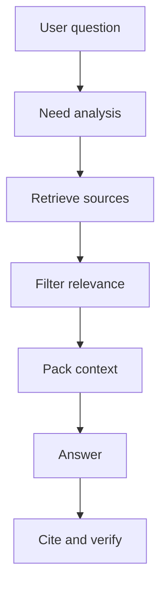

# Context engineering

Source status: `official + experiment`  
Источники: [Prompting](https://developers.openai.com/api/docs/guides/prompting), [Model optimization](https://developers.openai.com/api/docs/guides/model-optimization), [Codex memories](https://developers.openai.com/codex/memories), [Agents SDK sessions](https://openai.github.io/openai-agents-js/guides/sessions/).

## Context как supply chain

Контекст должен быть управляемой цепочкой поставки фактов:



## Иерархия источников

Для этой базы знаний порядок доверия такой:

1. Текущий workspace и checked-in docs.
2. Официальные OpenAI docs и GitHub репозитории OpenAI.
3. Context7 retrieval, если source URL указывает на официальный источник.
4. Community sources как candidate insights.
5. Memory как recall layer, но не source of truth.

## Context packing

Хороший context block должен быть не просто большим. Он должен быть читаемым и ссылочным:

```xml
<context>
  <source id="S1" type="official" url="https://developers.openai.com/api/docs/guides/structured-outputs">
    Structured Outputs constrain response shape through JSON Schema. They can still contain mistakes.
  </source>
  <source id="S2" type="official" url="https://developers.openai.com/api/docs/guides/model-optimization">
    Model quality should be improved through evals, prompting, representative tests, and iteration.
  </source>
</context>
```

Правила:

- каждому фрагменту дайте `id`;
- не смешивайте источники без labels;
- удаляйте нерелевантные куски;
- кладите свежие или приоритетные факты ближе к задаче;
- явно помечайте missing context.

## Что не класть в context

- Secrets, tokens, private keys.
- Полные документы, если нужен один раздел.
- Старые assumptions из memory без проверки.
- Community advice без trust marker.
- Сырые логи subagents, если достаточно summary with sources.

## Session vs memory vs retrieved context

| Слой | Назначение | Риск |
| --- | --- | --- |
| Session | Continuity текущего разговора | Накапливает устаревшие assumptions |
| Memory | Межсессионные preferences и patterns | Может быть локальной и неполной |
| Retrieved context | Проверяемые факты для ответа | Retrieval может пропустить нужный источник |
| Prompt instructions | Политика и goal | Может конфликтовать с user task |

Если факты важны, извлекайте их заново, а не полагайтесь на session summary.

## Compression without distortion

При сжатии context сохраняйте:

- source IDs;
- exact constraints;
- decisions and rejected alternatives;
- unresolved questions;
- freshness dates.

Не сохраняйте:

- риторические рассуждения;
- дублирующие цитаты;
- неподтвержденные выводы как facts.

