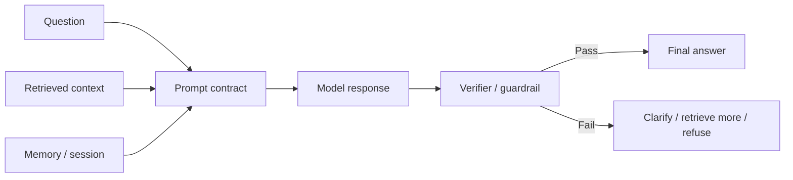

# Prompt & Context Engineering

Source status: `official + experiment`  
Sources: [Prompting](https://developers.openai.com/api/docs/guides/prompting), [Prompt engineering](https://developers.openai.com/api/docs/guides/prompt-engineering), [Model optimization](https://developers.openai.com/api/docs/guides/model-optimization), [Structured Outputs](https://developers.openai.com/api/docs/guides/structured-outputs), [OpenAI Cookbook](https://github.com/openai/openai-cookbook).

## Separation of concepts

Prompt engineering is responsible for instructions: what the model should do, in what style, with what constraints and in what result format.

Context engineering is responsible for the working memory of a specific call: which facts, documents, citations, history, tool outputs and session state the model sees before answering.

To reduce hallucinations, the important part is not the "perfect phrase", but full control of the circuit:



## Prompt as a contract

A good prompt should answer eight questions explicitly:

| Question | Prompt contract field |
| --- | --- |
| Who answers? | `Role` |
| What counts as success? | `Goal` |
| What can it rely on? | `Context` |
| What is forbidden? | `Constraints` |
| What should happen with unknowns? | `Uncertainty policy` |
| Which tools can be used? | `Tools` |
| How should the result be returned? | `Output format` |
| How should the answer be checked? | `Verification` |

## Instruction hierarchy

For API and agentic systems, it is useful to separate levels:

- System/developer instructions: stable policy, tone, safety, tool rules.
- User task: concrete task, data, goal.
- Retrieved context: facts, documents, tool outputs.
- Examples: compact few-shot examples of the desired result.
- Output schema: machine-checkable contract.

Do not put transient task details into the permanent system prompt. Do not put long-term policy into a user message if it must always be followed.

## Optimization cycle

OpenAI model optimization guidance describes a cycle: eval baseline, prompt/context, realistic test inputs, measurement, adjustment, repeat. For this knowledge base, this means:

1. First define the eval: "the answer must cite source IDs", "it must not invent a source", "it must ask a clarification when data is missing".
2. Then write the prompt.
3. Check it on question sets similar to real ones.
4. Version the prompt and record changes.

## Anti-hallucination baseline

Minimal baseline for factual tasks:

```text
Answer only from the provided context.
If the context is insufficient, say what is missing.
Do not invent facts, citations, file paths, versions, prices, dates, or line numbers.
Separate verified facts from assumptions.
Return citations for every factual claim when sources are provided.
```

## GPT-6: initiative and sufficient verification

Checked 2026-11-03: [prompting guidance](https://developers.openai.com/api/docs/guides/latest-model). Specify outcome, scope, constraints, authorized actions, completion criteria and evidence. Start with a simple prompt; add examples for a measured recurring failure or product requirement, not for volume.

An agent can continue already authorized work without repeated approvals. Before requesting permission for a separate external action, prepare a concrete reviewable result within the authorized scope. This does not extend permissions, costs or side effects. Clarify blocking ambiguity; use a justified assumption for reversible choices.

Conflicting skills/AGENTS, unbounded repeated verification and universal delegation can degrade execution. Name applicable instructions, delegation triggers and the stop condition: after relevant mandatory checks, repetition needs a new change, failure or unresolved risk. This is prompt-design guidance; it does not edit active AGENTS/skills. Evaluate quality using the [migration playbook](../playbooks/model-migration.md).
