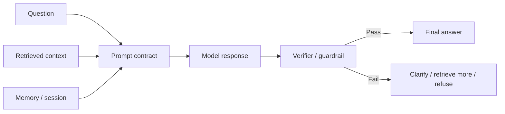

# Prompt & Context Engineering

Source status: `official + experiment`  
Источники: [Prompting](https://developers.openai.com/api/docs/guides/prompting), [Prompt engineering](https://developers.openai.com/api/docs/guides/prompt-engineering), [Model optimization](https://developers.openai.com/api/docs/guides/model-optimization), [Structured Outputs](https://developers.openai.com/api/docs/guides/structured-outputs), [OpenAI Cookbook](https://github.com/openai/openai-cookbook).

## Разделение понятий

Prompt engineering отвечает за инструкции: что модель должна сделать, в каком стиле, с какими ограничениями и каким форматом результата.

Context engineering отвечает за рабочую память конкретного вызова: какие факты, документы, цитаты, history, tool outputs и session state модель видит перед ответом.

Для уменьшения hallucinations важнее не "идеальная фраза", а полный контроль контура:



## Prompt как контракт

Хороший prompt должен явно отвечать на восемь вопросов:

| Вопрос | Поле prompt contract |
| --- | --- |
| Кто отвечает? | `Role` |
| Что считается успехом? | `Goal` |
| На чем можно основываться? | `Context` |
| Что запрещено? | `Constraints` |
| Что делать с неизвестным? | `Uncertainty policy` |
| Какие tools можно использовать? | `Tools` |
| Как вернуть результат? | `Output format` |
| Как проверить ответ? | `Verification` |

## Instruction hierarchy

Для API и агентных систем полезно разделять уровни:

- System/developer instructions: стабильная политика, tone, safety, tool rules.
- User task: конкретная задача, данные, цель.
- Retrieved context: факты, документы, outputs tools.
- Examples: компактные few-shot примеры нужного результата.
- Output schema: машинно-проверяемый контракт.

Не кладите transient task details в постоянный system prompt. Не кладите долгосрочную policy в user message, если она должна соблюдаться всегда.

## Оптимизационный цикл

OpenAI model optimization guidance описывает цикл: eval baseline, prompt/context, реалистичные test inputs, измерение, корректировка, повтор. Для этой базы знаний это означает:

1. Сначала определить eval: "ответ должен цитировать source IDs", "не должен выдумывать источник", "должен спросить уточнение при нехватке данных".
2. Затем писать prompt.
3. Проверять на наборах вопросов, похожих на реальные.
4. Версионировать prompt и фиксировать изменения.

## Anti-hallucination baseline

Минимальный baseline для factual tasks:

```text
Answer only from the provided context.
If the context is insufficient, say what is missing.
Do not invent facts, citations, file paths, versions, prices, dates, or line numbers.
Separate verified facts from assumptions.
Return citations for every factual claim when sources are provided.
```

## GPT-6: инициатива и достаточная проверка

Проверено 2026-11-03: [prompting guidance](https://developers.openai.com/api/docs/guides/latest-model). Формулируйте результат, scope, ограничения, разрешенные действия, критерии завершения и evidence. Начинайте с простого prompt; добавляйте примеры для устойчивого измеренного сбоя или требования продукта, а не для объема.

Агент может продолжать уже разрешенную работу без повторных approvals. До запроса разрешения на отдельное внешнее действие подготовьте конкретный проверяемый результат внутри разрешенного scope. Не распространяйте это на новые permissions, расходы или side effects. Уточняйте блокирующую неоднозначность; для обратимых вариантов используйте обоснованное допущение.

Конфликтующие skills/AGENTS, неограниченные «проверяй снова» и универсальная делегация могут ухудшать выполнение. Называйте применимые инструкции, условия делегации и stop condition: после релевантных обязательных checks повтор оправдан только новым изменением, failure или неустраненным риском. Это рекомендация для проектирования prompts; активные AGENTS/skills этим текстом не изменяются. Качество проверяется по [playbook миграции](../playbooks/model-migration.md).
