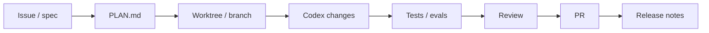

# Automations и GitHub

Source status: `official + experiment`  
Источники: [Codex automations](https://developers.openai.com/codex/app/automations), [Codex best practices](https://developers.openai.com/codex/learn/best-practices), [Codex GitHub integration](https://developers.openai.com/codex/integrations/github), [Codex GitHub Action](https://developers.openai.com/codex/automation/github-action).

## Skills define method, automations define schedule

Codex best practices формулируют практическое правило: skill описывает метод, automation задает cadence. Если workflow еще требует ручного steering, сначала превратите его в skill и прогоните вручную.

## Хорошие automation candidates

- summarize recent commits;
- scan likely bugs;
- draft release notes;
- check CI failures;
- produce standup summaries;
- run scheduled documentation freshness audit;
- run recurring security/threat-model review.

## GitHub delivery loop

## Permission baseline

For CI/PR automation:

- prefer read-only analysis for review jobs;
- use least-privilege repository tokens;
- separate comment/review jobs from write jobs;
- require explicit branch or PR scope;
- store final evidence in PR body or check summary.

