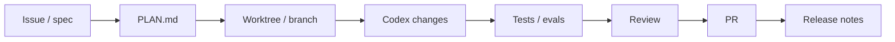

# Automations и GitHub

Source status: `official + experiment`  
Источники: [Codex automations](https://developers.openai.com/codex/app/automations), [Codex best practices](https://developers.openai.com/codex/learn/best-practices), [Codex GitHub integration](https://developers.openai.com/codex/integrations/github), [Codex GitHub Action](https://developers.openai.com/codex/automation/github-action).

## Skills define method, automations define schedule

Codex best practices формулируют практическое правило: skill описывает метод, automation задает cadence. Если workflow еще требует ручного steering, сначала превратите его в skill и прогоните вручную.

## Хорошие automation candidates

- summarize recent commits;
- scan likely bugs;
- draft заметки к release;
- check CI failures;
- produce standup summaries;
- запуск scheduled documentation freshness audit;
- запуск system file hygiene audit для `AGENTS.md`, control-plane files, subagents, skills, workflows, hooks, evals и automation candidates;
- запуск recurring security/threat-model review.

## GitHub delivery loop



## Permission baseline

Для CI/PR automation:

- prefer read-only analysis для review jobs;
- использовать least-privilege repository tokens;
- separate comment/review jobs из писать jobs;
- требуют explicit branch или PR scope;
- сохраняйте final evidence в PR body или check summary.

System file hygiene automation должна начинаться как `.codex/automation-candidates/system-file-hygiene-audit.md`: weekly/monthly cadence, on-change trigger и size trigger остаются proposal, а не active schedule. До approval используйте только read-only команду:

```powershell
python plugins\product-agent-os\scripts\validate_system_file_hygiene.py <workspace>
```

## Scheduled tasks: выбрать режим

Проверено 05.11.2026 по [Scheduled tasks](https://developers.openai.com/codex/app/automations). Native schedule, GitHub Action и проектный automation candidate — разные объекты.

| Режим | Контекст и исполнение | Условие |
| --- | --- | --- |
| Standalone schedule | Новый chat для запуска | Явные inputs, ожидаемый artifact и место результата |
| Existing-chat schedule | Контекст существующего chat | Удалить устаревшие assumptions, проверить текущий scope |
| Local project | Local workspace либо Git worktree | Компьютер включён, desktop app работает; dependencies доступны |
| Cloud / team task | Подготовленная cloud среда; team identity по доступной конфигурации | Plan/workspace support, service identity и права проверены |

Начните с одного ручного запуска. Зафиксируйте prompt/skill, разрешённые чтения и записи, выбранную model, время/таймзону, output destination, failure owner и способ остановить schedule. В Git project выбирайте local или worktree по риску; non-Git project использует local route. Не рассчитывайте на retired model или неустановленные tools.

После первого scheduled run проверьте actual result, execution environment и failures. Наличие расписания не доказывает выполненную задачу. Project automation остаётся candidate-only до отдельного разрешения; эта страница не активирует schedule.

GitHub Action — путь CI: least privilege, read-only analysis и patch artifact отдельно от публикации PR. Ручной setup команды не должны получать model credentials. [Non-interactive mode](https://developers.openai.com/codex/noninteractive).
