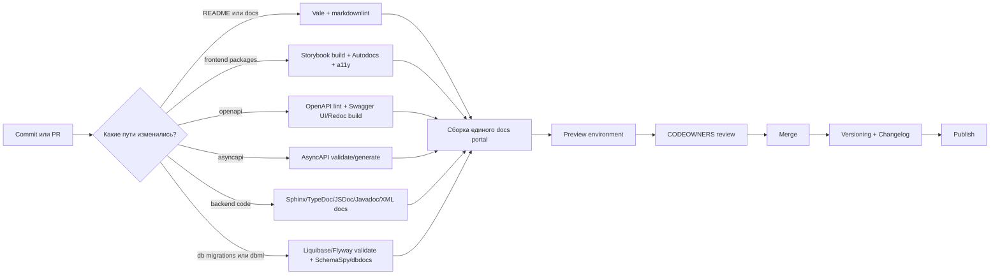
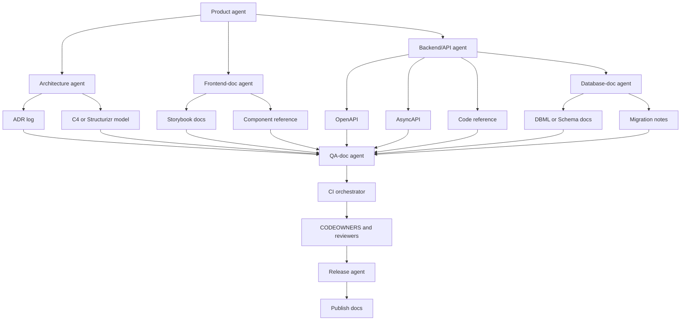

# Документирование проекта и кода для начинающей команды разработки

Source status: `mixed source-backed draft`  
Статус: входной deep-research отчет. Claims пригодны для проектирования Product-Agent OS только после сверки с первоисточниками и записи устойчивых источников в `docs/sources/registry.md`.

## Исполнительное резюме

Хорошая документация — это не «папка с файлами», а рабочая система знаний о продукте: что он делает, почему устроен именно так, как пользоваться его интерфейсами, как изменять код без страха сломать систему и как поддерживать все это в актуальном состоянии. Официальные рекомендации по технической документации сходятся в одном: документация должна быть корректной, актуальной, понятной, релевантной, поддерживаемой, легко находиться по ссылкам и жить под контролем версий; чем больше можно автоматизировать, тем меньше риск «гниения документации».

Для начинающей команды лучший подход — разделить документацию на несколько слоев. Архитектурная документация объясняет границы системы, роли компонентов и принятые решения; здесь особенно полезны ISO/IEC/IEEE 42010, C4 model, arc42 и ADR. C4 дает последовательные уровни приближения — контекст, контейнеры, компоненты и, при необходимости, код; arc42 предлагает готовую структуру архитектурного описания; ADR фиксирует одно решение, его контекст и последствия.

Для frontend, backend и баз данных лучше иметь отдельные «источники истины». Для UI это документация компонентов и состояний, обычно через Storybook и комментарии JSDoc/TypeDoc. Для HTTP API — OpenAPI и инструменты вроде Swagger UI или Redoc; для событийных API — AsyncAPI; для кода backend — Sphinx/pydoc, JSDoc/TypeDoc, Javadoc или XML-комментарии C#. Для БД — миграции, словарь схемы, комментарии на уровне таблиц и колонок, а также генераторы вроде DBML/dbdocs или SchemaSpy.

Если стек, масштаб команды, монорепо/мультирепо, регуляторные ограничения и уровень зрелости CI/CD не указаны, их следует считать **неуточненными**. В таком случае разумный стартовый вариант для большинства команд — Markdown в репозитории, doc-as-code, текстовые диаграммы Mermaid или PlantUML, ADR в Markdown, OpenAPI/AsyncAPI как контракт, один генератор справочной документации по коду и один портал документации на базе MkDocs, Docusaurus, Sphinx или Antora.

## Неуточненные ограничения и базовый подход

В запросе не указаны язык backend, frontend-фреймворк, тип репозитория, уровень публичности API, размер команды и то, нужен ли публичный портал документации. Поэтому ниже используется **вариант по умолчанию**, который подходит как для внутреннего продукта, так и для SaaS/enterprise-команды. Базовое правило: документы, которые тесно связаны с кодом, лучше хранить рядом с кодом в том же репозитории; если нужен единый портал поверх нескольких репозиториев, его лучше строить как агрегатор, а не как отдельную «параллельную реальность». Именно такой подход явно поддерживают GitLab Docs и Antora.

| Ситуация | Стартовый вариант | Когда особенно уместно |
|---|---|---|
| Небольшой продукт или внутренний сервис | **MkDocs + Markdown + Mermaid + GitHub Pages/Pages-like hosting** | Когда важны простота, быстрый запуск и минимум инфраструктуры |
| JS/TS-продукт с богатым UI | **Docusaurus + Storybook + TypeDoc/JSDoc + OpenAPI** | Когда документация должна хорошо работать рядом с frontend-компонентами и MDX |
| Python-heavy backend | **Sphinx + autodoc + Read the Docs или собственный CI-паблишинг** | Когда важны docstrings, автогенерация API-справки и кросс-ссылки |
| Мультирепо или крупная enterprise-документация | **Antora + AsciiDoc + ADR + C4/Structurizr** | Когда документация собирается из нескольких репозиториев и версий |
| Сильный фокус на БД | **DBML/dbdocs или SchemaSpy + миграции Liquibase/Flyway** | Когда схема часто меняется и нужна понятная карта таблиц/связей |

Эти варианты опираются на официальные возможности инструментов: MkDocs ориентирован на проектную документацию в Markdown; Docusaurus — на статически генерируемые сайты документации с версионированием; Sphinx — на технические документы и автогенерацию справки; Antora — на многорепозиторные сайты на AsciiDoc; Storybook — на документацию компонентов; TypeDoc и JSDoc — на генерацию справки из комментариев; Read the Docs — на versioned doc-as-code; DBML/dbdocs и SchemaSpy — на документирование схемы БД.

## Таксономия видов документации

Практически удобно мыслить так: **проектная документация** отвечает на вопросы «что это», «зачем это», «как это собрано» и «что изменилось», а **кодовая документация** отвечает на вопросы «как вызвать», «какие параметры», «какие ограничения», «какие побочные эффекты». Отдельно стоит **контрактная документация** — формальные описания API и схем, из которых можно генерировать сайт, тесты, проверки и клиентские библиотеки.

| Вид документации | Назначение | Аудитория | Рекомендуемая частота обновления | Типичные форматы и инструменты |
|---|---|---|---|---|
| README проекта | Быстрый вход: что это за проект, как запустить, где искать остальное | Новые разработчики, reviewers, DevOps | При любом изменении способа запуска, структуры или ссылок | Markdown в корне репозитория |
| Архитектурный обзор | Понять границы системы, внешние зависимости, ключевые контейнеры и ограничения | Вся команда, техлиды, архитекторы, QA | При изменении архитектуры, интеграций, NFR | arc42, C4, Mermaid, PlantUML, Structurizr |
| ADR | Зафиксировать одно значимое решение и его последствия | Разработчики, архитекторы, future maintainers | Каждый раз при архитектурно значимом решении | Markdown ADR, MADR |
| Документация UI-компонентов | Показать назначение, props, состояния, accessibility, примеры | Frontend, QA, дизайнеры | При изменении компонента или дизайн-системы | Storybook, MDX, JSDoc, TypeDoc |
| Контракт HTTP API | Формально описать ресурсы, операции, схемы, auth, ошибки | Backend, frontend, integrators, QA | При каждом изменении API | OpenAPI, Swagger UI, Redoc/Redocly |
| Контракт событий/API сообщений | Описать каналы, сообщения, payload и роли producer/consumer | Backend, интеграции, platform team | При каждом изменении event contract | AsyncAPI |
| Справка по коду | Понять интерфейс модулей, классов, функций и методов | Разработчики, иногда SDK consumers | При каждом изменении публичного интерфейса | JSDoc, TypeDoc, Sphinx, pydoc, Javadoc, XML docs C# |
| Документация БД | Понять смысл таблиц, колонок, связей, миграций и ограничений | Backend, data/BI, DBA, аналитики | При каждом изменении схемы | DBML, dbdocs, SchemaSpy, pgModeler, SQL comments |
| Changelog | Показать заметные изменения по версиям | Пользователи, команда, support | На каждый релиз | Keep a Changelog + SemVer |

Эта таксономия собрана из официальных ролей и форматов: README в корне репозитория отображается на странице проекта; C4 и arc42 покрывают архитектурное описание; ADR фиксирует контекст, решение и последствия; OpenAPI и AsyncAPI задают машиночитаемый контракт; Storybook, JSDoc/TypeDoc, Sphinx/Javadoc/XML docs служат кодовой справкой; DBML/dbdocs/SchemaSpy описывают схему БД; Keep a Changelog и SemVer задают практику истории изменений и связи ее с версиями.

## Архитектурная документация

Архитектурная документация нужна не ради красивых диаграмм, а чтобы ответить на три базовых вопроса: **какие у системы есть заинтересованные стороны**, **какие у них concerns**, и **какими представлениями системы эти concerns закрываются**. Это прямо соответствует подходу ISO/IEC/IEEE 42010. Для новичка это можно упростить так: сначала опишите окружение системы и ее главные части, потом зафиксируйте важные решения, а уже затем — детали реализации.

C4 model особенно хорош для начинающей команды, потому что дает очень понятную лестницу абстракций: system context, container, component и code. При этом официальный сайт C4 отдельно подчеркивает, что не обязательно использовать все четыре уровня: для многих команд достаточно контекстной и контейнерной диаграмм. arc42 хорошо дополняет это шаблоном разделов, где уже есть место для целей, требований, quality goals, stakeholders, ограничений, решений и рисков.

Практический минимум архитектурной документации для команды новичков лучше держать очень коротким: одна обзорная страница, две C4-диаграммы, список интеграций, журнал ADR и короткая страница про NFR/риски. Если нужен architecture-as-code, Structurizr DSL очень удобен: он позволяет описывать C4-модель текстом, а сам Structurizr workspace может хранить модель, views, Markdown/AsciiDoc-документацию и ADR.

**Пошаговый метод для команды**

1. Создайте файл `docs/architecture/overview.md` и запишите, какую бизнес-задачу решает система, кто ее пользователи и какие внешние системы для нее критичны.  
2. Нарисуйте **C4 System Context**: пользователи, ваша система, внешние интеграции.  
3. Нарисуйте **C4 Container**: фронтенд, backend-сервисы, очередь, БД, кэш, файловое хранилище и каналы связи между ними.  
4. Для каждого контейнера добавьте 3–5 строк текста: ответственность, технология, входы/выходы, ограничения.  
5. Заводите отдельный ADR на каждое решение, которое трудно отменить: выбор БД, очереди, API-стандарта, схемы авторизации, монорепо/мультирепо, подхода к миграциям.  
6. Добавьте страницу `quality-attributes.md`: производительность, доступность, безопасность, наблюдаемость, локализация, доступность UI, требования к данным.  
7. Каждый PR, который меняет границы системы, интеграции или критические NFR, должен менять и соответствующий архитектурный документ.  

Такой цикл хорошо согласуется с официальными подходами ISO 42010, C4, arc42 и ADR/MADR: сначала stakeholders и concerns, затем views, затем решения и их последствия.

**Короткий шаблон архитектурной страницы**

```md
# Архитектурный обзор

## Назначение системы
Кратко: какую бизнес-задачу решает система.

## Основные пользователи и внешние системы
- Пользователь A
- Оператор B
- Платежный шлюз
- Email-провайдер

## Контейнеры
| Контейнер | Ответственность | Технология | Хранит данные |
|---|---|---|---|
| Web app | UI и клиентская логика | React/Vue/... | Нет |
| API service | Бизнес-логика | Node/Python/Java/... | Нет |
| Database | Постоянные данные | PostgreSQL/... | Да |

## Ключевые ограничения
- SLA
- Безопасность
- Регуляторика
- Ограничения интеграций

## ADR
- ADR-0001 ...
- ADR-0002 ...
```

**Шаблон ADR**

```md
# ADR-0003 Выбрать OpenAPI как контракт REST API

Статус: Принято
Дата: 2026-05-23

## Контекст
Нужен единый машиночитаемый контракт для frontend, backend и QA.

## Решение
Используем OpenAPI 3.x как основной формат описания HTTP API.

## Последствия
### Плюсы
- единый источник истины для endpoints и schemas
- можно генерировать документацию и проверки

### Минусы
- требуется дисциплина обновления спецификации
- нужен линтинг в CI
```

**Минимальный пример Structurizr DSL**

```txt
workspace {
  model {
    user = person "Пользователь"
    system = softwareSystem "Product System"
    user -> system "Использует"
  }

  views {
    systemContext system {
      include *
      autoLayout
    }
  }
}
```

Синтаксис текстовых диаграмм и моделей особенно полезен потому, что он version-control friendly, помогает хранить архитектуру рядом с кодом и проще автоматизируется в CI, чем «рисунки мышкой». Mermaid использует Markdown-подобный текстовый синтаксис, PlantUML тоже полностью текстовый, а Structurizr умеет экспортировать представления в PlantUML и Mermaid.

## Документация frontend

Frontend-документация должна объяснять не только «какие есть компоненты», но и **где они используются, в каких состояниях живут, какие у них props/events, какие есть ограничения по доступности и адаптивности, как выглядит happy path и что происходит в empty/loading/error states**. Storybook официально позиционируется как среда для разработки и документирования UI-компонентов и страниц в изоляции, а stories показывают поддерживаемые состояния компонента; Autodocs превращает stories в живую документацию.

Для новичка это означает очень простое правило: **каждый переиспользуемый компонент должен иметь одну страницу документации**, а каждый важный экран — краткое описание маршрута, зависимостей от API и сценариев ошибок. Если у вас React, официальная документация сама учит мыслить интерфейс как композицию компонентов; аналогичный подход легко переносится на Vue, Angular и другие UI-стэки.

Доступность в frontend-документации нельзя считать необязательной. WAI-ARIA и APG рекомендуют сначала по возможности использовать нативный HTML и только затем ARIA-атрибуты и роли; MDN и WAI отдельно подчеркивают, что ARIA нужна прежде всего для сложных пользовательских виджетов и состояний. Storybook также поддерживает accessibility testing как часть рабочего процесса UI-команд.

**Пошаговый метод для команды**

1. Для каждого компонента создайте карточку документации: назначение, когда использовать, когда не использовать, props, events, примеры.  
2. Для каждого компонента покажите обязательные состояния: default, loading, empty, error, disabled, success, responsive variants, keyboard/focus states.  
3. Если компонент общается с backend, укажите его зависимость от endpoint/event и ссылку на contract docs.  
4. Добавьте пару реальных примеров использования компонента в экране, а не только «идеальный» standalone-вид.  
5. Для экранов и маршрутов заведите краткие страницы: путь, цель экрана, какие данные загружаются, какие ошибки должны обрабатываться, какие события аналитики/telemetry возникают.  
6. Для accessibility документируйте роли, labels, keyboard navigation, focus management, aria-live и ограничения скринридеров там, где это важно.  
7. Стройте Storybook в CI и не пропускайте merge, если упал сборочный шаг или accessibility/visual regression checks.  

Этот порядок хорошо опирается на официальные возможности Storybook, MDN/WAI-ARIA и TypeDoc/JSDoc.

**Шаблон карточки компонента**

```md
# Button

## Назначение
Кнопка для подтверждения явного действия пользователя.

## Использовать
- primary action на форме
- подтверждение сохранения

## Не использовать
- как ссылку на другой маршрут
- как контейнер для произвольного HTML

## Props
| Prop | Тип | Обязателен | Описание |
|---|---|---:|---|
| label | string | да | Текст кнопки |
| loading | boolean | нет | Показывает состояние загрузки |
| disabled | boolean | нет | Блокирует действие |

## Состояния
- default
- hover
- focus-visible
- disabled
- loading

## Accessibility
- доступна с клавиатуры
- текстовая метка обязательна
- spinner не должен скрывать текст без альтернативы

## Связанный код
- `src/components/Button.tsx`
- `src/components/Button.stories.tsx`
```

**Короткий пример JSDoc и Storybook state**

```ts
/**
 * Кнопка подтверждения действия.
 *
 * @param props.label Текст на кнопке.
 * @param props.loading Показывает индикатор загрузки.
 * @param props.disabled Блокирует нажатие.
 */
export function Button(props: {
  label: string;
  loading?: boolean;
  disabled?: boolean;
}) {
  // ...
}

export const Loading = {
  args: { label: "Сохранить", loading: true },
};
```

Для TypeScript-проектов TypeDoc особенно удобен как машинно-читаемый слой справки: он генерирует HTML или JSON-модель из комментариев в исходниках; JSDoc дает аналогичный путь для JavaScript и умеет связывать сущности через `{@link}` и tutorials. Это удобно, когда нужно не только показать API-компонента людям, но и дать эту структуру CI или агентам-генераторам.

## Документация backend и API

У backend обычно есть три уровня документации. Первый — **сервисный обзор**: ответственность сервиса, его зависимости, хранилища, очереди, фоновые задачи и NFR. Второй — **контракт**: HTTP API через OpenAPI или message-driven API через AsyncAPI. Третий — **справка по коду**: модули, классы, функции, исключения, примеры использования и ограничения. Такой слоистый подход позволяет не смешивать narrative docs, formal contract и reference docs в одном месте.

OpenAPI — формальный стандарт для описания HTTP API, который позволяет и людям, и инструментам понимать возможности сервиса без чтения исходного кода; Swagger UI визуализирует этот контракт и дает интерактивную навигацию по операциям. AsyncAPI делает то же самое для событийных и message-driven интерфейсов и прямо определяет документ как communication contract между отправителями и получателями. Для JSON payload полезно опираться на RFC 8259 и JSON Schema: JSON Schema официально описывает себя как декларативный язык для аннотирования и валидации структуры JSON-документов.

Документация backend обязательно должна включать безопасность. OpenAPI имеет формальные security schemes, а OWASP API Security Project и API Security Top 10 дают очень практичный перечень рисков, которые стоит отражать в документации: object-level authorization, authentication, sensitive data exposure, resource consumption и другие типовые классы уязвимостей. Для внутреннего стандарта полезно писать требования словами MUST/SHOULD/MAY в смысле RFC 2119, но делать это осознанно и только там, где действительно задается норма, а не «пожелание автора».

**Пошаговый метод для команды**

1. На каждом сервисе держите страницу `docs/service-overview.md`: purpose, owner, dependencies, data stores, background jobs, SLO/SLA и внешние интеграции.  
2. Все внешние HTTP endpoints описывайте в OpenAPI, а не только в prose-тексте.  
3. Все события/топики/очереди описывайте в AsyncAPI, если продукт живет не только на REST.  
4. На каждый endpoint или operation документируйте auth, input/output schemas, error codes, idempotency, pagination/filtering, rate limiting, examples.  
5. Для кода фиксируйте docstrings/structured comments на публичных функциях, классах и исключениях; если интерфейс внутренний, кратко описывайте инварианты и side effects.  
6. Порождайте reference docs автоматически: JSDoc/TypeDoc для JS/TS, Sphinx autodoc/pydoc для Python, Javadoc для Java, XML docs для C#.  
7. Если в документации есть runnable examples, проверяйте их автоматически: для Python это удобно делать через `doctest`.  
8. Добавьте линтер OpenAPI/AsyncAPI в CI, чтобы не допускать невалидационных контрактов в main branch.  

Эта схема опирается на официальные спецификации и инструменты OpenAPI, AsyncAPI, Sphinx, pydoc, Javadoc, C# XML docs, Redocly CLI и Spectral.

**Минимальный шаблон OpenAPI**

```yaml
openapi: 3.1.0
info:
  title: Orders API
  version: 1.2.0
paths:
  /orders/{id}:
    get:
      summary: Получить заказ
      operationId: getOrder
      security:
        - bearerAuth: []
      parameters:
        - in: path
          name: id
          required: true
          schema:
            type: string
      responses:
        '200':
          description: Заказ найден
        '404':
          description: Заказ не найден
components:
  securitySchemes:
    bearerAuth:
      type: http
      scheme: bearer
```

**Минимальный каркас AsyncAPI**

```yaml
asyncapi: 3.0.0
info:
  title: Orders Events
  version: 1.0.0
channels:
  orderCreated:
    address: orders/created
    messages:
      orderCreated:
        payload:
          type: object
          properties:
            orderId:
              type: string
            createdAt:
              type: string
              format: date-time
operations:
  receiveOrderCreated:
    action: receive
    channel:
      $ref: '#/channels/orderCreated'
```

**Пример Python docstring**

```python
def calculate_total(items: list[dict]) -> int:
    """
    Возвращает итоговую стоимость заказа в копейках.

    Args:
        items: Список позиций заказа с полями price и qty.

    Returns:
        Сумма в копейках.

    Raises:
        ValueError: Если qty < 1.
    """
```

Если backend написан на JavaScript, используйте JSDoc; если на TypeScript, чаще удобнее TypeDoc; если на Python, базовый путь — docstrings + Sphinx autodoc/pydoc; если на Java — Javadoc; если на C# — XML documentation comments. Не пытайтесь выбрать один универсальный формат для всех языков — лучше выбрать **один стандарт на язык** и **один стандарт на контракт**.

## Документация баз данных

Документация БД должна отвечать не только на вопрос «какие есть таблицы», но и на более важный вопрос: **что означают данные**. Поэтому хорошая БД-документация состоит из модели схемы, словаря терминов, комментариев к объектам, истории миграций и краткого объяснения того, какие сущности являются источниками истины. DBML официально создан как читаемый DSL для определения и документирования структуры БД; dbdocs публикует такую документацию как веб-проект; SchemaSpy генерирует HTML-документацию с ER-диаграммами.

Схему лучше документировать максимально близко к самой схеме. PostgreSQL поддерживает `COMMENT ON` для объектов БД; MySQL позволяет указывать `COMMENT` для таблиц и колонок. Для эволюции схемы полезны миграционные инструменты: Liquibase использует текстовый changelog и отслеживает примененные changesets через `DATABASECHANGELOG`, а Flyway строит процесс вокруг versioned/repeatable migrations и schema history table.

Если вы работаете с PostgreSQL и нужен richer modeling/reverse engineering, pgModeler — разумный вариант. Если нужен нейтральный текстовый формат, который удобно ревьюить в pull request, DBML обычно проще для командной работы. Для внутренних порталов документации БД чаще всего выигрывают либо **DBML → dbdocs**, либо **schema introspection → SchemaSpy**.

**Пошаговый метод для команды**

1. Заведите `db/README.md` с описанием доменов: пользователи, заказы, платежи, каталоги, аудиты и т.д.  
2. Для каждой таблицы поддерживайте краткое назначение, owner, primary key, основные foreign keys и бизнес-смысл колонок.  
3. Комментируйте таблицы и колонки в самой БД или в миграциях, а не только в Confluence/Notion-like notes.  
4. Храните миграции в репозитории и считайте их canonical history изменений схемы.  
5. Генерируйте визуальное представление схемы автоматически: DBML/dbdocs, SchemaSpy или pgModeler export.  
6. Для аналитических и data-heavy систем отдельно отмечайте PII/чувствительные поля, retention и источники master data.  
7. Каждый PR с новой миграцией должен обновлять словарь схемы и, если нужно, ERD/DB docs build.  

Так вы связываете «смысл данных», «реальную схему» и «историю изменений» в один поддерживаемый контур.

**Пример SQL-комментариев**

```sql
COMMENT ON TABLE orders IS 'Заказы клиентов';
COMMENT ON COLUMN orders.status IS 'Статус заказа: new, paid, shipped, canceled';
COMMENT ON COLUMN orders.total_amount IS 'Итоговая сумма в копейках';
```

**Пример MySQL-комментариев**

```sql
CREATE TABLE orders (
  id BIGINT PRIMARY KEY,
  status VARCHAR(32) COMMENT 'new|paid|shipped|canceled',
  total_amount BIGINT COMMENT 'Сумма в копейках'
) COMMENT='Заказы клиентов';
```

**Пример DBML**

```dbml
Table users {
  id bigint [pk]
  email varchar [unique, note: 'Уникальный email пользователя']
  created_at timestamp
}

Table orders {
  id bigint [pk]
  user_id bigint [ref: > users.id]
  status varchar [note: 'new|paid|shipped|canceled']
  total_amount bigint [note: 'Сумма в копейках']
  created_at timestamp
}
```

**Шаблон страницы словаря БД**

```md
# orders

## Назначение
Хранит заказы клиентов после подтверждения корзины.

## Ключи и связи
- PK: id
- FK: user_id -> users.id

## Важные поля
- status: жизненный цикл заказа
- total_amount: сумма в копейках
- created_at: дата создания

## Бизнес-правила
- заказ без позиций не создается
- отмененный заказ не может перейти в shipped

## История изменений
- V12__add_total_amount.sql
- V18__add_order_status_index.sql
```

## Инструменты, процессы, поддержка и мультиагентная оркестрация

Самая полезная практика для поддержки документации — **связывать ее с кодом ссылками и общими артефактами**, а не копировать один и тот же текст в разные места. GitHub поддерживает относительные ссылки в Markdown и permalinks на конкретные строки кода; JSDoc поддерживает `{@link}` и `@see`; Sphinx умеет делать семантические cross-references внутри и между документами. Это означает, что README может вести на `docs/architecture/overview.md`, архитектурная страница — на OpenAPI-файл и код, а кодовые комментарии — на tutorial/guide.

Для версионирования лучше придерживаться двух связанных правил. Первое: если у вас есть публичный API, его версия должна быть ясной и точной, что прямо соответствует SemVer. Второе: changelog должен быть curated списком заметных изменений, а не просто выгрузкой git log. Docusaurus и Read the Docs поддерживают versioned documentation; Conventional Commits помогает автоматизировать явную историю изменений и хорошо сочетается с SemVer и changelog generation.

Для ревью и поддержки документации используйте те же механизмы, что и для кода. GitLab прямо пишет, что документация хранится вместе с кодом и проходит похожие процессы качества; GitHub и GitLab поддерживают CODEOWNERS, а GitHub protected branches умеют требовать review от code owners и прохождение status checks перед merge. Для команды это означает простое правило: `docs/**`, `openapi/**`, `asyncapi/**`, `db/**` и `packages/ui/**` должны иметь явных владельцев и обязательный review.

Для автоматизации лучше идти по пути **doc-as-code + CI generation**. GitHub Actions определяет workflow как конфигурируемый автоматизированный процесс в YAML; GitHub Pages может публиковать сайт из branch или через Actions; GitLab CI/CD строится на `.gitlab-ci.yml`. Поверх этого вы добавляете специальные jobs: `vale` для prose linting, `markdownlint` для Markdown, `redocly lint` или Spectral для API contracts, Storybook build для frontend docs, Sphinx/TypeDoc/JSDoc для code reference, DB docs build для схемы и changelog/version jobs для релиза.

| Категория | Рекомендуемые инструменты | Когда брать | Что они дают автоматически |
|---|---|---|---|
| Портал документации | MkDocs, Docusaurus, Sphinx, Antora | Один проект, JS/TS docs portal, Python docs, мультирепо enterprise | HTML-сайт, навигация, версионирование, cross-links |
| Архитектура | C4 + Structurizr DSL, Mermaid, PlantUML, arc42, ADR | Когда нужен architecture-as-code и lean diagrams | Текстовые модели/диаграммы, экспорт, единая структура решений |
| Frontend docs | Storybook, TypeDoc/JSDoc | Компонентный UI, дизайн-система, reusable component library | Документация компонентов из stories и comments |
| Backend/API docs | OpenAPI + Swagger UI/Redoc, AsyncAPI, Sphinx/pydoc, Javadoc, XML docs | HTTP API, event-driven API, language-specific code reference | Машиночитаемый контракт, interactive docs, generated reference |
| База данных | DBML + dbdocs, SchemaSpy, pgModeler, Liquibase/Flyway | Частые изменения схемы, сложные связи, migration-driven DB | Веб-документация схемы, ERD, history of schema changes |
| Качество документации | Vale, markdownlint, Redocly CLI, Spectral, Storybook a11y/visual tests | Когда нужен quality gate в PR | Линтинг prose/Markdown/contracts/UI docs |
| Публикация | GitHub Actions + Pages, GitLab CI/CD, Read the Docs | Почти всегда | Автосборка, preview, публикация, versioned docs |

Сравнение в таблице выше основано на официальных описаниях соответствующих инструментов и спецификаций.

Ниже — практичный workflow, который связывает изменения кода с обновлением документации и публикацией preview/docs release.



Такой pipeline напрямую поддерживается официальными CI/CD и docs-инструментами: workflow YAML в GitHub Actions и GitLab CI/CD, Pages/hosting для публикации, automatic build/test/lint для docs-as-code, versioned docs в Docusaurus/Read the Docs, линтеры Vale/Redocly/Spectral и built-from-stories frontend docs в Storybook.

Для мультиагентной системы разработки сложного продукта полезно закрепить **источники истины по областям** и дать каждому агенту четкую зону ответственности. На практике это выглядит так.

| Роль агента | Вход | Выход | Авто-проверка |
|---|---|---|---|
| Product/BA agent | Требования, user stories, roadmap | README changes, glossary, feature overview | Vale, markdownlint, link check |
| Architecture agent | Требования и constraints | C4/Structurizr, arc42 sections, ADR proposals | Structurizr DSL validate, diagram render |
| Frontend-doc agent | Изменения компонентов и экранов | Storybook stories/docs, component cards, props notes | Storybook build, a11y, visual tests |
| Backend/API agent | Service changes, handlers, schemas | OpenAPI/AsyncAPI, examples, error catalogs, code comments | OpenAPI/AsyncAPI lint, generated docs build |
| Database-doc agent | Миграции, schema changes | DBML/Schema docs, data dictionary, migration notes | Liquibase/Flyway validate, SchemaSpy/dbdocs build |
| QA-doc agent | Acceptance criteria, regression scope | test scenarios, release notes, docs gap report | CI aggregation, broken-link report |
| Release agent | Merged changes | version bump, changelog, docs publication | SemVer/Conventional Commits/changelog checks |

Эта схема особенно сильна, когда артефакты машиночитаемы: Structurizr DSL для архитектуры, OpenAPI/AsyncAPI для контрактов, TypeDoc JSON или Sphinx reference для кода, DBML для схемы, Conventional Commits + changelog + SemVer для релизного цикла. Некоторые из этих инструментов прямо ориентированы на machine-friendly generation: TypeDoc генерирует JSON model, AsyncAPI generator умеет генерировать documentation/code/configs, Structurizr DSL можно валидировать и экспортировать во внешние форматы.

Пример оркестрации агентов и автоматических крючков можно представить так.



**Рекомендуемые automation hooks и triggers**

| Trigger | Что запускать | Кто обязан одобрить |
|---|---|---|
| Изменился `README.md` или `docs/**` | Vale, markdownlint, link check, preview build | owner документации |
| Изменился `openapi/**` | `redocly lint`, Swagger UI/Redoc preview, contract diff | backend/API owner |
| Изменился `asyncapi/**` | AsyncAPI validate/generate, examples preview | platform/integration owner |
| Изменился `packages/ui/**` или `src/components/**` | Storybook build, Autodocs, a11y, visual tests | frontend owner |
| Изменился `src/backend/**` и затронут public interface | code docs build, contract consistency check | backend owner |
| Изменился `db/migrations/**` или `db/**/*.dbml` | Liquibase/Flyway validate, SchemaSpy/dbdocs build | DB owner |
| Изменился `docs/adr/**` или `structurizr/**` | DSL validate, diagram export, architecture preview | architect/tech lead |

Эти триггеры — уже не стандарт, а рекомендованная оркестрационная политика, построенная поверх официальных возможностей GitHub Actions, GitLab CI/CD, Storybook, Redocly, AsyncAPI generator, Structurizr, Liquibase/Flyway и DB-docs tooling.

**Пошаговый план внедрения**

1. В первую итерацию создайте каркас: `README.md`, `docs/architecture`, `docs/adr`, `openapi/`, `asyncapi/`, `db/`, `packages/ui` или аналогичные каталоги. Выберите один docs portal и один формат диаграмм.  
2. Во вторую итерацию определите источники истины: архитектура — C4/Structurizr + ADR; HTTP — OpenAPI; события — AsyncAPI; UI — Storybook + comments; БД — migrations + DBML/comments.  
3. В третью итерацию подключите CI: линтинг prose и Markdown, проверка контрактов API, генерация reference docs, preview deployment, CODEOWNERS и protected branches.  
4. В четвертую итерацию вводите агентов: сначала на генерацию черновиков, затем на update checks, и только после этого — на частичную автоматическую публикацию.  

Если нужен один **дефолтный набор без уточнения стека**, берите такой: Markdown + Git + MkDocs или Docusaurus для портала; Mermaid или PlantUML для диаграмм; ADR в Markdown; Storybook для frontend; OpenAPI/Swagger UI или Redoc для HTTP; AsyncAPI для событий; TypeDoc/JSDoc или Sphinx для кодовой справки; DBML/dbdocs или SchemaSpy для БД; GitHub Actions или GitLab CI/CD для сборки и публикации; Vale и markdownlint как базовые quality gates. Это сочетание дает хороший баланс между низким порогом входа и зрелой автоматизацией.

