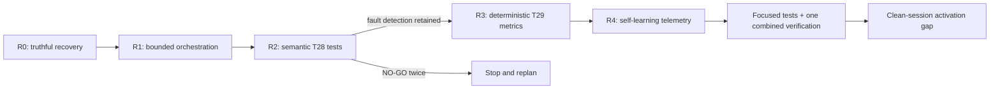

# Archive - Product-Agent OS: execution-loop remediation and delivery recovery {#product-agent-os-execution-loop-remediation-and-delivery-recovery}

> Historical source record. Dates and verdicts below describe that run; use current guides for present behavior.

Source status: `active local implementation plan; hook/automation activation and external actions are not authorized`

## Scope

- Schema version: task_matrix_plan_v1
- Prepared: 17-08-2026 06:06 Europe/Moscow
- Project: Product-Agent OS
- Task ID: `PAOS-LOOP-REMEDIATION-2026-08-17`
- Trigger: independent audit of task `019feb6f-301c-7f63-947e-e27b1ea8ab11`, project-local `.codex`, and control-plane files.
- Goal: stop repeated checks without new evidence and restore sequential progress of implementation slices.
- Constraint: one writing root agent; no subagents, Git writes, provider/model calls, deployment, publishing, or hook/automation activation.

## Change comparison matrix

| Current state | Action / change | Technical meaning | Product meaning for the user |
| --- | --- | --- | --- |
| S9-C is `in_progress` in the marker and `planned` in the plan; T29 has not started | Close the old run as `stopped_repair_required` / `partially_implemented_not_accepted`; T28=`repair_required`, T29=`blocked` | New sessions do not continue a false active route | Honest progress and an explicit reason for stopping |
| All 15 subagent profiles require a full Task Brief and Completion Brief | Lifecycle and user-facing briefs belong only to root; a subagent returns a compact Result Packet | Removes nested lifecycle loops and duplicate control-plane writes | Less ceremony and faster delivery of working results |
| Concurrency=6 and 11 fresh-context files | Concurrency=3; 4 core context files; the rest are role-specific | Reduces write conflicts, context pressure, and compaction | Fewer pauses and contradictory handoffs |
| Project-local and plugin-cache skills may be mixed | Repository-local skills are canonical; SessionStart reports provenance/hash; mixed source is a stop condition | One reproducible instruction source per run | Stable behavior between sessions |
| Review/retry has no numeric budget; an unchanged command can be repeated | Maximum 2 repair cycles; a repeat requires a named changed input; 30 minutes without a target diff means stop/replan | Makes the loop finite and measurable | Time goes to implementation, not tests for their own sake |
| The Stop hook recognizes only the completion-ready path | Permit terminal `blocked`/`stopped_repair_required`; SessionStart diagnoses a stale marker | A blocker ends the run without self-restart | The user receives a specific blocker and next action |
| State is duplicated across plan/task-group/RUNLOG/TEST/lifecycle | Ownership: task-group=machine state, task plan=detail, lifecycle=current run, RUNLOG=evidence, TEST=evidence ceiling | Removes projection conflicts and drift | Statuses become trustworthy |
| T28 stores 196 line/text-sensitive exceptions | Compact semantic cases and stable field-path invariants; exceptions <=10 | Tests protect the contract instead of wording or line numbers | Faster product changes without losing fault detection |
| T29 deterministic metrics are absent | Typed metrics plus promotion blockers; self-score is diagnostic only | Missing evidence blocks promotion | Reproducible quality and risk assessment |
| Self-learning does not measure the execution loop | Add first-diff latency, fan-out, repeats, churn, compactions, stale/mixed state, and stop triggers | Process degradation becomes observable | Earlier detection of stalled delivery |
| Changed hook files could be mistaken for runtime proof | Change assets/tests while keeping activation as a clean-session acceptance gate | Separates static contract from activation evidence | No false “fixed” claim |

## Sequence and budgets

- Writer concurrency: 1.
- Review: one review after R2 and one completion-skeptic pass after R4.
- Repair budget: at most 2 cycles per slice.
- Repeat budget: repeat the same command only after naming the changed input/code/config/fixture/environment.
- Progress timeout: if no target implementation diff or new blocker evidence appears for 30 minutes, stop and replan the slice.
- Control-plane writes: one initial truthful recovery and one final sync after acceptance.

### Task `PAOS-R0-STATE-RECOVERY`

- Task: close the stale S9-C route and align machine/user-facing state.
- Status: implemented
- Schema version: task_matrix_plan_v1
- Timezone: Europe/Moscow
- Plan trigger: contradictory active marker after interrupted T28 work.
- Validator target: detailed task blocks
- Date and time of task implementation: 17-08-2026 06:06
- Depends on: none
- Blocks: R1-R4 until truthful state exists
- Source: lifecycle marker; S9-C plans; task-group JSON; PLAN.md; RUNLOG.md; TEST.md
- Short description: record `partially_implemented_not_accepted`, T28=`repair_required`, T29=`blocked`.
- Technical value: removes stale route and projection conflict.
- Product value: restores honest status and a manageable next step.
- Scope: the listed state/control-plane artifacts.
- Non-goals: accepting current T28 or starting T29.
- Expected result: one consistent recovery route.
- Acceptance criteria: every projection refers to one task-group state; the old run is not active.
- Verification gates: JSON parse; plan validator; focused state tests.
- Risks / approval gates: preserve existing S9-B/S9-C evidence edits.
- Complexity: medium
- Estimated execution time: 30-60 minutes
- Agents: root only
- Skills: implementation-planner; docs-maintainer
- Output artifacts: lifecycle; S9-C RU/EN plans; task-group; PLAN/RUNLOG/TEST
- Next step: R1 after focused state validation.

#### Completion Report

- status: implemented
- what was done: stale S9-C was closed as blocked/repair-required; T28 and T29 received truthful machine states; root projections point to the recovery route.
- files touched / work locations: S9-C RU/EN plans; task-group JSON; PLAN.md; RUNLOG.md; TEST.md; lifecycle marker.
- technical value delivered: removed the stale active route and aligned state ownership.
- product value delivered: a new run no longer presents unfinished T28 as ongoing implementation.
- actual implementation date and time: 17-08-2026 06:06
- verification evidence: task-group JSON parsed; both stopped S9-C plans and the active recovery plan passed task-matrix validation.
- residual risks: T28 debt was not yet repaired; lifecycle runtime activation was not verified.
- follow-up: R1

### Task `PAOS-R1-BOUNDED-ORCHESTRATION`

- Task: make orchestration root-owned, bounded, and canonical-source-aware.
- Status: implemented
- Schema version: task_matrix_plan_v1
- Timezone: Europe/Moscow
- Plan trigger: R0 accepted.
- Validator target: detailed task blocks
- Date and time of task implementation: 17-08-2026 06:33
- Depends on: PAOS-R0-STATE-RECOVERY
- Blocks: R2
- Source: active `.codex` config/agents/workflows/hooks/evals and plugin asset mirrors.
- Short description: concurrency 3; core context 4; root-only lifecycle; bounded review/retry; stale recovery; skill provenance.
- Technical value: finite orchestration protocol without nested lifecycle loops.
- Product value: less delay and repetition, more time for target implementation.
- Scope: active `.codex` and matching Product-Agent OS templates/tests.
- Non-goals: runtime activation proof.
- Expected result: static contracts and focused tests are aligned.
- Acceptance criteria: active/template roles do not require subagent briefs; root contract and budgets validate.
- Verification gates: TOML/JSON parse; lifecycle/config/template tests.
- Risks / approval gates: hook activation is not separately authorized.
- Complexity: high
- Estimated execution time: 2-3 hours
- Agents: root only
- Skills: openai-docs; agent-team-designer; documentation-and-adrs
- Output artifacts: config; workflows; hooks; agents; evals; tests
- Next step: R2.

#### Completion Report

- status: implemented
- what was done: root-only lifecycle, concurrency/context/review budgets, canonical skill provenance, stale-marker recovery, and terminal blocker states were added to active/template contracts.
- files touched / work locations: active/template config, 23 agent profiles, lifecycle/review/ownership workflows, hook scripts, eval contracts, and focused tests.
- technical value delivered: nested lifecycle/control-plane loops were removed; writer/review/repeat budgets are explicit and SessionStart reports the canonical skill digest.
- product value delivered: fewer repeated briefs/checks and lower fan-out/context pressure.
- actual implementation date and time: 17-08-2026 06:33
- verification evidence: lifecycle/hooks 29/29; focused infrastructure template/config contracts green; both eval JSON files parse.
- residual risks: clean-session activation gap; PreToolUse role enforcement was not added because the official hook payload does not provide a reliable delegated-role field.
- follow-up: R2

### Task `PAOS-R2-T28-SEMANTIC-TESTS`

- Task: replace repeated exact assertions with stable semantic contracts.
- Status: implemented
- Schema version: task_matrix_plan_v1
- Timezone: Europe/Moscow
- Plan trigger: R1 accepted.
- Validator target: detailed task blocks
- Date and time of task implementation: 17-08-2026 06:33
- Depends on: PAOS-R1-BOUNDED-ORCHESTRATION
- Blocks: R3
- Source: three T28 test files and task-group acceptance.
- Short description: compact PACKET_CASES, stable `contract_id`/field paths/invariants, without line/source-text identities.
- Technical value: reduces brittle test debt while retaining fault detection.
- Product value: faster changes without artificial test load.
- Scope: T28 files only.
- Non-goals: historical evidence rewrite.
- Expected result: repeated-family count <=98, exceptions <=10, combined test LOC does not grow.
- Acceptance criteria: all seeded faults fail; at most two NO-GO repair cycles.
- Verification gates: red/green focused suite; before/after inventory.
- Risks / approval gates: stop if fault detection is lost.
- Complexity: high
- Estimated execution time: 1-2 hours
- Agents: root only
- Skills: python-design-patterns; python-code-style
- Output artifacts: three T28 tests
- Next step: R3 only after a green handoff.

#### Completion Report

- status: implemented
- what was done: the legacy T18-T22 exact-assertion block and 196-record exception manifest were replaced by semantic packet cases with stable field paths and seeded corruptions.
- files touched / work locations: three T28 test files; RUNLOG traceability pointer.
- technical value delivered: repeated families 196→34; combined test LOC 8130→5658; retained owned exceptions=3.
- product value delivered: materially less test debt while preserving failure detection.
- actual implementation date and time: 17-08-2026 06:33
- verification evidence: 48/48 focused T28 tests after one RUNLOG traceability repair cycle.
- residual risks: the metric is an anomaly inventory, not universal test-quality proof.
- follow-up: R3

### Task `PAOS-R3-T29-DETERMINISTIC-METRICS`

- Task: implement deterministic quality metrics and promotion blockers.
- Status: implemented
- Schema version: task_matrix_plan_v1
- Timezone: Europe/Moscow
- Plan trigger: R2 green.
- Validator target: detailed task blocks
- Date and time of task implementation: 17-08-2026 06:33
- Depends on: PAOS-R2-T28-SEMANTIC-TESTS
- Blocks: R4
- Source: promotion contract; T29 task contract; eval templates.
- Short description: typed acceptance/regression/seeded-fault/reviewer/dependency/performance/cost signals; self-score diagnostic only.
- Technical value: missing/NA semantics and deterministic promotion decision.
- Product value: quality and risk are explainable and reproducible.
- Scope: metric module/schema/test and promotion integration.
- Non-goals: live benchmark/provider proof.
- Expected result: missing required evidence blocks promotion; applicable gates are typed.
- Acceptance criteria: a single proxy/self-score does not permit promotion; missing is not converted to zero/success.
- Verification gates: focused metrics plus promotion tests; JSON parse.
- Risks / approval gates: do not mix T30 reviewer implementation.
- Complexity: high
- Estimated execution time: 1-2 hours
- Agents: root only
- Skills: python-design-patterns; python-code-style
- Output artifacts: module; template; tests; promotion integration
- Next step: R4.

#### Completion Report

- status: implemented
- what was done: typed deterministic evidence aggregator, JSON contract, and promotion-contract wrapper added.
- files touched / work locations: code_quality_metrics.py; code-quality-metrics.json; metric and promotion tests; promotion_contract.py.
- technical value delivered: required missing/failed evidence blocks; performance/cost use applicability; self-score cannot influence promotion.
- product value delivered: explainable, repeatable local quality decision.
- actual implementation date and time: 17-08-2026 06:33
- verification evidence: 23/23 focused metric and promotion-contract tests.
- residual risks: live performance evidence remains applicability-dependent; this is not promotion proof.
- follow-up: R4

### Task `PAOS-R4-SELF-LEARNING-LOOP`

- Task: add manual loop telemetry and stop-trigger recommendations.
- Status: implemented
- Schema version: task_matrix_plan_v1
- Timezone: Europe/Moscow
- Plan trigger: R3 accepted.
- Validator target: detailed task blocks
- Date and time of task implementation: 17-08-2026 06:33
- Depends on: PAOS-R3-T29-DETERMINISTIC-METRICS
- Blocks: final combined verification
- Source: agent skill metrics/report; learning-loop profile; self-learning tests.
- Short description: measure process-loop regressions and produce bounded recommendations.
- Technical value: observable first-diff latency, fan-out, repeat, churn, compaction, stale/mixed-source signals.
- Product value: early warning before delivery stops completely.
- Scope: metrics/report/tests/agent instructions; no automation activation.
- Non-goals: automatic mutation of durable instructions or launching external agents.
- Expected result: deterministic loop diagnosis with an explicit evidence ceiling.
- Acceptance criteria: fixture regressions produce stop triggers; missing fields are not treated as success.
- Verification gates: focused metrics/report/self-learning tests; combined suite.
- Risks / approval gates: recommendations do not mutate config automatically.
- Complexity: medium
- Estimated execution time: 1-2 hours
- Agents: root only
- Skills: Product-Agent OS self-learning mechanisms; python-design-patterns; python-code-style
- Output artifacts: metrics module/report/tests/learning-loop profile
- Next step: combined validation and clean-session handoff.

#### Completion Report

- status: implemented
- what was done: execution-loop metrics, report section, manual docs, and learning-loop agent stop guidance added.
- files touched / work locations: agent_skill_metrics.py; agent_skill_metrics_report.py; RU/EN self-learning docs; learning-loop agent; focused tests.
- technical value delivered: delivery-loop regressions now produce deterministic stop triggers without auto-mutation.
- product value delivered: repeat/fan-out/stale-state degradation can be detected before delivery stops.
- actual implementation date and time: 17-08-2026 06:33
- verification evidence: 7/7 focused execution-loop/report tests.
- residual risks: clean-session activation remains a user acceptance gate; diagnostics need real sanitized run records.
- follow-up: restart the Codex task and verify the loaded instruction chain, provenance, hook behavior, latency/tokens/cost

## Final verification

- Product-Agent OS docs: 100/100.
- Combined affected-contract route excluding the already verified docs module: 208/208.
- Strict MkDocs through the project-local dependency target and Python 3.13: exit 0; generated `site/` restored to 652 files and file-safe i18n normalization passed.
- Task-matrix RU/EN and task-state consistency validators: green before the final static pass.
- Evidence ceiling: local/static verification only; hook trust/activation, fresh-task behavior, provider/model quality, latency/tokens/cost, external review, and promotion are not proven.

## Rollback

- Changes are separated by R0-R4 and do not require Git history operations.
- On a focused failure, only the current slice returns to repair; the previous green slice remains unchanged.
- Hook activation is outside this implementation, so runtime disable/rollback is not required.

## Subsequent documentation handoff — 2026-11-03

Current root task `PAOS-DOCS-REFRESH-2026-11-03` is owned by the [new documentation plan](2026-11-03-gpt6-documentation-refresh.md). This dated pointer lets the legacy state-consistency check locate the current task; it does not change any August implementation status, result or Batch 45 dependency. The validator still hardcodes this historical plan; generalizing that implementation is separate follow-up.
