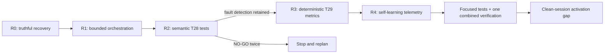

# Product-Agent OS: устранение execution-loop и восстановление delivery

Source status: `активный локальный implementation plan; hooks/automation activation и внешние действия не авторизованы`

## Область

- Schema version: task_matrix_plan_v1
- Сформировано: 17-08-2026 06:06 Europe/Moscow
- Проект: Product-Agent OS
- Task ID: `PAOS-LOOP-REMEDIATION-2026-08-17`
- Trigger: независимый аудит task `019feb6f-301c-7f63-947e-e27b1ea8ab11`, project-local `.codex` и control-plane файлов.
- Цель: прекратить повторные проверки без нового evidence и вернуть последовательное продвижение implementation slices.
- Ограничение: один пишущий root-agent; без subagents, Git-записей, provider/model calls, deployment, публикации и активации hooks/automation.

## Сравнительная матрица изменений

| Сейчас | Действие / изменение | Техническое значение | Продуктовое значение для пользователя |
| --- | --- | --- | --- |
| S9-C числится `in_progress` в marker и `planned` в плане; T29 не начат | Закрыть старый запуск как `stopped_repair_required` / `partially_implemented_not_accepted`; T28=`repair_required`, T29=`blocked` | Новые сессии не продолжают ложный active route | Честный прогресс и понятная причина остановки |
| Все 15 subagent profiles требуют полный Task Brief и Completion Brief | Lifecycle и user-facing briefs принадлежат только root; subagent возвращает компактный Result Packet | Удаляет nested lifecycle loops и дублирование control plane | Меньше церемонии, быстрее появляется рабочий результат |
| Concurrency=6 и 11 fresh-context files | Concurrency=3; 4 core context files; остальное role-specific | Снижает write conflicts, context pressure и compaction | Меньше пауз и противоречивых handoff |
| Project-local и plugin-cache skills могут смешиваться | Repository-local skills — canonical; SessionStart показывает provenance/hash; mixed source — stop | Один воспроизводимый instruction source на run | Стабильное поведение между сессиями |
| Review/retry не имеет численного бюджета; unchanged command можно повторять | Максимум 2 repair cycles; повтор требует named changed input; 30 минут без target diff — stop/replan | Цикл становится конечным и измеримым | Время уходит на реализацию, а не на тесты ради тестов |
| Stop hook знает только completion-ready path | Разрешить terminal `blocked`/`stopped_repair_required`; SessionStart диагностирует stale marker | Blocker корректно завершает run без самоперезапуска | Пользователь получает конкретный blocker и следующий шаг |
| State дублируется в plan/task-group/RUNLOG/TEST/lifecycle | Ownership: task-group=machine state, task plan=detail, lifecycle=current run, RUNLOG=evidence, TEST=evidence ceiling | Устраняет projection conflicts и drift | Статусы становятся доверенными |
| T28 хранит 196 line/text-sensitive exceptions | Compact semantic cases и stable field-path invariants; exceptions <=10 | Тесты защищают контракт, не формулировку/номер строки | Быстрее менять продукт без потери fault detection |
| T29 deterministic metrics отсутствуют | Typed metrics + promotion blockers; self-score diagnostic only | Missing evidence блокирует promotion | Воспроизводимая оценка качества и риска |
| Self-learning не измеряет execution loop | Добавить first-diff latency, fan-out, repeats, churn, compactions, stale/mixed state и stop triggers | Процессная деградация становится observable | Раннее обнаружение остановки delivery |
| Изменённые hook files можно ошибочно принять за runtime proof | Изменить assets/tests, но activation оставить clean-session acceptance gate | Static contract отделён от activation evidence | Нет ложного заявления «исправлено» |

## Последовательность и бюджеты

- Writer concurrency: 1.
- Review: один review после R2 и один completion-skeptic pass после R4.
- Repair budget: максимум 2 цикла на slice.
- Repeat budget: та же команда повторяется только после названного изменения input/code/config/fixture/environment.
- Progress timeout: если за 30 минут нет target implementation diff или нового blocker evidence, slice останавливается и перепланируется.
- Control-plane writes: начальный truthful recovery и один итоговый sync после acceptance.

### Task `PAOS-R0-STATE-RECOVERY`

- Task: закрыть stale S9-C route и согласовать machine/user-facing state.
- Status: implemented
- Schema version: task_matrix_plan_v1
- Timezone: Europe/Moscow
- Plan trigger: противоречивый active marker после прерванного T28.
- Validator target: detailed task blocks
- Date and time of task implementation: 17-08-2026 06:06
- Depends on: none
- Blocks: R1-R4 until truthful state exists
- Source: lifecycle marker; S9-C plans; task-group JSON; PLAN.md; RUNLOG.md; TEST.md
- Short description: записать `partially_implemented_not_accepted`, T28=`repair_required`, T29=`blocked`.
- Technical value: устраняет stale route и projection conflict.
- Product value: возвращает честный статус и управляемый следующий шаг.
- Scope: перечисленные state/control-plane artifacts.
- Non-goals: принимать текущий T28 или начинать T29.
- Expected result: один непротиворечивый recovery route.
- Acceptance criteria: все проекции ссылаются на один task-group state; старый run не active.
- Verification gates: JSON parse; plan validator; focused state tests.
- Risks / approval gates: сохранить существующие S9-B/S9-C evidence edits.
- Complexity: medium
- Estimated execution time: 30-60 minutes
- Agents: root only
- Skills: implementation-planner; docs-maintainer
- Output artifacts: lifecycle; S9-C RU/EN plans; task-group; PLAN/RUNLOG/TEST
- Next step: R1 после focused state validation.

#### Completion Report

- status: implemented
- what was done: stale S9-C закрыт как blocked/repair-required; T28 и T29 получили честные machine states; root projections указывают на recovery route.
- files touched / work locations: S9-C RU/EN plans; task-group JSON; PLAN.md; RUNLOG.md; TEST.md; lifecycle marker.
- technical value delivered: устранён stale active route и согласован state ownership.
- product value delivered: новый run больше не выдаёт незавершённый T28 за продолжающуюся реализацию.
- actual implementation date and time: 17-08-2026 06:06
- verification evidence: task-group JSON parsed; both stopped S9-C plans and active recovery plan passed task-matrix validation.
- residual risks: T28 debt ещё не отремонтирован; lifecycle runtime activation не проверена.
- follow-up: R1

### Task `PAOS-R1-BOUNDED-ORCHESTRATION`

- Task: сделать orchestration root-owned, bounded и canonical-source-aware.
- Status: implemented
- Schema version: task_matrix_plan_v1
- Timezone: Europe/Moscow
- Plan trigger: R0 accepted.
- Validator target: detailed task blocks
- Date and time of task implementation: 17-08-2026 06:33
- Depends on: PAOS-R0-STATE-RECOVERY
- Blocks: R2
- Source: active `.codex` config/agents/workflows/hooks/evals и plugin asset mirrors.
- Short description: concurrency 3; core context 4; root-only lifecycle; bounded review/retry; stale recovery; skill provenance.
- Technical value: конечный orchestration protocol без nested lifecycle loops.
- Product value: меньше задержек и повторов, больше времени на target implementation.
- Scope: active `.codex` и matching Product-Agent OS templates/tests.
- Non-goals: runtime activation proof.
- Expected result: static contracts и focused tests согласованы.
- Acceptance criteria: active/template roles не требуют subagent briefs; root contract и budgets валидируются.
- Verification gates: TOML/JSON parse; lifecycle/config/template tests.
- Risks / approval gates: hook activation отдельно не авторизована.
- Complexity: high
- Estimated execution time: 2-3 hours
- Agents: root only
- Skills: openai-docs; agent-team-designer; documentation-and-adrs
- Output artifacts: config; workflows; hooks; agents; evals; tests
- Next step: R2.

#### Completion Report

- status: implemented
- what was done: root-only lifecycle, concurrency/context/review budgets, canonical skill provenance, stale marker recovery and terminal blocker states added to active/template contracts.
- files touched / work locations: active/template config, 23 agent profiles, lifecycle/review/ownership workflows, hook scripts, eval contracts and focused tests.
- technical value delivered: nested lifecycle/control-plane loops removed; writer/review/repeat budgets are explicit and SessionStart reports canonical skill digest.
- product value delivered: fewer repeated briefs/checks and lower fan-out/context pressure.
- actual implementation date and time: 17-08-2026 06:33
- verification evidence: lifecycle/hooks 29/29; focused infrastructure template/config contracts green; both eval JSON files parse.
- residual risks: clean-session activation gap; PreToolUse role enforcement was not added because the official hook payload does not provide a reliable delegated-role field.
- follow-up: R2

### Task `PAOS-R2-T28-SEMANTIC-TESTS`

- Task: заменить repeated exact assertions стабильными semantic contracts.
- Status: implemented
- Schema version: task_matrix_plan_v1
- Timezone: Europe/Moscow
- Plan trigger: R1 accepted.
- Validator target: detailed task blocks
- Date and time of task implementation: 17-08-2026 06:33
- Depends on: PAOS-R1-BOUNDED-ORCHESTRATION
- Blocks: R3
- Source: три T28 test files и task-group acceptance.
- Short description: compact PACKET_CASES, stable `contract_id`/field paths/invariants, без line/source-text identities.
- Technical value: уменьшает brittle test debt при сохранении fault detection.
- Product value: более быстрые изменения без фиктивной тестовой нагрузки.
- Scope: T28 files only.
- Non-goals: historical evidence rewrite.
- Expected result: repeated-family count <=98, exceptions <=10, combined test LOC не растёт.
- Acceptance criteria: все seeded faults падают; максимум два NO-GO repair cycles.
- Verification gates: red/green focused suite; before/after inventory.
- Risks / approval gates: stop при потере fault detection.
- Complexity: high
- Estimated execution time: 1-2 hours
- Agents: root only
- Skills: python-design-patterns; python-code-style
- Output artifacts: three T28 tests
- Next step: R3 only after green handoff.

#### Completion Report

- status: implemented
- what was done: legacy T18-T22 exact-assertion block and 196-record exception manifest replaced by semantic packet cases with stable field paths and seeded corruptions.
- files touched / work locations: three T28 test files; RUNLOG traceability pointer.
- technical value delivered: repeated families 196→34; combined test LOC 8130→5658; retained owned exceptions=3.
- product value delivered: materially less test debt while preserving failure detection.
- actual implementation date and time: 17-08-2026 06:33
- verification evidence: 48/48 focused T28 tests after one RUNLOG traceability repair cycle.
- residual risks: metric is an anomaly inventory, not universal test-quality proof.
- follow-up: R3

### Task `PAOS-R3-T29-DETERMINISTIC-METRICS`

- Task: реализовать deterministic quality metrics и promotion blockers.
- Status: implemented
- Schema version: task_matrix_plan_v1
- Timezone: Europe/Moscow
- Plan trigger: R2 green.
- Validator target: detailed task blocks
- Date and time of task implementation: 17-08-2026 06:33
- Depends on: PAOS-R2-T28-SEMANTIC-TESTS
- Blocks: R4
- Source: promotion contract; T29 task contract; eval templates.
- Short description: typed acceptance/regression/seeded-fault/reviewer/dependency/performance/cost signals; self-score diagnostic only.
- Technical value: missing/NA semantics и deterministic promotion decision.
- Product value: качество и риск объяснимы и воспроизводимы.
- Scope: metric module/schema/test и promotion integration.
- Non-goals: live benchmark/provider proof.
- Expected result: обязательный missing evidence блокирует promotion; applicable gates типизированы.
- Acceptance criteria: single proxy/self-score не разрешает promotion; missing не становится zero/success.
- Verification gates: focused metrics + promotion tests; JSON parse.
- Risks / approval gates: не смешивать T30 reviewer implementation.
- Complexity: high
- Estimated execution time: 1-2 hours
- Agents: root only
- Skills: python-design-patterns; python-code-style
- Output artifacts: module; template; tests; promotion integration
- Next step: R4.

#### Completion Report

- status: implemented
- what was done: typed deterministic evidence aggregator, JSON contract and promotion-contract wrapper added.
- files touched / work locations: code_quality_metrics.py; code-quality-metrics.json; metric and promotion tests; promotion_contract.py.
- technical value delivered: required missing/failed evidence blocks; performance/cost use applicability; self-score cannot influence promotion.
- product value delivered: explainable, repeatable local quality decision.
- actual implementation date and time: 17-08-2026 06:33
- verification evidence: 23/23 focused metric and promotion-contract tests.
- residual risks: live performance evidence remains applicability-dependent; this is not promotion proof.
- follow-up: R4

### Task `PAOS-R4-SELF-LEARNING-LOOP`

- Task: добавить manual loop telemetry и stop-trigger recommendations.
- Status: implemented
- Schema version: task_matrix_plan_v1
- Timezone: Europe/Moscow
- Plan trigger: R3 accepted.
- Validator target: detailed task blocks
- Date and time of task implementation: 17-08-2026 06:33
- Depends on: PAOS-R3-T29-DETERMINISTIC-METRICS
- Blocks: final combined verification
- Source: agent skill metrics/report; learning-loop profile; self-learning tests.
- Short description: измерять process loop regressions и формировать bounded recommendations.
- Technical value: observable first-diff latency, fan-out, repeat, churn, compaction, stale/mixed source signals.
- Product value: раннее предупреждение до полной остановки delivery.
- Scope: metrics/report/tests/agent instructions; no automation activation.
- Non-goals: автоматическое изменение durable instructions или запуск внешних агентов.
- Expected result: deterministic loop diagnosis with explicit evidence ceiling.
- Acceptance criteria: stop triggers возникают на fixture regressions; missing fields не считаются success.
- Verification gates: focused metrics/report/self-learning tests; combined suite.
- Risks / approval gates: рекомендации не мутируют config автоматически.
- Complexity: medium
- Estimated execution time: 1-2 hours
- Agents: root only
- Skills: Product-Agent OS self-learning mechanisms; python-design-patterns; python-code-style
- Output artifacts: metrics module/report/tests/learning-loop profile
- Next step: combined validation and clean-session handoff.

#### Completion Report

- status: implemented
- what was done: execution-loop metrics, report section, manual docs and learning-loop agent stop guidance added.
- files touched / work locations: agent_skill_metrics.py; agent_skill_metrics_report.py; RU/EN self-learning docs; learning-loop agent; focused tests.
- technical value delivered: delivery-loop regressions now produce deterministic stop triggers without auto-mutation.
- product value delivered: repeat/fan-out/stale-state degradation can be detected before delivery stops.
- actual implementation date and time: 17-08-2026 06:33
- verification evidence: 7/7 focused execution-loop/report tests.
- residual risks: clean-session activation remains user acceptance gate; diagnostics need real sanitized run records.
- follow-up: restart Codex task and verify loaded instruction chain, provenance, hook behavior, latency/tokens/cost

## Итоговая проверка

- Product-Agent OS docs: 100/100.
- Объединённый affected-contract route без повторного docs-модуля: 208/208.
- Strict MkDocs через project-local dependency target и Python 3.13: exit 0; generated `site/` восстановлен до 652 файлов и прошёл file-safe i18n normalization.
- Task-matrix RU/EN и task-state consistency validators: green до финального static pass.
- Evidence ceiling: local/static verification only; hook trust/activation, fresh-task behavior, provider/model quality, latency/tokens/cost, external reviewer и promotion не доказаны.

## Rollback

- Изменения разделены по R0-R4 и не требуют Git history operations.
- При focused failure возвращается на ремонт только текущий slice; предыдущий green slice остаётся неизменным.
- Hook activation не входит в реализацию, поэтому runtime disable/rollback не требуется.
