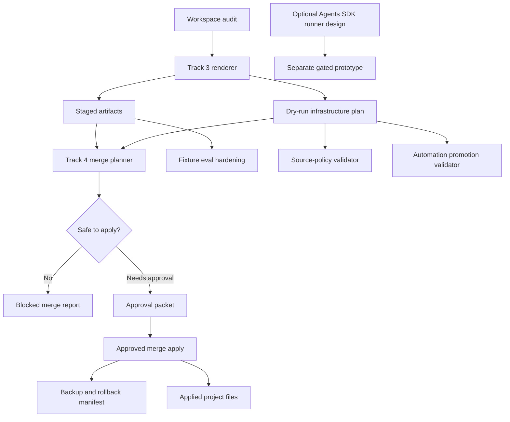

# Product-Agent OS Production Hardening Design

Source status: `official + experiment`

Sources: [Product-Agent OS plugin spec](../../product-agent/product-agent-os-plugin-spec.md), [Track 1 core plan](../plans/2026-05-14-product-agent-os-plugin-core.md), [Track 2 lifecycle skills design](2026-05-14-product-agent-os-lifecycle-skills-design.md), [Track 3 generated infrastructure design](2026-05-14-product-agent-os-generated-infrastructure-design.md), [Track 3 implementation plan](../plans/2026-05-14-product-agent-os-generated-infrastructure.md), [source registry](../../sources/registry.md).

This design defines Track 4 for the `product-agent-os` plugin. It starts from the completed Track 3 baseline: deterministic staged infrastructure rendering, dry-run JSON output, staged artifact generation, fixture eval coverage, generated templates, validators, and clean verification on 2026-05-14.

## Goal

Track 4 turns the staged-first infrastructure generator into a production-hardened workflow that can be used on real projects without weakening the safety model.

The output is a hardened Product-Agent OS layer with:

- a safe approved merge workflow for applying staged artifacts;
- a staged artifact manifest that records provenance, digests, renderer validation, and intended write policy;
- an explicit approval record that is separate from the merge plan id;
- stronger fixture evals and failure-log regression cases;
- source-policy validation for docs and generated guidance;
- automation promotion gates that keep recurring work candidate-only until evidence and approval exist;
- an optional Agents SDK runner design path that remains separate from the default plugin workflow.

## Design Choice

Use a gated hardening layer.

Track 4 should keep Track 3's default behavior unchanged: render plans and staged artifacts first, then require explicit approval before project writes. Production behavior is added through separate validators, merge plans, approval records, and eval reports.

Rejected approaches:

- Direct apply by default: faster for greenfield projects, but too risky for existing `AGENTS.md`, `.codex/config.toml`, hooks, workflows, and user-authored project conventions.
- Only add more templates: safe, but does not solve the real production gaps: approved merge, regression evidence, source drift, and automation readiness.
- Build a full Agents SDK runtime immediately: powerful, but it expands the risk surface before the plugin's local hardening layer is proven.

Recommended approach:

1. Harden local merge and validation first.
2. Expand fixture evals around real failure modes.
3. Add source and automation gates as deterministic validators.
4. Keep the Agents SDK runner as an optional Track 4B design/prototype path, not part of default plugin activation.

## Existing Foundation

Track 1 already provides:

- plugin manifest and package skeleton under `plugins/product-agent-os/`;
- lifecycle state and handoff contracts in `contracts.py`;
- workspace discovery in `discovery.py` and `detect_project.py`;
- validation wrappers for control-plane files, agents, and hooks;
- `merge_markdown.py` for managed Markdown sections;
- fixture projects and fixture eval runner.

Track 2 already provides:

- lifecycle `skills` under `plugins/product-agent-os/skills/`;
- shared references for lifecycle state, handoff, source policy, and complexity routing;
- static tests that prevent lifecycle skills from creating infrastructure, active automations, hooks, MCP servers, or an Agents SDK runner.

Track 3 already provides:

- `templates.py` template registry;
- `infrastructure.py` dry-run and stage renderer;
- `render_infrastructure.py` CLI wrapper;
- templates for control-plane files, `.codex/config.toml`, agents, hooks, workflows, evals, runlog archive, automation candidates, and PR/release packets;
- renderer actions: `create`, `update`, `leave_unchanged`, `blocked`;
- validation for agents, hooks, hook lifecycle config, eval JSON, staged config, and unresolved substitution markers;
- fixture behavior checks for existing config, duplicate managed sections, monorepo ownership, source registry warning, unsafe write, and failed verification evidence.

## Problem Statement

Track 3 proves that Product-Agent OS can produce safe staged proposals. It does not yet prove that the proposals can be applied safely to a real project.

Production use introduces additional risks:

- a staged artifact can be stale by the time a user approves it;
- a merge can escape the workspace through path traversal, symlinks, or malformed staged paths;
- user-authored files can be overwritten if unmarked content is treated as generated content;
- source-backed documentation can drift from official OpenAI docs or local source registry entries;
- automation candidates can become active recurring work without enough manual evidence;
- fixture evals can pass structurally while missing behavior-level regressions;
- an Agents SDK runner can blur ownership, approvals, and secrets unless it is isolated from default plugin behavior.

Track 4 must close these gaps without turning Product-Agent OS into an uncontrolled writer.

## Scope

Track 4 adds five workstreams.

### 1. Safe Approved Merge

Add a merge workflow that can apply staged artifacts only after an explicit approval step.

Required capabilities:

- produce a merge plan from a workspace and a Track 3 staging directory;
- require a staged manifest generated by the renderer before any apply command;
- require an explicit approval record before any apply command;
- verify target paths stay inside the workspace;
- reject symlink escapes and parent-directory traversal;
- compute target and staged content digests;
- detect stale targets before applying a plan;
- preserve user-authored content outside managed sections;
- apply managed Markdown section updates only when the target has a safe marker state or an approved append strategy;
- keep unmarked `.toml`, `.json`, `.py`, and hook files as companion proposals unless a later narrower rule proves a safe merge;
- keep hook activation as a separate approval gate;
- write backups and a rollback manifest before any project write;
- provide a rollback command that can restore a recorded apply only when current digests still match the post-apply manifest;
- report every write, skip, and block in a machine-readable result.

### 2. Stronger Fixture Evals

Expand fixture evals from structural renderer checks into behavior-level regression checks.

Required capabilities:

- convert documented failure logs into deterministic regression cases;
- fixture cases for stale merge plans, symlink escape attempts, path traversal, invalid staged manifest, broken rollback backup, missing approval, invalid source policy, and invalid automation promotion;
- stable JSON results with expected checks, observed decisions, evidence paths, and failure reasons;
- golden behavior summaries that explain why a fixture is `ok`, `blocked`, or `needs_approval`;
- full fixture eval remains deterministic and requires no network access or secrets.

### 3. Source-Policy Hardening

Add deterministic source-policy checks for docs and generated guidance.

Required capabilities:

- verify every non-index docs page keeps `Source status:`;
- verify source-backed Product-Agent OS pages declare official docs, local specs, or source registry entries;
- keep community claims under insight cards or explicitly marked `community` or `experiment`;
- reject source-policy output that stores secrets, credentials, private customer data, or raw private chat logs;
- mark freshness risk for current APIs, models, security, approvals, hooks, Agents SDK, MCP, and automation behavior;
- produce a source-policy report that separates supported facts, assumptions, unsupported claims, and missing context;
- classify semantic source ambiguity as `needs_review` instead of pretending deterministic text scanning can prove every factual claim.

### 4. Automation Promotion Gates

Harden automation candidates without creating active schedules.

Required capabilities:

- parse automation candidate packets;
- require owner, cadence, stable inputs, stable outputs, verification, failure modes, rollback or disable path, write policy, and explicit approval status;
- require at least two manual successful runs or equivalent fixture evidence before a candidate can be marked ready for manual approval;
- classify promotion state as `candidate_only`, `ready_for_manual_approval`, or `blocked`;
- never create Codex App automations, GitHub Actions, schedules, recurring jobs, or external workflows inside Track 4 validators.

### 5. Optional Agents SDK Runner Design

Define an optional runner path for teams that need programmable orchestration.

Track 4 may add a design packet and validation contract for an Agents SDK runner. It should not make the runner part of the default Product-Agent OS plugin path.

Required design boundaries:

- Manager agent owns lifecycle state and final output;
- specialist agents are tools or handoff targets with explicit ownership;
- every durable runner role has model and reasoning policy, escalation rules, downgrade rules, and cost or latency budget;
- Codex MCP is treated as an execution backend, not as an approval bypass;
- guardrails validate handoff completeness, source fidelity, tool boundaries, and secret retention;
- sessions and tracing are application-level concerns and must not replace checked-in project rules, `RUNLOG.md`, or source registry records;
- traces and sessions must have redaction and retention rules before real project use;
- dependency installation and network access are separate setup steps, not implicit fixture behavior;
- OpenAI credentials are read from environment or platform configuration only and never written to templates, fixtures, docs, memory, or runlogs.

## Use-Case Alignment

Track 4 maps to official use-case archetypes recorded in [Codex use cases deep analysis](../../codex/use-cases-deep-analysis.md).

| Track 4 workstream | Use-case group | Why it matters |
| --- | --- | --- |
| Safe approved merge | Tooling; PR and production review | Creates an agent-friendly local CLI and prevents unreviewed production changes. |
| Stronger fixture evals | AI quality; PR and production review | Converts hardening behavior into repeatable regression checks. |
| Source-policy hardening | Knowledge and product; PR and production review | Keeps docs and generated guidance grounded in source status and reviewable claims. |
| Automation promotion gates | Operations and collaboration | Prevents premature recurring work and aligns automation with verified operations. |
| Optional Agents SDK runner | Tooling; long-running creation | Provides a later programmable orchestration path without making it the default plugin runtime. |

Implementation plans for Track 4 should reference these groups when adding new playbooks, skills, plugin metadata, or automation candidates.

## Out Of Scope

Track 4 does not:

- silently mutate user projects;
- replace user-authored files without managed-section boundaries and explicit approval;
- change global Codex config;
- enable packaged hooks automatically;
- install dependencies or use network access during fixture evals;
- create active automations, scheduled jobs, GitHub Actions, recurring Codex App automations, or external workflows;
- store secrets, credentials, private customer data, raw private chat logs, or absolute user-specific paths;
- claim project tests, builds, hooks, evals, or automations work unless the current run produced evidence;
- implement a full production Agents SDK app as part of the default hardening path.

## Architecture

Track 4 adds a hardening layer beside the existing renderer.



The renderer remains the source of staged artifacts. Track 4 does not duplicate template rendering. It consumes renderer output, validates it more strictly, and controls the approved transition from staged artifacts to project files.

## Merge Workflow Contract

Track 4 should add a merge planner module and CLI wrapper.

Proposed files:

```text
plugins/product-agent-os/scripts/product_agent_os/merge_infrastructure.py
plugins/product-agent-os/scripts/merge_infrastructure.py
tests/product_agent_os/test_merge_infrastructure.py
```

CLI contract:

```powershell
python plugins\product-agent-os\scripts\merge_infrastructure.py <workspace> <stage-dir> --plan
python plugins\product-agent-os\scripts\merge_infrastructure.py <workspace> <stage-dir> --apply --approval-file <approval-file>
python plugins\product-agent-os\scripts\merge_infrastructure.py <workspace> <stage-dir> --rollback <rollback-manifest>
```

Plan mode is read-only. Apply mode writes only when:

- the user explicitly selected `--apply`;
- the staged manifest exists and matches the current staged files;
- the approval file exists and names the current merge plan id;
- the approval file names the approved target paths and write scope;
- every write decision is included in the approved target path list;
- the target digest still matches the digest recorded during plan generation;
- every target path resolves inside the workspace;
- no target parent or target file is a symlink;
- validation passes for staged content and merge decisions;
- every write has a rollback entry.

Approval id alone is not sufficient. A merge plan id proves that a plan is stable; it does not prove that the user approved the write. Track 4 approval is represented as a separate approval record.

Plan output should include an approval record template that a user or higher-level approved workflow can complete. The merge tool must not infer approval from its own plan output.

Staged manifest shape:

```yaml
stage_manifest:
  schema_version: 1
  renderer: "product-agent-os"
  renderer_version: ""
  workspace_audit_digest: ""
  infrastructure_plan_digest: ""
  generated_at: ""
  validation:
    ok: true
    checks: []
    errors: {}
  files:
    - target_path: "AGENTS.md"
      staged_path: "AGENTS.md"
      action: "create | update | leave_unchanged | blocked"
      write_policy: "staged_only | approved_write_required | blocked"
      digest: "sha256:..."
      managed_section: "project-rules"
```

Approval record shape:

```yaml
approval:
  schema_version: 1
  merge_plan_id: ""
  approved_by: "user"
  approved_at: ""
  approved_targets:
    - "AGENTS.md"
  approved_actions:
    - "create_file"
    - "append_managed_section"
    - "replace_managed_section"
  accepted_risks: []
  denied_targets: []
  notes: ""
```

The approval record is local evidence for the merge command. It is not a substitute for platform-level sandbox or filesystem approvals when those are required by the current runtime.

Merge plan shape:

```yaml
merge_plan:
  id: "stable digest from workspace, stage manifest, and generated_at"
  status: "needs_approval | blocked | applied"
  workspace: ""
  stage_root: ""
  generated_at: ""
  decisions:
    - target_path: "AGENTS.md"
      staged_path: ""
      action: "create_file | append_managed_section | replace_managed_section | companion_only | blocked"
      reason: ""
      target_digest_before: ""
      staged_digest: ""
      approval_required: true
      rollback_entry: ""
  blocked:
    - target_path: ""
      reason: ""
  warnings: []
  verification:
    ok: true
    checks: []
    errors: {}
```

Allowed merge actions:

| Action | Allowed when | Write behavior |
| --- | --- | --- |
| `create_file` | target does not exist and parent path is safe | create file after backup manifest records absence |
| `append_managed_section` | target is Markdown, has no conflicting markers, and user approved append | append managed Product-Agent OS section |
| `replace_managed_section` | target has exactly one matching managed section | replace only that section |
| `companion_only` | target exists without safe managed merge path | no project write; keep staged proposal |
| `blocked` | path, marker, digest, validation, or approval is unsafe | no project write |

Rollback requirements:

- before writing, copy existing target content or record that the file was absent;
- store rollback manifest under the staging directory, not in global user config;
- for created files, rollback can remove only files whose current digest still matches the generated digest;
- for updated files, rollback can restore only when the current digest matches the post-apply digest;
- rollback reports are evidence artifacts, not hidden state.

Rollback manifest shape:

```yaml
rollback_manifest:
  schema_version: 1
  merge_plan_id: ""
  applied_at: ""
  entries:
    - target_path: "AGENTS.md"
      action: "created | updated"
      existed_before: false
      digest_before: ""
      digest_after: "sha256:..."
      backup_path: ""
  verification:
    ok: true
    checks: []
```

Rollback mode is conservative. It refuses to restore or remove a file when the current target digest differs from the recorded post-apply digest, because that means another actor changed the file after apply.

## Hook Activation Gate

Track 3 stages hook scripts and `.codex/hooks/hooks.json` as target-project assets. Track 4 may merge hook files into a workspace, but activation remains a separate decision.

Rules:

- hook scripts can be merged only after validator success and explicit approval;
- `.codex/hooks/hooks.json` defaults to `companion_only` unless the approval record includes `enable_hooks`;
- enabling hooks requires an approval record that names hook events, scripts, blocking behavior, and rollback path;
- `pre_tool_use_policy.py` blocking rules must stay narrow and auditable;
- hook activation must never happen from plugin-root lifecycle config;
- fixture eval must include one case where hook scripts are staged but hook activation is not approved, and one case where approval enables hook config safely.

Hook approval extension:

```yaml
approval:
  enable_hooks: false
  approved_hook_events: []
  blocking_hooks:
    - "PreToolUse"
  hook_rollback: "remove or restore .codex/hooks/hooks.json when current digest matches post-apply digest"
```

## Fixture Eval Hardening

Track 4 should extend `run_fixture_eval.py` rather than replace it.

Additional fixture projects:

```text
plugins/product-agent-os/assets/fixtures/stale-merge-plan/
plugins/product-agent-os/assets/fixtures/path-traversal-stage/
plugins/product-agent-os/assets/fixtures/symlink-escape/
plugins/product-agent-os/assets/fixtures/hook-activation-unapproved/
plugins/product-agent-os/assets/fixtures/hook-activation-approved/
plugins/product-agent-os/assets/fixtures/source-policy-conflict/
plugins/product-agent-os/assets/fixtures/automation-candidate-valid/
plugins/product-agent-os/assets/fixtures/automation-candidate-invalid/
plugins/product-agent-os/assets/fixtures/rollback-required/
plugins/product-agent-os/assets/fixtures/failure-log-regression/
```

Fixture result shape:

```yaml
fixture: ""
ok: true
profile: ""
renderer_status: ""
merge_status: ""
source_policy_status: ""
automation_status: ""
expected_checks:
  safe_paths: true
  stale_digest_blocked: true
  source_policy_enforced: true
  automation_candidate_gated: true
evidence:
  files_inspected: []
  commands: []
  reports: []
risks: []
```

Behavior-level checks:

- dry-run still writes no files;
- stage mode writes only under the requested staging directory;
- merge plan mode writes no files;
- apply mode requires staged manifest and approval record;
- unapproved apply is blocked;
- stale target digest is blocked;
- symlink and path traversal attempts are blocked;
- existing unmarked `.codex/config.toml` remains companion-only;
- hook scripts can be merged without activating `.codex/hooks/hooks.json` unless `enable_hooks` is approved;
- failed verification evidence remains visible;
- failure log entries can generate deterministic regression cases;
- invalid automation candidate remains candidate-only or blocked;
- source-policy conflict does not become an official claim.

## Failure-Log Regression Contract

Product-Agent OS should turn real hardening failures into future deterministic checks.

Input sources:

- current `RUNLOG.md`;
- `.codex/runlogs/archive/`;
- fixture eval reports;
- rollback manifests;
- source-policy reports;
- automation promotion reports.

Regression case shape:

```yaml
regression_case:
  id: "stale-merge-plan-blocked"
  source: "RUNLOG.md#2026-05-14"
  failure_summary: ""
  reproduction_fixture: "stale-merge-plan"
  command: "python plugins\\product-agent-os\\scripts\\run_fixture_eval.py"
  expected_status: "blocked"
  expected_checks:
    stale_digest_blocked: true
  evidence_to_preserve:
    - "merge_plan.id"
    - "target_digest_before"
    - "blocked reason"
```

Rules:

- a failure-log regression must name the original evidence source;
- regression fixtures must use synthetic data only;
- sensitive logs are summarized, not copied raw;
- every regression case must have an expected command and observable expected result;
- failure-log conversion may propose fixture additions but must not silently edit production projects.

## Source-Policy Validator

Track 4 should add a deterministic source-policy validator.

Proposed files:

```text
plugins/product-agent-os/scripts/product_agent_os/source_policy.py
plugins/product-agent-os/scripts/validate_source_policy.py
tests/product_agent_os/test_source_policy.py
```

CLI contract:

```powershell
python plugins\product-agent-os\scripts\validate_source_policy.py <workspace>
```

Report shape:

```yaml
source_policy_report:
  status: "ok | needs_review | blocked"
  files:
    - path: ""
      source_status: "official | official + experiment | community | experiment | missing"
      supported_facts: []
      assumptions: []
      unsupported_claims: []
      missing_context: []
      freshness_risks: []
  registry_updates_required: []
  secret_findings: []
  errors: []
```

Rules:

- docs pages must include `Source status:` unless exempt by project docs policy;
- OpenAI, Codex, Agents SDK, model, approvals, hooks, MCP, and automation behavior claims require official sources or an explicit freshness risk;
- Context7 is accepted as official only when the underlying source is official;
- community claims require insight-card handling with `trust_level` and `verification_status`;
- generated examples cannot contain secrets, private customer data, raw private chat logs, or absolute user-specific paths;
- missing or stale source evidence yields `needs_review` unless the claim is safety-sensitive, in which case it yields `blocked`.

Deterministic boundary:

- the validator can prove document structure, required markers, source registry references, forbidden literals, stale `checked_at` dates, and known unsupported-source patterns;
- the validator cannot prove full semantic truth for every sentence;
- when semantic truth is uncertain, output must be `needs_review` with a specific file path and reason;
- only explicit high-risk patterns, forbidden literals, missing source status, or unsafe promotion of community claims should become `blocked`.

## Automation Promotion Validator

Track 4 should add an automation candidate validator.

Proposed files:

```text
plugins/product-agent-os/scripts/product_agent_os/automation_policy.py
plugins/product-agent-os/scripts/validate_automation_candidate.py
tests/product_agent_os/test_automation_policy.py
```

CLI contract:

```powershell
python plugins\product-agent-os\scripts\validate_automation_candidate.py <candidate-file>
```

Report shape:

```yaml
automation_promotion_report:
  status: "candidate_only | ready_for_manual_approval | blocked"
  candidate_file: ""
  required_fields_present: true
  manual_success_count: 0
  owner_present: true
  cadence_present: true
  verification_present: true
  failure_modes_present: true
  rollback_or_disable_present: true
  write_policy_present: true
  explicit_approval_present: false
  errors: []
  warnings: []
```

Promotion rules:

- `candidate_only` is the default state;
- `ready_for_manual_approval` requires stable inputs, stable outputs, owner, cadence, verification, failure modes, rollback or disable path, explicit write policy, and at least two manual successful runs or equivalent fixture evidence;
- `blocked` is required for missing owner, missing verification, missing rollback or disable path, ambiguous writes, external side effects without approval, or any secret-like content;
- validator output must not create schedules or call automation APIs.

## Optional Agents SDK Runner Boundary

Track 4 should include only a bounded runner design unless the user separately approves implementation.

Proposed design artifact:

```text
docs/superpowers/specs/2026-05-14-product-agent-os-agents-sdk-runner-design.md
```

Possible future implementation root:

```text
plugins/product-agent-os/scripts/agents_sdk_runner/
```

Runner responsibilities:

- read Product-Agent OS control-plane artifacts;
- create a Manager agent that owns lifecycle routing;
- expose specialist roles as tools or handoff targets;
- call Codex MCP only within explicit sandbox and approval policy;
- validate handoff payloads before continuing;
- keep sessions and tracing separate from checked-in project memory;
- fail closed when credentials, sources, approval state, or write ownership are unclear.
- record model, reasoning, tool, handoff, latency, failure, and approval events in traces without storing secrets.

Runner non-goals:

- no default dependency installation;
- no default network access in plugin verification;
- no credential creation or storage;
- no direct replacement for Codex App, CLI, project skills, or `.codex/agents`;
- no automation scheduling from inside the runner.

Runner design must define:

- dependency setup path and offline test fallback;
- model and reasoning defaults per role;
- environment variable names for credentials without exposing values;
- session retention and redaction policy;
- tracing retention and redaction policy;
- eval suite for handoff completeness, source fidelity, tool boundary, approval handling, and secret retention;
- rollback or shutdown path for partial runner execution.

## Security And Approval Model

Track 4 must preserve least privilege.

Approval required for:

- applying staged files to a workspace;
- appending managed sections to unmarked Markdown files;
- enabling hooks;
- creating or updating automation schedules outside Track 4 validators;
- writing external systems;
- changing source-of-truth docs, registry records, or release artifacts;
- using an Agents SDK runner against a real workspace.

Blocked by default:

- path traversal and symlink escape;
- stale merge plans;
- destructive commands embedded in generated assets;
- global Codex config mutation;
- broad network access in tests or fixture evals;
- secret-like literals in templates, fixtures, examples, docs, runlogs, automation candidates, or runner config;
- active automation without manual stability evidence and explicit approval.

## Testing Strategy

Track 4 tests should remain deterministic `unittest` tests.

Required tests:

- staged manifest is required before apply;
- approval record is required before apply and cannot be replaced by a bare plan id;
- approval record must name approved targets and actions;
- merge planner produces read-only plans;
- apply mode rejects missing approval record;
- apply mode rejects approval records that do not match the current merge plan id;
- apply mode rejects stale target digest;
- apply mode rejects path traversal and symlink escape;
- managed Markdown section replacement preserves user content outside markers;
- unmarked Markdown append requires explicit approval;
- unmarked `.codex/config.toml` stays companion-only;
- hook scripts can be applied without enabling hook lifecycle config;
- hook lifecycle config requires `enable_hooks` approval;
- backups and rollback manifest are created before writes;
- rollback mode restores created or updated files only when current digests match the post-apply digest;
- rollback refuses to overwrite changed post-apply content;
- source-policy validator detects missing source status and unsupported OpenAI behavior claims;
- source-policy validator returns `needs_review` for semantic ambiguity instead of claiming proof;
- source-policy validator separates official, community, experiment, and unsupported claims;
- automation validator blocks incomplete candidates;
- automation validator classifies complete candidates as ready for manual approval without creating a schedule;
- fixture eval includes merge, hook activation, source-policy, automation, rollback, and failure-log regression statuses;
- optional Agents SDK runner design is not part of default plugin activation.

Required verification commands after implementation:

```powershell
python -m unittest discover -s tests -p "test_*.py" -v
python plugins\product-agent-os\scripts\run_fixture_eval.py
python tools\check_docs.py
$env:PYTHONPATH='C:\tmp\codex_docs_mkdocs'; python -m mkdocs build --strict
```

## Критерии приемки

Track 4 is complete when:

- the plugin can generate a merge plan from Track 3 staged artifacts without writing to the workspace;
- Track 3 stage output includes a manifest or Track 4 can create a verified manifest from staged artifacts before apply;
- apply requires a separate approval record with approved target paths, actions, accepted risks, and approval timestamp;
- approved apply mode writes only allowed files and sections inside the workspace;
- stale, ambiguous, unsafe, or unapproved merge plans are blocked;
- hook lifecycle config is not activated unless the approval record explicitly enables hooks;
- every apply creates a rollback manifest and evidence report;
- rollback can be executed and refuses unsafe restore conditions;
- failure-log regression cases can be generated or validated from synthetic evidence;
- fixture eval covers merge safety, stale state, path safety, hook activation, source-policy conflict, automation readiness, rollback behavior, and failure-log regression behavior;
- source-policy validator produces deterministic `ok`, `needs_review`, or `blocked` reports;
- automation validator keeps candidates candidate-only until evidence and explicit approval are present;
- active automations are not created by Track 4 code;
- optional Agents SDK runner remains isolated from the default plugin path;
- full verification pack exits `0` in the current run.

## Residual Risks

Even after Track 4, Product-Agent OS still cannot prove that every generated workflow is product-correct for every real project. It can prove stronger safety properties around merge behavior, evidence, source policy, and automation readiness.

The optional Agents SDK runner remains a higher-risk architecture layer. It should move forward only after local hardening is implemented and a separate plan defines dependencies, credential handling, MCP boundaries, evals, and rollback.

Automation promotion remains a human-owned decision. Track 4 can validate readiness and produce an approval packet, but it should not infer business ownership, legal acceptability, customer impact, or operational cadence without explicit user input.

## Implementation Handoff

Implementation should be split into focused tasks:

1. Stage manifest and approval record contracts.
2. Merge plan data model and read-only planner.
3. Approved apply mode with backup and rollback manifest.
4. Rollback command and safety checks.
5. Hook activation gate.
6. Merge, hook, rollback, and failure-log fixture cases.
7. Source-policy validator and tests.
8. Automation promotion validator and tests.
9. Fixture eval result expansion.
10. Optional Agents SDK runner design artifact.
11. Documentation, navigation, and full verification.

Each task must start with failing tests where practical, preserve Track 3 staged-first behavior, and avoid unrelated refactors.

## Spec Self-Review

Coverage:

- stage manifest and approval record are specified as separate contracts;
- safe approved merge is specified through merge plan, apply, rollback, and path-safety contracts;
- hook activation is separated from hook file merge;
- fixture eval hardening has explicit new fixtures and expected behaviors;
- failure-log regression has input sources and case shape;
- source-policy hardening has report shape and blocking rules;
- automation gates have report shape and promotion states;
- optional Agents SDK runner has a boundary and non-goals;
- verification commands match project rules.

Scope check:

- Track 4 is broad but still one coherent hardening layer around an existing plugin package;
- the optional runner is explicitly separated so the implementation plan can defer it or place it in a gated final task.

Ambiguity check:

- default behavior remains staged-first;
- active automation creation is out of scope;
- direct writes require explicit apply mode plus approval record;
- bare merge plan id is not treated as user approval;
- unmarked user-authored files are preserved unless a safe managed Markdown append is explicitly approved.
