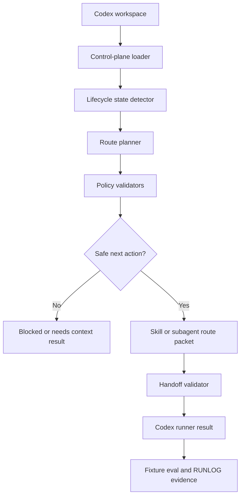

# Product-Agent OS Codex Runtime Runner Design

Source status: `official + experiment`

Sources: [Product-Agent OS plugin spec](../../product-agent/product-agent-os-plugin-spec.md), [Product-Agent OS production hardening design](2026-05-14-product-agent-os-production-hardening-design.md), Product-Agent OS production hardening plan (`docs/superpowers/plans/2026-05-14-product-agent-os-production-hardening.md`), [Product-Agent OS Agents SDK runner boundary](2026-05-14-product-agent-os-agents-sdk-runner-design.md), [source registry](../../sources/registry.md), [Codex plugins](https://developers.openai.com/codex/plugins), [Codex skills](https://developers.openai.com/codex/skills), [Codex subagents](https://developers.openai.com/codex/subagents), [Codex hooks](https://developers.openai.com/codex/hooks), [Agent approvals and security](https://developers.openai.com/codex/agent-approvals-security), [Codex workflows](https://developers.openai.com/codex/workflows).

This design supersedes the Track 5 standalone Agents SDK runner idea. The plugin will run only inside Codex surfaces: Codex App, CLI, IDE extension, plugin skills, subagents, hooks, staged renderer, approval-gated merge, and local validators. Track 5 therefore implements a Codex runtime runner, not an API-backed application and not a separate OpenAI Agents SDK service.

## Read-Only Analysis

The original Product-Agent OS spec defined four implementation tracks and treated Agents SDK as an advanced optional surface. Track 4 kept that path design-only because the default Product-Agent OS plugin already had a safer local workflow: lifecycle skills, staged infrastructure, explicit approval records, safe merge, rollback, source-policy validation, automation promotion validation, and fixture eval.

The current implementation confirms that this local Codex-first layer is the strongest foundation. Track 1-2 provide contracts, discovery, validators, lifecycle skills, and handoff references. Track 3 provides staged templates and renderer. Track 4 provides manifest-bound merge/apply/rollback and policy validators. The clean baseline before this spec change was: `python -m unittest discover -s tests -p "test_*.py" -v` ran 194 tests with `OK`, `python plugins\product-agent-os\scripts\run_fixture_eval.py` exited `0`, and `python tools\check_docs.py` passed.

The implementation gap is now narrower: Product-Agent OS needs a Codex-only orchestrator that can read control-plane artifacts, choose the next lifecycle action, validate handoffs, route to packaged skills or project-scoped subagents, and emit evidence. It must not introduce separate API credentials, external runtime dependency installation, or an out-of-Codex agent service.

## Goal

Implement the smallest useful Codex runtime runner that turns Product-Agent OS from a set of skills and validators into a coherent local orchestration layer inside Codex.

The runner must:

- read Product-Agent OS context from `AGENTS.md`, `REQUIREMENTS.md`, `PLAN.md`, `TEST.md`, `EVALS.md`, and `RUNLOG.md`;
- infer lifecycle state and recommended next action;
- route to packaged Product-Agent OS skills and generated subagent role configs;
- validate structured handoffs before lifecycle advancement;
- validate source policy, approval state, ownership boundaries, tool boundaries, and redaction;
- produce a machine-readable `codex_runner_result`;
- run deterministically in tests without network, external credentials, or package installation;
- write nothing by default and never create active automations.

## Non-Goals

Track 5 does not:

- implement a standalone OpenAI Agents SDK app;
- call OpenAI APIs directly;
- require API keys, external credentials, or environment-provided model access;
- install `openai-agents` or other runtime dependencies;
- run Codex as an MCP server from outside Codex;
- make an external service, deployment target, or HTTP server;
- bypass Codex sandbox, approvals, or plugin boundaries;
- change global Codex config;
- create Codex App automations, GitHub Actions, schedules, recurring jobs, or external workflows;
- store secrets, private customer data, raw private chat logs, raw traces, or absolute user-specific paths.

## Design Choice

Use a Codex-only contract runner.

Rejected approaches:

- **Standalone Agents SDK runner**: unnecessary for a plugin that will run only in Codex, and it would add credential, dependency, network, tracing, and deployment concerns.
- **Codex MCP bridge**: useful when an external Agents SDK app wants Codex as a backend, but not needed when the plugin is already executing in Codex.
- **Implicit skill auto-runner**: convenient, but too opaque. The runner must return a route packet and require explicit handoff/approval gates rather than silently invoking broad workflows.

Recommended approach:

1. Add a dependency-free `codex_runtime_runner` package under the plugin scripts.
2. Make it read-only by default and contract-first.
3. Route lifecycle actions to existing Product-Agent OS skills, templates, validators, and generated subagent role configs.
4. Extend fixture eval with runner status and regression checks.

## Architecture



The runner is a local helper, not a new runtime surface. Codex remains the execution plane. Existing skills remain the method layer. Existing safe merge and rollback remain the write gate.

## Proposed Files

Create:

- `plugins/product-agent-os/scripts/codex_runtime_runner/__init__.py` - package marker and public version.
- `plugins/product-agent-os/scripts/codex_runtime_runner/contracts.py` - request, route, handoff, result, and policy schemas.
- `plugins/product-agent-os/scripts/codex_runtime_runner/context_loader.py` - safe control-plane reader.
- `plugins/product-agent-os/scripts/codex_runtime_runner/state.py` - lifecycle state inference.
- `plugins/product-agent-os/scripts/codex_runtime_runner/routes.py` - route planner from lifecycle state to skill or subagent task.
- `plugins/product-agent-os/scripts/codex_runtime_runner/guards.py` - deterministic validators for source, approval, ownership, handoff, automation, and claims.
- `plugins/product-agent-os/scripts/codex_runtime_runner/redaction.py` - deterministic redaction for secrets, private data markers, raw chat markers, and local absolute paths.
- `plugins/product-agent-os/scripts/codex_runtime_runner/cli.py` - CLI implementation.
- `plugins/product-agent-os/scripts/run_codex_runtime_runner.py` - CLI wrapper.
- `plugins/product-agent-os/scripts/validate_codex_runtime_runner.py` - deterministic runner contract validator.
- `tests/product_agent_os/test_codex_runtime_runner_contracts.py`
- `tests/product_agent_os/test_codex_runtime_runner_cli.py`
- `tests/product_agent_os/test_codex_runtime_runner_guards.py`
- `tests/product_agent_os/test_codex_runtime_runner_fixture_eval.py`

Modify:

- `tests/product_agent_os/test_plugin_structure.py` - prove runner exists but is not default-activated by plugin manifest.
- `plugins/product-agent-os/scripts/run_fixture_eval.py` - add `codex_runtime_runner_status` and runner evidence.
- `mkdocs.yml` - add this design to implementation specs navigation.
- `docs/sources/registry.md` - refresh source cards used by Track 5.

Do not modify:

- `.codex-plugin/plugin.json` capabilities unless a later review proves the plugin UI should expose a runner command.
- Track 4 merge/apply/rollback behavior.
- Automation policy that keeps recurring work candidate-only.

## Runner Mode

The runner has one default deterministic mode.

Command:

```powershell
python plugins\product-agent-os\scripts\run_codex_runtime_runner.py <workspace> --contract
```

Behavior:

- read safe control-plane files;
- infer current lifecycle state;
- build a route packet;
- validate source policy and handoff requirements;
- validate whether the next action is read-only, staged-only, approval-required, or blocked;
- emit `status: "route_ready" | "needs_context" | "needs_approval" | "blocked"`;
- write nothing unless an explicit `--output <file>` path points inside a staging directory.

There is no live API mode. Model execution is supplied by the current Codex session or subagent mechanism, not by a separate runner process.

## Data Contracts

### Runner Request

```yaml
codex_runner_request:
  schema_version: 1
  workspace: ""
  task:
    goal: ""
    lifecycle_state: ""
    constraints: []
    allowed_sources: []
    expected_artifacts: []
  routing:
    preferred_surface: "Codex App | CLI | IDE extension | codex exec | subagent | skill"
    allow_subagents: false
    allow_workspace_writes: false
  approval:
    required: false
    approval_file: ""
    approval_status: "not_required | required | approved | rejected | stale"
```

### Route Packet

```yaml
codex_route_packet:
  lifecycle_state: ""
  next_action: ""
  recommended_skill: ""
  recommended_subagent_role: ""
  runtime_surface: ""
  write_policy: "read_only | staged_only | approved_write | blocked"
  required_inputs: []
  expected_outputs: []
  verification: []
  approval_requirements: []
  stop_conditions: []
```

### Handoff

```yaml
codex_runner_handoff:
  lifecycle_state: ""
  role: ""
  goal: ""
  constraints: []
  sources_used: []
  assumptions: []
  verified_claims: []
  unsupported_claims: []
  files_touched: []
  files_proposed: []
  commands_run: []
  verification_evidence: []
  approval_requirements: []
  open_risks: []
  recommended_next_role: ""
  stop_reason: ""
```

### Runner Result

```yaml
codex_runner_result:
  schema_version: 1
  status: "route_ready | needs_context | needs_approval | blocked | completed | failed"
  workspace: ""
  lifecycle_state: ""
  route_packet: {}
  handoffs: []
  files_touched: []
  files_proposed: []
  verification_evidence: []
  source_policy_status: ""
  approval_status: ""
  redactions:
    count: 0
    categories: []
  errors: []
  warnings: []
  next_action: ""
```

The result schema is the core Track 5 contract. Fixture eval should grade this contract first; Codex execution quality can be judged only after deterministic gates pass.

## Routing Policy

The runner chooses the next Product-Agent OS action from lifecycle state and current artifacts:

| State | Default route | Write policy |
| --- | --- | --- |
| `uninitialized` | `workspace-discovery-auditor` | `read_only` |
| `infrastructure_planned` | `requirements-author` | `staged_only` |
| `requirements_ready` | `implementation-planner` | `staged_only` |
| `plan_ready` | `agent-team-designer` | `staged_only` |
| `team_ready` | `test-eval-designer` | `staged_only` |
| `build_active` | builder subagent or build slice packet | `approved_write` |
| `quality_gate` | `risk-reviewer` | `read_only` |
| `review_ready` | `pr-release-operator` | `staged_only` |
| `release_ready` | `learning-loop-maintainer` | `staged_only` |
| `learning_ready` | `automation-promoter` | `staged_only` |
| `maintenance` | `project-lifecycle-orchestrator` | `read_only` |

The runner may recommend a subagent only when ownership boundaries are explicit. It must not spawn subagents itself from deterministic tests; it returns a route packet that Codex can execute in the active session.

## Guardrails And Validators

Required validators:

- `validate_codex_runner_request` - schema, surface, write policy, and approval state.
- `validate_control_plane_context` - required Product-Agent OS artifacts and lifecycle consistency.
- `validate_route_packet` - recommended skill or subagent is valid for lifecycle state.
- `validate_handoff` - reuse and extend Product-Agent OS handoff fields.
- `validate_source_policy` - block or mark needs-review before durable source-backed claims.
- `validate_approval_boundary` - no workspace writes or hook activation without approval.
- `validate_automation_boundary` - active automation creation remains blocked.
- `validate_redaction` - no secret-like literals, private customer data markers, raw private chat markers, or absolute user-specific paths in persisted outputs.
- `validate_result_contract` - every completion claim has current-run evidence.

## Fixture Eval Extension

Extend fixture eval with runner fields:

```yaml
codex_runtime_runner_status: "route_ready | needs_context | needs_approval | blocked | not_applicable"
codex_runtime_runner_checks:
  contract_mode_offline: true
  route_matches_lifecycle_state: true
  approval_required_for_writes: true
  handoff_incomplete_blocked: true
  active_automation_blocked: true
  secret_redaction_enforced: true
```

New synthetic fixtures:

- `codex-runner-ready` - complete control-plane context produces `route_ready`.
- `codex-runner-missing-context` - missing `PLAN.md` or acceptance criteria produces `needs_context`.
- `codex-runner-handoff-incomplete` - missing `constraints` or `verification_evidence` is blocked.
- `codex-runner-approval-required` - build/write route without approval produces `needs_approval`.
- `codex-runner-automation-blocked` - active automation request is blocked.
- `codex-runner-secret-redaction` - secret-like and absolute-path strings are redacted in result.

All fixtures must use synthetic data only.

## Security And Approval Model

Default policy:

- read-only unless the route explicitly says `staged_only` or `approved_write`;
- no network access;
- no external dependency installation;
- no direct API calls;
- no active automation creation;
- no project write from the runner itself;
- outputs redacted before persistence;
- failures return machine-readable status and no traceback in normal CLI output.

Blocked by default:

- global Codex config mutation;
- hook activation without Track 4 approval;
- merge/apply without approval record;
- active automation creation;
- external system writes;
- raw private chat logs;
- secret-like literals in outputs;
- absolute user-specific paths in persisted artifacts;
- claiming implementation success without current-run evidence.

## Testing Strategy

Deterministic Track 5 tests remain `unittest` and standard-library-only.

Required tests:

- runner contracts validate valid and invalid request/result payloads;
- package imports with only Python standard library;
- contract mode runs offline against a fixture workspace;
- lifecycle state maps to the expected Product-Agent OS skill route;
- build/write routes require approval;
- incomplete handoff is rejected;
- source-policy `blocked` prevents route readiness;
- active automation request is blocked;
- redaction removes secret-like literals and local absolute paths;
- fixture eval includes `codex_runtime_runner_status`;
- plugin structure test proves runner exists but is not default-activated;
- normal verification commands do not require network, API credentials, or dependency installation.

Required verification after implementation:

```powershell
python -m unittest discover -s tests -p "test_*.py" -v
python plugins\product-agent-os\scripts\run_fixture_eval.py
python tools\check_docs.py
$env:PYTHONPATH='C:\tmp\codex_docs_mkdocs'; python -m mkdocs build --strict
```

## Acceptance Criteria

Track 5 is complete when:

- `plugins/product-agent-os/scripts/codex_runtime_runner/` exists and imports with standard library only;
- contract mode returns a valid `codex_runner_result`;
- route packets correctly map lifecycle states to Product-Agent OS skills or subagent roles;
- workspace writes, hook activation, merge/apply, and automation remain approval-gated;
- runner validators catch incomplete handoffs, blocked source policy, missing approval, active automation requests, and secret retention;
- fixture eval reports Codex runtime runner status and catches regressions;
- plugin manifest and lifecycle skills do not make the runner default-active;
- source registry and docs navigation include this Track 5 spec;
- full verification pack exits `0`.

## Residual Risks

Even after Track 5, a Codex-only runner cannot prove product correctness for every project. It can prove that lifecycle routing, handoff shape, source policy, approval boundary, redaction, and fixture eval behavior are stable.

The runner intentionally delegates actual model work to Codex. Quality still depends on the active Codex surface, selected model, prompt context, project artifacts, and verification evidence.

## Implementation Handoff

Implementation should be split into focused tasks:

1. Codex runner contracts and result schema.
2. Context loader and lifecycle state detector.
3. Route planner for skills and subagent role recommendations.
4. Redaction and deterministic guard validators.
5. Contract-mode CLI wrapper.
6. Fixture eval extension and synthetic runner fixtures.
7. Plugin structure tests proving the runner is present but inactive by default.
8. Documentation, source registry refresh, navigation, and full verification.

Each task should start with failing tests where practical, preserve Track 4 safety behavior, and avoid unrelated refactors.

## Spec Self-Review

Coverage:

- standalone API-backed runner is removed from scope;
- Codex-only execution boundary is explicit;
- current Track 1-4 implementation and clean baseline are recorded;
- route packet, handoff, result, approval, source, automation, and redaction policies are explicit;
- fixture eval and verification requirements are defined.

Scope check:

- Track 5 is one coherent Codex plugin orchestration layer, not a deployment platform or external app;
- no deterministic test requires network, credentials, or third-party dependencies;
- actual Codex model execution remains in the active Codex session, not in a separate runner process.

Ambiguity check:

- default Product-Agent OS workflow remains unchanged;
- no API keys or external credentials are used;
- the runner may exist in the repo while remaining inactive by default;
- writes and automations remain approval-gated through existing Product-Agent OS controls.
