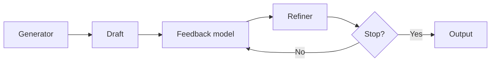
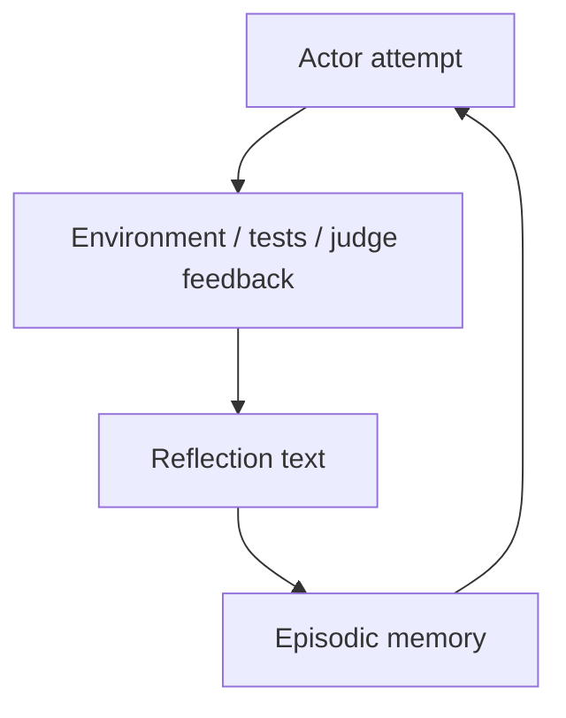
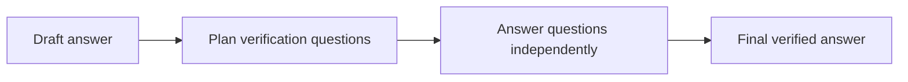
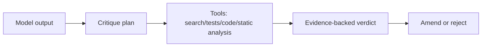
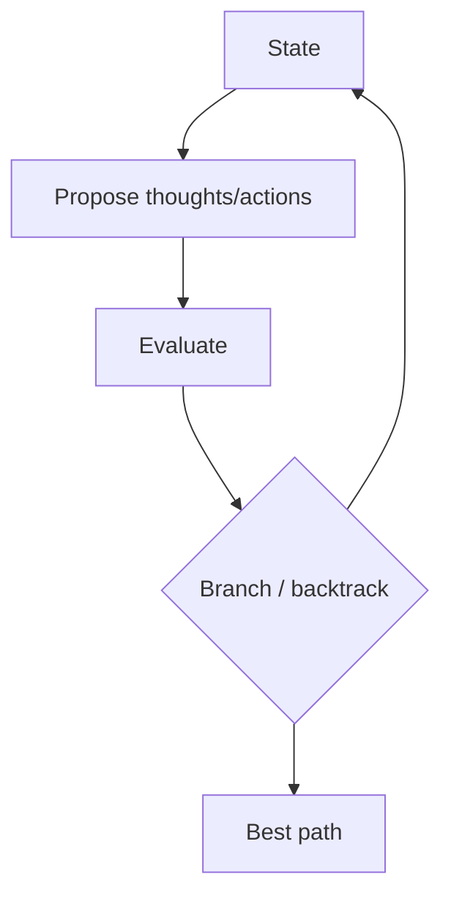
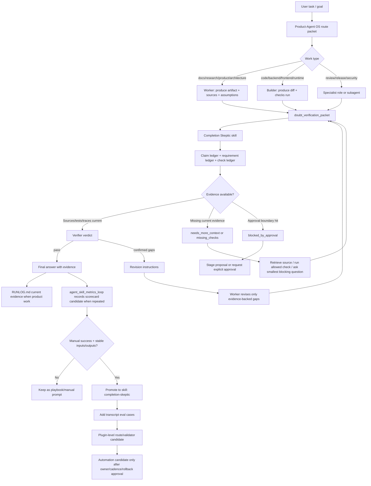

# Doubt / verifier loop: технический и архитектурный отчет

Checked at: 2026-06-09

Scope: исследование техник self-critique, self-reflection, verification, debate, verifier/evaluator loops и их встраивания в Codex/Product-Agent OS как prompt pattern, Context-engineering contract, skill, subagent или agent workflow.

Source status: `research artifact, not canonical docs`. Этот файл не обновляет `docs/sources/registry.md`; при переносе выводов в `docs/` нужно оформить source-backed docs slice и registry update.

## 1. Главный вывод

То, что пользователь называет "техникой сомнений", уже существует в литературе и инженерной практике под несколькими именами:

- `self-reflection` / `reflection`: агент критикует свой предыдущий ответ или траекторию.
- `self-refine`: генератор, критик и редактор работают итеративно, часто в одном LLM.
- `Chain-of-Verification` / `CoVe`: модель сначала строит проверочные вопросы, затем независимо проверяет факты.
- `critic-verifier` / `evaluator-optimizer`: отдельный evaluator/judge возвращает structured feedback до финального ответа.
- `tool-interactive critique`: verifier использует внешние инструменты, тесты, поиск, статический анализ, traces.
- `multi-agent debate`: несколько независимых агентов ищут ошибки друг друга.
- `search + evaluation`: Tree of Thoughts, LATS и похожие архитектуры ищут несколько решений и оценивают ветки.

Ключевой архитектурный урок: **не надо делать "сомнение" как простое "передумай и перепиши"**. Рабочий паттерн выглядит так:

1. Сгенерировать draft.
2. Извлечь проверяемые claims, assumptions, requirements, actions и evidence gaps.
3. Проверить их против внешнего контекста: source registry, repo state, tests, tools, traces, evals, official docs.
4. Переписывать только там, где verifier нашел конкретный defect или missing evidence.
5. Остановиться по лимиту раундов и вернуть residual risks вместо бесконечного polishing.

## 2. Сравнительная матрица подходов

| Подход | Prompt primitive | Context-engineering primitive | Workflow integration | Где силен | Главный риск |
| --- | --- | --- | --- | --- | --- |
| Self-Refine | `generate -> feedback -> refine` | Draft, critique, revision history | Skill для улучшения текста/спека/кода с лимитом раундов | Быстро добавляет упущенные детали | Без внешней проверки может усиливать ошибку |
| Reflexion | verbal reflection + episodic memory | Short reflection memory per failed attempt | Agent loop для задач с environment feedback | Учится на failed attempts внутри сессии | Reflection memory может хранить ложную диагностику |
| CoVe | verification questions before final | Claims -> questions -> independent answers -> final | Research/answering skill, anti-hallucination gate | Снижает factual hallucination | Нужен независимый answering step, иначе bias сохраняется |
| CRITIC | critique with tools | Tool evidence, search/code outputs, citations | High-stakes verifier agent with tools | Хорош для factual/code/tool tasks | Cost/latency и tool availability |
| Self-consistency | sample many chains, vote | Multiple independent traces, aggregation | Reasoning helper, not completion verifier | Math/reasoning answer selection | Не проверяет factual grounding |
| Tree of Thoughts / LATS | propose/evaluate/search branches | State tree, scores, backtracking | Planning/problem-solving agent | Сложные задачи с branching | Дорого, требует stop policy |
| Multi-agent debate | agents critique each other | Separate contexts and final aggregation | Parallel subagents for independent risk views | Reduces single-agent blind spots | Group can converge on plausible wrong answer |
| SelfCheckGPT | sampling consistency detector | Multiple sampled passages, contradiction score | Hallucination detector for long-form answers | Black-box factuality detection | Detects inconsistency, not truth by itself |
| Metacognitive prompting | structured self-monitoring | Confidence, assumptions, reasoning checks | Lightweight prompt rubric | Cheap preflight for ambiguity | Still intrinsic, weak without evidence |
| Evaluator-optimizer | generator + evaluator loop | Criteria, feedback, accepted output | Production workflow pattern | Simple, composable, monitorable | Needs clear criteria |
| Guardrails/tracing | input/output/tool checks | Span/tool/guardrail evidence | Agents SDK app architecture | Runtime enforceability | Guardrail schema can miss semantic gaps |
| Code review agents | specialist critics | Diff, static analysis, tests, PR context | PR/review workflow | Clear evidence from code/test tools | Noisy false positives |
| Community "glitch prompt" | "audit your last answer" | Last answer only | Manual user prompt | Good as intake trigger | Low trust, no proof, no source hierarchy |

## 3. Source-by-source technical analysis

### 3.1 Self-Reflection in LLM Agents

Source: [arXiv 2405.06682](https://arxiv.org/abs/2405.06682)  
Trust level: high for experiment description, medium for generalization.  
Verification status: opened during current research run.

What it contributes:

- Tests the exact user observation: incorrect answer -> self-reflection -> second answer.
- Shows reflection can improve performance statistically, but depends on model, task and prompt.

Prompt pattern:

```text
You answered incorrectly or incompletely.
Reflect on likely mistakes, missing constraints and unsupported assumptions.
Then produce a revised answer.
```

Context-engineering implication:

- The reflection prompt should include the original question, the first answer, explicit failure signal and any ground truth/evidence available.
- Without failure signal or evidence, the model guesses what might be wrong.

Workflow fit:

- Good as a **manual doubt pass** or a first `completion_skeptic` skill.
- Not enough for Product-Agent OS completion gates unless paired with current workspace/test/source evidence.

### 3.2 Self-Refine

Sources: [arXiv 2303.17651](https://arxiv.org/abs/2303.17651), [GitHub madaan/self-refine](https://github.com/madaan/self-refine)  
Trust level: high for architecture pattern, medium for transfer to production agent systems.  
Verification status: opened during current research run.

Architecture:



Prompt engineering:

- Separate roles even if implemented by the same model: generator, feedback, refiner.
- Feedback prompt must demand concrete defects, not vague style advice.
- Refiner prompt must preserve correct parts and change only defect-linked parts.

Context engineering:

- Keep `draft_vN`, `feedback_vN`, `revision_vN` as structured state.
- Add a stop condition: max rounds, no new defects, or verifier pass.

Product-Agent OS mapping:

- Good candidate for `doubt-refine-loop` playbook.
- As skill: trigger on "проверь еще раз", "найди упущенное", "перед финалом проверь".
- Needs failure mode guard: no external evidence means output status `self_review_only`.

### 3.3 Reflexion

Sources: [arXiv 2303.11366](https://arxiv.org/abs/2303.11366), [GitHub noahshinn/reflexion](https://github.com/noahshinn/reflexion)  
Trust level: high for agentic pattern.  
Verification status: opened during current research run.

Architecture:



Prompt engineering:

- Reflection is not final answer text. It is a compact operational memory: "what failed, why, what to try next".
- Best prompt asks for actionable correction policy, not a general apology.

Context engineering:

- Store reflection separately from source facts.
- Mark reflection as `hypothesis`, not source-of-truth.
- Keep only short reflections, because verbose self-analysis pollutes later context.

Product-Agent OS mapping:

- Strong fit for `RUNLOG.md` and `agent_skill_metrics_loop`: failed checks become evidence, reflection becomes next-slice guidance.
- Do not persist raw reflection into `AGENTS.md`; only promote stable rules after repeated evidence.

### 3.4 Chain-of-Verification (CoVe)

Source: [arXiv 2309.11495](https://arxiv.org/abs/2309.11495)  
Trust level: high for factual QA architecture.  
Verification status: opened during current research run.

Architecture:



Prompt engineering:

- Force verifier to ask questions about factual claims, dates, APIs, versions, citations, missing constraints.
- The independent answer step matters: do not show the draft when answering verification questions if avoidable.

Context engineering:

- Convert draft into claim ledger.
- Each claim gets `source_id`, `needs_fresh_check`, `unsupported`, `contradicted`, or `assumption`.

Workflow fit:

- Best default for research and documentation updates.
- Product-Agent OS should use this for source-sensitive docs, market research and architecture reports.

### 3.5 CRITIC

Source: [arXiv 2305.11738](https://arxiv.org/abs/2305.11738)  
Trust level: high for tool-interactive critique concept.  
Verification status: opened during current research run.

Architecture:



Prompt engineering:

- The critique prompt should choose tools based on claim type.
- For code: run tests/static analysis. For docs: check sources. For current facts: browse. For UI: inspect rendered output.

Context engineering:

- Tool outputs must be summarized with exact commands, timestamps and result status.
- Do not let model claim tool evidence if trace is missing.

Product-Agent OS mapping:

- This is the closest research pattern to existing Product-Agent OS `verification-before-completion`, `risk-reviewer`, `run_codex_runtime_runner.py`, and fixture evals.
- Recommended implementation: `doubt_verifier` may request tools, but completion stays blocked until current evidence exists.

### 3.6 Intrinsic self-correction limitations

Sources: [Large Language Models Cannot Self-Correct Reasoning Yet](https://arxiv.org/abs/2310.01798), [LLMs cannot find reasoning errors, but can correct them given the error location](https://arxiv.org/abs/2311.08516)  
Trust level: high for cautionary evidence.  
Verification status: opened during current research run.

What these papers warn:

- Asking the same model to "think again" can degrade correct answers.
- The weak point is often error localization: the model may be able to fix a known error but fail to find where the error is.

Prompt implication:

- Do not use unconditional "revise your answer".
- Use "locate specific defects first; if no defect is supported by evidence, do not rewrite".

Workflow implication:

- Separate `verifier` from `reviser`.
- Prefer external evidence, independent sampling, tests, sources, or human error locations.

Product-Agent OS rule:

- A doubt pass should be **verification-first**, not **rewrite-first**.

### 3.7 Self-consistency

Source: [arXiv 2203.11171](https://arxiv.org/abs/2203.11171)  
Trust level: high for reasoning tasks.  
Verification status: opened during current research run.

Prompt primitive:

- Sample multiple reasoning paths and choose the most consistent answer.

Context primitive:

- Keep independent traces separate; aggregate only final answer and confidence distribution.

Workflow fit:

- Useful inside a verifier for math/logic/planning estimates.
- Not enough for factual claims because many samples can repeat the same hallucinated fact.

### 3.8 Tree of Thoughts and LATS

Sources: [Tree of Thoughts arXiv](https://arxiv.org/abs/2305.10601), [Tree of Thoughts GitHub](https://github.com/princeton-nlp/tree-of-thought-llm), [LangChain reflection agents](https://www.langchain.com/blog/reflection-agents)  
Trust level: high for search architecture, medium for production generality.  
Verification status: opened during current research run.

Architecture:



Prompt engineering:

- Need explicit state representation, evaluation rubric and backtracking instruction.

Context engineering:

- Use state tree, scores and reason for pruning.
- Do not put every branch into final context; compress to decision trace.

Product-Agent OS mapping:

- Useful for implementation planning, architecture options, migration paths.
- Too heavy for every final answer; trigger only for high-ambiguity/high-risk tasks.

### 3.9 Multi-agent debate

Source: [arXiv 2305.14325](https://arxiv.org/abs/2305.14325)  
Trust level: high for research pattern, medium for practical cost/latency.  
Verification status: opened during current research run.

Prompt primitive:

- Agents independently answer, critique others, then converge.

Context engineering:

- Give each agent isolated context or a role-specific slice to reduce shared bias.
- Aggregator must record disagreements and evidence, not only consensus.

Workflow fit:

- Good for reviews: security, correctness, UX, tests, release risk.
- Product-Agent OS already has `agent-team-designer` and fresh-context handoff, so debate should be modeled as role-owned review, not generic argument.

### 3.10 SelfCheckGPT

Source: [arXiv 2303.08896](https://arxiv.org/abs/2303.08896)  
Trust level: high for black-box hallucination detection idea.  
Verification status: opened during current research run.

Prompt/context primitive:

- Sample multiple passages about the same entity/fact.
- Inconsistency implies likely hallucination.

Workflow fit:

- Good for long-form unsupported content when retrieval is unavailable.
- Should return `needs_source`, not "false", because consistency is not truth.

Product-Agent OS mapping:

- Use as a low-cost pre-verifier in docs/research, followed by source lookup.

### 3.11 Metacognitive prompting

Source: [arXiv 2308.05342](https://arxiv.org/abs/2308.05342)  
Trust level: medium-high.  
Verification status: opened during current research run.

Prompt primitive:

- Ask model to identify assumptions, confidence, alternative interpretations and missing information.

Context engineering:

- Works best as a structured output:

```yaml
assumptions: []
missing_context: []
confidence_by_claim: []
next_verification_step: []
```

Workflow fit:

- Good preflight for ambiguous tasks.
- Weak as final correctness gate unless tied to evidence.

### 3.12 ReAct

Source: [arXiv 2210.03629](https://arxiv.org/abs/2210.03629)  
Trust level: high for reasoning/action interleaving.  
Verification status: opened during current research run.

Why relevant:

- It is not a doubt technique by itself, but it gives the action loop that tool-backed doubt needs: reason -> act -> observe -> update.

Prompt/context implication:

- Verifier should be able to convert a doubt into a tool action: search, run tests, inspect file, fetch docs, query graph.

Product-Agent OS mapping:

- Doubt verifier should integrate with runtime route/tool policy, not remain pure text.

### 3.13 LangChain reflection agents and LangGraph reflection

Sources: [LangChain Reflection Agents](https://www.langchain.com/blog/reflection-agents), [langgraph-reflection GitHub](https://github.com/langchain-ai/langgraph-reflection)  
Trust level: medium-high for implementation examples.  
Verification status: opened during current research run.

Architecture patterns:

- Basic reflection: generator and reflector loop.
- Reflexion-style: actor, evaluator, external evidence and retry.
- LATS: tree search with reflection/evaluation.
- LangGraph reflection: main agent plus critique agent; failing critique loops back.

Prompt engineering:

- Critique should output actionable feedback.
- Code validation example uses deterministic static checks as critique source.

Product-Agent OS mapping:

- Direct analog: `builder/risk-reviewer/test-eval-designer` split.
- Use graph/workflow only after manual skill version stabilizes.

### 3.14 Anthropic evaluator-optimizer pattern

Source: [Building effective agents](https://www.anthropic.com/engineering/building-effective-agents)  
Trust level: high for production workflow guidance.  
Verification status: opened during current research run.

Pattern:

- Generator produces candidate.
- Evaluator scores or critiques against criteria.
- Optimizer revises.

Context engineering:

- Best when evaluation criteria are explicit and output can be judged iteratively.
- Needs stopping rule and cost/latency budget.

Product-Agent OS mapping:

- This should be the default high-level shape for `doubt_verifier`: simple, composable, auditable.

### 3.15 OpenAI Codex and Agents SDK docs

Sources: [Codex skills](https://developers.openai.com/codex/skills), [Codex subagents](https://developers.openai.com/codex/subagents), [Codex plugins](https://developers.openai.com/codex/plugins), [Codex iterate on difficult problems](https://developers.openai.com/codex/use-cases/iterate-on-difficult-problems), [Agents SDK guardrails](https://openai.github.io/openai-agents-python/guardrails/), [Agents SDK tracing](https://openai.github.io/openai-agents-python/tracing/)  
Trust level: source-of-truth for OpenAI product surfaces.  
Verification status: Codex manual refreshed locally during current run; official URLs opened or used from local manual route.

Architecture implication:

- Skill: best for repeatable local method with trigger, inputs, outputs, verification, failure modes.
- Subagent: best for independent review ownership and fresh context.
- Plugin: best once the skill needs packaging with templates, validators, scripts and evals.
- Guardrails/tracing: best for programmatic Agents SDK apps, not necessarily for manual Codex App work.

Product-Agent OS mapping:

- Start as manual playbook.
- Promote to skill after repeated success and failure log.
- Add plugin-level validator/eval only after stable packet schema.
- Do not create automation until manual success, cadence, owner, rollback and disable path exist.

### 3.16 AgentPatterns / OpenAgentHub / community prompts

Sources: [AgentPatterns self-review loop](https://agentpatterns.ai/agent-design/agent-self-review-loop/), [OpenAgentHub Reflection](https://openagenthub.io/patterns/reasoning-planning/reflection/), [Tom's Guide glitch prompt](https://www.tomsguide.com/ai/the-glitch-prompt-instantly-makes-chatgpt-smarter-i-use-it-every-day), Reddit community threads from prior search intake.  
Trust level: low to medium; community/article intake only.  
Verification status: useful as vocabulary and observed user behavior, not as canonical rule.

What they add:

- Practical user-facing trigger: "audit your last answer".
- Simple review checklist: mistakes, missing steps, false assumptions, invented facts, confidence.

Product-Agent OS use:

- Store as `docs/insights` if promoted into docs.
- Do not convert into durable project rule without experiment/eval evidence.

### 3.17 GitHub implementations

Sources: [Agent Verifier](https://github.com/Aurite-ai/agent-verifier), [Calimero AI Code Reviewer](https://github.com/calimero-network/ai-code-reviewer), [repo-task-proof-loop](https://github.com/DenisSergeevitch/repo-task-proof-loop), [Aider docs](https://aider.chat/docs/)  
Trust level: medium for implementation inspiration, varies by maintenance/activity.  
Verification status: opened/search-checked during current and previous research passes.

Implementation lessons:

- Agent Verifier: security/pattern/quality/language checks as a verification suite.
- AI Code Reviewer: parallel specialized agents plus aggregator and convergence/delta tracking.
- Repo Task Proof Loop: plan/build/evidence/verify/fix/run with fresh verifier pass.
- Aider-style loop: code changes are safer when lint/test output feeds back into the model.

Product-Agent OS mapping:

- For code: doubt pass should call deterministic checks first.
- For docs/research: doubt pass should call source policy and claim ledger.
- For agent/skill updates: doubt pass should feed `agent_skill_metrics_loop`, not self-apply updates.

### 3.18 LangGraph reflection

Source: [langgraph-reflection GitHub](https://github.com/langchain-ai/langgraph-reflection)  
Trust level: medium-high for concrete orchestration pattern.  
Verification status: opened during current research run.

Architecture lesson:

- Main agent and critique agent are separate graph nodes.
- Critique output can become the next input to the main agent.
- The loop stops when critique passes or max iterations are reached.

Prompt engineering:

- Critique prompt should be a judge prompt with dimensions such as accuracy, completeness, clarity, helpfulness and safety.
- For code, critique should be backed by deterministic validators when available.

Product-Agent OS mapping:

- Model this as route-level edge: `worker_output -> completion-skeptic -> revise_or_pass`.
- Do not make every lifecycle skill self-reflect internally; keep the verifier node reusable.

### 3.19 Agent Verifier

Source: [Aurite Agent Verifier](https://github.com/Aurite-ai/agent-verifier)  
Trust level: medium for implementation inspiration; repo-specific claims need separate code review before adoption.  
Verification status: opened during current research run.

Architecture lesson:

- Verification is split by concern: security, dangerous agent patterns, code quality and language-specific checks.
- Output is a structured report, not just a rewritten answer.

Prompt/context implication:

- A Product-Agent OS doubt pass should classify gaps by concern:
  - `source_gap`
  - `test_gap`
  - `security_gap`
  - `approval_gap`
  - `tool_trace_gap`
  - `completion_claim_gap`

Workflow fit:

- Best analog for `risk-reviewer` and `test-gap-finder`.
- Should be deterministic where possible and LLM-judged only for semantic review.

### 3.20 Calimero AI Code Reviewer

Source: [calimero-network/ai-code-reviewer](https://github.com/calimero-network/ai-code-reviewer)  
Trust level: medium; good implementation pattern, but external model/provider details are project-specific.  
Verification status: opened during current research run.

Architecture lesson:

- Multiple specialized reviewers run in parallel.
- Aggregator clusters similar findings and scores severity by agreement.
- Delta tracking separates new, fixed and open findings across pushes.
- Rule-based documentation review runs alongside LLM review.

Prompt/context implication:

- Give each reviewer a bounded context and focus area.
- Aggregator prompt should preserve disagreement and evidence, not flatten everything into consensus.

Product-Agent OS mapping:

- Use parallel subagents only when ownership is independent: security, tests, docs/source, architecture.
- Add `finding_status: new|open|fixed|accepted_gap` to the gap ledger if this becomes a code-review workflow.

### 3.21 repo-task-proof-loop

Source: [repo-task-proof-loop](https://github.com/DenisSergeevitch/repo-task-proof-loop)  
Trust level: medium as community implementation.  
Verification status: opened during current research run.

Architecture lesson:

- Proof loop is explicit: plan, build, evidence, verify, fix, rerun.
- Fresh verifier pass is a named phase, not an informal last thought.

Prompt/context implication:

- The verifier should receive a compact proof packet, not raw chat.
- Proof packet should list task, diff/artifact, commands, evidence and unresolved gaps.

Product-Agent OS mapping:

- This maps cleanly onto `PLAN.md`, `TEST.md`, `RUNLOG.md` and completion evidence.
- It supports the proposed `doubt_verification_packet` name and schema.

### 3.22 Aider lint/test loop

Source: [Aider linting and testing docs](https://aider.chat/docs/usage/lint-test.html)  
Trust level: high for Aider behavior, medium as transferable architecture.  
Verification status: opened during current research run.

Architecture lesson:

- After AI edits, lint/test commands are run and non-zero output becomes feedback to repair.
- This is a tool-backed doubt loop for code.

Prompt/context implication:

- The strongest critique for code is not "what might be wrong", but exact stdout/stderr/test failure.
- Context should include command, exit code and relevant output excerpt.

Product-Agent OS mapping:

- For code tasks, `completion-skeptic` should first ask: "What deterministic checks ran in this current run?"
- Missing test/lint/build evidence becomes a `missing_checks` item, not a pass.

### 3.23 AgentPatterns self-review loop

Source: [AgentPatterns self-review loop](https://agentpatterns.ai/agent-design/agent-self-review-loop/)  
Trust level: medium for pattern language.  
Verification status: opened during current research run.

Architecture lesson:

- Generate artifact, review it, fix issues, repeat with a small iteration cap.
- The pattern is useful when there is an objective review checklist.

Prompt/context implication:

- Review prompt must specify check categories and output format.
- Product-Agent OS should avoid "review everything" prompts and prefer task-specific gates.

Workflow fit:

- Good as a playbook-level explanation for users.
- Not enough alone for high-risk completion claims because it can still be self-blind.

### 3.24 OpenAgentHub reflection pattern

Source: [OpenAgentHub Reflection](https://openagenthub.io/patterns/reasoning-planning/reflection/)  
Trust level: medium-low; useful as pattern catalog, not proof.  
Verification status: opened during current research run.

Architecture lesson:

- Standard reflection loop is `generate -> critique -> revise -> repeat or finish`.
- Catalog explicitly warns about self-blindness and added cost.

Product-Agent OS mapping:

- Use as a glossary reference if adding docs, with `trust_level: medium-low`.
- Do not use as source-of-truth for effectiveness claims.

### 3.25 Community "glitch prompt" and forum observations

Sources: [Tom's Guide glitch prompt](https://www.tomsguide.com/ai/the-glitch-prompt-instantly-makes-chatgpt-smarter-i-use-it-every-day), Reddit/forum intake from prior search.  
Trust level: low; anecdotal.  
Verification status: intake only.

Architecture lesson:

- The user-facing trigger is real: "audit your last answer for mistakes, missing steps, false assumptions, made-up details".
- It is valuable as UX language, not as technical proof.

Prompt/context implication:

- Community prompt should become a structured verifier prompt with source IDs, missing checks and trust markers.

Product-Agent OS mapping:

- If documented, place under `docs/insights/` with `trust_level: low` and `verification_status: intake_only`.
- Do not promote to `AGENTS.md` durable rule until our eval loop shows net improvement and acceptable false-positive rate.

## 4. Prompt architecture for a Product-Agent OS doubt pass

### 4.1 Worker prompt

```text
Produce the requested artifact.
Return:
- output
- assumptions
- sources_used
- files_touched_or_proposed
- verification_run
- known_risks
Do not claim completion without current evidence.
```

### 4.2 Skeptic/verifier prompt

```text
Role: Completion Skeptic / Verifier.
Goal: find concrete missing requirements, unsupported claims, stale facts, unsafe actions, missing checks and evidence gaps.

Inputs:
- original user request
- acceptance criteria
- worker output or diff
- context packet with source IDs
- tool/test/source evidence
- project rules and approval boundaries

Rules:
- Do not rewrite first.
- Extract claims and requirements.
- For each item, mark: supported, contradicted, unsupported, needs_fresh_check, accepted_gap_candidate.
- If a defect is not evidence-backed, mark it as assumption, not required fix.
- Recommend revision only for confirmed gaps or high-risk unsupported claims.
- Cap revision loop at 2 rounds unless user explicitly asks.

Output:
- verdict: pass | revise | needs_more_context | blocked_by_approval | accepted_risk
- confirmed_gaps
- unsupported_claims
- missing_checks
- stale_or_temporal_claims
- approval_boundary_hits
- revision_instructions
- residual_risks
```

### 4.3 Reviser prompt

```text
Revise only the sections linked to confirmed_gaps or unsupported_claims.
Preserve supported content.
Add missing_context or accepted_risk instead of inventing evidence.
Return diff summary and updated verification status.
```

## 5. Context-engineering schema

Recommended packet:

```yaml
doubt_verification_packet:
  original_request: ""
  acceptance_criteria: []
  artifact_type: "code|docs|research|architecture|product|review"
  source_context:
    official_sources: []
    repo_files: []
    community_sources:
      - url: ""
        trust_level: "low|medium"
        verification_status: "intake_only|verified|contradicted"
  artifact_under_review:
    summary: ""
    files_touched_or_proposed: []
    output_excerpt_or_diff_ref: ""
  claim_ledger:
    - id: "C1"
      claim: ""
      claim_type: "factual|temporal|code_behavior|architecture|product|security|completion"
      evidence: []
      status: "supported|unsupported|contradicted|needs_fresh_check|assumption"
  requirement_ledger:
    - id: "R1"
      requirement: ""
      covered_by: []
      status: "covered|missing|partial|not_applicable|accepted_gap"
  checks:
    current_run: []
    not_run:
      - check: ""
        reason: ""
        risk: ""
  verdict:
    status: "pass|revise|needs_more_context|blocked_by_approval|accepted_risk"
    revision_budget_remaining: 2
```

## 6. Как встроить в текущий Product-Agent OS

Local site/docs evidence inspected:

- Generated `site/` pages present for the relevant areas:
  - `site/prompting/context-engineering.html`
  - `site/prompting/anti-hallucination.html`
  - `site/agent-systems/subagents-skills.html`
  - `site/agent-systems/evals-observability.html`
  - `site/playbooks/workflow-to-skill.html`
  - `site/playbooks/eval-driven-improvement.html`
  - `site/diagrams/context-memory-verification.html`
  - `site/diagrams/skill-lifecycle.html`
  - `site/product-agent-os/architecture.html`
  - `site/product-agent-os/technical.html`
  - `site/product-agent-os/agent-skill-modernization-loop.html`
- The architectural analysis below cites the source `docs/*.md` files because MkDocs generated site HTML is a projection; the project rules say source files, owner decisions and current verification evidence are stronger than generated dashboards/site output.
- `docs/prompting/context-engineering.md`: уже задает context supply chain, context packing, missing context и разделение session/memory/retrieved context.
- `docs/prompting/anti-hallucination.md`: уже содержит layered controls и `Verifier agent` с `supported_claims`, `unsupported_claims`, `missing_context`, `verdict`.
- `docs/agent-systems/subagents-skills.md`: уже содержит fresh-context handoff contract и кандидаты `claim-verifier`, `test-gap-finder`, `eval-loop-runner`.
- `docs/playbooks/workflow-to-skill.md`: уже описывает manual workflow -> skill -> plugin -> automation candidate.
- `docs/playbooks/eval-driven-improvement.md`: уже задает baseline eval, focused change, rerun, stopping rule и RUNLOG rule.
- `docs/product-agent-os/architecture.md`: уже содержит lifecycle routing, route packet and Codex Runtime Runner.
- `docs/product-agent-os/technical.md`: уже описывает packaged skills, runtime runner, transcript eval runner, source policy and `agent_skill_metrics_loop`.
- `docs/product-agent-os/agent-skill-modernization-loop.md`: уже задает evidence dataset, scorecards, owner review, rollback target and stage-only boundary.
- `plugins/product-agent-os/assets/eval-fixtures/transcripts/product-agent-os-synthetic-sessions.json`: уже есть behavioral cases for `evidence_before_completion`, two-stage review, fresh-context handoff and agent skill metrics blockers.

Missing piece:

Product currently has verification concepts, but not one named cross-cutting artifact: **`doubt_verification_packet` + `completion-skeptic` route**. This should sit between worker output and final completion claim.

## 7. Proposed Product-Agent OS integration diagram



## 8. Recommended implementation shape

### Phase 0: manual usage now

Use a prompt block after any substantial answer:

```text
Run a verification-first doubt pass:
1. Extract requirements and claims from my original request and your answer.
2. Mark each as covered, missing, unsupported, contradicted, needs fresh check, or accepted risk.
3. Do not rewrite unless you found evidence-backed gaps.
4. If checks were not run, list missing checks and residual risk.
5. Return a concise revision plan or say pass with evidence.
```

### Phase 1: playbook

Create a playbook under Product-Agent OS docs only after a docs slice:

- `docs/playbooks/doubt-verification-loop.md`
- `docs/playbooks/doubt-verification-loop.en.md`
- registry entries for research sources
- MkDocs nav update
- docs checks

### Phase 2: skill

Candidate skill name: `completion-skeptic` or `doubt-verifier`.

Skill contract:

- Trigger: "проверь еще раз", "ничего не забыли", "completion claim", "before final", "source-sensitive answer", "high-risk artifact".
- Inputs: user request, output/diff, sources, checks, acceptance criteria, approval boundaries.
- Outputs: `doubt_verification_packet`.
- Verification: no pass without current evidence or explicit accepted gap.
- Failure modes: no sources, stale context, tool unavailable, approval boundary, over-revision, hallucinated tool evidence.

### Phase 3: Product-Agent OS plugin integration

Where it plugs in:

- `risk-reviewer`: add a completion-skeptic subsection before final verdict.
- `test-eval-designer`: convert missing checks into TEST/EVALS gates.
- `run_codex_runtime_runner.py`: add route reason `completion_skeptic_recommended` for high-risk or source-sensitive completion.
- `run_transcript_eval.py`: add synthetic cases:
  - "user asks check once more after docs answer"
  - "worker tries to rewrite without evidence"
  - "status dashboard stale evidence cannot pass"
  - "community claim must stay insight/intake"
- `agent_skill_metrics_loop`: treat false-pass/false-rewrite as measurable skill regression.

### Phase 4: automation candidate, not automation

Only after repeated manual success:

- stable packet schema;
- false-pass rate measured;
- owner approval;
- rollback/disable path;
- cost and latency budget;
- evidence that the skill improves outcomes without excessive false positives.

## 9. Recommended default policy

For our product, the default should be:

1. Run doubt pass before completion claims for source-sensitive, code-changing, security, release, eval, architecture and long-running goal work.
2. Do not run heavy doubt loops for trivial deterministic tasks unless requested.
3. Use external evidence when available: tests, docs, source registry, current repo state, traces, browser/runtime checks.
4. Treat community claims as `intake_only` until verified.
5. Cap revision loops at 2.
6. If the verifier only produces speculative improvements, return them as optional risks, not required changes.

## 10. Decision

The most suitable architecture for Product-Agent OS is **CoVe + CRITIC + evaluator-optimizer**, wrapped as a Codex skill:

- CoVe gives claim/question/answer/final structure.
- CRITIC gives tool-backed verification.
- Evaluator-optimizer gives simple production workflow.
- Reflexion gives learning from failures into `RUNLOG.md` and `agent_skill_metrics_loop`.
- Self-Refine gives the revision loop, but only after verifier evidence.

The wrong architecture is a pure self-reflection prompt that always rewrites the answer. It explains the user's observation, but it is not reliable enough for Product-Agent OS without evidence, source hierarchy, checks, stop conditions and regression tracking.
